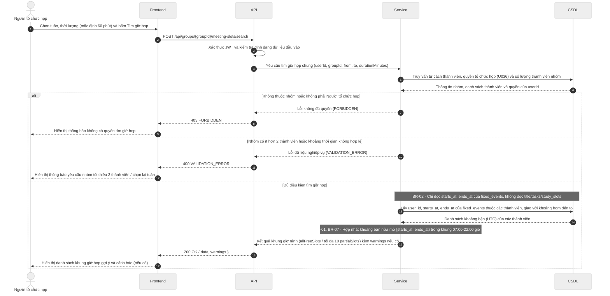

# Đặc tả API (API Spec) – StudySync

> Khung tài liệu theo Template 7. Chủ module viết endpoint của mình, Nhi review. Mỗi endpoint mới hoặc đổi đều cập nhật file này trong cùng PR.
> Ký hiệu: `<nội dung>` là chỗ cần điền (thay cả dấu ngoặc nhọn). Xóa các ghi chú *Hướng dẫn* khi dùng thật.

## Quy ước chung

| Mục | Quy ước |
| --- | --- |
| Định dạng | REST, gửi và trả JSON, mã hóa UTF-8 |
| Tiền tố đường dẫn | `/api` |
| Xác thực | Bearer token (JWT) trong header `Authorization: Bearer <token>` |
| Thời gian | Chuỗi ISO 8601 theo UTC, ví dụ `2026-11-05T13:00:00Z`; nhận cả dạng có mili giây (`2026-11-05T13:00:00.000Z`), không nhận offset như `+07:00` và không nhận chuỗi thiếu hậu tố `Z` (trả `400 VALIDATION_ERROR`, BR-07); dữ liệu API trả về luôn có mili giây, ví dụ `2026-11-05T13:00:00.000Z`; frontend tự hiển thị giờ Việt Nam |
| Tên trường JSON | camelCase cho toàn bộ (ví dụ `dueAt`, `startsAt`, `durationMinutes`). Backend đổi qua lại với tên cột snake_case của CSDL, không đổi tên cột theo API |
| Khoảng thời gian | Đối tượng `{ "startsAt": "...", "endsAt": "..." }` (kiểu `TimeSlot` trong `docs/interval-library.md`), hai giá trị theo dòng Thời gian ở trên, hiểu theo nửa mở `[startsAt, endsAt)`. Khoảng tìm kiếm gửi lên dùng `from` và `to`, cũng nửa mở `[from, to)` |
| Định danh | `id` là chuỗi UUID, theo kiểu khóa chính của CSDL |
| Việc đã xóa (từ #57) | Khung học còn lưu khi việc gốc bị xóa thì có `taskId: null`. API không trả tên việc cũ; giao diện hiện nhãn mặc định, ví dụ "Việc đã xóa" (đã chốt ở việc 3, `#56`) |
| Quyền riêng tư (BR-02) | API dành cho nhóm chỉ trả trạng thái bận hoặc rảnh, không trả tên sự kiện |
| Dạng phản hồi | Thành công bọc kết quả trong `data`; thành công nhưng có cảnh báo (BR-01, BR-04) thì thêm `warnings` ngang hàng với `data`; lỗi dùng `error`. Mỗi phản hồi chỉ có `data` hoặc `error` (trừ `GET /health`, xem mục "Dạng phản hồi thành công"), không bao giờ có cả hai; HTTP 204 (xóa thành công) không có nội dung. Chi tiết xem các mục bên dưới. |

## Dạng phản hồi thành công

> Trạng thái: **đã chốt** (Nhi, việc "Chốt quy ước chung của API", `#56`). Lý do: một số quy định nghiệp vụ (BR-01, BR-04) cho gọi thành công nhưng kèm cảnh báo, nên cần chỗ đặt cảnh báo tách khỏi các trường của đối tượng.

Áp dụng cho mọi phản hồi thành công có nội dung (HTTP 200, 201). HTTP 204 không có nội dung, xem mục "Mã HTTP khi thành công".

**Thành công thường:**

```json
{
  "data": { }
}
```

**Thành công kèm cảnh báo (vẫn HTTP 200 hoặc 201):**

```json
{
  "data": {
    "id": "550e8400-e29b-41d4-a716-446655440000",
    "title": "Ôn tập CSDL",
    "dueAt": "2026-11-08T10:00:00.000Z"
  },
  "warnings": [
    {
      "code": "DEADLINE_PASSED",
      "message": "Hạn hoàn thành đã qua so với thời điểm hiện tại (BR-04)."
    }
  ]
}
```

- `data`: nội dung chính của endpoint (đối tượng hoặc danh sách bọc trong đối tượng, ví dụ `data.slots`).
- `warnings`: chỉ có khi có cảnh báo, không trả mảng rỗng. Mỗi phần tử có dạng `{ code, message }`, có thể kèm `details` (xem mục "Mã HTTP khi thành công").
- Phản hồi lỗi (4xx, 5xx) dùng dạng riêng ở mục sau, không có `data`.
- Ngoại lệ duy nhất: `GET /health` (kiểm tra máy chủ còn chạy, đường dẫn nằm ngoài tiền tố `/api`) giữ nguyên dạng `{ "status": "ok", "time": "2026-11-05T13:00:00.000Z" }`, không bọc `data`. `time` theo dòng Thời gian ở Quy ước chung. Đã chốt ở việc 3 (`#56`).

Bảng mã cảnh báo dùng chung (đã chốt ở việc 3 – `#56`):

| Mã cảnh báo (`code`) | Quy tắc | Ý nghĩa / Khi nào trả về |
| --- | --- | --- |
| `FIXED_EVENT_OVERLAP` | BR-01 | Sự kiện cố định vừa tạo/nhập bị chồng thời gian với sự kiện cố định khác (vẫn cho lưu thành công kèm cảnh báo) |
| `DEADLINE_PASSED` | BR-04 | Việc cần làm được lưu với hạn hoàn thành (`dueAt`) đã qua so với thời điểm hiện tại |
| `MEMBER_NO_FIXED_EVENTS` | Yêu cầu 4.1 (U031) | Khi tìm giờ họp chung mà trong nhóm có thành viên chưa nhập sự kiện cố định nào trong tuần được chọn |

## Mã HTTP khi thành công

> Bổ sung của Nhi cho Quy ước chung (việc 3, `#56`).

| Mã HTTP | Khi nào | Nội dung trả về |
| --- | --- | --- |
| 200 | Đọc, sửa, hoặc thao tác không tạo tài nguyên mới (ví dụ tìm giờ họp, đề xuất khung giờ) thành công | Dạng phản hồi thành công ở trên |
| 201 | Tạo tài nguyên mới thành công | Dạng phản hồi thành công ở trên, `data` là tài nguyên vừa tạo |
| 204 | Xóa thành công | Body rỗng, không gửi chuỗi JSON nào (không trả `{ "data": null }` hay `{ "data": {} }`) |

Phần tử của `warnings` có thể kèm `details` (tùy chọn, cùng dạng `[{ "field", "issue" }]` với `error.details`) khi cảnh báo gắn với một trường cụ thể để frontend hiện ngay tại trường nhập. Ví dụ `DEADLINE_PASSED` kèm `"details": [{ "field": "dueAt", "issue": "đã qua" }]`.

## Dạng thông báo lỗi thống nhất

```json
{
  "error": {
    "code": "VALIDATION_ERROR",
    "message": "Thời lượng phải lớn hơn 0",
    "details": [{ "field": "durationMinutes", "issue": "phải lớn hơn 0" }]
  }
}
```

## Bảng mã lỗi dùng chung

| Mã HTTP | error.code | Khi nào |
| --- | --- | --- |
| 400 | VALIDATION_ERROR | Dữ liệu gửi lên sai định dạng hoặc thiếu trường bắt buộc |
| 401 | UNAUTHORIZED | Chưa đăng nhập hoặc token hết hạn |
| 403 | FORBIDDEN | Đã đăng nhập nhưng không có quyền (ví dụ không thuộc nhóm) |
| 404 | NOT_FOUND | Không tìm thấy tài nguyên |
| 409 | CONFLICT | Khung giờ do hệ thống xếp trùng lịch cố định (BR-01) hoặc dữ liệu bị trùng; hai sự kiện cố định chồng nhau (nhập tay hoặc import) không trả lỗi này mà chỉ cảnh báo |
| 413 | FILE_TOO_LARGE | File import (.ics, .csv, ảnh) vượt 5 MB, tính 1 MB = 1024 × 1024 byte (BR-05) |
| 422 | FILE_INVALID | File import sai định dạng hoặc có dòng không hợp lệ (kể cả tên việc quá 200 ký tự, BR-08); trả kèm tối đa 20 dòng lỗi đầu tiên (BR-06); với .ics báo theo sự kiện kèm số dòng bắt đầu khối VEVENT; lỗi gồm thiếu tên hoặc giờ bắt đầu, giờ kết thúc không sau giờ bắt đầu, TZID không nhận ra được, tệp không có sự kiện nào; mỗi phần tử details có dạng `{line?, issue}`: `line` bỏ trống khi lỗi cấp tệp (tệp rỗng, không có sự kiện, sai định dạng, ảnh), còn lỗi trong một VEVENT vẫn có `line` là dòng bắt đầu khối |
| 500 | INTERNAL_ERROR | Lỗi máy chủ, không lộ chi tiết kỹ thuật cho người dùng |

## Danh sách endpoint theo module (tổng quan, điền dần)

| Module | Phương thức và đường dẫn | Mô tả ngắn | Trạng thái |
| --- | --- | --- | --- |
| TV1 | `<POST /api/auth/register>` | `<Đăng ký>` | Nháp |
| TV2 | `<GET /api/events>` | `<Xem lịch tuần>` | Nháp |
| TV3 | `<POST /api/schedule/suggest>` | `<Đề xuất khung giờ học>` | Nháp |
| TV4 | `POST /api/groups/{groupId}/meeting-slots/search` | Tìm giờ họp chung | Nháp |
| TV5 | `<GET /api/groups/{groupId}/cards>` | `<Danh sách thẻ Kanban>` | Nháp |

## Mẫu một endpoint (sao chép cho mỗi endpoint)

````markdown
### <PHƯƠNG THỨC> /api/<đường-dẫn>
Module: TV<x> · Story: US-<xx> · Người viết: <tên> · Trạng thái: <Nháp / Đã chốt / Đã làm>
Mô tả: <Một câu, endpoint làm gì>
Quyền: <Ai gọi được: chủ tài khoản / thành viên nhóm / trưởng nhóm>

**Tham số đường dẫn và query**

| Tên | Kiểu | Bắt buộc | Mô tả |
| --- | --- | --- | --- |

**Nội dung gửi lên (body)**

```json
<JSON mẫu>
```

**Kết quả thành công (<mã HTTP>)**

```json
{ "data": { } }
```

**Cảnh báo có thể gặp** (xóa mục này nếu endpoint không trả cảnh báo)

| Mã cảnh báo (`warnings[].code`) | Điều kiện |
| --- | --- |

**Lỗi có thể gặp**

| Mã HTTP | error.code | Điều kiện |
| --- | --- | --- |

Ghi chú: <Quy định nghiệp vụ áp dụng, giới hạn, lưu ý cho frontend>
````

---

## TV1 – Tài khoản và nhóm

<!-- Vùng của TV1: chỉ sửa trong vùng này để tránh xung đột khi merge. -->

`<Thêm các endpoint của TV1 bên dưới theo mẫu ở trên, trạng thái ban đầu là Nháp.>`

---

## TV2 – Lịch, sự kiện cố định và việc cần làm

<!-- Vùng của TV2: chỉ sửa trong vùng này để tránh xung đột khi merge. -->

`<Thêm các endpoint của TV2 bên dưới theo mẫu ở trên, trạng thái ban đầu là Nháp.>`

---

## TV3 – Đề xuất khung giờ học

<!-- Vùng của TV3: chỉ sửa trong vùng này để tránh xung đột khi merge. -->

`<Thêm các endpoint của TV3 bên dưới theo mẫu ở trên, trạng thái ban đầu là Nháp.>`

---

## TV4 – Họp nhóm, lời mời và nhắc việc

<!-- Vùng của TV4: chỉ sửa trong vùng này để tránh xung đột khi merge. -->

`<Thêm các endpoint của TV4 bên dưới theo mẫu ở trên, trạng thái ban đầu là Nháp.>`

---

## TV5 – Kanban và thống kê

<!-- Vùng của TV5: chỉ sửa trong vùng này để tránh xung đột khi merge. -->

`<Thêm các endpoint của TV5 bên dưới theo mẫu ở trên, trạng thái ban đầu là Nháp.>`

---

## Ví dụ điền sẵn: `POST /api/groups/{groupId}/meeting-slots/search` (TV4)

> Ví dụ minh họa cách điền một endpoint theo mẫu trên. Xóa hoặc chuyển vào vùng TV4 khi viết bản chính thức ở việc 11 (`#77`).

### `POST /api/groups/{groupId}/meeting-slots/search`

Mô tả: Tìm các khung giờ họp chung của nhóm trong tuần được chọn dựa trên khoảng bận (`starts_at`, `ends_at`) từ sự kiện cố định của các thành viên (US-23, U031).  
Module: TV4 · Story: US-23 · Người viết: Thư Q.A. · Trạng thái: Nháp  
Quyền: Người tổ chức họp của nhóm (gồm Trưởng nhóm hoặc Thành viên nhóm được Trưởng nhóm ủy quyền theo U036).  

Tham số đường dẫn (Path parameters):

| Tên | Kiểu | Bắt buộc | Mô tả |
| --- | --- | --- | --- |
| `groupId` | `uuid` | Có | Mã nhóm cần tìm giờ họp chung |

Dữ liệu gửi lên (Request body):

```json
{
  "from": "2026-11-08T17:00:00.000Z",
  "to": "2026-11-15T17:00:00.000Z",
  "durationMinutes": 60
}
```

Phản hồi thành công (`200 OK`):

```json
{
  "data": {
    "allFreeSlots": [
      {
        "startsAt": "2026-11-10T01:00:00.000Z",
        "endsAt": "2026-11-10T03:00:00.000Z",
        "availableCount": 5,
        "totalMembers": 5,
        "busyMembers": []
      }
    ],
    "partialSlots": []
  },
  "warnings": [
    {
      "code": "MEMBER_NO_FIXED_EVENTS",
      "message": "Thành viên Nguyễn Văn B chưa nhập sự kiện cố định nào trong tuần được chọn."
    }
  ]
}
```

Lỗi có thể gặp:

| HTTP | Mã lỗi (`code`) | Khi nào xảy ra |
| --- | --- | --- |
| `400` | `VALIDATION_ERROR` | Nhóm có ít hơn 2 thành viên; khoảng `[from, to)` không hợp lệ hoặc tuần đã qua hoàn toàn; `durationMinutes <= 0` hoặc `> 900` (vượt quá khung 07:00–22:00 giờ VN) |
| `401` | `UNAUTHORIZED` | Chưa đăng nhập hoặc token không hợp lệ / hết hạn |
| `403` | `FORBIDDEN` | Người gọi không thuộc nhóm hoặc là thành viên thường chưa được Trưởng nhóm ủy quyền tổ chức họp (U031, U036) |
| `404` | `NOT_FOUND` | Không tìm thấy nhóm với `groupId` đã truyền |

Ghi chú:
- Khoảng thời gian tìm kiếm hiểu theo nửa mở `[from, to)` tính bằng UTC (BR-01, BR-07), chỉ xét trong khung hoạt động `07:00–22:00` giờ Việt Nam mỗi ngày và loại bỏ các mốc thời gian đã qua so với hiện tại (yêu cầu 4.1).
- `durationMinutes` mặc định là `60` phút nếu client không truyền (bước nhảy 30 phút).
- Chỉ coi sự kiện cố định (`fixed_events`) là bận; không lấy tên/chi tiết sự kiện cố định (BR-02) và không coi việc cần làm (`tasks`) hay khung giờ học (`study_slots`) là bận.
- Nếu không có khung nào cả nhóm cùng rảnh (`allFreeSlots` rỗng), hệ thống trả tối đa 10 khung giờ có nhiều thành viên rảnh nhất trong `partialSlots` (xếp giảm dần theo số người rảnh, ưu tiên thời gian sớm hơn) kèm danh sách tên hiển thị của các thành viên bận (`busyMembers`) ở từng khung (U031).

---

## Sơ đồ tuần tự mẫu

> Mọi sơ đồ tuần tự của nhóm viết bằng Mermaid trong khối ```` ```mermaid ````, theo quy ước ở danh sách dưới. Sơ đồ của từng module đặt ở vùng của module đó (hoặc file riêng trong `docs/`), lấy sơ đồ này làm mẫu.

Quy ước trình bày sơ đồ tuần tự (Sequence Diagram):
- Giữ cố định thứ tự 5 cột từ trái sang phải: `Tác nhân` → `Frontend` → `API` → `Service` → `CSDL`.
- Quy ước đặt mã viết tắt cho tác nhân (`actor`): `ND` (Người dùng / Sinh viên), `TVN` (Thành viên nhóm), `TN` (Trưởng nhóm), `NTH` (Người tổ chức họp – gồm Trưởng nhóm hoặc Thành viên nhóm được ủy quyền), hoặc tác nhân hệ thống `Timer` (`Bộ hẹn giờ` cho U035).
- Bật `autonumber`, dùng khối `alt`/`else` cho rẽ nhánh kiểm tra điều kiện/lỗi và dùng `Note` để gắn mã quy tắc nghiệp vụ (`BR-xx`). Không dùng dấu `;` hoặc `#` trong nhãn thông điệp để tránh lỗi parser của Mermaid trên GitHub.


