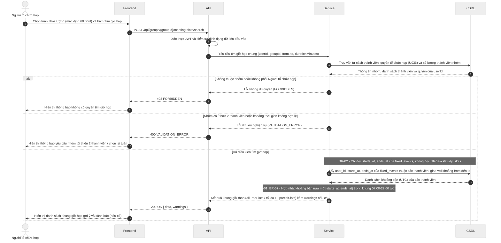

# Đặc tả API (API Spec) – StudySync

> Khung tài liệu theo Template 7. Chủ module viết endpoint của mình, Nhi review. Mỗi endpoint mới hoặc đổi đều cập nhật file này trong cùng PR.
> Ký hiệu: `<nội dung>` là chỗ cần điền (thay cả dấu ngoặc nhọn). Xóa các ghi chú *Hướng dẫn* khi dùng thật.

## Quy ước chung

| Mục | Quy ước |
| --- | --- |
| Định dạng | REST, gửi và trả JSON, mã hóa UTF-8 |
| Tiền tố đường dẫn | `/api` |
| Xác thực | Bearer token (JWT) trong header `Authorization: Bearer <token>` |
| Thời gian | Chuỗi ISO 8601 theo UTC, ví dụ `2026-11-05T13:00:00Z`; nhận cả dạng có mili giây (`2026-11-05T13:00:00.000Z`), không nhận offset như `+07:00` và không nhận chuỗi thiếu hậu tố `Z` (trả `400 VALIDATION_ERROR`, BR-07); dữ liệu API trả về luôn có mili giây, ví dụ `2026-11-05T13:00:00.000Z`; frontend tự hiển thị giờ Việt Nam |
| Tên trường JSON | camelCase cho toàn bộ (ví dụ `dueAt`, `startsAt`, `durationMinutes`). Backend đổi qua lại với tên cột snake_case của CSDL, không đổi tên cột theo API |
| Khoảng thời gian | Đối tượng `{ "startsAt": "...", "endsAt": "..." }` (kiểu `TimeSlot` trong `docs/interval-library.md`), hai giá trị theo dòng Thời gian ở trên, hiểu theo nửa mở `[startsAt, endsAt)`. Khoảng tìm kiếm gửi lên dùng `from` và `to`, cũng nửa mở `[from, to)` |
| Định danh | `id` là chuỗi UUID, theo kiểu khóa chính của CSDL |
| Việc đã xóa (từ #57) | Khung học còn lưu khi việc gốc bị xóa thì có `taskId: null`. API không trả tên việc cũ; giao diện hiện nhãn mặc định, ví dụ "Việc đã xóa" (đã chốt ở việc 3, `#56`) |
| Quyền riêng tư (BR-02) | API dành cho nhóm chỉ trả trạng thái bận hoặc rảnh, không trả tên sự kiện |
| Dạng phản hồi | Thành công bọc kết quả trong `data`; thành công nhưng có cảnh báo (BR-01, BR-04) thì thêm `warnings` ngang hàng với `data`; lỗi dùng `error`. Mỗi phản hồi chỉ có `data` hoặc `error` (trừ `GET /health`, xem mục "Dạng phản hồi thành công"), không bao giờ có cả hai; HTTP 204 (xóa thành công) không có nội dung. Chi tiết xem các mục bên dưới. |

## Dạng phản hồi thành công

> Trạng thái: **đã chốt** (Nhi, việc "Chốt quy ước chung của API", `#56`). Lý do: một số quy định nghiệp vụ (BR-01, BR-04) cho gọi thành công nhưng kèm cảnh báo, nên cần chỗ đặt cảnh báo tách khỏi các trường của đối tượng.

Áp dụng cho mọi phản hồi thành công có nội dung (HTTP 200, 201). HTTP 204 không có nội dung, xem mục "Mã HTTP khi thành công".

**Thành công thường:**

```json
{
  "data": { }
}
```

**Thành công kèm cảnh báo (vẫn HTTP 200 hoặc 201):**

```json
{
  "data": {
    "id": "550e8400-e29b-41d4-a716-446655440000",
    "title": "Ôn tập CSDL",
    "dueAt": "2026-11-08T10:00:00.000Z"
  },
  "warnings": [
    {
      "code": "DEADLINE_PASSED",
      "message": "Hạn hoàn thành đã qua so với thời điểm hiện tại (BR-04)."
    }
  ]
}
```

- `data`: nội dung chính của endpoint (đối tượng hoặc danh sách bọc trong đối tượng, ví dụ `data.slots`).
- `warnings`: chỉ có khi có cảnh báo, không trả mảng rỗng. Mỗi phần tử có dạng `{ code, message }`, có thể kèm `details` (xem mục "Mã HTTP khi thành công").
- Phản hồi lỗi (4xx, 5xx) dùng dạng riêng ở mục sau, không có `data`.
- Ngoại lệ duy nhất: `GET /health` (kiểm tra máy chủ còn chạy, đường dẫn nằm ngoài tiền tố `/api`) giữ nguyên dạng `{ "status": "ok", "time": "2026-11-05T13:00:00.000Z" }`, không bọc `data`. `time` theo dòng Thời gian ở Quy ước chung. Đã chốt ở việc 3 (`#56`).

Bảng mã cảnh báo dùng chung (đã chốt ở việc 3 – `#56`):

| Mã cảnh báo (`code`) | Quy tắc | Ý nghĩa / Khi nào trả về |
| --- | --- | --- |
| `FIXED_EVENT_OVERLAP` | BR-01 | Sự kiện cố định vừa tạo/nhập bị chồng thời gian với sự kiện cố định khác (vẫn cho lưu thành công kèm cảnh báo) |
| `DEADLINE_PASSED` | BR-04 | Việc cần làm được lưu với hạn hoàn thành (`dueAt`) đã qua so với thời điểm hiện tại |
| `MEMBER_NO_FIXED_EVENTS` | Yêu cầu 4.1 (U031) | Khi tìm giờ họp chung mà trong nhóm có thành viên chưa nhập sự kiện cố định nào trong tuần được chọn |

## Mã HTTP khi thành công

> Bổ sung của Nhi cho Quy ước chung (việc 3, `#56`).

| Mã HTTP | Khi nào | Nội dung trả về |
| --- | --- | --- |
| 200 | Đọc, sửa, hoặc thao tác không tạo tài nguyên mới (ví dụ tìm giờ họp, đề xuất khung giờ) thành công | Dạng phản hồi thành công ở trên |
| 201 | Tạo tài nguyên mới thành công | Dạng phản hồi thành công ở trên, `data` là tài nguyên vừa tạo |
| 204 | Xóa thành công | Body rỗng, không gửi chuỗi JSON nào (không trả `{ "data": null }` hay `{ "data": {} }`) |

Phần tử của `warnings` có thể kèm `details` (tùy chọn, cùng dạng `[{ "field", "issue" }]` với `error.details`) khi cảnh báo gắn với một trường cụ thể để frontend hiện ngay tại trường nhập. Ví dụ `DEADLINE_PASSED` kèm `"details": [{ "field": "dueAt", "issue": "đã qua" }]`.

## Dạng thông báo lỗi thống nhất

```json
{
  "error": {
    "code": "VALIDATION_ERROR",
    "message": "Thời lượng phải lớn hơn 0",
    "details": [{ "field": "durationMinutes", "issue": "phải lớn hơn 0" }]
  }
}
```

## Bảng mã lỗi dùng chung

| Mã HTTP | error.code | Khi nào |
| --- | --- | --- |
| 400 | VALIDATION_ERROR | Dữ liệu gửi lên sai định dạng hoặc thiếu trường bắt buộc |
| 401 | UNAUTHORIZED | Chưa đăng nhập hoặc token hết hạn |
| 403 | FORBIDDEN | Đã đăng nhập nhưng không có quyền (ví dụ không thuộc nhóm) |
| 404 | NOT_FOUND | Không tìm thấy tài nguyên |
| 409 | CONFLICT | Khung giờ do hệ thống xếp trùng lịch cố định (BR-01) hoặc dữ liệu bị trùng; hai sự kiện cố định chồng nhau (nhập tay hoặc import) không trả lỗi này mà chỉ cảnh báo |
| 413 | FILE_TOO_LARGE | File import (.ics, .csv, ảnh) vượt 5 MB, tính 1 MB = 1024 × 1024 byte (BR-05) |
| 422 | FILE_INVALID | File import sai định dạng hoặc có dòng không hợp lệ (kể cả tên việc quá 200 ký tự, BR-08); trả kèm tối đa 20 dòng lỗi đầu tiên (BR-06); với .ics báo theo sự kiện kèm số dòng bắt đầu khối VEVENT; lỗi gồm thiếu tên hoặc giờ bắt đầu, giờ kết thúc không sau giờ bắt đầu, TZID không nhận ra được, tệp không có sự kiện nào; mỗi phần tử details có dạng `{line?, issue}`: `line` bỏ trống khi lỗi cấp tệp (tệp rỗng, không có sự kiện, sai định dạng, ảnh), còn lỗi trong một VEVENT vẫn có `line` là dòng bắt đầu khối |
| 500 | INTERNAL_ERROR | Lỗi máy chủ, không lộ chi tiết kỹ thuật cho người dùng |

## Danh sách endpoint theo module (tổng quan, điền dần)

| Module | Phương thức và đường dẫn | Mô tả ngắn | Trạng thái |
| --- | --- | --- | --- |
| TV1 | POST /api/auth/register | Đăng ký tài khoản mới | Nháp |
| TV1 | POST /api/auth/login | Đăng nhập hệ thống | Nháp |
| TV1 | GET /api/users/me | Lấy thông tin tài khoản cá nhân | Nháp |
| TV1 | PATCH /api/users/me | Cập nhật tên hiển thị | Nháp |
| TV1 | POST /api/groups | Tạo nhóm đồ án mới | Nháp |
| TV1 | GET /api/groups | Danh sách nhóm của người dùng | Nháp |
| TV1 | GET /api/groups/{groupId} | Chi tiết nhóm và danh sách thành viên | Nháp |
| TV1 | POST /api/groups/{groupId}/invite-link | Lấy hoặc tạo liên kết mời | Nháp |
| TV1 | POST /api/groups/{groupId}/invite-link/regenerate | Tạo lại liên kết mời mới | Nháp |
| TV1 | GET /api/invitations/{token} | Xem thông tin lời mời tham gia nhóm | Nháp |
| TV1 | POST /api/invitations/{token}/join | Tham gia nhóm bằng liên kết mời | Nháp |
| TV1 | PUT /api/groups/{groupId}/leader | Chuyển quyền Trưởng nhóm | Nháp |
| TV1 | POST /api/groups/{groupId}/leave | Rời nhóm đồ án | Nháp |
| TV2 | `<GET /api/events>` | `<Xem lịch tuần>` | Nháp |
| TV3 | `<POST /api/schedule/suggest>` | `<Đề xuất khung giờ học>` | Nháp |
| TV4 | `POST /api/groups/{groupId}/meeting-slots/search` | Tìm giờ họp chung | Nháp |
| TV5 | `<GET /api/groups/{groupId}/cards>` | `<Danh sách thẻ Kanban>` | Nháp |

## Mẫu một endpoint (sao chép cho mỗi endpoint)

````markdown
### <PHƯƠNG THỨC> /api/<đường-dẫn>
Module: TV<x> · Story: US-<xx> · Người viết: <tên> · Trạng thái: <Nháp / Đã chốt / Đã làm>
Mô tả: <Một câu, endpoint làm gì>
Quyền: <Ai gọi được: chủ tài khoản / thành viên nhóm / trưởng nhóm>

**Tham số đường dẫn và query**

| Tên | Kiểu | Bắt buộc | Mô tả |
| --- | --- | --- | --- |

**Nội dung gửi lên (body)**

```json
<JSON mẫu>
```

**Kết quả thành công (<mã HTTP>)**

```json
{ "data": { } }
```

**Cảnh báo có thể gặp** (xóa mục này nếu endpoint không trả cảnh báo)

| Mã cảnh báo (`warnings[].code`) | Điều kiện |
| --- | --- |

**Lỗi có thể gặp**

| Mã HTTP | error.code | Điều kiện |
| --- | --- | --- |

Ghi chú: <Quy định nghiệp vụ áp dụng, giới hạn, lưu ý cho frontend>
````

---

## TV1 – Tài khoản và nhóm

<!-- Vùng của TV1: chỉ sửa trong vùng này để tránh xung đột khi merge. -->

<!-- TV1:BEGIN -->

Trạng thái: Nháp · Người viết: Thư H.A. · Người review: Nhi · Cập nhật: 10/11/2026

Phạm vi: US-01 đến US-07. Use case: U001 đến U007. Mọi endpoint theo quy ước chung ở đầu file (REST, JSON UTF-8, tiền tố `/api`, camelCase, id là UUID, thời gian ISO 8601 hậu tố Z và luôn có mili giây khi API trả về, dạng phản hồi `data` hoặc `error`).

### Quy định áp dụng cho TV1

| Mục | Quy định |
| :-: | :-: |
| Mật khẩu | Tối thiểu 8 ký tự, gồm cả chữ cái và chữ số (US-01, yêu cầu 1.2) |
| Phiên đăng nhập | JWT trong header `Authorization: Bearer <token>`, hiệu lực 7 ngày (`JWT_EXPIRES_IN=7d`). Token gồm các claim `sub` (id người dùng), `iat`, `exp`. Hết hạn thì trả 401 UNAUTHORIZED và người dùng đăng nhập lại, hệ thống không có cơ chế làm mới token |
| Đăng xuất | Không có endpoint. Frontend xóa token đã lưu. Phiên chấm dứt về phía người dùng, còn token cũ hết hạn tự nhiên sau 7 ngày |
| Liên kết mời | Có hiệu lực 7 ngày. Mỗi nhóm chỉ có một liên kết còn hiệu lực. Tạo lại thì liên kết cũ vô hiệu ngay |
| Tên nhóm, tên hiển thị (BR-08) | Backend chuẩn hóa NFC, cắt khoảng trắng hai đầu rồi đếm theo code point. Tối đa 100 ký tự, tối thiểu 1 ký tự. Giá trị lưu và giá trị trả về là chuỗi đã chuẩn hóa. Không tự cắt tên quá dài, chỉ báo lỗi |
| Email | Backend cắt khoảng trắng và đổi chữ thường trước khi kiểm tra trùng, lưu và đối chiếu. Giá trị `email` trả về luôn là dạng đã chuẩn hóa |
| Phân quyền | Quyền Trưởng nhóm được kiểm tra ở API, trả 403 FORBIDDEN khi không đủ quyền, không chỉ ẩn nút ở giao diện |
| Riêng tư (BR-02) | Danh sách thành viên chỉ trả `userId`, `displayName`, vai trò và thời điểm vào nhóm. Không trả email, không trả dữ liệu lịch |

### Kiểu dữ liệu dùng chung trong TV1

User:

```json
{
  "id": "0b8f6f5e-2c1a-4c7e-9d4b-3a5f1e7c9a10",
  "email": "an.nguyen@example.com",
  "displayName": "Nguyễn Văn An",
  "createdAt": "2026-11-05T13:00:00.000Z"
}
```

GroupSummary (nhóm nhìn từ phía người đang đăng nhập):

```json
{
  "id": "7d2c9a51-6b3e-4f08-8a1d-5e9c2b4f7a33",
  "name": "Đồ án NMCNPM nhóm 04",
  "myRole": "leader",
  "memberCount": 5,
  "createdAt": "2026-11-05T13:00:00.000Z"
}
```

Member:

```json
{
  "userId": "0b8f6f5e-2c1a-4c7e-9d4b-3a5f1e7c9a10",
  "displayName": "Nguyễn Văn An",
  "role": "leader",
  "canOrganizeMeetings": false,
  "joinedAt": "2026-11-05T13:00:00.000Z"
}
```

`role` nhận `leader` hoặc `member`. `canOrganizeMeetings` chỉ có nghĩa với `member` (xem U036), Trưởng nhóm luôn là `false` vì mặc nhiên có quyền.

### Danh sách endpoint TV1

| Phương thức và đường dẫn | Mô tả ngắn | Story | Quyền | Trạng thái |
| :-: | :-: | :-: | :-: | :-: |
| POST /api/auth/register | Đăng ký | US-01 | Công khai | Nháp |
| POST /api/auth/login | Đăng nhập | US-02 | Công khai | Nháp |
| GET /api/users/me | Lấy thông tin cá nhân | US-02, US-06 | Đã đăng nhập | Nháp |
| PATCH /api/users/me | Cập nhật tên hiển thị | US-06 | Đã đăng nhập | Nháp |
| POST /api/groups | Tạo nhóm | US-03 | Đã đăng nhập | Nháp |
| GET /api/groups | Danh sách nhóm của tôi | US-03, US-07 | Đã đăng nhập | Nháp |
| GET /api/groups/{groupId} | Chi tiết nhóm và danh sách thành viên | US-04, US-07 | Thành viên nhóm | Nháp |
| POST /api/groups/{groupId}/invite-link | Lấy liên kết mời | US-04 | Trưởng nhóm | Nháp |
| POST /api/groups/{groupId}/invite-link/regenerate | Tạo lại liên kết mời | US-04 | Trưởng nhóm | Nháp |
| GET /api/invitations/{token} | Xem tên nhóm của lời mời | US-05 | Công khai | Nháp |
| POST /api/invitations/{token}/join | Tham gia nhóm bằng liên kết mời | US-05 | Đã đăng nhập | Nháp |
| PUT /api/groups/{groupId}/leader | Chuyển quyền Trưởng nhóm | US-07 | Trưởng nhóm | Nháp |
| POST /api/groups/{groupId}/leave | Rời nhóm | US-07 | Thành viên nhóm | Nháp |

Ghi chú về phạm vi: endpoint bật hoặc tắt quyền ủy quyền tổ chức họp (U036) thuộc TV4, ghi vào cột `group_members.can_organize_meetings` trong từ điển dữ liệu. Danh sách thành viên ở `GET /api/groups/{groupId}` đã trả cột này để giao diện U036 dùng.

---

### POST /api/auth/register

Module: TV1 · Story: US-01 · Người viết: Thư H.A. · Trạng thái: Nháp  
Mô tả: tạo tài khoản mới và đăng nhập luôn, trả token.  
Quyền: công khai.

**Tham số đường dẫn và query:** Không có.

**Nội dung gửi lên (body)**

| Tên | Kiểu | Bắt buộc | Mô tả |
| --- | --- | --- | --- |
| displayName | string | Có | Họ tên dùng làm tên hiển thị. Tối đa 100 ký tự sau chuẩn hóa (BR-08) |
| email | string | Có | Địa chỉ email đúng định dạng, chưa gắn với tài khoản khác |
| password | string | Có | Tối thiểu 8 ký tự, gồm chữ cái và chữ số |

```json
{
  "displayName": "Nguyễn Văn An",
  "email": "An.Nguyen@Example.com",
  "password": "matkhau2026"
}
```

Ô nhập lại mật khẩu chỉ kiểm tra ở giao diện, không gửi lên API.

**Kết quả thành công (201)**

```json
{
  "data": {
    "token": "eyJhbGciOiJIUzI1NiIsInR5cCI6IkpXVCJ9.<payload>.<signature>",
    "expiresAt": "2026-11-12T13:00:00.000Z",
    "user": {
      "id": "0b8f6f5e-2c1a-4c7e-9d4b-3a5f1e7c9a10",
      "email": "an.nguyen@example.com",
      "displayName": "Nguyễn Văn An",
      "createdAt": "2026-11-05T13:00:00.000Z"
    }
  }
}
```

`expiresAt` là thời điểm token hết hạn, bằng lúc cấp cộng 7 ngày. Ví dụ trên đã chuẩn hóa email về chữ thường.

**Lỗi có thể gặp**

| Mã HTTP | error.code | Điều kiện |
| --- | --- | --- |
| 400 | VALIDATION_ERROR | Họ tên rỗng, chỉ gồm khoảng trắng hoặc quá 100 ký tự; email sai định dạng; mật khẩu dưới 8 ký tự hoặc thiếu chữ cái hoặc chữ số |
| 409 | CONFLICT | Email đã được dùng cho tài khoản khác |
| 500 | INTERNAL_ERROR | Lỗi máy chủ |

Ví dụ lỗi 400:

```json
{
  "error": {
    "code": "VALIDATION_ERROR",
    "message": "Dữ liệu đăng ký không hợp lệ",
    "details": [
      { "field": "password", "issue": "Mật khẩu tối thiểu 8 ký tự, gồm cả chữ cái và chữ số" }
    ]
  }
}
```

Ví dụ lỗi 409:

```json
{
  "error": {
    "code": "CONFLICT",
    "message": "Email này đã được sử dụng. Vui lòng đăng nhập hoặc sử dụng email khác.",
    "details": [{ "field": "email", "issue": "đã được sử dụng" }]
  }
}
```

**Ghi chú:** BR-08. Việc kiểm tra email trùng dựa vào ràng buộc `uq_users_email` (xem từ điển dữ liệu), nên hai yêu cầu đăng ký đồng thời với cùng email chỉ có một yêu cầu thành công, yêu cầu còn lại nhận 409. Phiên bản đầu không gửi email kích hoạt. Nếu người dùng đến từ liên kết mời, frontend dùng token vừa nhận rồi gọi tiếp `POST /api/invitations/{token}/join`.

---

### POST /api/auth/login

Module: TV1 · Story: US-02 · Người viết: Thư H.A. · Trạng thái: Nháp  
Mô tả: đăng nhập bằng email và mật khẩu, trả token có hiệu lực 7 ngày.  
Quyền: công khai.

**Tham số đường dẫn và query:** Không có.

**Nội dung gửi lên (body)**

| Tên | Kiểu | Bắt buộc | Mô tả |
| --- | --- | --- | --- |
| email | string | Có | Email đã đăng ký. Backend chuẩn hóa chữ thường và cắt khoảng trắng trước khi tìm |
| password | string | Có | Mật khẩu |

```json
{
  "email": "an.nguyen@example.com",
  "password": "matkhau2026"
}
```

**Kết quả thành công (200)**

```json
{
  "data": {
    "token": "eyJhbGciOiJIUzI1NiIsInR5cCI6IkpXVCJ9.<payload>.<signature>",
    "expiresAt": "2026-11-12T13:00:00.000Z",
    "user": {
      "id": "0b8f6f5e-2c1a-4c7e-9d4b-3a5f1e7c9a10",
      "email": "an.nguyen@example.com",
      "displayName": "Nguyễn Văn An",
      "createdAt": "2026-11-05T13:00:00.000Z"
    }
  }
}
```

**Lỗi có thể gặp**

| Mã HTTP | error.code | Điều kiện |
| --- | --- | --- |
| 400 | VALIDATION_ERROR | Thiếu email hoặc mật khẩu, hoặc email không đúng dạng chuỗi |
| 401 | UNAUTHORIZED | Email không tồn tại hoặc mật khẩu sai. Thông báo giống nhau cho cả hai trường hợp |
| 500 | INTERNAL_ERROR | Lỗi máy chủ |

Ví dụ lỗi 401:

```json
{
  "error": {
    "code": "UNAUTHORIZED",
    "message": "Email hoặc mật khẩu không chính xác"
  }
}
```

**Ghi chú:** không nêu cụ thể email hay mật khẩu sai, và không đặt `details` cho lỗi này, để không lộ email nào đã đăng ký. Thời gian xử lý của hai trường hợp (email không tồn tại, mật khẩu sai) nên tương đương nhau, tức vẫn so khớp với một bản băm giả khi không tìm thấy email.

---

### GET /api/users/me

Module: TV1 · Story: US-02, US-06 · Người viết: Thư H.A. · Trạng thái: Nháp  
Mô tả: lấy thông tin tài khoản đang đăng nhập.  
Quyền: chủ tài khoản (đã đăng nhập).

**Tham số đường dẫn và query:** Không có.

**Kết quả thành công (200)**

```json
{
  "data": {
    "id": "0b8f6f5e-2c1a-4c7e-9d4b-3a5f1e7c9a10",
    "email": "an.nguyen@example.com",
    "displayName": "Nguyễn Văn An",
    "createdAt": "2026-11-05T13:00:00.000Z"
  }
}
```

**Lỗi có thể gặp**

| Mã HTTP | error.code | Điều kiện |
| --- | --- | --- |
| 401 | UNAUTHORIZED | Chưa gửi token, token sai hoặc đã hết hạn 7 ngày |
| 500 | INTERNAL_ERROR | Lỗi máy chủ |

**Ghi chú:** frontend gọi endpoint này khi mở lại ứng dụng để biết token còn hiệu lực hay không. Không bao giờ trả `passwordHash`.

---

### PATCH /api/users/me

Module: TV1 · Story: US-06 · Người viết: Thư H.A. · Trạng thái: Nháp  
Mô tả: sửa tên hiển thị của tài khoản đang đăng nhập.  
Quyền: chủ tài khoản.

**Tham số đường dẫn và query:** Không có.

**Nội dung gửi lên (body)**

| Tên | Kiểu | Bắt buộc | Mô tả |
| --- | --- | --- | --- |
| displayName | string | Có | Tên hiển thị mới, tối đa 100 ký tự sau chuẩn hóa NFC (BR-08) |

```json
{ "displayName": "Nguyễn Văn An (K24)" }
```

**Kết quả thành công (200)**

```json
{
  "data": {
    "id": "0b8f6f5e-2c1a-4c7e-9d4b-3a5f1e7c9a10",
    "email": "an.nguyen@example.com",
    "displayName": "Nguyễn Văn An (K24)",
    "createdAt": "2026-11-05T13:00:00.000Z"
  }
}
```

**Lỗi có thể gặp**

| Mã HTTP | error.code | Điều kiện |
| --- | --- | --- |
| 400 | VALIDATION_ERROR | Tên rỗng, chỉ gồm khoảng trắng hoặc quá 100 ký tự. Dữ liệu cũ giữ nguyên |
| 401 | UNAUTHORIZED | Chưa đăng nhập hoặc token hết hạn |
| 500 | INTERNAL_ERROR | Lỗi máy chủ |

Ví dụ lỗi 400:

```json
{
  "error": {
    "code": "VALIDATION_ERROR",
    "message": "Tên hiển thị không được để trống và tối đa 100 ký tự",
    "details": [
      { "field": "displayName", "issue": "không được để trống và tối đa 100 ký tự" }
    ]
  }
}
```

**Ghi chú:** BR-08. Email chưa cho sửa ở phiên bản này. Tên mới hiện ngay trong danh sách thành viên của mọi nhóm vì danh sách đó đọc tên từ `users.display_name`.

---

### POST /api/groups

Module: TV1 · Story: US-03 · Người viết: Thư H.A. · Trạng thái: Nháp  
Mô tả: tạo nhóm mới, người tạo trở thành Trưởng nhóm của nhóm đó.  
Quyền: đã đăng nhập.

**Tham số đường dẫn và query:** Không có.

**Nội dung gửi lên (body)**

| Tên | Kiểu | Bắt buộc | Mô tả |
| --- | --- | --- | --- |
| name | string | Có | Tên nhóm, tối đa 100 ký tự sau chuẩn hóa NFC, tối thiểu 1 ký tự (BR-08) |

```json
{ "name": "Đồ án NMCNPM nhóm 04" }
```

**Kết quả thành công (201)**

```json
{
  "data": {
    "id": "7d2c9a51-6b3e-4f08-8a1d-5e9c2b4f7a33",
    "name": "Đồ án NMCNPM nhóm 04",
    "myRole": "leader",
    "memberCount": 1,
    "createdAt": "2026-11-05T13:00:00.000Z"
  }
}
```

**Lỗi có thể gặp**

| Mã HTTP | error.code | Điều kiện |
| --- | --- | --- |
| 400 | VALIDATION_ERROR | Tên rỗng, chỉ gồm khoảng trắng hoặc quá 100 ký tự. Không tạo nhóm |
| 401 | UNAUTHORIZED | Chưa đăng nhập hoặc token hết hạn |
| 500 | INTERNAL_ERROR | Lỗi máy chủ |

Ví dụ lỗi 400:

```json
{
  "error": {
    "code": "VALIDATION_ERROR",
    "message": "Tên nhóm không được để trống và tối đa 100 ký tự",
    "details": [
      { "field": "name", "issue": "không được để trống và tối đa 100 ký tự" }
    ]
  }
}
```

**Ghi chú:** nhóm và dòng Trưởng nhóm được tạo trong cùng một transaction nên không có nhóm nào thiếu Trưởng nhóm. Một sinh viên được tạo và tham gia nhiều nhóm, vai trò tính theo từng nhóm. Cho phép trùng tên nhóm.

---

### GET /api/groups

Module: TV1 · Story: US-03, US-07 · Người viết: Thư H.A. · Trạng thái: Nháp  
Mô tả: liệt kê các nhóm người dùng đang tham gia, mới tham gia sau cùng đứng trước.  
Quyền: đã đăng nhập.

**Tham số đường dẫn và query:** Không có.

**Kết quả thành công (200)**

```json
{
  "data": {
    "groups": [
      {
        "id": "7d2c9a51-6b3e-4f08-8a1d-5e9c2b4f7a33",
        "name": "Đồ án NMCNPM nhóm 04",
        "myRole": "leader",
        "memberCount": 5,
        "createdAt": "2026-11-05T13:00:00.000Z"
      }
    ]
  }
}
```

Chưa có nhóm nào thì `groups` là mảng rỗng, vẫn trả 200.

**Lỗi có thể gặp**

| Mã HTTP | error.code | Điều kiện |
| --- | --- | --- |
| 401 | UNAUTHORIZED | Chưa đăng nhập hoặc token hết hạn |
| 500 | INTERNAL_ERROR | Lỗi máy chủ |

---

### GET /api/groups/{groupId}

Module: TV1 · Story: US-04, US-07 · Người viết: Thư H.A. · Trạng thái: Nháp  
Mô tả: lấy thông tin nhóm kèm danh sách thành viên. Giao diện dùng để hiện mục Thành viên và để chọn người kế nhiệm khi Trưởng nhóm rời nhóm.  
Quyền: thành viên của nhóm.

**Tham số đường dẫn và query**

| Tên | Kiểu | Bắt buộc | Mô tả |
| --- | --- | --- | --- |
| groupId | uuid | Có | Mã nhóm |

**Kết quả thành công (200)**

```json
{
  "data": {
    "id": "7d2c9a51-6b3e-4f08-8a1d-5e9c2b4f7a33",
    "name": "Đồ án NMCNPM nhóm 04",
    "myRole": "leader",
    "createdAt": "2026-11-05T13:00:00.000Z",
    "members": [
      {
        "userId": "0b8f6f5e-2c1a-4c7e-9d4b-3a5f1e7c9a10",
        "displayName": "Nguyễn Văn An",
        "role": "leader",
        "canOrganizeMeetings": false,
        "joinedAt": "2026-11-05T13:00:00.000Z"
      },
      {
        "userId": "5c1e8d27-9a4b-4e3f-b6d1-2f7a0c8e4b19",
        "displayName": "Trần Thị Bình",
        "role": "member",
        "canOrganizeMeetings": true,
        "joinedAt": "2026-11-06T02:30:00.000Z"
      }
    ]
  }
}
```

Danh sách `members` xếp Trưởng nhóm trước, sau đó theo `joinedAt` tăng dần.

**Lỗi có thể gặp**

| Mã HTTP | error.code | Điều kiện |
| --- | --- | --- |
| 401 | UNAUTHORIZED | Chưa đăng nhập hoặc token hết hạn |
| 403 | FORBIDDEN | Người gọi không thuộc nhóm |
| 404 | NOT_FOUND | Không có nhóm với mã này |
| 500 | INTERNAL_ERROR | Lỗi máy chủ |

**Ghi chú:** BR-02. Không trả email và không trả dữ liệu lịch của thành viên.

---

### POST /api/groups/{groupId}/invite-link

Module: TV1 · Story: US-04 · Người viết: Thư H.A. · Trạng thái: Nháp  
Mô tả: lấy liên kết mời của nhóm. Còn hiệu lực thì trả lại đúng liên kết đó, chưa có hoặc đã hết hạn thì tạo liên kết mới có hiệu lực 7 ngày.  
Quyền: Trưởng nhóm của nhóm.

**Tham số đường dẫn và query**

| Tên | Kiểu | Bắt buộc | Mô tả |
| --- | --- | --- | --- |
| groupId | uuid | Có | Mã nhóm |

**Nội dung gửi lên (body):** Không có.

**Kết quả thành công (200 hoặc 201)**

200 khi trả lại liên kết đang còn hạn, 201 khi vừa tạo mới liên kết:

```json
{
  "data": {
    "token": "q7G2mXk9VbT4nYc1ZsLd8WpRfH3uJaE0oIiKxN5vMtA",
    "inviteUrl": "https://studysync.example.com/invite/q7G2mXk9VbT4nYc1ZsLd8WpRfH3uJaE0oIiKxN5vMtA",
    "expiresAt": "2026-11-12T13:00:00.000Z"
  }
}
```

**Lỗi có thể gặp**

| Mã HTTP | error.code | Điều kiện |
| --- | --- | --- |
| 401 | UNAUTHORIZED | Chưa đăng nhập hoặc token hết hạn |
| 403 | FORBIDDEN | Người gọi không phải Trưởng nhóm của nhóm này, kể cả Thành viên nhóm thường gọi trực tiếp API |
| 404 | NOT_FOUND | Không có nhóm với mã này |
| 500 | INTERNAL_ERROR | Lỗi máy chủ |

**Ghi chú:** dùng POST dù có lúc chỉ trả lại liên kết cũ, vì endpoint có thể tạo dữ liệu. Gọi lặp lại là an toàn: không bao giờ sinh ra hai liên kết còn hiệu lực cho một nhóm. Phần đầu của `inviteUrl` lấy từ biến môi trường địa chỉ frontend (`CORS_ORIGIN`). `token` và `inviteUrl` chỉ trả cho Trưởng nhóm.

---

### POST /api/groups/{groupId}/invite-link/regenerate

Module: TV1 · Story: US-04 · Người viết: Thư H.A. · Trạng thái: Nháp  
Mô tả: tạo liên kết mời mới, liên kết cũ vô hiệu ngay lập tức.  
Quyền: Trưởng nhóm của nhóm.

**Tham số đường dẫn và query**

| Tên | Kiểu | Bắt buộc | Mô tả |
| --- | --- | --- | --- |
| groupId | uuid | Có | Mã nhóm |

**Nội dung gửi lên (body):** Không có.

**Kết quả thành công (201)**

```json
{
  "data": {
    "token": "k9VbT4nYc1ZsLd8WpRfH3uJaE0oIiKxN5vMtAq7G2mX",
    "inviteUrl": "https://studysync.example.com/invite/k9VbT4nYc1ZsLd8WpRfH3uJaE0oIiKxN5vMtAq7G2mX",
    "expiresAt": "2026-11-12T15:30:00.000Z"
  }
}
```

**Lỗi có thể gặp**

| Mã HTTP | error.code | Điều kiện |
| --- | --- | --- |
| 401 | UNAUTHORIZED | Chưa đăng nhập hoặc token hết hạn |
| 403 | FORBIDDEN | Người gọi không phải Trưởng nhóm của nhóm này |
| 404 | NOT_FOUND | Không có nhóm với mã này |
| 500 | INTERNAL_ERROR | Lỗi máy chủ |

**Ghi chú:** người mở liên kết cũ nhận 404 NOT_FOUND từ `GET /api/invitations/{token}` với cùng thông báo như liên kết hết hạn.

---

### GET /api/invitations/{token}

Module: TV1 · Story: US-05 · Người viết: Thư H.A. · Trạng thái: Nháp  
Mô tả: kiểm tra liên kết mời và lấy tên nhóm để hiện ở màn hình lời mời, trước cả khi người mở đăng nhập.  
Quyền: công khai.

**Tham số đường dẫn và query**

| Tên | Kiểu | Bắt buộc | Mô tả |
| --- | --- | --- | --- |
| token | string | Có | Mã trong liên kết mời |

**Kết quả thành công (200)**

```json
{
  "data": {
    "groupName": "Đồ án NMCNPM nhóm 04",
    "expiresAt": "2026-11-12T13:00:00.000Z"
  }
}
```

**Lỗi có thể gặp**

| Mã HTTP | error.code | Điều kiện |
| --- | --- | --- |
| 404 | NOT_FOUND | Mã không tồn tại, đã hết hạn hoặc đã bị thay bằng liên kết mới. Thông báo: "Liên kết mời không hợp lệ hoặc đã hết hạn" |
| 500 | INTERNAL_ERROR | Lỗi máy chủ |

**Ghi chú:** endpoint công khai nên chỉ trả tên nhóm và hạn của liên kết, không trả số thành viên hay tên thành viên. Không phân biệt "không tồn tại", "hết hạn" và "đã bị thay" trong thông báo, để người ngoài không dò được trạng thái của mã.

---

### POST /api/invitations/{token}/join

Module: TV1 · Story: US-05 · Người viết: Thư H.A. · Trạng thái: Nháp  
Mô tả: người dùng đã đăng nhập tham gia nhóm bằng liên kết mời còn hiệu lực và trở thành Thành viên nhóm.  
Quyền: đã đăng nhập.

**Tham số đường dẫn và query**

| Tên | Kiểu | Bắt buộc | Mô tả |
| --- | --- | --- | --- |
| token | string | Có | Mã trong liên kết mời |

**Nội dung gửi lên (body):** Không có.

**Kết quả thành công (201 hoặc 200)**

201 khi vừa vào nhóm mới, 200 khi người gọi đã là thành viên từ trước:

```json
{
  "data": {
    "group": {
      "id": "7d2c9a51-6b3e-4f08-8a1d-5e9c2b4f7a33",
      "name": "Đồ án NMCNPM nhóm 04",
      "myRole": "member",
      "memberCount": 5,
      "createdAt": "2026-11-05T13:00:00.000Z"
    },
    "alreadyMember": false
  }
}
```

Khi đã là thành viên, `alreadyMember` là `true`, API không tạo thêm dòng thành viên và giữ nguyên vai trò hiện tại. Frontend hiển thị "Bạn đã là thành viên của nhóm này" rồi chuyển vào nhóm.

**Lỗi có thể gặp**

| Mã HTTP | error.code | Điều kiện |
| --- | --- | --- |
| 401 | UNAUTHORIZED | Chưa đăng nhập hoặc token hết hạn |
| 404 | NOT_FOUND | Mã không tồn tại, đã hết hạn, đã bị thay bằng liên kết mới, hoặc nhóm vừa bị xóa. Thông báo: "Liên kết mời không hợp lệ hoặc đã hết hạn" |
| 500 | INTERNAL_ERROR | Lỗi máy chủ |

**Ghi chú:** BR-02. Tư cách thành viên không làm lộ dữ liệu lịch: sau khi vào nhóm, API của nhóm chỉ trả khoảng thời gian bận hoặc rảnh của người mới, không trả tên sự kiện. Mở liên kết nhiều lần chỉ có một dòng thành viên (ràng buộc `uq_group_members_group_id_user_id`). Chưa có giới hạn số thành viên mỗi nhóm.

---

### PUT /api/groups/{groupId}/leader

Module: TV1 · Story: US-07 · Người viết: Thư H.A. · Trạng thái: Nháp  
Mô tả: Trưởng nhóm chuyển quyền Trưởng nhóm cho một Thành viên nhóm khác và ở lại nhóm với vai trò Thành viên nhóm.  
Quyền: Trưởng nhóm của nhóm.

**Tham số đường dẫn và query**

| Tên | Kiểu | Bắt buộc | Mô tả |
| --- | --- | --- | --- |
| groupId | uuid | Có | Mã nhóm |

**Nội dung gửi lên (body)**

| Tên | Kiểu | Bắt buộc | Mô tả |
| --- | --- | --- | --- |
| userId | uuid | Có | Người nhận quyền Trưởng nhóm, phải là thành viên khác của nhóm |

```json
{ "userId": "5c1e8d27-9a4b-4e3f-b6d1-2f7a0c8e4b19" }
```

**Kết quả thành công (200)**

```json
{
  "data": {
    "groupId": "7d2c9a51-6b3e-4f08-8a1d-5e9c2b4f7a33",
    "leaderUserId": "5c1e8d27-9a4b-4e3f-b6d1-2f7a0c8e4b19",
    "myRole": "member"
  }
}
```

**Lỗi có thể gặp**

| Mã HTTP | error.code | Điều kiện |
| --- | --- | --- |
| 400 | VALIDATION_ERROR | Thiếu `userId`, không đúng dạng UUID, hoặc trùng với chính người gọi |
| 401 | UNAUTHORIZED | Chưa đăng nhập hoặc token hết hạn |
| 403 | FORBIDDEN | Người gọi không phải Trưởng nhóm của nhóm này |
| 404 | NOT_FOUND | Không có nhóm với mã này, hoặc người nhận không còn là thành viên của nhóm ("Thành viên không còn trong nhóm") |
| 500 | INTERNAL_ERROR | Lỗi máy chủ |

**Ghi chú:** việc hạ Trưởng nhóm cũ và nâng người mới chạy trong một transaction (xem mục Transaction trong từ điển dữ liệu), nên nhóm không có lúc nào thiếu hoặc thừa Trưởng nhóm. Người nhận quyền bị đặt lại `canOrganizeMeetings` về `false` vì Trưởng nhóm mặc nhiên có quyền tổ chức họp. Nếu Trưởng nhóm muốn rời hẳn nhóm thì gọi `POST /api/groups/{groupId}/leave` kèm `successorId`, không cần gọi endpoint này trước.

---

### POST /api/groups/{groupId}/leave

Module: TV1 · Story: US-07 · Người viết: Thư H.A. · Trạng thái: Nháp  
Mô tả: người đang đăng nhập rời nhóm. Trưởng nhóm rời khi nhóm còn thành viên khác thì phải chỉ định người kế nhiệm. Thành viên cuối cùng rời thì nhóm bị xóa.  
Quyền: thành viên của nhóm.

**Tham số đường dẫn và query**

| Tên | Kiểu | Bắt buộc | Mô tả |
| --- | --- | --- | --- |
| groupId | uuid | Có | Mã nhóm |

**Nội dung gửi lên (body)**

| Tên | Kiểu | Bắt buộc | Mô tả |
| --- | --- | --- | --- |
| successorId | uuid | Chỉ khi người rời là Trưởng nhóm và nhóm còn thành viên khác | Người kế nhiệm làm Trưởng nhóm, phải là thành viên khác của nhóm. Bỏ qua nếu người rời là Thành viên nhóm thường |

```json
{ "successorId": "5c1e8d27-9a4b-4e3f-b6d1-2f7a0c8e4b19" }
```

Thành viên thường rời nhóm không cần body.

**Kết quả thành công (200)**

```json
{
  "data": {
    "groupId": "7d2c9a51-6b3e-4f08-8a1d-5e9c2b4f7a33",
    "groupDeleted": false
  }
}
```

`groupDeleted` là `true` khi người rời là thành viên duy nhất còn lại và nhóm đã bị xóa cùng liên kết mời, thẻ Kanban và lời mời họp của nhóm. Lịch và việc cần làm cá nhân giữ nguyên.

**Lỗi có thể gặp**

| Mã HTTP | error.code | Điều kiện |
| --- | --- | --- |
| 400 | VALIDATION_ERROR | Người rời là Trưởng nhóm, nhóm còn thành viên khác mà thiếu `successorId`, hoặc `successorId` trùng với chính người rời |
| 401 | UNAUTHORIZED | Chưa đăng nhập hoặc token hết hạn |
| 403 | FORBIDDEN | Người gọi không thuộc nhóm |
| 404 | NOT_FOUND | Không có nhóm với mã này, hoặc `successorId` không còn là thành viên của nhóm ("Thành viên không còn trong nhóm") |
| 500 | INTERNAL_ERROR | Lỗi máy chủ |

Ví dụ lỗi 400:

```json
{
  "error": {
    "code": "VALIDATION_ERROR",
    "message": "Trưởng nhóm phải chọn người kế nhiệm trước khi rời nhóm",
    "details": [{ "field": "successorId", "issue": "bắt buộc khi Trưởng nhóm rời nhóm còn thành viên khác" }]
  }
}
```

**Ghi chú:** toàn bộ các nhánh (chuyển Trưởng nhóm rồi rời, rời thường, xóa nhóm) chạy trong một transaction, và dòng `groups` được khóa trước để hai người cuối cùng rời cùng lúc không để lại nhóm rỗng. Rời nhóm làm lịch cá nhân của người đó không còn được tính vào giờ rảnh chung của nhóm. Quyền ủy quyền tổ chức họp (U036) mất theo. Thẻ Kanban đang giao cho người rời trở về trạng thái chưa giao (U043). Dùng POST thay vì DELETE vì có body và vì thao tác không chỉ xóa một dòng.

---

### Câu hỏi mở cho người review

Những điểm dưới đây chưa có trong tài liệu nhóm, mình chọn tạm để bản Nháp chạy được. Nhi xem và chốt hoặc sửa.

1. Địa chỉ gốc để dựng `inviteUrl`: `backend/.env.example` đã có `CORS_ORIGIN=http://localhost:5173`, mình tạm dùng biến này làm base URL cho liên kết mời. Nhi xem có cần thêm biến riêng `CLIENT_URL` không.
2. Độ dài tối đa của mật khẩu chưa có quy định (hiện chỉ quy định tối thiểu 8 ký tự, gồm chữ cái và chữ số). Để tránh DoS khi băm mật khẩu quá dài (ví dụ bcrypt giới hạn 72 byte), đề xuất chặn tối đa 72 hoặc 128 ký tự ở tầng API.
3. Đăng xuất hiện chỉ là việc của frontend (xóa token). Phiên làm việc kết thúc tự nhiên sau 7 ngày (`JWT_EXPIRES_IN=7d`). Nếu muốn vô hiệu hóa token ngay lập tức ở server thì cần thêm bảng blacklist token hoặc lưu session/refresh token, ảnh hưởng đến migration #69.
4. `GET /api/invitations/{token}` để công khai nhằm báo liên kết lỗi ngay trước bước đăng nhập, khớp thứ tự trong U005 (bước 2 kiểm tra mã, bước 3 mới kiểm tra đăng nhập).

<!-- TV1:END -->

---

## TV2 – Lịch, sự kiện cố định và việc cần làm

<!-- Vùng của TV2: chỉ sửa trong vùng này để tránh xung đột khi merge. -->

`<Thêm các endpoint của TV2 bên dưới theo mẫu ở trên, trạng thái ban đầu là Nháp.>`

---

## TV3 – Đề xuất khung giờ học

<!-- Vùng của TV3: chỉ sửa trong vùng này để tránh xung đột khi merge. -->

`<Thêm các endpoint của TV3 bên dưới theo mẫu ở trên, trạng thái ban đầu là Nháp.>`

---

## TV4 – Họp nhóm, lời mời và nhắc việc

<!-- Vùng của TV4: chỉ sửa trong vùng này để tránh xung đột khi merge. -->

`<Thêm các endpoint của TV4 bên dưới theo mẫu ở trên, trạng thái ban đầu là Nháp.>`

---

## TV5 – Kanban và thống kê

<!-- Vùng của TV5: chỉ sửa trong vùng này để tránh xung đột khi merge. -->

`<Thêm các endpoint của TV5 bên dưới theo mẫu ở trên, trạng thái ban đầu là Nháp.>`

---

## Ví dụ điền sẵn: `POST /api/groups/{groupId}/meeting-slots/search` (TV4)

> Ví dụ minh họa cách điền một endpoint theo mẫu trên. Xóa hoặc chuyển vào vùng TV4 khi viết bản chính thức ở việc 11 (`#77`).

### `POST /api/groups/{groupId}/meeting-slots/search`

Mô tả: Tìm các khung giờ họp chung của nhóm trong tuần được chọn dựa trên khoảng bận (`starts_at`, `ends_at`) từ sự kiện cố định của các thành viên (US-23, U031).  
Module: TV4 · Story: US-23 · Người viết: Thư Q.A. · Trạng thái: Nháp  
Quyền: Người tổ chức họp của nhóm (gồm Trưởng nhóm hoặc Thành viên nhóm được Trưởng nhóm ủy quyền theo U036).  

Tham số đường dẫn (Path parameters):

| Tên | Kiểu | Bắt buộc | Mô tả |
| --- | --- | --- | --- |
| `groupId` | `uuid` | Có | Mã nhóm cần tìm giờ họp chung |

Dữ liệu gửi lên (Request body):

```json
{
  "from": "2026-11-08T17:00:00.000Z",
  "to": "2026-11-15T17:00:00.000Z",
  "durationMinutes": 60
}
```

Phản hồi thành công (`200 OK`):

```json
{
  "data": {
    "allFreeSlots": [
      {
        "startsAt": "2026-11-10T01:00:00.000Z",
        "endsAt": "2026-11-10T03:00:00.000Z",
        "availableCount": 5,
        "totalMembers": 5,
        "busyMembers": []
      }
    ],
    "partialSlots": []
  },
  "warnings": [
    {
      "code": "MEMBER_NO_FIXED_EVENTS",
      "message": "Thành viên Nguyễn Văn B chưa nhập sự kiện cố định nào trong tuần được chọn."
    }
  ]
}
```

Lỗi có thể gặp:

| HTTP | Mã lỗi (`code`) | Khi nào xảy ra |
| --- | --- | --- |
| `400` | `VALIDATION_ERROR` | Nhóm có ít hơn 2 thành viên; khoảng `[from, to)` không hợp lệ hoặc tuần đã qua hoàn toàn; `durationMinutes <= 0` hoặc `> 900` (vượt quá khung 07:00–22:00 giờ VN) |
| `401` | `UNAUTHORIZED` | Chưa đăng nhập hoặc token không hợp lệ / hết hạn |
| `403` | `FORBIDDEN` | Người gọi không thuộc nhóm hoặc là thành viên thường chưa được Trưởng nhóm ủy quyền tổ chức họp (U031, U036) |
| `404` | `NOT_FOUND` | Không tìm thấy nhóm với `groupId` đã truyền |

Ghi chú:
- Khoảng thời gian tìm kiếm hiểu theo nửa mở `[from, to)` tính bằng UTC (BR-01, BR-07), chỉ xét trong khung hoạt động `07:00–22:00` giờ Việt Nam mỗi ngày và loại bỏ các mốc thời gian đã qua so với hiện tại (yêu cầu 4.1).
- `durationMinutes` mặc định là `60` phút nếu client không truyền (bước nhảy 30 phút).
- Chỉ coi sự kiện cố định (`fixed_events`) là bận; không lấy tên/chi tiết sự kiện cố định (BR-02) và không coi việc cần làm (`tasks`) hay khung giờ học (`study_slots`) là bận.
- Nếu không có khung nào cả nhóm cùng rảnh (`allFreeSlots` rỗng), hệ thống trả tối đa 10 khung giờ có nhiều thành viên rảnh nhất trong `partialSlots` (xếp giảm dần theo số người rảnh, ưu tiên thời gian sớm hơn) kèm danh sách tên hiển thị của các thành viên bận (`busyMembers`) ở từng khung (U031).

---

## Sơ đồ tuần tự mẫu

> Mọi sơ đồ tuần tự của nhóm viết bằng Mermaid trong khối ```` ```mermaid ````, theo quy ước ở danh sách dưới. Sơ đồ của từng module đặt ở vùng của module đó (hoặc file riêng trong `docs/`), lấy sơ đồ này làm mẫu.

Quy ước trình bày sơ đồ tuần tự (Sequence Diagram):
- Giữ cố định thứ tự 5 cột từ trái sang phải: `Tác nhân` → `Frontend` → `API` → `Service` → `CSDL`.
- Quy ước đặt mã viết tắt cho tác nhân (`actor`): `ND` (Người dùng / Sinh viên), `TVN` (Thành viên nhóm), `TN` (Trưởng nhóm), `NTH` (Người tổ chức họp – gồm Trưởng nhóm hoặc Thành viên nhóm được ủy quyền), hoặc tác nhân hệ thống `Timer` (`Bộ hẹn giờ` cho U035).
- Bật `autonumber`, dùng khối `alt`/`else` cho rẽ nhánh kiểm tra điều kiện/lỗi và dùng `Note` để gắn mã quy tắc nghiệp vụ (`BR-xx`). Không dùng dấu `;` hoặc `#` trong nhãn thông điệp để tránh lỗi parser của Mermaid trên GitHub.


