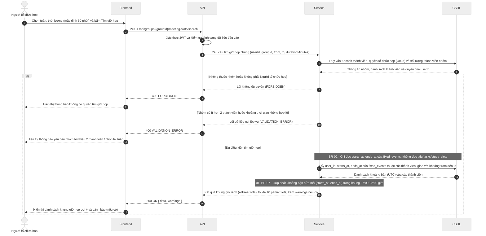

# Đặc tả API (API Spec) – StudySync

> Khung tài liệu theo Template 7. Chủ module viết endpoint của mình, Nhi review. Mỗi endpoint mới hoặc đổi đều cập nhật file này trong cùng PR.
> Ký hiệu: `<nội dung>` là chỗ cần điền (thay cả dấu ngoặc nhọn). Xóa các ghi chú *Hướng dẫn* khi dùng thật.

## Quy ước chung

| Mục | Quy ước |
| --- | --- |
| Định dạng | REST, gửi và trả JSON, mã hóa UTF-8 |
| Tiền tố đường dẫn | `/api` |
| Xác thực | Bearer token (JWT) trong header `Authorization: Bearer <token>` |
| Thời gian | Chuỗi ISO 8601 theo UTC, ví dụ `2026-11-05T13:00:00Z`; nhận cả dạng có mili giây (`2026-11-05T13:00:00.000Z`), không nhận offset như `+07:00` và không nhận chuỗi thiếu hậu tố `Z` (trả `400 VALIDATION_ERROR`, BR-07); dữ liệu API trả về luôn có mili giây, ví dụ `2026-11-05T13:00:00.000Z`; frontend tự hiển thị giờ Việt Nam |
| Tên trường JSON | camelCase cho toàn bộ (ví dụ `dueAt`, `startsAt`, `durationMinutes`). Backend đổi qua lại với tên cột snake_case của CSDL, không đổi tên cột theo API |
| Khoảng thời gian | Đối tượng `{ "startsAt": "...", "endsAt": "..." }` (kiểu `TimeSlot` trong `docs/interval-library.md`), hai giá trị theo dòng Thời gian ở trên, hiểu theo nửa mở `[startsAt, endsAt)`. Khoảng tìm kiếm gửi lên dùng `from` và `to`, cũng nửa mở `[from, to)` |
| Định danh | `id` là chuỗi UUID, theo kiểu khóa chính của CSDL |
| Việc đã xóa (từ #57) | Khung học còn lưu khi việc gốc bị xóa thì có `taskId: null`. API không trả tên việc cũ; giao diện hiện nhãn mặc định, ví dụ "Việc đã xóa" (đã chốt ở việc 3, `#56`) |
| Quyền riêng tư (BR-02) | API dành cho nhóm chỉ trả trạng thái bận hoặc rảnh, không trả tên sự kiện |
| Dạng phản hồi | Thành công bọc kết quả trong `data`; thành công nhưng có cảnh báo (BR-01, BR-04) thì thêm `warnings` ngang hàng với `data`; lỗi dùng `error`. Mỗi phản hồi chỉ có `data` hoặc `error` (trừ `GET /health`, xem mục "Dạng phản hồi thành công"), không bao giờ có cả hai; HTTP 204 (xóa thành công) không có nội dung. Chi tiết xem các mục bên dưới. |

## Dạng phản hồi thành công

> Trạng thái: **đã chốt** (Nhi, việc "Chốt quy ước chung của API", `#56`). Lý do: một số quy định nghiệp vụ (BR-01, BR-04) cho gọi thành công nhưng kèm cảnh báo, nên cần chỗ đặt cảnh báo tách khỏi các trường của đối tượng.

Áp dụng cho mọi phản hồi thành công có nội dung (HTTP 200, 201). HTTP 204 không có nội dung, xem mục "Mã HTTP khi thành công".

**Thành công thường:**

```json
{
  "data": { }
}
```

**Thành công kèm cảnh báo (vẫn HTTP 200 hoặc 201):**

```json
{
  "data": {
    "id": "550e8400-e29b-41d4-a716-446655440000",
    "title": "Ôn tập CSDL",
    "dueAt": "2026-11-08T10:00:00.000Z"
  },
  "warnings": [
    {
      "code": "DEADLINE_PASSED",
      "message": "Hạn hoàn thành đã qua so với thời điểm hiện tại (BR-04)."
    }
  ]
}
```

- `data`: nội dung chính của endpoint (đối tượng hoặc danh sách bọc trong đối tượng, ví dụ `data.slots`).
- `warnings`: chỉ có khi có cảnh báo, không trả mảng rỗng. Mỗi phần tử có dạng `{ code, message }`, có thể kèm `details` (xem mục "Mã HTTP khi thành công").
- Phản hồi lỗi (4xx, 5xx) dùng dạng riêng ở mục sau, không có `data`.
- Ngoại lệ duy nhất: `GET /health` (kiểm tra máy chủ còn chạy, đường dẫn nằm ngoài tiền tố `/api`) giữ nguyên dạng `{ "status": "ok", "time": "2026-11-05T13:00:00.000Z" }`, không bọc `data`. `time` theo dòng Thời gian ở Quy ước chung. Đã chốt ở việc 3 (`#56`).

Bảng mã cảnh báo dùng chung (đã chốt ở việc 3 – `#56`):

| Mã cảnh báo (`code`) | Quy tắc | Ý nghĩa / Khi nào trả về |
| --- | --- | --- |
| `FIXED_EVENT_OVERLAP` | BR-01 | Sự kiện cố định vừa tạo/nhập bị chồng thời gian với sự kiện cố định khác (vẫn cho lưu thành công kèm cảnh báo) |
| `DEADLINE_PASSED` | BR-04 | Việc cần làm được lưu với hạn hoàn thành (`dueAt`) đã qua so với thời điểm hiện tại |
| `MEMBER_NO_FIXED_EVENTS` | Yêu cầu 4.1 (U031) | Khi tìm giờ họp chung mà trong nhóm có thành viên chưa nhập sự kiện cố định nào trong tuần được chọn |

## Mã HTTP khi thành công

> Bổ sung của Nhi cho Quy ước chung (việc 3, `#56`).

| Mã HTTP | Khi nào | Nội dung trả về |
| --- | --- | --- |
| 200 | Đọc, sửa, hoặc thao tác không tạo tài nguyên mới (ví dụ tìm giờ họp, đề xuất khung giờ) thành công | Dạng phản hồi thành công ở trên |
| 201 | Tạo tài nguyên mới thành công | Dạng phản hồi thành công ở trên, `data` là tài nguyên vừa tạo |
| 204 | Xóa thành công | Body rỗng, không gửi chuỗi JSON nào (không trả `{ "data": null }` hay `{ "data": {} }`) |

Phần tử của `warnings` có thể kèm `details` (tùy chọn, cùng dạng `[{ "field", "issue" }]` với `error.details`) khi cảnh báo gắn với một trường cụ thể để frontend hiện ngay tại trường nhập. Ví dụ `DEADLINE_PASSED` kèm `"details": [{ "field": "dueAt", "issue": "đã qua" }]`.

## Dạng thông báo lỗi thống nhất

```json
{
  "error": {
    "code": "VALIDATION_ERROR",
    "message": "Thời lượng phải lớn hơn 0",
    "details": [{ "field": "durationMinutes", "issue": "phải lớn hơn 0" }]
  }
}
```

## Bảng mã lỗi dùng chung

| Mã HTTP | error.code | Khi nào |
| --- | --- | --- |
| 400 | VALIDATION_ERROR | Dữ liệu gửi lên sai định dạng hoặc thiếu trường bắt buộc |
| 401 | UNAUTHORIZED | Chưa đăng nhập hoặc token hết hạn |
| 403 | FORBIDDEN | Đã đăng nhập nhưng không có quyền (ví dụ không thuộc nhóm) |
| 404 | NOT_FOUND | Không tìm thấy tài nguyên |
| 409 | CONFLICT | Khung giờ do hệ thống xếp trùng lịch cố định (BR-01) hoặc dữ liệu bị trùng; hai sự kiện cố định chồng nhau (nhập tay hoặc import) không trả lỗi này mà chỉ cảnh báo |
| 413 | FILE_TOO_LARGE | File import (.ics, .csv, ảnh) vượt 5 MB, tính 1 MB = 1024 × 1024 byte (BR-05) |
| 422 | FILE_INVALID | File import sai định dạng hoặc có dòng không hợp lệ (kể cả tên việc quá 200 ký tự, BR-08); trả kèm tối đa 20 dòng lỗi đầu tiên (BR-06); với .ics báo theo sự kiện kèm số dòng bắt đầu khối VEVENT; lỗi gồm thiếu tên hoặc giờ bắt đầu, giờ kết thúc không sau giờ bắt đầu, TZID không nhận ra được, tệp không có sự kiện nào; mỗi phần tử details có dạng `{line?, issue}`: `line` bỏ trống khi lỗi cấp tệp (tệp rỗng, không có sự kiện, sai định dạng, ảnh), còn lỗi trong một VEVENT vẫn có `line` là dòng bắt đầu khối |
| 500 | INTERNAL_ERROR | Lỗi máy chủ, không lộ chi tiết kỹ thuật cho người dùng |

## Danh sách endpoint theo module (tổng quan, điền dần)

| Module | Phương thức và đường dẫn | Mô tả ngắn | Trạng thái |
| --- | --- | --- | --- |
| TV1 | `<POST /api/auth/register>` | `<Đăng ký>` | Nháp |
| TV2 | `<GET /api/events>` | `<Xem lịch tuần>` | Nháp |
| TV3 | `<POST /api/schedule/suggest>` | `<Đề xuất khung giờ học>` | Nháp |
| TV4 | `POST /api/groups/{groupId}/meeting-slots/search` | Tìm giờ họp chung | Nháp |
| TV4 | `POST /api/groups/{groupId}/meeting-proposals` | Tạo đề xuất buổi họp và gửi lời mời | Nháp |
| TV4 | `POST /api/groups/{groupId}/meeting-proposals/{proposalId}/invitations/{invitationId}/respond` | Phản hồi lời mời tham dự buổi họp | Nháp |
| TV4 | `GET /api/users/me/reminders` | Lấy danh sách nhắc việc sắp đến hạn | Nháp |
| TV5 | `GET /api/groups/{groupId}/cards` | Danh sách và lọc thẻ Kanban | Nháp |
| TV5 | `POST /api/groups/{groupId}/cards` | Tạo thẻ Kanban mới | Nháp |
| TV5 | `PATCH /api/groups/{groupId}/cards/{cardId}` | Sửa tên và hạn chót thẻ Kanban | Nháp |
| TV5 | `DELETE /api/groups/{groupId}/cards/{cardId}` | Xóa thẻ Kanban | Nháp |
| TV5 | `PATCH /api/groups/{groupId}/cards/{cardId}/status` | Chuyển cột trạng thái thẻ Kanban | Nháp |
| TV5 | `PATCH /api/groups/{groupId}/cards/{cardId}/assignee` | Giao hoặc bỏ giao thẻ Kanban | Nháp |
| TV5 | `GET /api/statistics/weekly` | Xem thống kê giờ học theo tuần | Nháp |

## Mẫu một endpoint (sao chép cho mỗi endpoint)

````markdown
### <PHƯƠNG THỨC> /api/<đường-dẫn>
Module: TV<x> · Story: US-<xx> · Người viết: <tên> · Trạng thái: <Nháp / Đã chốt / Đã làm>
Mô tả: <Một câu, endpoint làm gì>
Quyền: <Ai gọi được: chủ tài khoản / thành viên nhóm / trưởng nhóm>

**Tham số đường dẫn và query**

| Tên | Kiểu | Bắt buộc | Mô tả |
| --- | --- | --- | --- |

**Nội dung gửi lên (body)**

```json
<JSON mẫu>
```

**Kết quả thành công (<mã HTTP>)**

```json
{ "data": { } }
```

**Cảnh báo có thể gặp** (xóa mục này nếu endpoint không trả cảnh báo)

| Mã cảnh báo (`warnings[].code`) | Điều kiện |
| --- | --- |

**Lỗi có thể gặp**

| Mã HTTP | error.code | Điều kiện |
| --- | --- | --- |

Ghi chú: <Quy định nghiệp vụ áp dụng, giới hạn, lưu ý cho frontend>
````

---

## TV1 – Tài khoản và nhóm

<!-- Vùng của TV1: chỉ sửa trong vùng này để tránh xung đột khi merge. -->

`<Thêm các endpoint của TV1 bên dưới theo mẫu ở trên, trạng thái ban đầu là Nháp.>`

---

## TV2 – Lịch, sự kiện cố định và việc cần làm

<!-- Vùng của TV2: chỉ sửa trong vùng này để tránh xung đột khi merge. -->

`<Thêm các endpoint của TV2 bên dưới theo mẫu ở trên, trạng thái ban đầu là Nháp.>`

---

## TV3 – Đề xuất khung giờ học

<!-- Vùng của TV3: chỉ sửa trong vùng này để tránh xung đột khi merge. -->

`<Thêm các endpoint của TV3 bên dưới theo mẫu ở trên, trạng thái ban đầu là Nháp.>`

---

## TV4 – Họp nhóm, lời mời và nhắc việc

<!-- Vùng của TV4: chỉ sửa trong vùng này để tránh xung đột khi merge. -->

### `POST /api/groups/{groupId}/meeting-slots/search`

Module: TV4 · Story: US-23 · Người viết: Thư Q.A. · Trạng thái: Nháp  
Mô tả: Tìm các khung giờ họp chung của nhóm trong khoảng thời gian được chọn, dựa trên khoảng bận (`starts_at`, `ends_at`) từ sự kiện cố định của các thành viên; trả danh sách khung rảnh hoàn toàn (`allFreeSlots`) hoặc khung có nhiều người rảnh nhất (`partialSlots`) khi không có giờ chung (US-23, U031).  
Quyền: Người tổ chức họp của nhóm – gồm **Trưởng nhóm** hoặc **Thành viên nhóm được Trưởng nhóm ủy quyền** (kiểm tra động theo CSDL của nhóm, U036); không phải quyền tĩnh chỉ theo vai trò.

**Tham số đường dẫn**

| Tên | Kiểu | Bắt buộc | Mô tả |
| --- | --- | --- | --- |
| `groupId` | `uuid` | Có | Mã nhóm cần tìm giờ họp chung |

**Nội dung gửi lên (body)**

```json
{
  "from": "2026-11-08T17:00:00.000Z",
  "to": "2026-11-15T17:00:00.000Z",
  "durationMinutes": 60
}
```

| Trường | Kiểu | Bắt buộc | Mô tả |
| --- | --- | --- | --- |
| `from` | `string` (ISO 8601 UTC) | Có | Thời điểm bắt đầu khoảng tìm kiếm (nửa mở `[from, to)`) |
| `to` | `string` (ISO 8601 UTC) | Có | Thời điểm kết thúc khoảng tìm kiếm |
| `durationMinutes` | `integer` | Không | Thời lượng tối thiểu của khung giờ họp (phút); mặc định `60`, bước nhảy `30`, tối đa `900` |

**Kết quả thành công (200 OK)**

```json
{
  "data": {
    "allFreeSlots": [
      {
        "startsAt": "2026-11-10T01:00:00.000Z",
        "endsAt": "2026-11-10T03:00:00.000Z",
        "availableCount": 5,
        "totalMembers": 5,
        "busyMembers": []
      }
    ],
    "partialSlots": []
  }
}
```

Khi không có khung nào cả nhóm cùng rảnh (`allFreeSlots` rỗng), `partialSlots` trả tối đa 10 khung có nhiều thành viên rảnh nhất, sắp giảm dần theo `availableCount`, ưu tiên `startsAt` sớm hơn khi bằng nhau. Mỗi phần tử của `partialSlots` có thêm `busyMembers` chứa danh sách tên hiển thị (`displayName`) của thành viên bận tại khung đó – đây là tên hiển thị trong hồ sơ nhóm, **không phải** tên hay chi tiết sự kiện cá nhân (BR-02).

```json
{
  "data": {
    "allFreeSlots": [],
    "partialSlots": [
      {
        "startsAt": "2026-11-10T04:00:00.000Z",
        "endsAt": "2026-11-10T05:00:00.000Z",
        "availableCount": 4,
        "totalMembers": 5,
        "busyMembers": [
          { "displayName": "Nguyễn Văn B" }
        ]
      }
    ]
  },
  "warnings": [
    {
      "code": "MEMBER_NO_FIXED_EVENTS",
      "message": "Thành viên Trần Thị C chưa nhập sự kiện cố định nào trong tuần được chọn."
    }
  ]
}
```

**Cảnh báo có thể gặp**

| Mã cảnh báo (`warnings[].code`) | Điều kiện |
| --- | --- |
| `MEMBER_NO_FIXED_EVENTS` | Có ít nhất một thành viên chưa nhập sự kiện cố định nào trong khoảng `[from, to)`; thành viên đó được coi là rảnh hoàn toàn trong khoảng (yêu cầu 4.1, U031) |

**Lỗi có thể gặp**

| Mã HTTP | error.code | Điều kiện |
| --- | --- | --- |
| `400` | `VALIDATION_ERROR` | Nhóm có ít hơn 2 thành viên; `from >= to`; toàn bộ khoảng `[from, to)` nằm trong quá khứ so với thời điểm hiện tại; `durationMinutes <= 0` hoặc `> 900`; `from` hoặc `to` không phải chuỗi ISO 8601 hậu tố Z (BR-07) |
| `401` | `UNAUTHORIZED` | Chưa đăng nhập hoặc token không hợp lệ / hết hạn |
| `403` | `FORBIDDEN` | Người gọi không thuộc nhóm, hoặc là thành viên thường chưa được Trưởng nhóm ủy quyền tổ chức họp (U031, U036) |
| `404` | `NOT_FOUND` | Không tìm thấy nhóm với `groupId` đã truyền |

Ghi chú:
- Khoảng tìm kiếm hiểu theo nửa mở `[from, to)` tính bằng UTC (BR-01, BR-07); chỉ xét trong khung hoạt động `07:00–22:00` giờ Việt Nam (`Asia/Ho_Chi_Minh`) mỗi ngày và loại bỏ các mốc đã qua so với `now()` (yêu cầu 4.1).
- **Tuyệt đối không lộ tên, loại, địa điểm, ghi chú sự kiện cá nhân (BR-02):** Service chỉ đọc `starts_at` và `ends_at` từ `fixed_events`; không đọc `title`, `kind`, `location`, `notes`, `source`. Không coi `tasks` hay `study_slots` là bận (yêu cầu 4.1, mục 1.7).
- Phân quyền kiểm tra động: backend tra `group_members` xem `user_id` của token có vai trò `leader` hoặc có cờ ủy quyền tổ chức họp không (U036); không chỉ kiểm tra ở giao diện.

---

### `POST /api/groups/{groupId}/meeting-proposals`

Module: TV4 · Story: US-24 · Người viết: Thư Q.A. · Trạng thái: Nháp  
Mô tả: Người tổ chức họp tạo một đề xuất buổi họp cho nhóm (chốt một khung giờ từ kết quả tìm kiếm hoặc tự nhập) và gửi lời mời đến toàn bộ thành viên nhóm (U032).  
Quyền: Người tổ chức họp của nhóm (Trưởng nhóm hoặc Thành viên được ủy quyền, U036); kiểm tra động theo CSDL.

**Tham số đường dẫn**

| Tên | Kiểu | Bắt buộc | Mô tả |
| --- | --- | --- | --- |
| `groupId` | `uuid` | Có | Mã nhóm tổ chức buổi họp |

**Nội dung gửi lên (body)**

```json
{
  "title": "Họp đồ án tuần 4",
  "startsAt": "2026-11-10T01:00:00.000Z",
  "endsAt": "2026-11-10T03:00:00.000Z",
  "location": "Phòng họp B2",
  "notes": "Chuẩn bị slide demo"
}
```

| Trường | Kiểu | Bắt buộc | Mô tả |
| --- | --- | --- | --- |
| `title` | `string` | Có | Tên buổi họp; tối đa 200 code point, tối thiểu 1 ký tự sau cắt khoảng trắng (BR-08) |
| `startsAt` | `string` (ISO 8601 UTC) | Có | Thời điểm bắt đầu buổi họp |
| `endsAt` | `string` (ISO 8601 UTC) | Có | Thời điểm kết thúc buổi họp; phải sau `startsAt` |
| `location` | `string` | Không | Địa điểm họp (tùy chọn) |
| `notes` | `string` | Không | Ghi chú thêm (tùy chọn) |

**Kết quả thành công (201 Created)**

```json
{
  "data": {
    "id": "550e8400-e29b-41d4-a716-446655440000",
    "groupId": "661f9500-f30c-52e5-b827-557766551111",
    "organizerUserId": "772a0600-a41d-63f6-c938-668877662222",
    "title": "Họp đồ án tuần 4",
    "startsAt": "2026-11-10T01:00:00.000Z",
    "endsAt": "2026-11-10T03:00:00.000Z",
    "status": "open",
    "location": "Phòng họp B2",
    "notes": "Chuẩn bị slide demo",
    "invitationsSent": 4,
    "createdAt": "2026-11-09T10:00:00.000Z",
    "updatedAt": "2026-11-09T10:00:00.000Z"
  }
}
```

- `invitationsSent`: số lời mời vừa được tạo (bằng số thành viên nhóm trừ Người tổ chức họp; Người tổ chức họp không tự gửi mời cho chính mình).
- Hệ thống tạo một dòng `meeting_invitations` với `status = 'pending'` cho mỗi thành viên nhóm còn lại. Nếu đã có đề xuất `open` cũ cho cùng nhóm mà cùng thành viên chưa phản hồi, lời mời cũ chuyển sang `'superseded'` trước khi tạo lời mời mới (U032).

**Lỗi có thể gặp**

| Mã HTTP | error.code | Điều kiện |
| --- | --- | --- |
| `400` | `VALIDATION_ERROR` | `title` rỗng hoặc vượt 200 ký tự (BR-08); `endsAt <= startsAt`; trường bắt buộc thiếu; `startsAt`/`endsAt` không phải ISO 8601 hậu tố Z (BR-07) |
| `401` | `UNAUTHORIZED` | Chưa đăng nhập hoặc token không hợp lệ / hết hạn |
| `403` | `FORBIDDEN` | Người gọi không thuộc nhóm hoặc chưa được ủy quyền tổ chức họp (U036) |
| `404` | `NOT_FOUND` | Không tìm thấy nhóm với `groupId` |

Ghi chú:
- Quy tắc lời mời `'superseded'` (U032): khi tạo đề xuất mới, lời mời `'pending'` của đề xuất cũ (cùng nhóm) đổi thành `'superseded'`; lời mời `'accepted'`/`'declined'` giữ nguyên để lưu vết lịch sử.
- Khi thành viên rời nhóm sau khi đề xuất đã được tạo, lời mời của người đó không tính vào tổng lời mời đang mở (U033, U034, U036); logic do ứng dụng thực hiện cùng lúc xóa dòng `group_members` trong một transaction (mục 1.5).

---

### `POST /api/groups/{groupId}/meeting-proposals/{proposalId}/invitations/{invitationId}/respond`

Module: TV4 · Story: US-25, US-26 · Người viết: Thư Q.A. · Trạng thái: Nháp  
Mô tả: Thành viên nhóm phản hồi (chấp nhận hoặc từ chối) lời mời tham dự một buổi họp đã được đề xuất (U033).  
Quyền: Thành viên nhóm được mời (chủ sở hữu `invitationId`); chỉ người có `user_id` khớp với `meeting_invitations.user_id` mới được phản hồi.

**Tham số đường dẫn**

| Tên | Kiểu | Bắt buộc | Mô tả |
| --- | --- | --- | --- |
| `groupId` | `uuid` | Có | Mã nhóm |
| `proposalId` | `uuid` | Có | Mã đề xuất buổi họp |
| `invitationId` | `uuid` | Có | Mã lời mời của thành viên |

**Nội dung gửi lên (body)**

```json
{
  "response": "accepted"
}
```

| Trường | Kiểu | Bắt buộc | Mô tả |
| --- | --- | --- | --- |
| `response` | `string` | Có | Phản hồi của thành viên: `"accepted"` hoặc `"declined"` |

**Kết quả thành công (200 OK)**

```json
{
  "data": {
    "invitationId": "883b1700-b52e-74g7-d049-779988773333",
    "proposalId": "550e8400-e29b-41d4-a716-446655440000",
    "status": "accepted",
    "respondedAt": "2026-11-09T11:30:00.000Z"
  }
}
```

**Lỗi có thể gặp**

| Mã HTTP | error.code | Điều kiện |
| --- | --- | --- |
| `400` | `VALIDATION_ERROR` | `response` không phải `"accepted"` hoặc `"declined"` |
| `401` | `UNAUTHORIZED` | Chưa đăng nhập hoặc token không hợp lệ / hết hạn |
| `403` | `FORBIDDEN` | Người gọi không phải chủ sở hữu lời mời (`invitationId`), hoặc không thuộc nhóm |
| `404` | `NOT_FOUND` | Không tìm thấy `groupId`, `proposalId` hoặc `invitationId` |
| `409` | `CONFLICT` | Lời mời đã ở trạng thái `'superseded'` (đề xuất cũ bị thay thế, U032) và không thể phản hồi |

Ghi chú:
- Thành viên có thể đổi phản hồi nhiều lần (từ `'accepted'` sang `'declined'` hoặc ngược lại) miễn đề xuất còn ở trạng thái `'open'`; mỗi lần phản hồi cập nhật `responded_at`.
- Lời mời ở trạng thái `'superseded'` không được phản hồi (trả `409 CONFLICT`).

---

### `GET /api/users/me/reminders`

Module: TV4 · Story: US-28 · Người viết: Thư Q.A. · Trạng thái: Nháp  
Mô tả: Lấy danh sách nhắc việc sắp đến hạn của người dùng đang đăng nhập, sắp theo thời điểm nhắc gần nhất trước, tức `remindAt ASC, id ASC` (U035).  
Quyền: Người dùng đang đăng nhập (chỉ trả nhắc việc của chính `user_id` trong token; không trả của người khác).

**Tham số query**

| Tên | Kiểu | Bắt buộc | Mô tả |
| --- | --- | --- | --- |
| `from` | `string` (ISO 8601 UTC) | Không | Lọc nhắc việc có `remind_at >= from`; mặc định là thời điểm hiện tại (`now()`) |
| `to` | `string` (ISO 8601 UTC) | Không | Lọc nhắc việc có `remind_at < to`; mặc định là 7 ngày sau `from` |
| `limit` | `integer` | Không | Số nhắc việc tối đa trả về; mặc định `20`, tối đa `100` |

**Nội dung gửi lên (body):** không có.

**Kết quả thành công (200 OK)**

```json
{
  "data": {
    "reminders": [
      {
        "id": "994c2800-c63f-85h8-e150-880099884444",
        "taskId": "aa5d3900-d74a-96i9-f261-991100995555",
        "taskTitle": "Ôn tập Giải tích chương 3",
        "taskDueAt": "2026-11-12T10:00:00.000Z",
        "remindAt": "2026-11-11T10:00:00.000Z",
        "isSent": false
      }
    ]
  }
}
```

| Trường trong `reminders[]` | Kiểu | Mô tả |
| --- | --- | --- |
| `id` | `uuid` | Mã nhắc việc |
| `taskId` | `uuid` | Mã việc cần làm |
| `taskTitle` | `string` | Tên việc cần làm (lấy từ `tasks.title`); dữ liệu cá nhân, chỉ trả cho chủ sở hữu (BR-02) |
| `taskDueAt` | `string` (ISO 8601 UTC) | Hạn hoàn thành của việc |
| `remindAt` | `string` (ISO 8601 UTC) | Thời điểm gửi thông báo nhắc |
| `isSent` | `boolean` | Đã gửi thông báo chưa |

**Lỗi có thể gặp**

| Mã HTTP | error.code | Điều kiện |
| --- | --- | --- |
| `400` | `VALIDATION_ERROR` | `from` hoặc `to` không phải ISO 8601 hậu tố Z; `from >= to`; `limit` ngoài khoảng `[1, 100]` (BR-07) |
| `401` | `UNAUTHORIZED` | Chưa đăng nhập hoặc token không hợp lệ / hết hạn |

Ghi chú:
- Nhắc việc chỉ trả cho chính người dùng đang đăng nhập; không có endpoint trả nhắc việc của người khác (BR-02).
- Danh sách `reminders` luôn sắp theo `remindAt ASC, id ASC`: hai nhắc việc cùng `remindAt` (ví dụ hai việc cùng hạn, cùng nhắc trước 1 giờ) thì sắp theo khóa chính `id` tăng dần, nên thứ tự luôn xác định. `limit` áp dụng sau khi sắp xếp theo đúng thứ tự này, vì vậy kết quả cắt ở `limit` cũng xác định.
- Nhắc việc gắn với việc đã xóa sẽ bị xóa CASCADE từ `tasks` → không bao giờ trả `taskId` của việc đã xóa (mục 1.5, U035); `taskId` luôn hợp lệ, không có trường hợp `null` ở endpoint này (khác với `study_slots.task_id` có thể `null` theo quy ước từ `#57`).
- Bộ hẹn giờ hệ thống (Timer, tác nhân `Timer` trong sơ đồ tuần tự) quét định kỳ và gửi thông báo; endpoint này chỉ đọc danh sách, không kích hoạt gửi thông báo.

---

> **Sơ đồ tuần tự TV4** (nháp, bổ sung sau khi hoàn thiện task tài liệu)

---

## TV5 – Kanban và thống kê

<!-- Vùng của TV5: chỉ sửa trong vùng này để tránh xung đột khi merge. -->

<!-- TV5:BEGIN -->

Trạng thái: Nháp · Người viết: Kiên · Người review: Hưng · Cập nhật: 10/11/2026

Phạm vi: US-29 đến US-34 (Use Case U041 đến U046, mục 3.2.1 Bảng 3.6 yêu cầu 5.1 đến 5.6 của Báo cáo Yêu cầu M2). Toàn bộ endpoint tuân theo Quy ước chung ở đầu tài liệu (REST, JSON UTF-8, tiền tố `/api`, `camelCase`, `id` kiểu UUID, thời gian ISO 8601 theo UTC hậu tố `Z` và luôn có mili giây khi trả về, phản hồi `{ data }`, `{ data, warnings }` hoặc `{ error }`, HTTP `204` không có nội dung).

### Quy định áp dụng cho TV5

| Mục | Quy định |
| --- | --- |
| Bảng Kanban 3 cột cố định (`U041`, `U042`, `5.2`) | Bảng gồm đúng 3 cột `todo` (`Cần làm`), `in_progress` (`Đang làm`) và `done` (`Đã xong`); không thêm, sửa hoặc xóa cột. Thẻ chuyển được theo mọi hướng, kể cả từ `done` quay về `in_progress` hoặc `todo`. Không dùng `description` hay `position`. |
| Thứ tự sắp xếp (`U041`, `U042`) | Các thẻ trong mỗi cột luôn sắp xếp theo `dueAt` tăng dần; hai thẻ cùng `dueAt` thì thẻ có `createdAt` nhỏ hơn (tạo trước) nằm trên; nếu cùng cả `dueAt` và `createdAt` thì sắp theo khóa chính `id` tăng dần (`dueAt ASC, createdAt ASC, id ASC`). Không sắp theo thứ tự kéo thả thủ công hay thời điểm chuyển cột. |
| Tên thẻ Kanban (`BR-08`) | Bắt buộc, không có thời lượng ước tính (`durationMinutes`). Backend chuẩn hóa NFC, cắt khoảng trắng hai đầu rồi đếm theo code point Unicode (tối thiểu `1`, tối đa `200` ký tự); giá trị lưu và trả về là chuỗi đã chuẩn hóa. Quá dài thì báo `400 VALIDATION_ERROR`, không tự cắt. |
| Hạn chót (`BR-04`, `BR-07`) | Bắt buộc gồm cả ngày và giờ dưới dạng chuỗi ISO 8601 UTC hậu tố `Z` (nhận dạng có hoặc không có `.000`, từ chối offset như `+07:00` và chuỗi thiếu `Z`; dữ liệu trả về luôn có `.000Z`). Hạn chót đã qua vẫn cho lưu và trả thêm `warnings` chứa `DEADLINE_PASSED`; khi không có cảnh báo thì không trả trường `warnings`. |
| Giao thẻ (`U043`) | Mỗi thẻ có tối đa 1 người được giao (`assignedToUserId` hoặc `null`). Chỉ Trưởng nhóm (`role = 'leader'`) mới được giao hoặc bỏ giao thẻ (`403 FORBIDDEN` với thành viên thường). Giao người mới thì thay thế người cũ; không gửi thông báo riêng cho người nhận. Khi người được giao rời nhóm (`U007`), giao dịch TV1 tự đặt `assigned_to_user_id = NULL` và giữ nguyên cột. |
| Sửa và xóa thẻ (`U046`) | Chỉ người tạo thẻ (`createdByUserId`) hoặc Trưởng nhóm (`role = 'leader'`) mới được sửa `title`/`dueAt` hoặc xóa thẻ; thành viên khác (kể cả người đang được giao thẻ) nhận `403 FORBIDDEN`. Khi người tạo đã rời nhóm, thẻ vẫn giữ lại để Trưởng nhóm quản lý. Xóa thẻ là xóa thật (`204 No Content`), không khôi phục được. |
| Quyền riêng tư (`BR-02`) | Mọi endpoint Kanban kiểm tra tư cách thành viên hiện tại của nhóm tại API (`403 FORBIDDEN` nếu ngoài nhóm); chỉ trả `createdByDisplayName` và `assignedToDisplayName`, không trả `email` hay dữ liệu lịch cá nhân. Thống kê giờ học tuần (`U045`) chỉ đọc `study_slots` của chính người dùng đang đăng nhập. |
| Thống kê giờ học tuần (`U045`, `US-33`, PR `#83`) | Tuần tính từ Thứ Hai `00:00:00` đến Thứ Hai kế tiếp `00:00:00` theo `Asia/Ho_Chi_Minh` (`UTC+7`, nửa mở `[from, to)`), không cho xem tuần tương lai. Cộng hiệu `ends_at - starts_at` của mọi khung đã đánh dấu `"Đã học"` (bao gồm khung giờ bù `"Đã học"` và các bản ghi `task_id = NULL`, không chia theo môn học); mỗi khung được tính trọn vào ngày chứa `starts_at` sau khi đổi sang giờ Việt Nam. |

### Kiểu dữ liệu dùng chung trong TV5

`KanbanCard`:

```json
{
  "id": "a1b2c3d4-1111-4222-8333-444455556666",
  "groupId": "7d2c9a51-6b3e-4f08-8a1d-5e9c2b4f7a33",
  "title": "Hoàn thiện sơ đồ ERD và từ điển dữ liệu nhóm",
  "status": "in_progress",
  "dueAt": "2026-11-13T10:00:00.000Z",
  "createdByUserId": "0b8f6f5e-2c1a-4c7e-9d4b-3a5f1e7c9a10",
  "createdByDisplayName": "Nguyễn Văn An",
  "assignedToUserId": "5c1e8d27-9a4b-4e3f-b6d1-2f7a0c8e4b19",
  "assignedToDisplayName": "Trần Thị Bình",
  "createdAt": "2026-11-10T08:15:00.000Z",
  "updatedAt": "2026-11-10T09:30:00.000Z"
}
```

`status` chỉ nhận một trong ba giá trị `"todo"`, `"in_progress"`, `"done"`. Khi thẻ chưa giao cho ai, cả `assignedToUserId` và `assignedToDisplayName` đều là `null`. `createdByDisplayName` và `assignedToDisplayName` nối từ `users.display_name` để frontend hiển thị trực tiếp mà không phải gọi thêm API phụ.

`WeeklyStatistics`:

```json
{
  "from": "2026-11-08T17:00:00.000Z",
  "to": "2026-11-15T17:00:00.000Z",
  "totalMinutes": 270,
  "days": [
    { "date": "2026-11-09", "dayOfWeek": 1, "minutes": 90 },
    { "date": "2026-11-10", "dayOfWeek": 2, "minutes": 0 },
    { "date": "2026-11-11", "dayOfWeek": 3, "minutes": 120 },
    { "date": "2026-11-12", "dayOfWeek": 4, "minutes": 0 },
    { "date": "2026-11-13", "dayOfWeek": 5, "minutes": 60 },
    { "date": "2026-11-14", "dayOfWeek": 6, "minutes": 0 },
    { "date": "2026-11-15", "dayOfWeek": 7, "minutes": 0 }
  ]
}
```

`days` luôn có đủ 7 phần tử từ Thứ Hai (`dayOfWeek: 1`) đến Chủ Nhật (`dayOfWeek: 7`) theo ngày Việt Nam (`YYYY-MM-DD`). Trả số phút dạng số nguyên (`totalMinutes`, `minutes`); frontend đổi sang dạng `"X giờ Y phút"` hoặc `"0 giờ"` (ví dụ `270` phút là `"4 giờ 30 phút"` theo yêu cầu 5.5).

### Danh sách endpoint TV5

| Phương thức và đường dẫn | Mô tả ngắn | Story | Quyền | Trạng thái |
| --- | --- | --- | --- | --- |
| GET /api/groups/{groupId}/cards | Danh sách và lọc thẻ Kanban | US-29, US-32 | Thành viên nhóm | Nháp |
| POST /api/groups/{groupId}/cards | Tạo thẻ Kanban mới | US-29 | Thành viên nhóm | Nháp |
| PATCH /api/groups/{groupId}/cards/{cardId} | Sửa tên và hạn chót thẻ Kanban | US-34 | Người tạo thẻ hoặc Trưởng nhóm | Nháp |
| DELETE /api/groups/{groupId}/cards/{cardId} | Xóa thẻ Kanban | US-34 | Người tạo thẻ hoặc Trưởng nhóm | Nháp |
| PATCH /api/groups/{groupId}/cards/{cardId}/status | Chuyển cột trạng thái thẻ Kanban | US-30 | Thành viên nhóm | Nháp |
| PATCH /api/groups/{groupId}/cards/{cardId}/assignee | Giao hoặc bỏ giao thẻ Kanban | US-31 | Trưởng nhóm | Nháp |
| GET /api/statistics/weekly | Xem thống kê giờ học theo tuần | US-33 | Chủ tài khoản | Nháp |

---

### GET /api/groups/{groupId}/cards
Module: TV5 · Story: US-29, US-32 · Người viết: Kiên · Trạng thái: Nháp  
Mô tả: Lấy toàn bộ thẻ Kanban của nhóm, hoặc lọc theo thành viên được giao / thẻ chưa giao, sắp theo hạn chót tăng dần.  
Quyền: Thành viên hiện tại của nhóm (kể cả Trưởng nhóm).

**Tham số đường dẫn và query**

| Tên | Kiểu | Bắt buộc | Mô tả |
| --- | --- | --- | --- |
| `groupId` | `uuid` | Có | (đường dẫn) Mã nhóm cần lấy bảng Kanban |
| `assigneeId` | `uuid` \| `"unassigned"` | Không | (query) Lọc thẻ giao cho một thành viên theo `uuid`, hoặc truyền `"unassigned"` để lọc thẻ chưa giao (`U044`); bỏ qua tham số để lấy toàn bộ thẻ |

**Nội dung gửi lên (body):** Không có.

**Kết quả thành công (200)**

```json
{
  "data": {
    "cards": [
      {
        "id": "c3d4e5f6-3333-4444-8555-666677778888",
        "groupId": "7d2c9a51-6b3e-4f08-8a1d-5e9c2b4f7a33",
        "title": "Chốt quy ước 3 cột bảng Kanban với nhóm",
        "status": "done",
        "dueAt": "2026-11-11T10:00:00.000Z",
        "createdByUserId": "5c1e8d27-9a4b-4e3f-b6d1-2f7a0c8e4b19",
        "createdByDisplayName": "Trần Thị Bình",
        "assignedToUserId": "0b8f6f5e-2c1a-4c7e-9d4b-3a5f1e7c9a10",
        "assignedToDisplayName": "Nguyễn Văn An",
        "createdAt": "2026-11-09T03:00:00.000Z",
        "updatedAt": "2026-11-10T04:20:00.000Z"
      },
      {
        "id": "a1b2c3d4-1111-4222-8333-444455556666",
        "groupId": "7d2c9a51-6b3e-4f08-8a1d-5e9c2b4f7a33",
        "title": "Hoàn thiện sơ đồ ERD và từ điển dữ liệu nhóm",
        "status": "in_progress",
        "dueAt": "2026-11-13T10:00:00.000Z",
        "createdByUserId": "0b8f6f5e-2c1a-4c7e-9d4b-3a5f1e7c9a10",
        "createdByDisplayName": "Nguyễn Văn An",
        "assignedToUserId": "5c1e8d27-9a4b-4e3f-b6d1-2f7a0c8e4b19",
        "assignedToDisplayName": "Trần Thị Bình",
        "createdAt": "2026-11-10T08:15:00.000Z",
        "updatedAt": "2026-11-10T09:30:00.000Z"
      },
      {
        "id": "b2c3d4e5-2222-4333-8444-555566667777",
        "groupId": "7d2c9a51-6b3e-4f08-8a1d-5e9c2b4f7a33",
        "title": "Chuẩn bị dữ liệu test cho kịch bản demo 2",
        "status": "todo",
        "dueAt": "2026-11-14T15:00:00.000Z",
        "createdByUserId": "0b8f6f5e-2c1a-4c7e-9d4b-3a5f1e7c9a10",
        "createdByDisplayName": "Nguyễn Văn An",
        "assignedToUserId": null,
        "assignedToDisplayName": null,
        "createdAt": "2026-11-10T10:00:00.000Z",
        "updatedAt": "2026-11-10T10:00:00.000Z"
      }
    ]
  }
}
```

**Lỗi có thể gặp**

| Mã HTTP | error.code | Điều kiện |
| --- | --- | --- |
| 400 | `VALIDATION_ERROR` | `groupId` không đúng dạng UUID, hoặc có truyền `assigneeId` nhưng giá trị rỗng, lặp tham số, hoặc không phải UUID hợp lệ hay `"unassigned"` |
| 401 | `UNAUTHORIZED` | Chưa đăng nhập hoặc token hết hạn |
| 403 | `FORBIDDEN` | Người gọi không thuộc nhóm hiện tại (`U044` 1a) |
| 404 | `NOT_FOUND` | Không tìm thấy nhóm với `groupId` đã truyền |
| 500 | `INTERNAL_ERROR` | Lỗi máy chủ |

Ghi chú: Danh sách `cards` luôn sắp theo `dueAt ASC, createdAt ASC, id ASC` nên frontend chia vào 3 cột `Cần làm`, `Đang làm`, `Đã xong` theo `status` là giữ nguyên thứ tự đúng. Nếu không có thẻ phù hợp, API vẫn trả `200` với `"cards": []`; khi lọc bằng `?assigneeId=<uuid>` ra rỗng, frontend hiện `"Chưa có thẻ nào được giao cho <Tên thành viên>"`, khi lọc `?assigneeId=unassigned` ra rỗng thì hiện `"Không có thẻ nào chưa giao"` (`U044` 2a, 2b). Nếu truyền `assigneeId` là UUID hợp lệ của người chưa có thẻ hoặc đã rời nhóm, API cũng trả `"cards": []`. Danh sách thành viên để đổ vào bộ lọc lấy từ `GET /api/groups/{groupId}`.

---

### POST /api/groups/{groupId}/cards
Module: TV5 · Story: US-29 · Người viết: Kiên · Trạng thái: Nháp  
Mô tả: Tạo một thẻ Kanban mới vào cột `Cần làm` ở trạng thái chưa giao.  
Quyền: Thành viên hiện tại của nhóm (kể cả Trưởng nhóm).

**Tham số đường dẫn và query**

| Tên | Kiểu | Bắt buộc | Mô tả |
| --- | --- | --- | --- |
| `groupId` | `uuid` | Có | (đường dẫn) Mã nhóm chứa bảng Kanban |

**Nội dung gửi lên (body)**

| Tên | Kiểu | Bắt buộc | Mô tả |
| --- | --- | --- | --- |
| `title` | `string` | Có | Tên thẻ Kanban; tối thiểu 1, tối đa 200 code point sau chuẩn hóa NFC và cắt khoảng trắng hai đầu (`BR-08`) |
| `dueAt` | `string` | Có | Hạn chót gồm cả ngày và giờ dạng ISO 8601 UTC hậu tố `Z` (`BR-04`, `BR-07`) |

```json
{
  "title": "Chuẩn bị dữ liệu test cho kịch bản demo 2",
  "dueAt": "2026-11-14T15:00:00Z"
}
```

**Kết quả thành công (201)**

Trường hợp hạn chót chưa qua:

```json
{
  "data": {
    "id": "b2c3d4e5-2222-4333-8444-555566667777",
    "groupId": "7d2c9a51-6b3e-4f08-8a1d-5e9c2b4f7a33",
    "title": "Chuẩn bị dữ liệu test cho kịch bản demo 2",
    "status": "todo",
    "dueAt": "2026-11-14T15:00:00.000Z",
    "createdByUserId": "0b8f6f5e-2c1a-4c7e-9d4b-3a5f1e7c9a10",
    "createdByDisplayName": "Nguyễn Văn An",
    "assignedToUserId": null,
    "assignedToDisplayName": null,
    "createdAt": "2026-11-10T10:00:00.000Z",
    "updatedAt": "2026-11-10T10:00:00.000Z"
  }
}
```

Trường hợp hạn chót đã qua thời điểm hiện tại (`BR-04`, vẫn trả `201` kèm `warnings`):

```json
{
  "data": {
    "id": "d4e5f6a7-4444-4555-8666-777788889999",
    "groupId": "7d2c9a51-6b3e-4f08-8a1d-5e9c2b4f7a33",
    "title": "Rà soát biên bản họp tuần 3",
    "status": "todo",
    "dueAt": "2026-11-08T10:00:00.000Z",
    "createdByUserId": "0b8f6f5e-2c1a-4c7e-9d4b-3a5f1e7c9a10",
    "createdByDisplayName": "Nguyễn Văn An",
    "assignedToUserId": null,
    "assignedToDisplayName": null,
    "createdAt": "2026-11-10T10:05:00.000Z",
    "updatedAt": "2026-11-10T10:05:00.000Z"
  },
  "warnings": [
    {
      "code": "DEADLINE_PASSED",
      "message": "Hạn chót đã qua thời điểm hiện tại",
      "details": [{ "field": "dueAt", "issue": "đã qua" }]
    }
  ]
}
```

**Cảnh báo có thể gặp**

| Mã cảnh báo (`warnings[].code`) | Điều kiện |
| --- | --- |
| `DEADLINE_PASSED` | `dueAt` nhỏ hơn thời điểm hiện tại ở máy chủ (`BR-04`); thẻ vẫn được lưu thành công |

**Lỗi có thể gặp**

| Mã HTTP | error.code | Điều kiện |
| --- | --- | --- |
| 400 | `VALIDATION_ERROR` | `groupId` sai UUID; `title` thiếu, rỗng hoặc chỉ gồm khoảng trắng ("Vui lòng nhập tên thẻ hợp lệ"); `title` vượt quá 200 ký tự ("Tên thẻ không được vượt quá 200 ký tự"); thiếu `dueAt` hoặc sai chuẩn ISO 8601 hậu tố `Z` / chứa `+07:00` / ngày không tồn tại ("Vui lòng chọn đầy đủ ngày và giờ cho hạn chót"); hoặc gửi trường ngoài phạm vi như `status`, `assignedToUserId`, `durationMinutes` |
| 401 | `UNAUTHORIZED` | Chưa đăng nhập hoặc token hết hạn |
| 403 | `FORBIDDEN` | Người gọi không phải thành viên hiện tại của nhóm (`U041` 1a) |
| 404 | `NOT_FOUND` | Không tìm thấy nhóm với `groupId` đã truyền |
| 500 | `INTERNAL_ERROR` | Lỗi máy chủ |

Ghi chú: Thẻ mới luôn nhận `status = "todo"` (`Cần làm`) và `assignedToUserId = null`; không có thời lượng ước tính và không gán mặc định 1 giờ như `tasks` (`BR-04`). Trường `warnings` chỉ có mặt khi `dueAt` đã qua, không bao giờ trả `"warnings": []`.

---

### PATCH /api/groups/{groupId}/cards/{cardId}
Module: TV5 · Story: US-34 · Người viết: Kiên · Trạng thái: Nháp  
Mô tả: Cập nhật tên và/hoặc hạn chót của một thẻ Kanban hiện có, giữ nguyên cột và người được giao.  
Quyền: Chỉ người tạo thẻ (`createdByUserId`) hoặc Trưởng nhóm hiện tại của nhóm (`role = 'leader'`).

**Tham số đường dẫn và query**

| Tên | Kiểu | Bắt buộc | Mô tả |
| --- | --- | --- | --- |
| `groupId` | `uuid` | Có | (đường dẫn) Mã nhóm chứa thẻ Kanban |
| `cardId` | `uuid` | Có | (đường dẫn) Mã thẻ Kanban cần sửa |

**Nội dung gửi lên (body)**

| Tên | Kiểu | Bắt buộc | Mô tả |
| --- | --- | --- | --- |
| `title` | `string` | Không (cần ít nhất `title` hoặc `dueAt`) | Tên thẻ mới; 1–200 code point sau NFC và cắt khoảng trắng (`BR-08`) |
| `dueAt` | `string` | Không (cần ít nhất `title` hoặc `dueAt`) | Hạn chót mới dạng ISO 8601 UTC hậu tố `Z` (`BR-04`, `BR-07`) |

```json
{
  "title": "Chuẩn bị dữ liệu test cho kịch bản demo 2 (đã chốt)",
  "dueAt": "2026-11-15T10:00:00Z"
}
```

**Kết quả thành công (200)**

```json
{
  "data": {
    "id": "b2c3d4e5-2222-4333-8444-555566667777",
    "groupId": "7d2c9a51-6b3e-4f08-8a1d-5e9c2b4f7a33",
    "title": "Chuẩn bị dữ liệu test cho kịch bản demo 2 (đã chốt)",
    "status": "todo",
    "dueAt": "2026-11-15T10:00:00.000Z",
    "createdByUserId": "0b8f6f5e-2c1a-4c7e-9d4b-3a5f1e7c9a10",
    "createdByDisplayName": "Nguyễn Văn An",
    "assignedToUserId": null,
    "assignedToDisplayName": null,
    "createdAt": "2026-11-10T10:00:00.000Z",
    "updatedAt": "2026-11-10T11:20:00.000Z"
  }
}
```

Nếu `dueAt` của thẻ sau cập nhật nhỏ hơn thời điểm hiện tại (`BR-04`), phản hồi `200` kèm thêm trường `warnings`:

```json
{
  "data": {
    "id": "b2c3d4e5-2222-4333-8444-555566667777",
    "groupId": "7d2c9a51-6b3e-4f08-8a1d-5e9c2b4f7a33",
    "title": "Chuẩn bị dữ liệu test cho kịch bản demo 2 (đã chốt)",
    "status": "todo",
    "dueAt": "2026-11-08T10:00:00.000Z",
    "createdByUserId": "0b8f6f5e-2c1a-4c7e-9d4b-3a5f1e7c9a10",
    "createdByDisplayName": "Nguyễn Văn An",
    "assignedToUserId": null,
    "assignedToDisplayName": null,
    "createdAt": "2026-11-10T10:00:00.000Z",
    "updatedAt": "2026-11-10T11:20:00.000Z"
  },
  "warnings": [
    {
      "code": "DEADLINE_PASSED",
      "message": "Hạn chót đã qua thời điểm hiện tại",
      "details": [{ "field": "dueAt", "issue": "đã qua" }]
    }
  ]
}
```

**Cảnh báo có thể gặp**

| Mã cảnh báo (`warnings[].code`) | Điều kiện |
| --- | --- |
| `DEADLINE_PASSED` | Hạn chót (`dueAt`) của thẻ sau cập nhật nhỏ hơn thời điểm hiện tại (`BR-04`); thẻ vẫn được lưu |

**Lỗi có thể gặp**

| Mã HTTP | error.code | Điều kiện |
| --- | --- | --- |
| 400 | `VALIDATION_ERROR` | `groupId`/`cardId` sai UUID; body rỗng `{}` không chứa `title` lẫn `dueAt`; `title` rỗng/chỉ khoảng trắng/quá 200 ký tự (`BR-08`); `dueAt` bằng `null` hoặc sai định dạng ISO 8601 UTC hậu tố `Z` (`BR-07`); hoặc truyền trường ngoài phạm vi như `status`, `assignedToUserId` |
| 401 | `UNAUTHORIZED` | Chưa đăng nhập hoặc token hết hạn |
| 403 | `FORBIDDEN` | Người gọi không thuộc nhóm, hoặc là thành viên thường không phải người tạo thẻ và không phải Trưởng nhóm (kể cả người đang được giao thẻ, `U046` 1a) |
| 404 | `NOT_FOUND` | Không tìm thấy nhóm `groupId`, hoặc thẻ `cardId` không tồn tại trong nhóm ("Thẻ không còn tồn tại", `U046` 5a) |
| 500 | `INTERNAL_ERROR` | Lỗi máy chủ |

Ghi chú: Chỉ sửa được tên và hạn chót (`U046`); đổi cột dùng `PATCH /api/groups/{groupId}/cards/{cardId}/status`, đổi người được giao dùng `PATCH /api/groups/{groupId}/cards/{cardId}/assignee`. Nếu người tạo thẻ đã rời nhóm (`U007`), thẻ vẫn giữ trên bảng và Trưởng nhóm sửa bình thường (`U046` 1b). Sau khi sửa `dueAt`, frontend cập nhật vị trí thẻ theo thứ tự `dueAt ASC, createdAt ASC, id ASC`.

---

### DELETE /api/groups/{groupId}/cards/{cardId}
Module: TV5 · Story: US-34 · Người viết: Kiên · Trạng thái: Nháp  
Mô tả: Xóa vĩnh viễn một thẻ Kanban khỏi nhóm.  
Quyền: Chỉ người tạo thẻ (`createdByUserId`) hoặc Trưởng nhóm hiện tại của nhóm (`role = 'leader'`).

**Tham số đường dẫn và query**

| Tên | Kiểu | Bắt buộc | Mô tả |
| --- | --- | --- | --- |
| `groupId` | `uuid` | Có | (đường dẫn) Mã nhóm chứa thẻ Kanban |
| `cardId` | `uuid` | Có | (đường dẫn) Mã thẻ Kanban cần xóa |

**Nội dung gửi lên (body):** Không có.

**Kết quả thành công (204)**

Trả mã HTTP `204 No Content` với body rỗng hoàn toàn (không gửi JSON, không trả `{ "data": null }`).

**Lỗi có thể gặp**

| Mã HTTP | error.code | Điều kiện |
| --- | --- | --- |
| 400 | `VALIDATION_ERROR` | `groupId` hoặc `cardId` không đúng dạng UUID |
| 401 | `UNAUTHORIZED` | Chưa đăng nhập hoặc token hết hạn |
| 403 | `FORBIDDEN` | Người gọi không thuộc nhóm, hoặc là thành viên thường không phải người tạo thẻ và không phải Trưởng nhóm (`U046` 1a) |
| 404 | `NOT_FOUND` | Không tìm thấy nhóm `groupId`, hoặc thẻ `cardId` không tồn tại / đã bị người khác xóa trước đó ("Thẻ không còn tồn tại", `U046` 5a) |
| 500 | `INTERNAL_ERROR` | Lỗi máy chủ |

Ghi chú: Thao tác xóa là xóa thật khỏi CSDL (không có cột `deleted_at`), không khôi phục được. Trên giao diện, luôn mở hộp thoại xác nhận trước khi gọi endpoint này; nếu nhận `404 NOT_FOUND`, frontend hiển thị `"Thẻ không còn tồn tại"` và gọi lại `GET /api/groups/{groupId}/cards` để làm mới bảng (`U046` 1c, 5a).

---

### PATCH /api/groups/{groupId}/cards/{cardId}/status
Module: TV5 · Story: US-30 · Người viết: Kiên · Trạng thái: Nháp  
Mô tả: Chuyển một thẻ Kanban sang một trong ba cột trạng thái cố định (`Cần làm`, `Đang làm`, `Đã xong`).  
Quyền: Thành viên hiện tại của nhóm (kể cả Trưởng nhóm).

**Tham số đường dẫn và query**

| Tên | Kiểu | Bắt buộc | Mô tả |
| --- | --- | --- | --- |
| `groupId` | `uuid` | Có | (đường dẫn) Mã nhóm chứa thẻ Kanban |
| `cardId` | `uuid` | Có | (đường dẫn) Mã thẻ Kanban cần chuyển cột |

**Nội dung gửi lên (body)**

| Tên | Kiểu | Bắt buộc | Mô tả |
| --- | --- | --- | --- |
| `status` | `string` | Có | Tên mã của cột đích: `"todo"` (Cần làm), `"in_progress"` (Đang làm), hoặc `"done"` (Đã xong) |

```json
{
  "status": "in_progress"
}
```

**Kết quả thành công (200)**

```json
{
  "data": {
    "id": "b2c3d4e5-2222-4333-8444-555566667777",
    "groupId": "7d2c9a51-6b3e-4f08-8a1d-5e9c2b4f7a33",
    "title": "Chuẩn bị dữ liệu test cho kịch bản demo 2",
    "status": "in_progress",
    "dueAt": "2026-11-14T15:00:00.000Z",
    "createdByUserId": "0b8f6f5e-2c1a-4c7e-9d4b-3a5f1e7c9a10",
    "createdByDisplayName": "Nguyễn Văn An",
    "assignedToUserId": null,
    "assignedToDisplayName": null,
    "createdAt": "2026-11-10T10:00:00.000Z",
    "updatedAt": "2026-11-10T12:00:00.000Z"
  }
}
```

**Lỗi có thể gặp**

| Mã HTTP | error.code | Điều kiện |
| --- | --- | --- |
| 400 | `VALIDATION_ERROR` | `groupId`/`cardId` sai UUID; thiếu `status` hoặc `status` không thuộc `["todo", "in_progress", "done"]` |
| 401 | `UNAUTHORIZED` | Chưa đăng nhập hoặc token hết hạn |
| 403 | `FORBIDDEN` | Người gọi không phải thành viên hiện tại của nhóm (`U042` 3b) |
| 404 | `NOT_FOUND` | Không tìm thấy nhóm `groupId`, hoặc thẻ `cardId` đã bị thành viên khác xóa trước khi lưu ("Thẻ không còn tồn tại", `U042` 3c) |
| 500 | `INTERNAL_ERROR` | Lỗi máy chủ |

Ghi chú: Cho phép chuyển theo mọi hướng, kể cả từ `"done"` sang `"in_progress"` hoặc `"todo"` (`U042` 2a). Thao tác lũy đẳng nếu gửi trùng trạng thái hiện tại. Không lưu `position`; thẻ ở cột đích vẫn tự xếp theo `dueAt ASC, createdAt ASC, id ASC`, giữ nguyên `title`, `dueAt` và `assignedToUserId`. Trên điện thoại, giao diện chạm thẻ chọn cột đích gọi cùng endpoint này (không cần kéo thả). Khi gọi lỗi (kể cả mất mạng), frontend hoàn thẻ về cột cũ và báo lỗi (`U042` 3a); nếu đang bật bộ lọc theo người được giao (`U044` 2c), bộ lọc vẫn được giữ nguyên.

---

### PATCH /api/groups/{groupId}/cards/{cardId}/assignee
Module: TV5 · Story: US-31 · Người viết: Kiên · Trạng thái: Nháp  
Mô tả: Giao thẻ Kanban cho một thành viên hiện tại trong nhóm hoặc bỏ giao thẻ về trạng thái chưa giao.  
Quyền: Chỉ Trưởng nhóm hiện tại của nhóm (`role = 'leader'`).

**Tham số đường dẫn và query**

| Tên | Kiểu | Bắt buộc | Mô tả |
| --- | --- | --- | --- |
| `groupId` | `uuid` | Có | (đường dẫn) Mã nhóm chứa thẻ Kanban |
| `cardId` | `uuid` | Có | (đường dẫn) Mã thẻ Kanban cần giao hoặc bỏ giao |

**Nội dung gửi lên (body)**

| Tên | Kiểu | Bắt buộc | Mô tả |
| --- | --- | --- | --- |
| `assignedToUserId` | `uuid` \| `null` | Có | Mã thành viên hiện tại của nhóm (kể cả chính Trưởng nhóm) để giao thẻ; truyền `null` để bỏ giao thẻ (`U043`) |

```json
{
  "assignedToUserId": "5c1e8d27-9a4b-4e3f-b6d1-2f7a0c8e4b19"
}
```

**Kết quả thành công (200)**

```json
{
  "data": {
    "id": "b2c3d4e5-2222-4333-8444-555566667777",
    "groupId": "7d2c9a51-6b3e-4f08-8a1d-5e9c2b4f7a33",
    "title": "Chuẩn bị dữ liệu test cho kịch bản demo 2",
    "status": "in_progress",
    "dueAt": "2026-11-14T15:00:00.000Z",
    "createdByUserId": "0b8f6f5e-2c1a-4c7e-9d4b-3a5f1e7c9a10",
    "createdByDisplayName": "Nguyễn Văn An",
    "assignedToUserId": "5c1e8d27-9a4b-4e3f-b6d1-2f7a0c8e4b19",
    "assignedToDisplayName": "Trần Thị Bình",
    "createdAt": "2026-11-10T10:00:00.000Z",
    "updatedAt": "2026-11-10T12:15:00.000Z"
  }
}
```

Khi truyền `{ "assignedToUserId": null }`, thẻ trở về chưa giao (`"assignedToUserId": null`, `"assignedToDisplayName": null`).

**Lỗi có thể gặp**

| Mã HTTP | error.code | Điều kiện |
| --- | --- | --- |
| 400 | `VALIDATION_ERROR` | `groupId`/`cardId` sai UUID; body thiếu khóa `assignedToUserId`; hoặc `assignedToUserId` khác `null` nhưng không đúng dạng UUID |
| 401 | `UNAUTHORIZED` | Chưa đăng nhập hoặc token hết hạn |
| 403 | `FORBIDDEN` | Người gọi không thuộc nhóm, hoặc là thành viên thường không phải Trưởng nhóm (`U043` 1a) |
| 404 | `NOT_FOUND` | Không tìm thấy nhóm `groupId`, thẻ `cardId` đã bị xóa ("Thẻ không còn tồn tại", `U043` 4a), hoặc `assignedToUserId` không còn là thành viên trong nhóm ("Thành viên không còn trong nhóm") |
| 500 | `INTERNAL_ERROR` | Lỗi máy chủ |

Ghi chú: Chỉ giao cho tối đa 1 thành viên; giao lại cho người khác sẽ ghi đè người cũ và giữ nguyên `status`, `title`, `dueAt`. Thao tác này không gửi thông báo riêng cho người được giao (`U043`). Trên giao diện, nút giao thẻ chỉ hiện với Trưởng nhóm, và tùy chọn `"Bỏ giao"` chỉ hiện khi thẻ đang có `assignedToUserId` khác `null` (`U043` 3b). Ngoài endpoint này, khi người được giao rời nhóm (`POST /api/groups/{groupId}/leave`), TV1 đặt `assigned_to_user_id = NULL` trong cùng transaction (xem `docs/data-dictionary.md`).

---

### GET /api/statistics/weekly
Module: TV5 · Story: US-33 · Người viết: Kiên · Trạng thái: Nháp  
Mô tả: Thống kê tổng số phút đã học trong tuần và từng ngày từ Thứ Hai đến Chủ Nhật của chính sinh viên đang đăng nhập.  
Quyền: Chủ tài khoản (Sinh viên đã đăng nhập; chỉ xem dữ liệu cá nhân).

**Tham số đường dẫn và query**

| Tên | Kiểu | Bắt buộc | Mô tả |
| --- | --- | --- | --- |
| `from` | `string` | Không (đi theo cặp với `to`) | (query) Mốc bắt đầu tuần theo ISO 8601 UTC hậu tố `Z`, phải ứng với `00:00:00` Thứ Hai giờ Việt Nam (ví dụ `"2026-11-08T17:00:00Z"` cho Thứ Hai `09/11/2026`); bỏ trống cùng `to` để lấy tuần hiện tại tại `Asia/Ho_Chi_Minh` |
| `to` | `string` | Không (đi theo cặp với `from`) | (query) Mốc kết thúc tuần nửa mở `[from, to)` theo ISO 8601 UTC hậu tố `Z`, ứng với `00:00:00` Thứ Hai kế tiếp giờ Việt Nam (`to` cách `from` đúng 7 ngày) |

**Nội dung gửi lên (body):** Không có.

**Kết quả thành công (200)**

```json
{
  "data": {
    "from": "2026-11-08T17:00:00.000Z",
    "to": "2026-11-15T17:00:00.000Z",
    "totalMinutes": 270,
    "days": [
      { "date": "2026-11-09", "dayOfWeek": 1, "minutes": 90 },
      { "date": "2026-11-10", "dayOfWeek": 2, "minutes": 0 },
      { "date": "2026-11-11", "dayOfWeek": 3, "minutes": 120 },
      { "date": "2026-11-12", "dayOfWeek": 4, "minutes": 0 },
      { "date": "2026-11-13", "dayOfWeek": 5, "minutes": 60 },
      { "date": "2026-11-14", "dayOfWeek": 6, "minutes": 0 },
      { "date": "2026-11-15", "dayOfWeek": 7, "minutes": 0 }
    ]
  }
}
```

**Lỗi có thể gặp**

| Mã HTTP | error.code | Điều kiện |
| --- | --- | --- |
| 400 | `VALIDATION_ERROR` | Chỉ truyền một trong hai tham số `from`/`to`; chuỗi thời gian có offset `+07:00`, thiếu `Z` hoặc ngày không tồn tại (`BR-07`); `to <= from` hoặc `[from, to)` không phải đúng trọn một tuần Thứ Hai đến Chủ Nhật theo giờ Việt Nam; hoặc `from` nằm ở tuần tương lai (`U045` 5a) |
| 401 | `UNAUTHORIZED` | Chưa đăng nhập hoặc token hết hạn |
| 500 | `INTERNAL_ERROR` | Lỗi máy chủ |

Ghi chú:
- Nguồn dữ liệu từ bảng `study_slots` (TV3) của chính `userId` trong JWT (`BR-02`), chỉ cộng các khung đã đánh dấu học xong (`"Đã học"` theo `U024` / `US-22`, bao gồm cả khung giờ bù `"Đã học"`). Khung đang chờ chấp nhận và khung mang nhãn `"Đã xếp"`, `"Bỏ lỡ"`, `"Cần xếp lại"` bị bỏ qua (`U045` 2b).
- Cộng cả các bản ghi `study_slots` có `task_id = NULL` (khi việc gốc đã bị xóa, khớp quyết định ở `#57` và PR `#83`) vì thống kê chỉ cộng tổng phút theo ngày, không chia theo môn học hay tên việc.
- Khoảng lọc áp dụng `starts_at >= from AND starts_at < to` (`BR-07`), sau đó quy đổi `starts_at` sang ngày theo `Asia/Ho_Chi_Minh` (`UTC+7`) để gom vào `days`:
  - Khung bắt đầu lúc `06:30` Thứ Hai `09/11/2026` giờ VN (lưu `2026-11-08T23:30:00.000Z` UTC) được tính vào Thứ Hai `2026-11-09` trong tuần `09/11–15/11/2026` (`U045` 2c).
  - Khung kéo dài qua nửa đêm (ví dụ `23:00` Chủ Nhật đến `01:00` Thứ Hai, `120` phút) được cộng toàn bộ `120` phút vào ngày Chủ Nhật chứa `starts_at`, không tách sang Thứ Hai (`U045` 2d).
- Mảng `days` luôn trả đủ 7 ngày (ngày không có buổi học có `minutes: 0`). Nếu cả tuần có `totalMinutes: 0`, frontend hiển thị `0 giờ` ở mọi ngày kèm thông báo trống, không để trang trắng (`U045` 2a, `A4`), và vô hiệu hóa nút `"Tuần sau"` khi đang xem tuần hiện tại (`U045` 5a).

---

### Xác nhận liên module và lưu ý cho người review

1. **Xác nhận quyết định `study_slots.task_id = NULL` (từ `#57` và PR `#83`):** Kiên xác nhận đồng ý giữ nguyên CSDL không lưu thêm cột tên việc trên `study_slots`; `GET /api/statistics/weekly` (`US-33`, `U045`) chỉ cộng tổng thời lượng theo ngày từ mọi khung `"Đã học"` (tính cả bản ghi `task_id IS NULL`) và không nhóm theo tên việc hay môn học, nên phương án tại PR `#83` hoàn toàn phù hợp với TV5.
2. **Tham chiếu mã trạng thái bảng `study_slots` (`#63`):** Khi TV3 (Nhi) điền bảng `study_slots` ở `#63`, hàm truy vấn của `GET /api/statistics/weekly` sẽ khớp đúng mã chuỗi snake_case ứng với nhãn `"Đã học"` đã chốt tại đó.

<!-- TV5:END -->

---

## Sơ đồ tuần tự mẫu

> Mọi sơ đồ tuần tự của nhóm viết bằng Mermaid trong khối ```` ```mermaid ````, theo quy ước ở danh sách dưới. Sơ đồ của từng module đặt ở vùng của module đó (hoặc file riêng trong `docs/`), lấy sơ đồ này làm mẫu.

Quy ước trình bày sơ đồ tuần tự (Sequence Diagram):
- Giữ cố định thứ tự 5 cột từ trái sang phải: `Tác nhân` → `Frontend` → `API` → `Service` → `CSDL`.
- Quy ước đặt mã viết tắt cho tác nhân (`actor`): `ND` (Người dùng / Sinh viên), `TVN` (Thành viên nhóm), `TN` (Trưởng nhóm), `NTH` (Người tổ chức họp – gồm Trưởng nhóm hoặc Thành viên nhóm được ủy quyền), hoặc tác nhân hệ thống `Timer` (`Bộ hẹn giờ` cho U035).
- Bật `autonumber`, dùng khối `alt`/`else` cho rẽ nhánh kiểm tra điều kiện/lỗi và dùng `Note` để gắn mã quy tắc nghiệp vụ (`BR-xx`). Không dùng dấu `;` hoặc `#` trong nhãn thông điệp để tránh lỗi parser của Mermaid trên GitHub.


