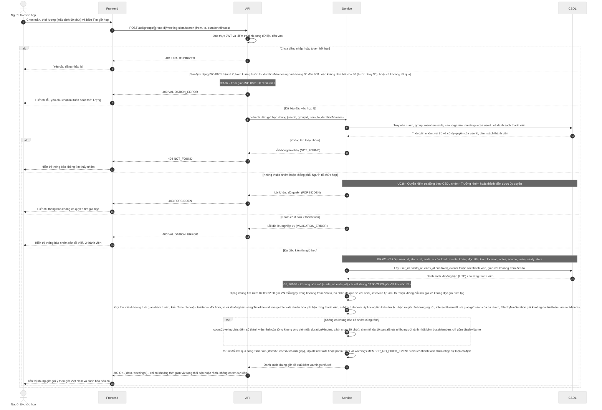
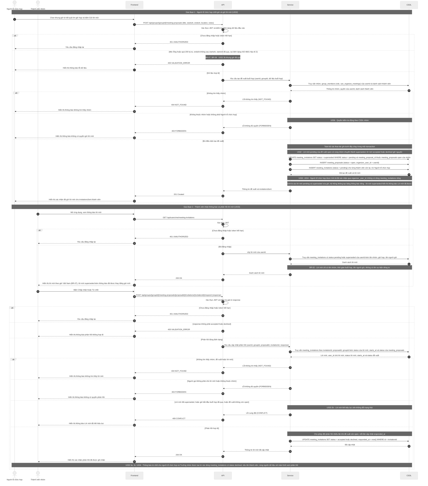
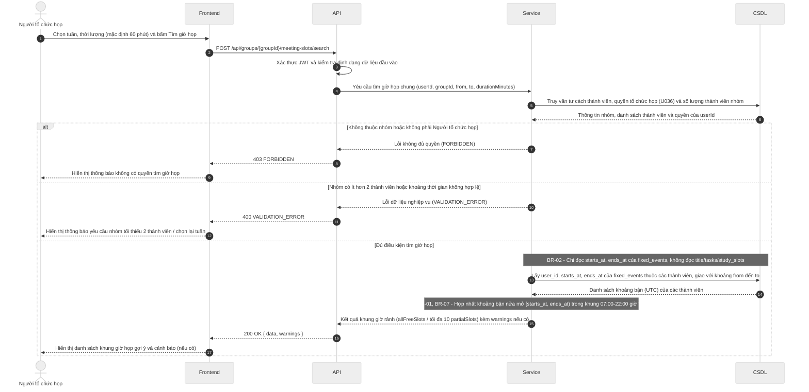

# Đặc tả API (API Spec) – StudySync

> Khung tài liệu theo Template 7. Chủ module viết endpoint của mình, Nhi review. Mỗi endpoint mới hoặc đổi đều cập nhật file này trong cùng PR.
> Ký hiệu: `<nội dung>` là chỗ cần điền (thay cả dấu ngoặc nhọn). Xóa các ghi chú *Hướng dẫn* khi dùng thật.

## Quy ước chung

| Mục | Quy ước |
| --- | --- |
| Định dạng | REST, gửi và trả JSON, mã hóa UTF-8 |
| Tiền tố đường dẫn | `/api` |
| Xác thực | Bearer token (JWT) trong header `Authorization: Bearer <token>` |
| Thời gian | Chuỗi ISO 8601 theo UTC, ví dụ `2026-11-05T13:00:00Z`; nhận cả dạng có mili giây (`2026-11-05T13:00:00.000Z`), không nhận offset như `+07:00` và không nhận chuỗi thiếu hậu tố `Z` (trả `400 VALIDATION_ERROR`, BR-07); dữ liệu API trả về luôn có mili giây, ví dụ `2026-11-05T13:00:00.000Z`; frontend tự hiển thị giờ Việt Nam |
| Tên trường JSON | camelCase cho toàn bộ (ví dụ `dueAt`, `startsAt`, `durationMinutes`). Backend đổi qua lại với tên cột snake_case của CSDL, không đổi tên cột theo API |
| Khoảng thời gian | Đối tượng `{ "startsAt": "...", "endsAt": "..." }` (kiểu `TimeSlot` trong `docs/interval-library.md`), hai giá trị theo dòng Thời gian ở trên, hiểu theo nửa mở `[startsAt, endsAt)`. Khoảng tìm kiếm gửi lên dùng `from` và `to`, cũng nửa mở `[from, to)` |
| Định danh | `id` là chuỗi UUID, theo kiểu khóa chính của CSDL |
| Việc đã xóa (từ #57) | Khung học còn lưu khi việc gốc bị xóa thì có `taskId: null`. API không trả tên việc cũ; giao diện hiện nhãn mặc định, ví dụ "Việc đã xóa" (đã chốt ở việc 3, `#56`) |
| Quyền riêng tư (BR-02) | API dành cho nhóm chỉ trả trạng thái bận hoặc rảnh, không trả tên sự kiện |
| Dạng phản hồi | Thành công bọc kết quả trong `data`; thành công nhưng có cảnh báo (BR-01, BR-04) thì thêm `warnings` ngang hàng với `data`; lỗi dùng `error`. Mỗi phản hồi chỉ có `data` hoặc `error` (trừ `GET /health`, xem mục "Dạng phản hồi thành công"), không bao giờ có cả hai; HTTP 204 (xóa thành công) không có nội dung. Chi tiết xem các mục bên dưới. |

## Dạng phản hồi thành công

> Trạng thái: **đã chốt** (Nhi, việc "Chốt quy ước chung của API", `#56`). Lý do: một số quy định nghiệp vụ (BR-01, BR-04) cho gọi thành công nhưng kèm cảnh báo, nên cần chỗ đặt cảnh báo tách khỏi các trường của đối tượng.

Áp dụng cho mọi phản hồi thành công có nội dung (HTTP 200, 201). HTTP 204 không có nội dung, xem mục "Mã HTTP khi thành công".

**Thành công thường:**

```json
{
  "data": { }
}
```

**Thành công kèm cảnh báo (vẫn HTTP 200 hoặc 201):**

```json
{
  "data": {
    "id": "550e8400-e29b-41d4-a716-446655440000",
    "title": "Ôn tập CSDL",
    "dueAt": "2026-11-08T10:00:00.000Z"
  },
  "warnings": [
    {
      "code": "DEADLINE_PASSED",
      "message": "Hạn hoàn thành đã qua so với thời điểm hiện tại (BR-04)."
    }
  ]
}
```

- `data`: nội dung chính của endpoint (đối tượng hoặc danh sách bọc trong đối tượng, ví dụ `data.slots`).
- `warnings`: chỉ có khi có cảnh báo, không trả mảng rỗng. Mỗi phần tử có dạng `{ code, message }`, có thể kèm `details` (xem mục "Mã HTTP khi thành công").
- Phản hồi lỗi (4xx, 5xx) dùng dạng riêng ở mục sau, không có `data`.
- Ngoại lệ duy nhất: `GET /health` (kiểm tra máy chủ còn chạy, đường dẫn nằm ngoài tiền tố `/api`) giữ nguyên dạng `{ "status": "ok", "time": "2026-11-05T13:00:00.000Z" }`, không bọc `data`. `time` theo dòng Thời gian ở Quy ước chung. Đã chốt ở việc 3 (`#56`).

Bảng mã cảnh báo dùng chung (đã chốt ở việc 3 – `#56`):

| Mã cảnh báo (`code`) | Quy tắc | Ý nghĩa / Khi nào trả về |
| --- | --- | --- |
| `FIXED_EVENT_OVERLAP` | BR-01 | Sự kiện cố định vừa tạo/nhập bị chồng thời gian với sự kiện cố định khác (vẫn cho lưu thành công kèm cảnh báo) |
| `DEADLINE_PASSED` | BR-04 | Việc cần làm được lưu với hạn hoàn thành (`dueAt`) đã qua so với thời điểm hiện tại |
| `MEMBER_NO_FIXED_EVENTS` | Yêu cầu 4.1 (U031) | Khi tìm giờ họp chung mà trong nhóm có thành viên chưa nhập sự kiện cố định nào trong tuần được chọn |
| `NO_TASKS_TO_SCHEDULE` | Yêu cầu 3.6 (U021) | Gọi xếp lịch khi không có việc cần làm chưa hoàn thành; không tạo đề xuất |
| `NO_MAKEUP_SLOT` | BR-01, yêu cầu 3.14 (U022) | Báo lỡ nhưng không còn khung giờ bù trong 7 ngày, trước hạn chót; khung vẫn ghi nhận "Bỏ lỡ" |

## Mã HTTP khi thành công

> Bổ sung của Nhi cho Quy ước chung (việc 3, `#56`).

| Mã HTTP | Khi nào | Nội dung trả về |
| --- | --- | --- |
| 200 | Đọc, sửa, hoặc thao tác không tạo tài nguyên mới (ví dụ tìm giờ họp, đề xuất khung giờ) thành công | Dạng phản hồi thành công ở trên |
| 201 | Tạo tài nguyên mới thành công | Dạng phản hồi thành công ở trên, `data` là tài nguyên vừa tạo |
| 204 | Xóa thành công | Body rỗng, không gửi chuỗi JSON nào (không trả `{ "data": null }` hay `{ "data": {} }`) |

Phần tử của `warnings` có thể kèm `details` (tùy chọn, cùng dạng `[{ "field", "issue" }]` với `error.details`) khi cảnh báo gắn với một trường cụ thể để frontend hiện ngay tại trường nhập. Ví dụ `DEADLINE_PASSED` kèm `"details": [{ "field": "dueAt", "issue": "đã qua" }]`.

## Dạng thông báo lỗi thống nhất

```json
{
  "error": {
    "code": "VALIDATION_ERROR",
    "message": "Thời lượng phải lớn hơn 0",
    "details": [{ "field": "durationMinutes", "issue": "phải lớn hơn 0" }]
  }
}
```

## Bảng mã lỗi dùng chung

| Mã HTTP | error.code | Khi nào |
| --- | --- | --- |
| 400 | VALIDATION_ERROR | Dữ liệu gửi lên sai định dạng hoặc thiếu trường bắt buộc |
| 401 | UNAUTHORIZED | Chưa đăng nhập hoặc token hết hạn |
| 403 | FORBIDDEN | Đã đăng nhập nhưng không có quyền (ví dụ không thuộc nhóm) |
| 404 | NOT_FOUND | Không tìm thấy tài nguyên |
| 409 | CONFLICT | Khung giờ do hệ thống xếp trùng lịch cố định (BR-01) hoặc dữ liệu bị trùng; hai sự kiện cố định chồng nhau (nhập tay hoặc import) không trả lỗi này mà chỉ cảnh báo |
| 413 | FILE_TOO_LARGE | File import (.ics, .csv, ảnh) vượt 5 MB, tính 1 MB = 1024 × 1024 byte (BR-05) |
| 422 | FILE_INVALID | File import sai định dạng hoặc có dòng không hợp lệ (kể cả tên việc quá 200 ký tự, BR-08); trả kèm tối đa 20 dòng lỗi đầu tiên (BR-06); với .ics báo theo sự kiện kèm số dòng bắt đầu khối VEVENT; lỗi gồm thiếu tên hoặc giờ bắt đầu, giờ kết thúc không sau giờ bắt đầu, TZID không nhận ra được, tệp không có sự kiện nào; mỗi phần tử details có dạng `{line?, issue}`: `line` bỏ trống khi lỗi cấp tệp (tệp rỗng, không có sự kiện, sai định dạng, ảnh), còn lỗi trong một VEVENT vẫn có `line` là dòng bắt đầu khối |
| 500 | INTERNAL_ERROR | Lỗi máy chủ, không lộ chi tiết kỹ thuật cho người dùng |

## Danh sách endpoint theo module (tổng quan, điền dần)

| Module | Phương thức và đường dẫn | Mô tả ngắn | Trạng thái |
| --- | --- | --- | --- |
| TV1 | POST /api/auth/register | Đăng ký tài khoản mới | Nháp |
| TV1 | POST /api/auth/login | Đăng nhập hệ thống | Nháp |
| TV1 | GET /api/users/me | Lấy thông tin tài khoản cá nhân | Nháp |
| TV1 | PATCH /api/users/me | Cập nhật tên hiển thị | Nháp |
| TV1 | POST /api/groups | Tạo nhóm đồ án mới | Nháp |
| TV1 | GET /api/groups | Danh sách nhóm của người dùng | Nháp |
| TV1 | GET /api/groups/{groupId} | Chi tiết nhóm và danh sách thành viên | Nháp |
| TV1 | POST /api/groups/{groupId}/invite-link | Lấy hoặc tạo liên kết mời | Nháp |
| TV1 | POST /api/groups/{groupId}/invite-link/regenerate | Tạo lại liên kết mời mới | Nháp |
| TV1 | GET /api/invitations/{token} | Xem thông tin lời mời tham gia nhóm | Nháp |
| TV1 | POST /api/invitations/{token}/join | Tham gia nhóm bằng liên kết mời | Nháp |
| TV1 | PUT /api/groups/{groupId}/leader | Chuyển quyền Trưởng nhóm | Nháp |
| TV1 | POST /api/groups/{groupId}/leave | Rời nhóm đồ án | Nháp |
| TV2 | GET /api/events | Lấy danh sách sự kiện cố định theo khoảng thời gian | Nháp |
| TV2 | POST /api/events | Tạo mới sự kiện cố định thủ công | Nháp |
| TV2 | GET /api/events/{eventId} | Lấy chi tiết một sự kiện cố định | Nháp |
| TV2 | PATCH /api/events/{eventId} | Cập nhật thông tin sự kiện cố định | Nháp |
| TV2 | DELETE /api/events/{eventId} | Xóa sự kiện cố định | Nháp |
| TV2 | POST /api/events/import/ics | Nạp lịch từ tệp iCalendar (.ics) | Nháp |
| TV2 | POST /api/events/import/csv | Nạp lịch từ tệp bảng tính (.csv) | Nháp |
| TV2 | GET /api/tasks | Danh sách việc cần làm cá nhân | Nháp |
| TV2 | POST /api/tasks | Tạo việc cần làm mới | Nháp |
| TV2 | GET /api/tasks/{taskId} | Lấy chi tiết một việc cần làm | Nháp |
| TV2 | PATCH /api/tasks/{taskId} | Cập nhật việc cần làm hoặc đánh dấu hoàn thành | Nháp |
| TV2 | DELETE /api/tasks/{taskId} | Xóa việc cần làm | Nháp |
| TV2 | GET /api/schedule/week | Xem lịch tuần tổng hợp | Nháp |
| TV3 | POST /api/scheduler/auto-plan | Đề xuất khung giờ học | Nháp |
| TV3 | POST /api/scheduler/confirm | Chấp nhận hoặc từ chối đề xuất, chọn khung giờ bù | Nháp |
| TV3 | POST /api/scheduler/missed-session | Báo lỡ khung giờ học và nhận khung giờ bù | Nháp |
| TV3 | POST /api/scheduler/replan | Đề xuất tái xếp lịch khi có việc phát sinh | Nháp |
| TV3 | POST /api/scheduler/completed-session | Đánh dấu khung giờ học đã học xong | Nháp |
| TV4 | `POST /api/groups/{groupId}/meeting-slots/search` | Tìm giờ họp chung | Nháp |
| TV4 | `POST /api/groups/{groupId}/meeting-proposals` | Tạo đề xuất buổi họp và gửi lời mời | Nháp |
| TV4 | `POST /api/groups/{groupId}/meeting-proposals/{proposalId}/invitations/{invitationId}/respond` | Phản hồi lời mời tham dự buổi họp | Nháp |
| TV4 | `GET /api/users/me/meeting-invitations` | Lấy danh sách lời mời họp của tôi (chờ phản hồi hoặc đã bị thay thế) | Nháp |
| TV4 | `GET /api/users/me/reminders` | Lấy danh sách nhắc việc sắp đến hạn | Nháp |
| TV5 | `GET /api/groups/{groupId}/cards` | Danh sách và lọc thẻ Kanban | Nháp |
| TV5 | `POST /api/groups/{groupId}/cards` | Tạo thẻ Kanban mới | Nháp |
| TV5 | `PATCH /api/groups/{groupId}/cards/{cardId}` | Sửa tên và hạn chót thẻ Kanban | Nháp |
| TV5 | `DELETE /api/groups/{groupId}/cards/{cardId}` | Xóa thẻ Kanban | Nháp |
| TV5 | `PATCH /api/groups/{groupId}/cards/{cardId}/status` | Chuyển cột trạng thái thẻ Kanban | Nháp |
| TV5 | `PATCH /api/groups/{groupId}/cards/{cardId}/assignee` | Giao hoặc bỏ giao thẻ Kanban | Nháp |
| TV5 | `GET /api/statistics/weekly` | Xem thống kê giờ học theo tuần | Nháp |

## Mẫu một endpoint (sao chép cho mỗi endpoint)

````markdown
### <PHƯƠNG THỨC> /api/<đường-dẫn>
Module: TV<x> · Story: US-<xx> · Người viết: <tên> · Trạng thái: <Nháp / Đã chốt / Đã làm>
Mô tả: <Một câu, endpoint làm gì>
Quyền: <Ai gọi được: chủ tài khoản / thành viên nhóm / trưởng nhóm>

**Tham số đường dẫn và query**

| Tên | Kiểu | Bắt buộc | Mô tả |
| --- | --- | --- | --- |

**Nội dung gửi lên (body)**

```json
<JSON mẫu>
```

**Kết quả thành công (<mã HTTP>)**

```json
{ "data": { } }
```

**Cảnh báo có thể gặp** (xóa mục này nếu endpoint không trả cảnh báo)

| Mã cảnh báo (`warnings[].code`) | Điều kiện |
| --- | --- |

**Lỗi có thể gặp**

| Mã HTTP | error.code | Điều kiện |
| --- | --- | --- |

Ghi chú: <Quy định nghiệp vụ áp dụng, giới hạn, lưu ý cho frontend>
````

---

## TV1 – Tài khoản và nhóm

<!-- Vùng của TV1: chỉ sửa trong vùng này để tránh xung đột khi merge. -->

<!-- TV1:BEGIN -->

Trạng thái: Nháp · Người viết: Thư H.A. · Người review: Nhi · Cập nhật: 10/11/2026

Phạm vi: US-01 đến US-07. Use case: U001 đến U007. Mọi endpoint theo quy ước chung ở đầu file (REST, JSON UTF-8, tiền tố `/api`, camelCase, id là UUID, thời gian ISO 8601 hậu tố Z và luôn có mili giây khi API trả về, dạng phản hồi `data` hoặc `error`).

### Quy định áp dụng cho TV1

| Mục | Quy định |
| --- | --- |
| Mật khẩu | Từ 8 đến 72 ký tự, gồm cả chữ cái và chữ số (US-01, yêu cầu 1.2; dùng thuật toán bcrypt qua thư viện bcryptjs cost 10, kiểm tra Buffer.byteLength(password, 'utf8') <= 72) |
| Phiên đăng nhập | JWT trong header `Authorization: Bearer <token>`, hiệu lực 7 ngày (`JWT_EXPIRES_IN=7d`). Token gồm các claim `sub` (id người dùng), `iat`, `exp`. Hết hạn thì trả 401 UNAUTHORIZED và người dùng đăng nhập lại, hệ thống không có cơ chế làm mới token |
| Đăng xuất | Không có endpoint. Frontend xóa token đã lưu. Phiên chấm dứt về phía người dùng, còn token cũ hết hạn tự nhiên sau 7 ngày (yêu cầu 1.4, U002) |
| Liên kết mời | Có hiệu lực 7 ngày. Mỗi nhóm chỉ có một liên kết còn hiệu lực. Tạo lại thì liên kết cũ vô hiệu ngay (U004, yêu cầu 1.6) |
| Tên nhóm, tên hiển thị (BR-08) | Backend chuẩn hóa NFC, cắt khoảng trắng hai đầu rồi đếm theo code point. Tối đa 100 ký tự, tối thiểu 1 ký tự. Giá trị lưu và giá trị trả về là chuỗi đã chuẩn hóa. Không tự cắt tên quá dài, chỉ báo lỗi |
| Email | Backend cắt khoảng trắng và đổi chữ thường trước khi kiểm tra trùng, lưu và đối chiếu. Giá trị `email` trả về luôn là dạng đã chuẩn hóa |
| Phân quyền | Quyền Trưởng nhóm được kiểm tra ở API, trả 403 FORBIDDEN khi không đủ quyền, không chỉ ẩn nút ở giao diện |
| Riêng tư (BR-02) | Danh sách thành viên chỉ trả `userId`, `displayName`, `role`, `canOrganizeMeetings` và thời điểm vào nhóm `joinedAt`. Không trả email, không trả dữ liệu lịch |

### Kiểu dữ liệu dùng chung trong TV1

User:

```json
{
  "id": "0b8f6f5e-2c1a-4c7e-9d4b-3a5f1e7c9a10",
  "email": "an.nguyen@example.com",
  "displayName": "Nguyễn Văn An",
  "createdAt": "2026-11-05T13:00:00.000Z"
}
```

GroupSummary (nhóm nhìn từ phía người đang đăng nhập):

```json
{
  "id": "7d2c9a51-6b3e-4f08-8a1d-5e9c2b4f7a33",
  "name": "Đồ án NMCNPM nhóm 04",
  "myRole": "leader",
  "memberCount": 5,
  "createdAt": "2026-11-05T13:00:00.000Z"
}
```

Member:

```json
{
  "userId": "0b8f6f5e-2c1a-4c7e-9d4b-3a5f1e7c9a10",
  "displayName": "Nguyễn Văn An",
  "role": "leader",
  "canOrganizeMeetings": false,
  "joinedAt": "2026-11-05T13:00:00.000Z"
}
```

`role` nhận `leader` hoặc `member`. `canOrganizeMeetings` chỉ có nghĩa với `member` (xem U036), Trưởng nhóm luôn là `false` vì mặc nhiên có quyền.

### Danh sách endpoint TV1

| Phương thức và đường dẫn | Mô tả ngắn | Story | Quyền | Trạng thái |
| --- | --- | --- | --- | --- |
| POST /api/auth/register | Đăng ký | US-01 | Công khai | Nháp |
| POST /api/auth/login | Đăng nhập | US-02 | Công khai | Nháp |
| GET /api/users/me | Lấy thông tin cá nhân | US-02, US-06 | Đã đăng nhập | Nháp |
| PATCH /api/users/me | Cập nhật tên hiển thị | US-06 | Đã đăng nhập | Nháp |
| POST /api/groups | Tạo nhóm | US-03 | Đã đăng nhập | Nháp |
| GET /api/groups | Danh sách nhóm của tôi | US-03, US-07 | Đã đăng nhập | Nháp |
| GET /api/groups/{groupId} | Chi tiết nhóm và danh sách thành viên | US-04, US-07 | Thành viên nhóm | Nháp |
| POST /api/groups/{groupId}/invite-link | Lấy liên kết mời | US-04 | Trưởng nhóm | Nháp |
| POST /api/groups/{groupId}/invite-link/regenerate | Tạo lại liên kết mời | US-04 | Trưởng nhóm | Nháp |
| GET /api/invitations/{token} | Xem tên nhóm của lời mời | US-05 | Công khai | Nháp |
| POST /api/invitations/{token}/join | Tham gia nhóm bằng liên kết mời | US-05 | Đã đăng nhập | Nháp |
| PUT /api/groups/{groupId}/leader | Chuyển quyền Trưởng nhóm | US-07 | Trưởng nhóm | Nháp |
| POST /api/groups/{groupId}/leave | Rời nhóm | US-07 | Thành viên nhóm | Nháp |

Ghi chú về phạm vi: endpoint bật hoặc tắt quyền ủy quyền tổ chức họp (U036) thuộc TV4, ghi vào cột `group_members.can_organize_meetings` trong từ điển dữ liệu. Danh sách thành viên ở `GET /api/groups/{groupId}` đã trả cột này để giao diện U036 dùng.

---

### POST /api/auth/register

Module: TV1 · Story: US-01 · Người viết: Thư H.A. · Trạng thái: Nháp  
Mô tả: tạo tài khoản mới và đăng nhập luôn, trả token.  
Quyền: công khai.

**Tham số đường dẫn và query:** Không có.

**Nội dung gửi lên (body)**

| Tên | Kiểu | Bắt buộc | Mô tả |
| --- | --- | --- | --- |
| displayName | string | Có | Họ tên dùng làm tên hiển thị. Tối đa 100 ký tự sau chuẩn hóa (BR-08) |
| email | string | Có | Địa chỉ email đúng định dạng, chưa gắn với tài khoản khác |
| password | string | Có | Từ 8 đến 72 ký tự, gồm cả chữ cái và chữ số |

```json
{
  "displayName": "Nguyễn Văn An",
  "email": "An.Nguyen@Example.com",
  "password": "matkhau2026"
}
```

Ô nhập lại mật khẩu chỉ kiểm tra ở giao diện, không gửi lên API.

**Kết quả thành công (201)**

```json
{
  "data": {
    "token": "eyJhbGciOiJIUzI1NiIsInR5cCI6IkpXVCJ9.<payload>.<signature>",
    "expiresAt": "2026-11-12T13:00:00.000Z",
    "user": {
      "id": "0b8f6f5e-2c1a-4c7e-9d4b-3a5f1e7c9a10",
      "email": "an.nguyen@example.com",
      "displayName": "Nguyễn Văn An",
      "createdAt": "2026-11-05T13:00:00.000Z"
    }
  }
}
```

`expiresAt` là thời điểm token hết hạn, bằng lúc cấp cộng 7 ngày. Ví dụ trên đã chuẩn hóa email về chữ thường.

**Lỗi có thể gặp**

| Mã HTTP | error.code | Điều kiện |
| --- | --- | --- |
| 400 | VALIDATION_ERROR | Họ tên rỗng, chỉ gồm khoảng trắng hoặc quá 100 ký tự; email sai định dạng; mật khẩu dưới 8 ký tự, quá 72 ký tự hoặc thiếu chữ cái hoặc chữ số |
| 409 | CONFLICT | Email đã được dùng cho tài khoản khác |
| 500 | INTERNAL_ERROR | Lỗi máy chủ |

Ví dụ lỗi 400:

```json
{
  "error": {
    "code": "VALIDATION_ERROR",
    "message": "Dữ liệu đăng ký không hợp lệ",
    "details": [
      { "field": "displayName", "issue": "Họ tên không được để trống và tối đa 100 ký tự" },
      { "field": "email", "issue": "Địa chỉ email không đúng định dạng" },
      { "field": "password", "issue": "Mật khẩu từ 8 đến 72 ký tự, gồm cả chữ cái và chữ số" }
    ]
  }
}
```

Ví dụ lỗi 409:

```json
{
  "error": {
    "code": "CONFLICT",
    "message": "Email này đã được sử dụng. Vui lòng đăng nhập hoặc sử dụng email khác.",
    "details": [{ "field": "email", "issue": "đã được sử dụng" }]
  }
}
```

**Ghi chú:** BR-08. Việc kiểm tra email trùng dựa vào ràng buộc `uq_users_email` (xem từ điển dữ liệu), nên hai yêu cầu đăng ký đồng thời với cùng email chỉ có một yêu cầu thành công, yêu cầu còn lại nhận 409. Phiên bản đầu không gửi email kích hoạt. Nếu người dùng đến từ liên kết mời, frontend dùng token vừa nhận rồi gọi tiếp `POST /api/invitations/{token}/join`.

---

### POST /api/auth/login

Module: TV1 · Story: US-02 · Người viết: Thư H.A. · Trạng thái: Nháp  
Mô tả: đăng nhập bằng email và mật khẩu, trả token có hiệu lực 7 ngày.  
Quyền: công khai.

**Tham số đường dẫn và query:** Không có.

**Nội dung gửi lên (body)**

| Tên | Kiểu | Bắt buộc | Mô tả |
| --- | --- | --- | --- |
| email | string | Có | Email đã đăng ký. Backend chuẩn hóa chữ thường và cắt khoảng trắng trước khi tìm |
| password | string | Có | Mật khẩu |

```json
{
  "email": "an.nguyen@example.com",
  "password": "matkhau2026"
}
```

**Kết quả thành công (200)**

```json
{
  "data": {
    "token": "eyJhbGciOiJIUzI1NiIsInR5cCI6IkpXVCJ9.<payload>.<signature>",
    "expiresAt": "2026-11-12T13:00:00.000Z",
    "user": {
      "id": "0b8f6f5e-2c1a-4c7e-9d4b-3a5f1e7c9a10",
      "email": "an.nguyen@example.com",
      "displayName": "Nguyễn Văn An",
      "createdAt": "2026-11-05T13:00:00.000Z"
    }
  }
}
```

**Lỗi có thể gặp**

| Mã HTTP | error.code | Điều kiện |
| --- | --- | --- |
| 400 | VALIDATION_ERROR | Thiếu email hoặc mật khẩu, hoặc email không đúng dạng chuỗi |
| 401 | UNAUTHORIZED | Email không tồn tại hoặc mật khẩu sai. Thông báo giống nhau cho cả hai trường hợp |
| 500 | INTERNAL_ERROR | Lỗi máy chủ |

Ví dụ lỗi 401:

```json
{
  "error": {
    "code": "UNAUTHORIZED",
    "message": "Email hoặc mật khẩu không chính xác"
  }
}
```

**Ghi chú:** không nêu cụ thể email hay mật khẩu sai, và không đặt `details` cho lỗi này, để không lộ email nào đã đăng ký. Thời gian xử lý của hai trường hợp (email không tồn tại, mật khẩu sai) nên tương đương nhau, tức vẫn so khớp với một bản băm giả khi không tìm thấy email.

---

### GET /api/users/me

Module: TV1 · Story: US-02, US-06 · Người viết: Thư H.A. · Trạng thái: Nháp  
Mô tả: lấy thông tin tài khoản đang đăng nhập.  
Quyền: chủ tài khoản (đã đăng nhập).

**Tham số đường dẫn và query:** Không có.

**Kết quả thành công (200)**

```json
{
  "data": {
    "id": "0b8f6f5e-2c1a-4c7e-9d4b-3a5f1e7c9a10",
    "email": "an.nguyen@example.com",
    "displayName": "Nguyễn Văn An",
    "createdAt": "2026-11-05T13:00:00.000Z"
  }
}
```

**Lỗi có thể gặp**

| Mã HTTP | error.code | Điều kiện |
| --- | --- | --- |
| 401 | UNAUTHORIZED | Chưa gửi token, token sai hoặc đã hết hạn 7 ngày |
| 500 | INTERNAL_ERROR | Lỗi máy chủ |

**Ghi chú:** frontend gọi endpoint này khi mở lại ứng dụng để biết token còn hiệu lực hay không. Không bao giờ trả `passwordHash`.

---

### PATCH /api/users/me

Module: TV1 · Story: US-06 · Người viết: Thư H.A. · Trạng thái: Nháp  
Mô tả: sửa tên hiển thị của tài khoản đang đăng nhập.  
Quyền: chủ tài khoản.

**Tham số đường dẫn và query:** Không có.

**Nội dung gửi lên (body)**

| Tên | Kiểu | Bắt buộc | Mô tả |
| --- | --- | --- | --- |
| displayName | string | Có | Tên hiển thị mới, tối đa 100 ký tự sau chuẩn hóa NFC (BR-08) |

```json
{ "displayName": "Nguyễn Văn An (K24)" }
```

**Kết quả thành công (200)**

```json
{
  "data": {
    "id": "0b8f6f5e-2c1a-4c7e-9d4b-3a5f1e7c9a10",
    "email": "an.nguyen@example.com",
    "displayName": "Nguyễn Văn An (K24)",
    "createdAt": "2026-11-05T13:00:00.000Z"
  }
}
```

**Lỗi có thể gặp**

| Mã HTTP | error.code | Điều kiện |
| --- | --- | --- |
| 400 | VALIDATION_ERROR | Tên rỗng, chỉ gồm khoảng trắng hoặc quá 100 ký tự. Dữ liệu cũ giữ nguyên |
| 401 | UNAUTHORIZED | Chưa đăng nhập hoặc token hết hạn |
| 500 | INTERNAL_ERROR | Lỗi máy chủ |

Ví dụ lỗi 400:

```json
{
  "error": {
    "code": "VALIDATION_ERROR",
    "message": "Tên hiển thị không được để trống và tối đa 100 ký tự",
    "details": [
      { "field": "displayName", "issue": "không được để trống và tối đa 100 ký tự" }
    ]
  }
}
```

**Ghi chú:** BR-08. Email chưa cho sửa ở phiên bản này. Tên mới hiện ngay trong danh sách thành viên của mọi nhóm vì danh sách đó đọc tên từ `users.display_name`.

---

### POST /api/groups

Module: TV1 · Story: US-03 · Người viết: Thư H.A. · Trạng thái: Nháp  
Mô tả: tạo nhóm mới, người tạo trở thành Trưởng nhóm của nhóm đó.  
Quyền: đã đăng nhập.

**Tham số đường dẫn và query:** Không có.

**Nội dung gửi lên (body)**

| Tên | Kiểu | Bắt buộc | Mô tả |
| --- | --- | --- | --- |
| name | string | Có | Tên nhóm, tối đa 100 ký tự sau chuẩn hóa NFC, tối thiểu 1 ký tự (BR-08) |

```json
{ "name": "Đồ án NMCNPM nhóm 04" }
```

**Kết quả thành công (201)**

```json
{
  "data": {
    "id": "7d2c9a51-6b3e-4f08-8a1d-5e9c2b4f7a33",
    "name": "Đồ án NMCNPM nhóm 04",
    "myRole": "leader",
    "memberCount": 1,
    "createdAt": "2026-11-05T13:00:00.000Z"
  }
}
```

**Lỗi có thể gặp**

| Mã HTTP | error.code | Điều kiện |
| --- | --- | --- |
| 400 | VALIDATION_ERROR | Tên rỗng, chỉ gồm khoảng trắng hoặc quá 100 ký tự. Không tạo nhóm |
| 401 | UNAUTHORIZED | Chưa đăng nhập hoặc token hết hạn |
| 500 | INTERNAL_ERROR | Lỗi máy chủ |

Ví dụ lỗi 400:

```json
{
  "error": {
    "code": "VALIDATION_ERROR",
    "message": "Tên nhóm không được để trống và tối đa 100 ký tự",
    "details": [
      { "field": "name", "issue": "không được để trống và tối đa 100 ký tự" }
    ]
  }
}
```

**Ghi chú:** nhóm và dòng Trưởng nhóm được tạo trong cùng một transaction nên không có nhóm nào thiếu Trưởng nhóm. Một sinh viên được tạo và tham gia nhiều nhóm, vai trò tính theo từng nhóm. Cho phép trùng tên nhóm.

---

### GET /api/groups

Module: TV1 · Story: US-03, US-07 · Người viết: Thư H.A. · Trạng thái: Nháp  
Mô tả: liệt kê các nhóm người dùng đang tham gia, mới tham gia sau cùng đứng trước.  
Quyền: đã đăng nhập.

**Tham số đường dẫn và query:** Không có.

**Kết quả thành công (200)**

```json
{
  "data": {
    "groups": [
      {
        "id": "7d2c9a51-6b3e-4f08-8a1d-5e9c2b4f7a33",
        "name": "Đồ án NMCNPM nhóm 04",
        "myRole": "leader",
        "memberCount": 5,
        "createdAt": "2026-11-05T13:00:00.000Z"
      }
    ]
  }
}
```

Chưa có nhóm nào thì `groups` là mảng rỗng, vẫn trả 200.

**Lỗi có thể gặp**

| Mã HTTP | error.code | Điều kiện |
| --- | --- | --- |
| 401 | UNAUTHORIZED | Chưa đăng nhập hoặc token hết hạn |
| 500 | INTERNAL_ERROR | Lỗi máy chủ |

**Ghi chú:** Danh sách nhóm được sắp xếp theo thời điểm tham gia mới nhất lên trước (`joinedAt DESC`). Trả mảng rỗng `groups: []` khi người dùng chưa tham gia nhóm nào.

---

### GET /api/groups/{groupId}

Module: TV1 · Story: US-04, US-07 · Người viết: Thư H.A. · Trạng thái: Nháp  
Mô tả: lấy thông tin nhóm kèm danh sách thành viên. Giao diện dùng để hiện mục Thành viên và để chọn người kế nhiệm khi Trưởng nhóm rời nhóm.  
Quyền: thành viên của nhóm.

**Tham số đường dẫn và query**

| Tên | Kiểu | Bắt buộc | Mô tả |
| --- | --- | --- | --- |
| groupId | uuid | Có | Mã nhóm |

**Kết quả thành công (200)**

```json
{
  "data": {
    "id": "7d2c9a51-6b3e-4f08-8a1d-5e9c2b4f7a33",
    "name": "Đồ án NMCNPM nhóm 04",
    "myRole": "leader",
    "createdAt": "2026-11-05T13:00:00.000Z",
    "members": [
      {
        "userId": "0b8f6f5e-2c1a-4c7e-9d4b-3a5f1e7c9a10",
        "displayName": "Nguyễn Văn An",
        "role": "leader",
        "canOrganizeMeetings": false,
        "joinedAt": "2026-11-05T13:00:00.000Z"
      },
      {
        "userId": "5c1e8d27-9a4b-4e3f-b6d1-2f7a0c8e4b19",
        "displayName": "Trần Thị Bình",
        "role": "member",
        "canOrganizeMeetings": true,
        "joinedAt": "2026-11-06T02:30:00.000Z"
      }
    ]
  }
}
```

Danh sách `members` xếp Trưởng nhóm trước, sau đó theo `joinedAt` tăng dần.

**Lỗi có thể gặp**

| Mã HTTP | error.code | Điều kiện |
| --- | --- | --- |
| 401 | UNAUTHORIZED | Chưa đăng nhập hoặc token hết hạn |
| 403 | FORBIDDEN | Người gọi không thuộc nhóm |
| 404 | NOT_FOUND | Không có nhóm với mã này |
| 500 | INTERNAL_ERROR | Lỗi máy chủ |

**Ghi chú:** BR-02. Không trả email và không trả dữ liệu lịch của thành viên.

---

### POST /api/groups/{groupId}/invite-link

Module: TV1 · Story: US-04 · Người viết: Thư H.A. · Trạng thái: Nháp  
Mô tả: lấy liên kết mời của nhóm. Còn hiệu lực thì trả lại đúng liên kết đó, chưa có hoặc đã hết hạn thì tạo liên kết mới có hiệu lực 7 ngày.  
Quyền: Trưởng nhóm của nhóm.

**Tham số đường dẫn và query**

| Tên | Kiểu | Bắt buộc | Mô tả |
| --- | --- | --- | --- |
| groupId | uuid | Có | Mã nhóm |

**Nội dung gửi lên (body):** Không có.

**Kết quả thành công (200 hoặc 201)**

200 khi trả lại liên kết đang còn hạn, 201 khi vừa tạo mới liên kết:

```json
{
  "data": {
    "token": "q7G2mXk9VbT4nYc1ZsLd8WpRfH3uJaE0oIiKxN5vMtA",
    "inviteUrl": "https://studysync.example.com/invite/q7G2mXk9VbT4nYc1ZsLd8WpRfH3uJaE0oIiKxN5vMtA",
    "expiresAt": "2026-11-12T13:00:00.000Z"
  }
}
```

**Lỗi có thể gặp**

| Mã HTTP | error.code | Điều kiện |
| --- | --- | --- |
| 401 | UNAUTHORIZED | Chưa đăng nhập hoặc token hết hạn |
| 403 | FORBIDDEN | Người gọi không phải Trưởng nhóm của nhóm này, kể cả Thành viên nhóm thường gọi trực tiếp API |
| 404 | NOT_FOUND | Không có nhóm với mã này |
| 500 | INTERNAL_ERROR | Lỗi máy chủ |

**Ghi chú:** dùng POST dù có lúc chỉ trả lại liên kết cũ, vì endpoint có thể tạo dữ liệu. Gọi lặp lại là an toàn: không bao giờ sinh ra hai liên kết còn hiệu lực cho một nhóm. Phần đầu của `inviteUrl` lấy từ biến môi trường địa chỉ frontend (`CORS_ORIGIN`, chỉ chứa một địa chỉ duy nhất). `token` và `inviteUrl` chỉ trả cho Trưởng nhóm.

---

### POST /api/groups/{groupId}/invite-link/regenerate

Module: TV1 · Story: US-04 · Người viết: Thư H.A. · Trạng thái: Nháp  
Mô tả: tạo liên kết mời mới, liên kết cũ vô hiệu ngay lập tức.  
Quyền: Trưởng nhóm của nhóm.

**Tham số đường dẫn và query**

| Tên | Kiểu | Bắt buộc | Mô tả |
| --- | --- | --- | --- |
| groupId | uuid | Có | Mã nhóm |

**Nội dung gửi lên (body):** Không có.

**Kết quả thành công (201)**

```json
{
  "data": {
    "token": "k9VbT4nYc1ZsLd8WpRfH3uJaE0oIiKxN5vMtAq7G2mX",
    "inviteUrl": "https://studysync.example.com/invite/k9VbT4nYc1ZsLd8WpRfH3uJaE0oIiKxN5vMtAq7G2mX",
    "expiresAt": "2026-11-12T15:30:00.000Z"
  }
}
```

**Lỗi có thể gặp**

| Mã HTTP | error.code | Điều kiện |
| --- | --- | --- |
| 401 | UNAUTHORIZED | Chưa đăng nhập hoặc token hết hạn |
| 403 | FORBIDDEN | Người gọi không phải Trưởng nhóm của nhóm này |
| 404 | NOT_FOUND | Không có nhóm với mã này |
| 500 | INTERNAL_ERROR | Lỗi máy chủ |

**Ghi chú:** người mở liên kết cũ nhận 404 NOT_FOUND từ `GET /api/invitations/{token}` với cùng thông báo như liên kết hết hạn.

---

### GET /api/invitations/{token}

Module: TV1 · Story: US-05 · Người viết: Thư H.A. · Trạng thái: Nháp  
Mô tả: kiểm tra liên kết mời và lấy tên nhóm để hiện ở màn hình lời mời, trước cả khi người mở đăng nhập.  
Quyền: công khai.

**Tham số đường dẫn và query**

| Tên | Kiểu | Bắt buộc | Mô tả |
| --- | --- | --- | --- |
| token | string | Có | Mã trong liên kết mời |

**Kết quả thành công (200)**

```json
{
  "data": {
    "groupName": "Đồ án NMCNPM nhóm 04",
    "expiresAt": "2026-11-12T13:00:00.000Z"
  }
}
```

**Lỗi có thể gặp**

| Mã HTTP | error.code | Điều kiện |
| --- | --- | --- |
| 404 | NOT_FOUND | Mã không tồn tại, đã hết hạn hoặc đã bị thay bằng liên kết mới. Thông báo: "Liên kết mời không hợp lệ hoặc đã hết hạn" |
| 500 | INTERNAL_ERROR | Lỗi máy chủ |

**Ghi chú:** endpoint công khai nên chỉ trả tên nhóm và hạn của liên kết, không trả số thành viên hay tên thành viên. Không phân biệt "không tồn tại", "hết hạn" và "đã bị thay" trong thông báo, để người ngoài không dò được trạng thái của mã.

---

### POST /api/invitations/{token}/join

Module: TV1 · Story: US-05 · Người viết: Thư H.A. · Trạng thái: Nháp  
Mô tả: người dùng đã đăng nhập tham gia nhóm bằng liên kết mời còn hiệu lực và trở thành Thành viên nhóm.  
Quyền: đã đăng nhập.

**Tham số đường dẫn và query**

| Tên | Kiểu | Bắt buộc | Mô tả |
| --- | --- | --- | --- |
| token | string | Có | Mã trong liên kết mời |

**Nội dung gửi lên (body):** Không có.

**Kết quả thành công (201 hoặc 200)**

201 khi vừa vào nhóm mới, 200 khi người gọi đã là thành viên từ trước:

```json
{
  "data": {
    "group": {
      "id": "7d2c9a51-6b3e-4f08-8a1d-5e9c2b4f7a33",
      "name": "Đồ án NMCNPM nhóm 04",
      "myRole": "member",
      "memberCount": 5,
      "createdAt": "2026-11-05T13:00:00.000Z"
    },
    "alreadyMember": false
  }
}
```

Khi đã là thành viên, `alreadyMember` là `true`, API không tạo thêm dòng thành viên và giữ nguyên vai trò hiện tại. Frontend hiển thị "Bạn đã là thành viên của nhóm này" rồi chuyển vào nhóm.

**Lỗi có thể gặp**

| Mã HTTP | error.code | Điều kiện |
| --- | --- | --- |
| 401 | UNAUTHORIZED | Chưa đăng nhập hoặc token hết hạn |
| 404 | NOT_FOUND | Mã không tồn tại, đã hết hạn, đã bị thay bằng liên kết mới, hoặc nhóm vừa bị xóa. Thông báo: "Liên kết mời không hợp lệ hoặc đã hết hạn" |
| 500 | INTERNAL_ERROR | Lỗi máy chủ |

**Ghi chú:** BR-02. Tư cách thành viên không làm lộ dữ liệu lịch: sau khi vào nhóm, API của nhóm chỉ trả khoảng thời gian bận hoặc rảnh của người mới, không trả tên sự kiện. Mở liên kết nhiều lần chỉ có một dòng thành viên (ràng buộc `uq_group_members_group_id_user_id`). Chưa có giới hạn số thành viên mỗi nhóm.

---

### PUT /api/groups/{groupId}/leader

Module: TV1 · Story: US-07 · Người viết: Thư H.A. · Trạng thái: Nháp  
Mô tả: Trưởng nhóm chuyển quyền Trưởng nhóm cho một Thành viên nhóm khác và ở lại nhóm với vai trò Thành viên nhóm.  
Quyền: Trưởng nhóm của nhóm.

**Tham số đường dẫn và query**

| Tên | Kiểu | Bắt buộc | Mô tả |
| --- | --- | --- | --- |
| groupId | uuid | Có | Mã nhóm |

**Nội dung gửi lên (body)**

| Tên | Kiểu | Bắt buộc | Mô tả |
| --- | --- | --- | --- |
| userId | uuid | Có | Người nhận quyền Trưởng nhóm, phải là thành viên khác của nhóm |

```json
{ "userId": "5c1e8d27-9a4b-4e3f-b6d1-2f7a0c8e4b19" }
```

**Kết quả thành công (200)**

```json
{
  "data": {
    "groupId": "7d2c9a51-6b3e-4f08-8a1d-5e9c2b4f7a33",
    "leaderUserId": "5c1e8d27-9a4b-4e3f-b6d1-2f7a0c8e4b19",
    "myRole": "member"
  }
}
```

**Lỗi có thể gặp**

| Mã HTTP | error.code | Điều kiện |
| --- | --- | --- |
| 400 | VALIDATION_ERROR | Thiếu `userId`, không đúng dạng UUID, hoặc trùng với chính người gọi |
| 401 | UNAUTHORIZED | Chưa đăng nhập hoặc token hết hạn |
| 403 | FORBIDDEN | Người gọi không phải Trưởng nhóm của nhóm này |
| 404 | NOT_FOUND | Không có nhóm với mã này, hoặc người nhận không còn là thành viên của nhóm ("Thành viên không còn trong nhóm") |
| 500 | INTERNAL_ERROR | Lỗi máy chủ |

**Ghi chú:** việc hạ Trưởng nhóm cũ và nâng người mới chạy trong một transaction (xem mục Transaction trong từ điển dữ liệu), nên nhóm không có lúc nào thiếu hoặc thừa Trưởng nhóm. Người nhận quyền bị đặt lại `canOrganizeMeetings` về `false` vì Trưởng nhóm mặc nhiên có quyền tổ chức họp. Nếu Trưởng nhóm muốn rời hẳn nhóm thì gọi `POST /api/groups/{groupId}/leave` kèm `successorId`, không cần gọi endpoint này trước. Chức năng mở rộng (thêm), chưa có trong tài liệu M2 và chưa có màn hình giao diện riêng trong v0.1 (M2 chỉ quy định chuyển Trưởng nhóm như một bước trong hộp thoại khi Trưởng nhóm rời nhóm ở US-07). Endpoint này được thiết kế để hỗ trợ quản trị phân quyền nhóm và sẵn sàng khi frontend bổ sung màn hình chuyển giao vai trò sau này.

---

### POST /api/groups/{groupId}/leave

Module: TV1 · Story: US-07 · Người viết: Thư H.A. · Trạng thái: Nháp  
Mô tả: người đang đăng nhập rời nhóm. Trưởng nhóm rời khi nhóm còn thành viên khác thì phải chỉ định người kế nhiệm. Thành viên cuối cùng rời thì nhóm bị xóa.  
Quyền: thành viên của nhóm.

**Tham số đường dẫn và query**

| Tên | Kiểu | Bắt buộc | Mô tả |
| --- | --- | --- | --- |
| groupId | uuid | Có | Mã nhóm |

**Nội dung gửi lên (body)**

| Tên | Kiểu | Bắt buộc | Mô tả |
| --- | --- | --- | --- |
| successorId | uuid | Chỉ khi người rời là Trưởng nhóm và nhóm còn thành viên khác | Người kế nhiệm làm Trưởng nhóm, phải là thành viên khác của nhóm. Bỏ qua nếu người rời là Thành viên nhóm thường |

```json
{ "successorId": "5c1e8d27-9a4b-4e3f-b6d1-2f7a0c8e4b19" }
```

Thành viên thường rời nhóm không cần body.

**Kết quả thành công (200)**

```json
{
  "data": {
    "groupId": "7d2c9a51-6b3e-4f08-8a1d-5e9c2b4f7a33",
    "groupDeleted": false
  }
}
```

`groupDeleted` là `true` khi người rời là thành viên duy nhất còn lại và nhóm đã bị xóa cùng liên kết mời, thẻ Kanban và lời mời họp của nhóm. Lịch và việc cần làm cá nhân giữ nguyên.

**Lỗi có thể gặp**

| Mã HTTP | error.code | Điều kiện |
| --- | --- | --- |
| 400 | VALIDATION_ERROR | Người rời là Trưởng nhóm, nhóm còn thành viên khác mà thiếu `successorId`, hoặc `successorId` trùng với chính người rời |
| 401 | UNAUTHORIZED | Chưa đăng nhập hoặc token hết hạn |
| 403 | FORBIDDEN | Người gọi không thuộc nhóm |
| 404 | NOT_FOUND | Không có nhóm với mã này, hoặc `successorId` không còn là thành viên của nhóm ("Thành viên không còn trong nhóm") |
| 500 | INTERNAL_ERROR | Lỗi máy chủ |

Ví dụ lỗi 400:

```json
{
  "error": {
    "code": "VALIDATION_ERROR",
    "message": "Trưởng nhóm phải chọn người kế nhiệm trước khi rời nhóm",
    "details": [{ "field": "successorId", "issue": "bắt buộc khi Trưởng nhóm rời nhóm còn thành viên khác" }]
  }
}
```

**Ghi chú:** toàn bộ các nhánh (chuyển Trưởng nhóm rồi rời, rời thường, xóa nhóm) chạy trong một transaction, và dòng `groups` được khóa trước để hai người cuối cùng rời cùng lúc không để lại nhóm rỗng. Rời nhóm làm lịch cá nhân của người đó không còn được tính vào giờ rảnh chung của nhóm. Quyền ủy quyền tổ chức họp (U036) mất theo. Thẻ Kanban đang giao cho người rời trở về trạng thái chưa giao (U043). Dùng POST thay vì DELETE vì có body và vì thao tác không chỉ xóa một dòng.

---

### Các điểm đã thống nhất sau review (Nhi)

1. **Địa chỉ gốc dựng `inviteUrl`:** Giữ `CORS_ORIGIN` (khai báo trong `.env.example`), không thêm biến `CLIENT_URL` (đã thống nhất ở #56 và Template 5). Lưu ý biến này chỉ chứa đúng một địa chỉ origin duy nhất của frontend.
2. **Quy định mật khẩu và thuật toán băm:** Sử dụng thuật toán `bcrypt` qua thư viện `bcryptjs` với cost factor 10 (thuần JS). Giới hạn độ dài mật khẩu từ 8 đến 72 ký tự, gồm cả chữ cái và chữ số; backend kiểm tra thêm `Buffer.byteLength(password, 'utf8') <= 72` do giới hạn 72 byte của bcrypt. Vi phạm trả lỗi `400 VALIDATION_ERROR` với thông báo `"Mật khẩu từ 8 đến 72 ký tự, gồm cả chữ cái và chữ số"`.
3. **Cơ chế đăng xuất:** Đồng ý xử lý hoàn toàn ở frontend (xóa token khỏi storage của trình duyệt) cho phiên bản v0.1; không tạo bảng blacklist token ở backend để giữ phạm vi gọn và không phát sinh bảng mới cho migration #69.
4. **Endpoint `GET /api/invitations/{token}`:** Đồng ý giữ công khai (public) để hiển thị tên nhóm và hạn dùng trên màn hình lời mời trước khi yêu cầu sinh viên đăng nhập, khớp luồng use case U005 (bước 2 kiểm tra mã, bước 3 kiểm tra đăng nhập) và yêu cầu 1.8.

<!-- TV1:END -->

---

## TV2 – Lịch, sự kiện cố định và việc cần làm

<!-- Vùng của TV2: chỉ sửa trong vùng này để tránh xung đột khi merge. -->

<!-- TV2:BEGIN -->

Trạng thái: Nháp · Người viết: Hưng · Người review: Thư H.A. · Cập nhật: 11/11/2026

Phạm vi: US-08 đến US-15. Use case: U011 đến U015. Mọi endpoint tuân thủ quy ước chung ở đầu tài liệu (RESTful, JSON UTF-8, tiền tố `/api`, camelCase, định danh UUID, thời gian ISO 8601 UTC có hậu tố `Z` và luôn có mili giây khi API trả về, dạng phản hồi `data`, `warnings`, `error`).

### Quy định nghiệp vụ áp dụng cho TV2

| Quy định | Nội dung áp dụng |
| --- | --- |
| **BR-01 (Trùng lịch cố định)** | Cho phép lưu sự kiện cố định trùng nhau vào CSDL kèm cảnh báo `FIXED_EVENT_OVERLAP`. Hai sự kiện tiếp giáp thời gian ($endsAt_1 = startsAt_2$) không tính là trùng lịch. Ràng buộc thời gian bắt buộc $endsAt > startsAt$. |
| **BR-02 (Bảo mật riêng tư)** | Mọi thông tin chi tiết sự kiện (`title`, `location`, `notes`, `kind`, `source`) và việc cần làm (`tasks`) là dữ liệu riêng tư của cá nhân. API nhóm (TV4) tìm giờ họp chỉ được trả `startsAt` và `endsAt` (biểu thị khung giờ "Bận"). |
| **BR-04 (Ràng buộc việc cần làm)** | Việc cần làm bắt buộc phải có hạn chót `dueAt`. Nếu tạo/sửa việc có hạn chót đã qua so với hiện tại, hệ thống vẫn cho lưu và trả cảnh báo `DEADLINE_PASSED`. Thời lượng ước tính `durationMinutes` mặc định là 60 phút (1 giờ) khi người dùng xóa trống hoặc không nhập. |
| **BR-05 (Giới hạn dung lượng tệp)** | Tệp nạp (`.ics`, `.csv`) có dung lượng tối đa 5 MB (chính xác 5.242.880 byte). Nếu vượt quá, API trả về ngay mã lỗi HTTP `413 FILE_TOO_LARGE`. |
| **BR-06 (Nguyên tắc dừng ngắt - Atomic Rejection)** | Nếu tệp import sai định dạng cấu trúc hoặc có bất kỳ dòng nào bị lỗi, hệ thống từ chối toàn bộ tệp (không lưu bất kỳ dòng nào vào CSDL), trả mã lỗi HTTP `422 FILE_INVALID` kèm danh sách tối đa 20 dòng lỗi đầu tiên (`details`) và tổng số lỗi thực tế (`totalErrors`). |
| **BR-07 (Chuẩn hóa múi giờ)** | Mọi mốc thời gian lưu trữ và truyền nhận qua API đều chuẩn hóa theo giờ quốc tế UTC (hậu tố `Z`). Giao diện người dùng tại Việt Nam chịu trách nhiệm hiển thị theo múi giờ `Asia/Ho_Chi_Minh` (UTC+7). Tuần bắt đầu từ Thứ 2 đến Chủ nhật. |
| **BR-08 (Giới hạn độ dài tên)** | Tên sự kiện cố định và tên việc cần làm có độ dài tối đa 200 ký tự sau khi chuẩn hóa Unicode NFC và cắt bỏ khoảng trắng hai đầu (`btrim`). Tối thiểu 1 ký tự sau khi cắt khoảng trắng. |

### Kiểu dữ liệu dùng chung trong TV2

**FixedEvent (Sự kiện cố định):**

```json
{
  "id": "11111111-2222-4333-8444-555555555555",
  "title": "Nhập môn Công nghệ phần mềm (Lý thuyết)",
  "kind": "class",
  "startsAt": "2026-11-16T00:30:00.000Z",
  "endsAt": "2026-11-16T04:10:00.000Z",
  "location": "Phòng C.42, CS1",
  "notes": "Buổi học lý thuyết hàng tuần",
  "source": "manual",
  "recurringRuleId": "33333333-4444-4555-8666-777777777777",
  "importedFileId": null,
  "hasOverlap": false,
  "createdAt": "2026-11-11T02:00:00.000Z",
  "updatedAt": "2026-11-11T02:00:00.000Z"
}
```

`kind` nhận một trong các giá trị: `class` (buổi học), `exam` (lịch thi), `work_shift` (ca làm thêm), `other` (việc cá nhân có giờ cố định khác).  
`source` nhận: `manual` (nhập tay), `ics` (tệp iCalendar), `csv` (tệp bảng tính).  
`hasOverlap` (boolean, tùy chọn): trường tính toán động (computed field) khi hiển thị lịch tuần (`GET /api/schedule/week`) hoặc truy vấn sự kiện, cho biết sự kiện có bị trùng khung thời gian với sự kiện cố định khác hay không (BR-01) để giao diện hiển thị cảnh báo; trường này không lưu thành cột trực tiếp trong bảng `fixed_events` của CSDL.

**Task (Việc cần làm cá nhân):**

```json
{
  "id": "55555555-6666-4777-8888-999999999999",
  "title": "Soạn thảo tài liệu CSDL và API module TV2",
  "dueAt": "2026-11-12T17:00:00.000Z",
  "priority": "high",
  "difficulty": "medium",
  "durationMinutes": 120,
  "isDone": false,
  "createdAt": "2026-11-11T01:00:00.000Z",
  "updatedAt": "2026-11-11T01:00:00.000Z"
}
```

`priority` nhận: `low`, `medium`, `high`.  
`difficulty` nhận: `easy`, `medium`, `hard`.

### Danh sách endpoint TV2

| Phương thức và đường dẫn | Mô tả ngắn | Story | Quyền | Trạng thái |
| --- | --- | --- | --- | --- |
| GET /api/events | Lấy danh sách sự kiện cố định theo khoảng thời gian | US-10, US-13 | Chủ tài khoản | Nháp |
| POST /api/events | Tạo mới sự kiện cố định thủ công | US-08 | Chủ tài khoản | Nháp |
| GET /api/events/{eventId} | Lấy chi tiết một sự kiện cố định | US-08 | Chủ tài khoản | Nháp |
| PATCH /api/events/{eventId} | Cập nhật thông tin sự kiện cố định | US-12 | Chủ tài khoản | Nháp |
| DELETE /api/events/{eventId} | Xóa sự kiện cố định | US-12 | Chủ tài khoản | Nháp |
| POST /api/events/import/ics | Nạp lịch từ tệp iCalendar (.ics) | US-11 | Chủ tài khoản | Nháp |
| POST /api/events/import/csv | Nạp lịch từ tệp bảng tính (.csv) | US-11, US-15 | Chủ tài khoản | Nháp |
| GET /api/tasks | Danh sách việc cần làm cá nhân | US-09, US-13 | Chủ tài khoản | Nháp |
| POST /api/tasks | Tạo việc cần làm mới | US-09 | Chủ tài khoản | Nháp |
| GET /api/tasks/{taskId} | Lấy chi tiết một việc cần làm | US-09 | Chủ tài khoản | Nháp |
| PATCH /api/tasks/{taskId} | Cập nhật việc cần làm hoặc đánh dấu hoàn thành | US-12, US-14 | Chủ tài khoản | Nháp |
| DELETE /api/tasks/{taskId} | Xóa việc cần làm | US-12 | Chủ tài khoản | Nháp |
| GET /api/schedule/week | Xem lịch tuần tổng hợp | US-10, US-15 | Chủ tài khoản | Nháp |

---

### GET /api/events

Module: TV2 · Story: US-10, US-13 · Người viết: Hưng · Trạng thái: Nháp  
Mô tả: Lấy danh sách sự kiện cố định của sinh viên đang đăng nhập trong một khoảng thời gian nửa mở `[from, to)`.  
Quyền: Chủ tài khoản (chỉ xem sự kiện của chính mình).

**Tham số query**

| Tên | Kiểu | Bắt buộc | Mô tả |
| --- | --- | --- | --- |
| `from` | string (ISO 8601 UTC) | Có | Mốc thời gian bắt đầu khoảng tìm kiếm (ví dụ: `2026-11-16T00:00:00.000Z`) |
| `to` | string (ISO 8601 UTC) | Có | Mốc thời gian kết thúc khoảng tìm kiếm (ví dụ: `2026-11-23T00:00:00.000Z`) |

**Nội dung gửi lên (body)**

Không có.

**Kết quả thành công (200)**

```json
{
  "data": {
    "events": [
      {
        "id": "11111111-2222-4333-8444-555555555555",
        "title": "Nhập môn Công nghệ phần mềm (Lý thuyết)",
        "kind": "class",
        "startsAt": "2026-11-16T00:30:00.000Z",
        "endsAt": "2026-11-16T04:10:00.000Z",
        "location": "Phòng C.42, CS1",
        "notes": "Buổi học lý thuyết hàng tuần",
        "source": "manual",
        "recurringRuleId": "33333333-4444-4555-8666-777777777777",
        "importedFileId": null,
        "createdAt": "2026-11-11T02:00:00.000Z",
        "updatedAt": "2026-11-11T02:00:00.000Z"
      }
    ]
  }
}
```

**Lỗi có thể gặp**

| Mã HTTP | error.code | Điều kiện |
| --- | --- | --- |
| 400 | VALIDATION_ERROR | Thiếu tham số `from` hoặc `to`, sai định dạng ISO 8601 thiếu hậu tố `Z` (BR-07), hoặc `to <= from` |
| 401 | UNAUTHORIZED | Chưa đăng nhập hoặc token hết hạn |
| 500 | INTERNAL_ERROR | Lỗi máy chủ |

Ghi chú: Khoảng thời gian tính theo nửa mở `[from, to)`. Hệ thống trả về mọi sự kiện có khoảng thời gian giao nhau với khoảng tìm kiếm: $startsAt < to \land endsAt > from$. Tiêu chuẩn sắp xếp áp dụng `ORDER BY starts_at ASC, ends_at ASC, id ASC` để đảm bảo thứ tự dữ liệu hoàn toàn tất định và nhất quán giữa các lần gọi.

---

### POST /api/events

Module: TV2 · Story: US-08 · Người viết: Hưng · Trạng thái: Nháp  
Mô tả: Thêm mới một sự kiện cố định thủ công vào lịch cá nhân.  
Quyền: Chủ tài khoản.

**Tham số đường dẫn và query**

Không có.

**Nội dung gửi lên (body)**

| Tên | Kiểu | Bắt buộc | Mô tả |
| --- | --- | --- | --- |
| `title` | string | Có | Tên sự kiện, tối đa 200 ký tự Unicode NFC sau khi cắt khoảng trắng hai đầu (BR-08) |
| `kind` | string | Không | Loại sự kiện: `class`, `exam`, `work_shift`, `other` (mặc định: `class`) |
| `startsAt` | string (ISO 8601 UTC) | Có | Thời điểm bắt đầu sự kiện (hậu tố `Z`, BR-07) |
| `endsAt` | string (ISO 8601 UTC) | Có | Thời điểm kết thúc sự kiện, bắt buộc sau `startsAt` (BR-01, BR-07) |
| `location` | string | Không | Địa điểm hoặc phòng học |
| `notes` | string | Không | Ghi chú thêm cho sự kiện |

```json
{
  "title": "Nhập môn Công nghệ phần mềm (Lý thuyết)",
  "kind": "class",
  "startsAt": "2026-11-16T00:30:00.000Z",
  "endsAt": "2026-11-16T04:10:00.000Z",
  "location": "Phòng C.42, CS1",
  "notes": "Buổi học lý thuyết hàng tuần"
}
```

**Kết quả thành công (201)**

*Trường hợp thành công không trùng lịch:*

```json
{
  "data": {
    "id": "11111111-2222-4333-8444-555555555555",
    "title": "Nhập môn Công nghệ phần mềm (Lý thuyết)",
    "kind": "class",
    "startsAt": "2026-11-16T00:30:00.000Z",
    "endsAt": "2026-11-16T04:10:00.000Z",
    "location": "Phòng C.42, CS1",
    "notes": "Buổi học lý thuyết hàng tuần",
    "source": "manual",
    "recurringRuleId": null,
    "importedFileId": null,
    "createdAt": "2026-11-11T02:00:00.000Z",
    "updatedAt": "2026-11-11T02:00:00.000Z"
  }
}
```

*Trường hợp thành công kèm cảnh báo trùng lịch (BR-01):*

```json
{
  "data": {
    "id": "11111111-2222-4333-8444-555555555555",
    "title": "Nhập môn Công nghệ phần mềm (Lý thuyết)",
    "kind": "class",
    "startsAt": "2026-11-16T00:30:00.000Z",
    "endsAt": "2026-11-16T04:10:00.000Z",
    "location": "Phòng C.42, CS1",
    "notes": "Buổi học lý thuyết hàng tuần",
    "source": "manual",
    "recurringRuleId": null,
    "importedFileId": null,
    "createdAt": "2026-11-11T02:00:00.000Z",
    "updatedAt": "2026-11-11T02:00:00.000Z"
  },
  "warnings": [
    {
      "code": "FIXED_EVENT_OVERLAP",
      "message": "Sự kiện cố định vừa tạo bị trùng thời gian với sự kiện khác trong lịch cá nhân",
      "details": [
        {
          "field": "startsAt",
          "issue": "Trùng thời gian với sự kiện: Luyện thi TOEIC (02:00 - 03:30 UTC)"
        }
      ]
    }
  ]
}
```

**Cảnh báo có thể gặp**

| Mã cảnh báo (`warnings[].code`) | Điều kiện |
| --- | --- |
| `FIXED_EVENT_OVERLAP` | Sự kiện vừa tạo bị chồng lấn thời gian với ít nhất một sự kiện cố định khác của người dùng ($startsAt < existing.endsAt \land endsAt > existing.startsAt$). Vẫn lưu thành công vào CSDL theo BR-01 |

**Lỗi có thể gặp**

| Mã HTTP | error.code | Điều kiện |
| --- | --- | --- |
| 400 | VALIDATION_ERROR | Tiêu đề để trống hoặc toàn khoảng trắng; tiêu đề quá 200 ký tự NFC (BR-08); thiếu `startsAt` hoặc `endsAt`; chuỗi thời gian thiếu hậu tố `Z` (BR-07); `endsAt <= startsAt` (thời gian kết thúc phải sau thời gian bắt đầu); `kind` không thuộc danh mục hợp lệ |
| 401 | UNAUTHORIZED | Chưa đăng nhập hoặc token hết hạn |
| 500 | INTERNAL_ERROR | Lỗi máy chủ |

Ghi chú: Hai sự kiện tiếp giáp giờ nhau ($endsAt_1 = startsAt_2$) không tính là trùng lịch (BR-01).

---

### GET /api/events/{eventId}

Module: TV2 · Story: US-08 · Người viết: Hưng · Trạng thái: Nháp  
Mô tả: Lấy thông tin chi tiết một sự kiện cố định theo mã định danh `eventId`.  
Quyền: Chủ tài khoản sở hữu sự kiện.

**Tham số đường dẫn**

| Tên | Kiểu | Bắt buộc | Mô tả |
| --- | --- | --- | --- |
| `eventId` | uuid | Có | Mã định danh sự kiện cố định |

**Nội dung gửi lên (body)**

Không có.

**Kết quả thành công (200)**

```json
{
  "data": {
    "id": "11111111-2222-4333-8444-555555555555",
    "title": "Nhập môn Công nghệ phần mềm (Lý thuyết)",
    "kind": "class",
    "startsAt": "2026-11-16T00:30:00.000Z",
    "endsAt": "2026-11-16T04:10:00.000Z",
    "location": "Phòng C.42, CS1",
    "notes": "Buổi học lý thuyết hàng tuần",
    "source": "manual",
    "recurringRuleId": "33333333-4444-4555-8666-777777777777",
    "importedFileId": null,
    "createdAt": "2026-11-11T02:00:00.000Z",
    "updatedAt": "2026-11-11T02:00:00.000Z"
  }
}
```

**Lỗi có thể gặp**

| Mã HTTP | error.code | Điều kiện |
| --- | --- | --- |
| 400 | VALIDATION_ERROR | `eventId` không phải định dạng UUID hợp lệ |
| 401 | UNAUTHORIZED | Chưa đăng nhập hoặc token hết hạn |
| 404 | NOT_FOUND | Không tìm thấy sự kiện, hoặc sự kiện thuộc người dùng khác |
| 500 | INTERNAL_ERROR | Lỗi máy chủ |

---

### PATCH /api/events/{eventId}

Module: TV2 · Story: US-12 · Người viết: Hưng · Trạng thái: Nháp  
Mô tả: Cập nhật thông tin sự kiện cố định (chỉ sửa đổi các trường được gửi lên trong body).  
Quyền: Chủ tài khoản sở hữu sự kiện.

**Tham số đường dẫn**

| Tên | Kiểu | Bắt buộc | Mô tả |
| --- | --- | --- | --- |
| `eventId` | uuid | Có | Mã định danh sự kiện cố định |

**Nội dung gửi lên (body)**

| Tên | Kiểu | Bắt buộc | Mô tả |
| --- | --- | --- | --- |
| `title` | string | Không | Tên sự kiện cập nhật, tối đa 200 ký tự (BR-08) |
| `kind` | string | Không | Loại sự kiện: `class`, `exam`, `work_shift`, `other` |
| `startsAt` | string (ISO 8601 UTC) | Không | Thời điểm bắt đầu mới (hậu tố `Z`, BR-07) |
| `endsAt` | string (ISO 8601 UTC) | Không | Thời điểm kết thúc mới, bắt buộc sau `startsAt` (BR-01, BR-07) |
| `location` | string | Không | Địa điểm hoặc phòng học (cho phép gửi `null` để xóa) |
| `notes` | string | Không | Ghi chú thêm (cho phép gửi `null` để xóa) |

```json
{
  "location": "Phòng C.43, CS1 (Đổi phòng học)",
  "notes": "Mang theo laptop để kiểm tra thực hành"
}
```

**Kết quả thành công (200)**

```json
{
  "data": {
    "id": "11111111-2222-4333-8444-555555555555",
    "title": "Nhập môn Công nghệ phần mềm (Lý thuyết)",
    "kind": "class",
    "startsAt": "2026-11-16T00:30:00.000Z",
    "endsAt": "2026-11-16T04:10:00.000Z",
    "location": "Phòng C.43, CS1 (Đổi phòng học)",
    "notes": "Mang theo laptop để kiểm tra thực hành",
    "source": "manual",
    "recurringRuleId": "33333333-4444-4555-8666-777777777777",
    "importedFileId": null,
    "createdAt": "2026-11-11T02:00:00.000Z",
    "updatedAt": "2026-11-11T04:30:00.000Z"
  }
}
```

**Cảnh báo có thể gặp**

| Mã cảnh báo (`warnings[].code`) | Điều kiện |
| --- | --- |
| `FIXED_EVENT_OVERLAP` | Mốc thời gian mới sau khi cập nhật bị chồng lấn với sự kiện cố định khác của người dùng (BR-01) |

**Lỗi có thể gặp**

| Mã HTTP | error.code | Điều kiện |
| --- | --- | --- |
| 400 | VALIDATION_ERROR | Tiêu đề rỗng hoặc quá 200 ký tự (BR-08); chuỗi thời gian sai định dạng thiếu `Z` (BR-07); mốc thời gian kết thúc không sau mốc bắt đầu; `kind` không hợp lệ |
| 401 | UNAUTHORIZED | Chưa đăng nhập hoặc token hết hạn |
| 404 | NOT_FOUND | Không tìm thấy sự kiện, hoặc sự kiện thuộc người dùng khác |
| 500 | INTERNAL_ERROR | Lỗi máy chủ |

---

### DELETE /api/events/{eventId}

Module: TV2 · Story: US-12 · Người viết: Hưng · Trạng thái: Nháp  
Mô tả: Xóa một sự kiện cố định khỏi lịch cá nhân hoặc xóa toàn bộ chuỗi sự kiện lặp (thực hiện xóa thật khỏi CSDL).  
Quyền: Chủ tài khoản sở hữu sự kiện.

**Tham số đường dẫn**

| Tên | Kiểu | Bắt buộc | Mô tả |
| --- | --- | --- | --- |
| `eventId` | uuid | Có | Mã định danh sự kiện cố định cần xóa |

**Tham số query**

| Tên | Kiểu | Bắt buộc | Mặc định | Mô tả |
| --- | --- | --- | --- | --- |
| `scope` | string | Không | `'single'` | Phạm vi xóa sự kiện:<br>- `single`: chỉ xóa sự kiện đơn lẻ được chỉ định (`eventId`). Nếu sự kiện thuộc chuỗi lặp, chỉ xóa buổi này còn quy tắc lặp và các buổi khác được bảo lưu.<br>- `all`: thực thi database transaction xóa toàn bộ các sự kiện có cùng `recurring_rule_id` và xóa luôn dòng `recurring_rules` tương ứng (nếu sự kiện là đơn lẻ không có `recurring_rule_id` thì tương đương `single`). |

**Nội dung gửi lên (body)**

Không có.

**Kết quả thành công (204)**

Phản hồi mã HTTP 204 No Content, body rỗng.

**Lỗi có thể gặp**

| Mã HTTP | error.code | Điều kiện |
| --- | --- | --- |
| 400 | VALIDATION_ERROR | `eventId` không phải định dạng UUID hợp lệ hoặc `scope` không thuộc `['single', 'all']` |
| 401 | UNAUTHORIZED | Chưa đăng nhập hoặc token hết hạn |
| 404 | NOT_FOUND | Không tìm thấy sự kiện, hoặc sự kiện thuộc người dùng khác |
| 500 | INTERNAL_ERROR | Lỗi máy chủ |

---

### POST /api/events/import/ics

Module: TV2 · Story: US-11 · Người viết: Hưng · Trạng thái: Nháp  
Mô tả: Nạp lịch từ tệp iCalendar (`.ics`) chuẩn RFC 5545 vào lịch cá nhân của sinh viên.  
Quyền: Chủ tài khoản.

**Tham số đường dẫn và query**

Không có.

**Nội dung gửi lên (body - multipart/form-data)**

| Tên trường | Kiểu | Bắt buộc | Mô tả |
| --- | --- | --- | --- |
| `file` | Binary | Có | Tệp `.ics` có dung lượng tối đa 5 MB (5.242.880 byte theo BR-05) |

**Kết quả thành công (200)**

*Trường hợp thành công hoàn toàn:*

```json
{
  "data": {
    "importedFileId": "44444444-5555-4666-8777-888888888888",
    "fileName": "thoi_khoa_bieu_hoc_ky_1.ics",
    "totalEvents": 7,
    "message": "Nạp lịch thành công 7 sự kiện"
  }
}
```

*Trường hợp thành công kèm cảnh báo trùng lịch cố định (BR-01):*

```json
{
  "data": {
    "importedFileId": "44444444-5555-4666-8777-888888888888",
    "fileName": "thoi_khoa_bieu_hoc_ky_1.ics",
    "totalEvents": 7,
    "message": "Nạp lịch thành công 7 sự kiện"
  },
  "warnings": [
    {
      "code": "FIXED_EVENT_OVERLAP",
      "message": "Có sự kiện trong tệp nạp bị trùng thời gian với sự kiện cố định đã có trong lịch cá nhân",
      "details": [
        {
          "field": "events[2]",
          "issue": "Sự kiện 'Kiến trúc phần mềm' bị trùng với lịch hiện có vào ngày 18/11/2026"
        }
      ]
    }
  ]
}
```

**Cảnh báo có thể gặp**

| Mã cảnh báo (`warnings[].code`) | Điều kiện |
| --- | --- |
| `FIXED_EVENT_OVERLAP` | Một hoặc nhiều sự kiện nạp vào bị trùng khung thời gian với sự kiện cố định đã tồn tại trong lịch cá nhân (BR-01) |

**Lỗi có thể gặp**

| Mã HTTP | error.code | Điều kiện |
| --- | --- | --- |
| 400 | VALIDATION_ERROR | Không đính kèm tệp, tệp không có đuôi mở rộng `.ics`, hoặc phần mở rộng tệp bị cấm |
| 401 | UNAUTHORIZED | Chưa đăng nhập hoặc token hết hạn |
| 413 | FILE_TOO_LARGE | Dung lượng tệp vượt quá ngưỡng tối đa 5 MB ($5 \times 1024 \times 1024 = 5.242.880\text{ byte}$ theo BR-05) |
| 422 | FILE_INVALID | Tệp rỗng (0 bytes); tệp sai định dạng RFC 5545 (thiếu `BEGIN:VCALENDAR`, khối lồng mồ côi, thẻ con `VALARM` chưa đóng); thiếu thuộc tính bắt buộc `DTSTART`, `SUMMARY`, `UID`; sự kiện cả ngày thiếu mốc giờ cụ thể; thời gian kết thúc không sau thời gian bắt đầu ($DTEND \le DTSTART$); tên sự kiện vượt quá 200 ký tự NFC (BR-08). Toàn bộ tệp bị từ chối và trả tối đa 20 dòng lỗi đầu tiên (BR-06) |
| 500 | INTERNAL_ERROR | Lỗi máy chủ |

Ví dụ phản hồi lỗi 413 (BR-05):

```json
{
  "error": {
    "code": "FILE_TOO_LARGE",
    "message": "Dung lượng tệp vượt quá giới hạn tối đa 5 MB (BR-05)"
  }
}
```

Ví dụ phản hồi lỗi 422 (BR-06):

```json
{
  "error": {
    "code": "FILE_INVALID",
    "message": "Phát hiện 25 lỗi trong tệp (đang hiển thị 20 lỗi đầu tiên)",
    "totalErrors": 25,
    "details": [
      { "line": 9, "issue": "Sự kiện thiếu thuộc tính bắt buộc DTSTART" },
      { "line": 17, "issue": "Chuỗi thời gian không hợp lệ: Ngày 31/04 không tồn tại" },
      { "line": 24, "issue": "Thời gian kết thúc phải sau thời gian bắt đầu" },
      { "line": 26, "issue": "Sự kiện thiếu tiêu đề (SUMMARY)" }
    ]
  }
}
```

Ghi chú: Toàn bộ quá trình nạp tệp thực thi trong một Database Transaction (nguyên tắc Atomic Rejection theo BR-06).

---

### POST /api/events/import/csv

Module: TV2 · Story: US-11, US-15 · Người viết: Hưng · Trạng thái: Nháp  
Mô tả: Nạp thời khóa biểu từ tệp bảng tính CSV vào lịch cá nhân của sinh viên.  
Quyền: Chủ tài khoản.

**Tham số đường dẫn và query**

Không có.

**Nội dung gửi lên (body - multipart/form-data)**

| Tên trường | Kiểu | Bắt buộc | Mô tả |
| --- | --- | --- | --- |
| `file` | Binary | Có | Tệp `.csv` có dung lượng tối đa 5 MB (5.242.880 byte theo BR-05) |

**Kết quả thành công (200)**

```json
{
  "data": {
    "importedFileId": "55555555-6666-4777-8888-999999999999",
    "fileName": "thoi_khoa_bieu.csv",
    "totalEvents": 14,
    "message": "Nạp thời khóa biểu thành công 14 buổi học"
  }
}
```

**Cảnh báo có thể gặp**

| Mã cảnh báo (`warnings[].code`) | Điều kiện |
| --- | --- |
| `FIXED_EVENT_OVERLAP` | Một hoặc nhiều buổi học nạp vào bị trùng khung thời gian với sự kiện cố định đã tồn tại trong lịch cá nhân (BR-01) |

**Lỗi có thể gặp**

| Mã HTTP | error.code | Điều kiện |
| --- | --- | --- |
| 400 | VALIDATION_ERROR | Không đính kèm tệp hoặc tệp không có đuôi mở rộng `.csv` |
| 401 | UNAUTHORIZED | Chưa đăng nhập hoặc token hết hạn |
| 413 | FILE_TOO_LARGE | Dung lượng tệp vượt quá 5 MB (BR-05) |
| 422 | FILE_INVALID | Tệp rỗng; thiếu các cột bắt buộc (`Tên môn học`, `Thứ trong tuần`, `Ngày bắt đầu`, `Ngày kết thúc`, `Giờ bắt đầu`, `Giờ kết thúc`, `Phòng học` theo US-15 AC1); dấu ngoặc kép không đóng; thứ trong tuần ghi sai; ngày tháng không tồn tại (31/02, 31/04); giờ kết thúc không sau giờ bắt đầu; tên môn học vượt quá 200 ký tự (BR-08). Trả tối đa 20 dòng lỗi đầu tiên kèm `totalErrors` (BR-06) |
| 500 | INTERNAL_ERROR | Lỗi máy chủ |

Ví dụ phản hồi lỗi 413 (BR-05):

```json
{
  "error": {
    "code": "FILE_TOO_LARGE",
    "message": "Dung lượng tệp vượt quá giới hạn tối đa 5 MB (BR-05)"
  }
}
```

Ví dụ phản hồi lỗi 422 (BR-06):

```json
{
  "error": {
    "code": "FILE_INVALID",
    "message": "Phát hiện 22 lỗi trong tệp (đang hiển thị 20 lỗi đầu tiên)",
    "totalErrors": 22,
    "details": [
      { "line": 3, "issue": "Thiếu cột bắt buộc 'Giờ kết thúc'" },
      { "line": 4, "issue": "Giá trị 'Thứ 9' ở cột Thứ trong tuần không hợp lệ" },
      { "line": 5, "issue": "Chuỗi thời gian không hợp lệ: Ngày 31/02 không tồn tại" },
      { "line": 6, "issue": "Thời gian kết thúc phải sau thời gian bắt đầu" }
    ]
  }
}
```

Ghi chú: Đối với tệp CSV, nếu ô `Phòng học` để trống, hệ thống tự động gán giá trị mặc định là `(Trực tuyến)` theo US-15 AC1.

---

### GET /api/tasks

Module: TV2 · Story: US-09, US-13 · Người viết: Hưng · Trạng thái: Nháp  
Mô tả: Lấy danh sách việc cần làm cá nhân của sinh viên, hỗ trợ lọc theo trạng thái hoàn thành và sắp xếp theo hạn chót.  
Quyền: Chủ tài khoản.

**Tham số query**

| Tên | Kiểu | Bắt buộc | Mô tả |
| --- | --- | --- | --- |
| `isDone` | boolean | Không | Lọc theo trạng thái hoàn thành (`true`: đã xong, `false`: chưa xong). Bỏ trống để lấy toàn bộ |
| `sortBy` | string | Không | Trường sắp xếp: `dueAt` (mặc định) hoặc `createdAt` |
| `order` | string | Không | Thứ tự sắp xếp: `asc` (tăng dần, mặc định) hoặc `desc` (giảm dần) |

**Nội dung gửi lên (body)**

Không có.

**Kết quả thành công (200)**

```json
{
  "data": {
    "tasks": [
      {
        "id": "55555555-6666-4777-8888-999999999999",
        "title": "Soạn thảo tài liệu CSDL và API module TV2",
        "dueAt": "2026-11-12T17:00:00.000Z",
        "priority": "high",
        "difficulty": "medium",
        "durationMinutes": 120,
        "isDone": false,
        "createdAt": "2026-11-11T01:00:00.000Z",
        "updatedAt": "2026-11-11T01:00:00.000Z"
      }
    ]
  }
}
```

**Lỗi có thể gặp**

| Mã HTTP | error.code | Điều kiện |
| --- | --- | --- |
| 400 | VALIDATION_ERROR | Tham số query sai định dạng (ví dụ `isDone` không phải boolean, `sortBy` ngoài danh mục) |
| 401 | UNAUTHORIZED | Chưa đăng nhập hoặc token hết hạn |
| 500 | INTERNAL_ERROR | Lỗi máy chủ |

Ghi chú: Tiêu chuẩn sắp xếp áp dụng `ORDER BY due_at ASC, created_at ASC, id ASC` (hoặc theo tham số `sortBy`, `order` và luôn có `id ASC` làm tiêu chí phụ cuối cùng) nhằm đảm bảo kết quả truy vấn luôn có thứ tự tất định.

---

### POST /api/tasks

Module: TV2 · Story: US-09 · Người viết: Hưng · Trạng thái: Nháp  
Mô tả: Tạo mới việc cần làm cá nhân có hạn chót bắt buộc, độ ưu tiên, độ khó và thời lượng ước tính.  
Quyền: Chủ tài khoản.

**Tham số đường dẫn và query**

Không có.

**Nội dung gửi lên (body)**

| Tên | Kiểu | Bắt buộc | Mô tả |
| --- | --- | --- | --- |
| `title` | string | Có | Tên việc cần làm, tối đa 200 ký tự Unicode NFC (BR-08) |
| `dueAt` | string (ISO 8601 UTC) | Có | Hạn chót hoàn thành việc gồm cả ngày và giờ (hậu tố `Z`, BR-04, BR-07) |
| `priority` | string | Không | Mức độ ưu tiên: `low`, `medium`, `high` (mặc định: `medium`) |
| `difficulty` | string | Không | Mức độ khó: `easy`, `medium`, `hard` (mặc định: `medium`) |
| `durationMinutes` | integer | Không | Thời lượng ước tính tính theo phút (mặc định: `60` phút, tức 1 giờ theo BR-04) |

```json
{
  "title": "Soạn thảo tài liệu CSDL và API module TV2",
  "dueAt": "2026-11-12T17:00:00.000Z",
  "priority": "high",
  "difficulty": "medium",
  "durationMinutes": 120
}
```

**Kết quả thành công (201)**

*Trường hợp thành công bình thường:*

```json
{
  "data": {
    "id": "55555555-6666-4777-8888-999999999999",
    "title": "Soạn thảo tài liệu CSDL và API module TV2",
    "dueAt": "2026-11-12T17:00:00.000Z",
    "priority": "high",
    "difficulty": "medium",
    "durationMinutes": 120,
    "isDone": false,
    "createdAt": "2026-11-11T01:00:00.000Z",
    "updatedAt": "2026-11-11T01:00:00.000Z"
  }
}
```

*Trường hợp hạn chót đã qua so với thời điểm tạo (BR-04):*

```json
{
  "data": {
    "id": "55555555-6666-4777-8888-999999999999",
    "title": "Soạn thảo tài liệu CSDL và API module TV2",
    "dueAt": "2026-11-10T17:00:00.000Z",
    "priority": "high",
    "difficulty": "medium",
    "durationMinutes": 120,
    "isDone": false,
    "createdAt": "2026-11-11T01:00:00.000Z",
    "updatedAt": "2026-11-11T01:00:00.000Z"
  },
  "warnings": [
    {
      "code": "DEADLINE_PASSED",
      "message": "Hạn hoàn thành đã qua so với thời điểm hiện tại (BR-04)",
      "details": [
        {
          "field": "dueAt",
          "issue": "Hạn chót đã qua"
        }
      ]
    }
  ]
}
```

**Cảnh báo có thể gặp**

| Mã cảnh báo (`warnings[].code`) | Điều kiện |
| --- | --- |
| `DEADLINE_PASSED` | Hạn chót `dueAt` được thiết lập ở mốc thời gian trong quá khứ so với thời điểm gọi API. Vẫn cho phép lưu thành công theo quy định BR-04 |

**Lỗi có thể gặp**

| Mã HTTP | error.code | Điều kiện |
| --- | --- | --- |
| 400 | VALIDATION_ERROR | Tiêu đề để trống hoặc quá 200 ký tự (BR-08); thiếu `dueAt` (hạn chót là bắt buộc theo BR-04); `dueAt` sai định dạng ISO 8601 thiếu `Z` (BR-07); `durationMinutes <= 0`; `priority` hoặc `difficulty` ngoài danh mục |
| 401 | UNAUTHORIZED | Chưa đăng nhập hoặc token hết hạn |
| 500 | INTERNAL_ERROR | Lỗi máy chủ |

---

### GET /api/tasks/{taskId}

Module: TV2 · Story: US-09 · Người viết: Hưng · Trạng thái: Nháp  
Mô tả: Lấy chi tiết thông tin một việc cần làm theo `taskId`.  
Quyền: Chủ tài khoản.

**Tham số đường dẫn**

| Tên | Kiểu | Bắt buộc | Mô tả |
| --- | --- | --- | --- |
| `taskId` | uuid | Có | Mã định danh việc cần làm |

**Nội dung gửi lên (body)**

Không có.

**Kết quả thành công (200)**

```json
{
  "data": {
    "id": "55555555-6666-4777-8888-999999999999",
    "title": "Soạn thảo tài liệu CSDL và API module TV2",
    "dueAt": "2026-11-12T17:00:00.000Z",
    "priority": "high",
    "difficulty": "medium",
    "durationMinutes": 120,
    "isDone": false,
    "createdAt": "2026-11-11T01:00:00.000Z",
    "updatedAt": "2026-11-11T01:00:00.000Z"
  }
}
```

**Lỗi có thể gặp**

| Mã HTTP | error.code | Điều kiện |
| --- | --- | --- |
| 400 | VALIDATION_ERROR | `taskId` không đúng định dạng UUID |
| 401 | UNAUTHORIZED | Chưa đăng nhập hoặc token hết hạn |
| 404 | NOT_FOUND | Không tìm thấy việc cần làm, hoặc việc thuộc tài khoản khác |
| 500 | INTERNAL_ERROR | Lỗi máy chủ |

---

### PATCH /api/tasks/{taskId}

Module: TV2 · Story: US-12, US-14 · Người viết: Hưng · Trạng thái: Nháp  
Mô tả: Cập nhật thông tin việc cần làm hoặc đánh dấu hoàn thành/chưa hoàn thành (`isDone`).  
Quyền: Chủ tài khoản.

**Tham số đường dẫn**

| Tên | Kiểu | Bắt buộc | Mô tả |
| --- | --- | --- | --- |
| `taskId` | uuid | Có | Mã định danh việc cần làm |

**Nội dung gửi lên (body)**

| Tên | Kiểu | Bắt buộc | Mô tả |
| --- | --- | --- | --- |
| `title` | string | Không | Tên việc cần làm cập nhật (tối đa 200 ký tự, BR-08) |
| `dueAt` | string (ISO 8601 UTC) | Không | Hạn chót mới (BR-04, BR-07) |
| `priority` | string | Không | `low`, `medium`, `high` |
| `difficulty` | string | Không | `easy`, `medium`, `hard` |
| `durationMinutes` | integer | Không | Thời lượng ước tính mới tính bằng phút (phải lớn hơn 0) |
| `isDone` | boolean | Không | Trạng thái hoàn thành (`true`: đã xong, `false`: chưa xong) |

```json
{
  "isDone": true
}
```

**Kết quả thành công (200)**

```json
{
  "data": {
    "id": "55555555-6666-4777-8888-999999999999",
    "title": "Soạn thảo tài liệu CSDL và API module TV2",
    "dueAt": "2026-11-12T17:00:00.000Z",
    "priority": "high",
    "difficulty": "medium",
    "durationMinutes": 120,
    "isDone": true,
    "createdAt": "2026-11-11T01:00:00.000Z",
    "updatedAt": "2026-11-11T05:00:00.000Z"
  }
}
```

**Cảnh báo có thể gặp**

| Mã cảnh báo (`warnings[].code`) | Điều kiện |
| --- | --- |
| `DEADLINE_PASSED` | Hạn chót `dueAt` được cập nhật sang một mốc thời gian trong quá khứ (BR-04) |

**Lỗi có thể gặp**

| Mã HTTP | error.code | Điều kiện |
| --- | --- | --- |
| 400 | VALIDATION_ERROR | Tiêu đề rỗng hoặc quá 200 ký tự (BR-08); `dueAt` sai định dạng thiếu `Z` (BR-07); `durationMinutes <= 0`; `priority` hoặc `difficulty` không hợp lệ |
| 401 | UNAUTHORIZED | Chưa đăng nhập hoặc token hết hạn |
| 404 | NOT_FOUND | Không tìm thấy việc cần làm, hoặc việc thuộc tài khoản khác |
| 500 | INTERNAL_ERROR | Lỗi máy chủ |

---

### DELETE /api/tasks/{taskId}

Module: TV2 · Story: US-12 · Người viết: Hưng · Trạng thái: Nháp  
Mô tả: Xóa việc cần làm cá nhân khỏi CSDL (thực hiện xóa thật).  
Quyền: Chủ tài khoản.

**Tham số đường dẫn**

| Tên | Kiểu | Bắt buộc | Mô tả |
| --- | --- | --- | --- |
| `taskId` | uuid | Có | Mã định danh việc cần làm cần xóa |

**Nội dung gửi lên (body)**

Không có.

**Kết quả thành công (204)**

Phản hồi mã HTTP 204 No Content, body rỗng.

**Lỗi có thể gặp**

| Mã HTTP | error.code | Điều kiện |
| --- | --- | --- |
| 400 | VALIDATION_ERROR | `taskId` không đúng định dạng UUID |
| 401 | UNAUTHORIZED | Chưa đăng nhập hoặc token hết hạn |
| 404 | NOT_FOUND | Không tìm thấy việc cần làm, hoặc việc thuộc tài khoản khác |
| 500 | INTERNAL_ERROR | Lỗi máy chủ |

Ghi chú: Khi việc cần làm bị xóa, giao dịch xóa thực hiện đồng thời trong cùng Database Transaction: (1) xóa các khung giờ học đề xuất (`study_slots`) đang chờ (`status = 'proposed'`) và các khung đã xếp (`status = 'scheduled'`) chưa bắt đầu; (2) các khung đã học (`studied`) và bỏ lỡ (`missed`) trong quá khứ được giữ lại với `task_id = NULL` (thực hiện qua `ON DELETE SET NULL`) để phục vụ thống kê tuần của TV5 (US-33, yêu cầu 3.19, #56, #57) kèm nhãn hiển thị "Việc đã xóa"; (3) toàn bộ thông báo nhắc việc (`reminders`) gắn với việc này tự động bị xóa qua khóa ngoại `ON DELETE CASCADE` (U035: không gửi nhắc việc cho việc đã xóa).

---

### GET /api/schedule/week

Module: TV2 · Story: US-10, US-15 · Người viết: Hưng · Trạng thái: Nháp  
Mô tả: Xem lịch tổng hợp trong một tuần (từ Thứ 2 đến Chủ nhật) gồm sự kiện cố định, việc cần làm có hạn trong tuần và các khung giờ học đề xuất của TV3.  
Quyền: Chủ tài khoản.

**Tham số query**

| Tên | Kiểu | Bắt buộc | Mô tả |
| --- | --- | --- | --- |
| `weekStart` | string (ISO 8601 UTC) | Có | Mốc thời gian bắt đầu của tuần (Thứ Hai, 00:00:00 UTC; ví dụ: `2026-11-16T00:00:00.000Z`) |

**Nội dung gửi lên (body)**

Không có.

**Kết quả thành công (200)**

```json
{
  "data": {
    "weekStart": "2026-11-16T00:00:00.000Z",
    "weekEnd": "2026-11-23T00:00:00.000Z",
    "fixedEvents": [
      {
        "id": "11111111-2222-4333-8444-555555555555",
        "title": "Nhập môn Công nghệ phần mềm (Lý thuyết)",
        "kind": "class",
        "startsAt": "2026-11-16T00:30:00.000Z",
        "endsAt": "2026-11-16T04:10:00.000Z",
        "location": "Phòng C.42, CS1",
        "notes": "Buổi học lý thuyết hàng tuần",
        "source": "manual",
        "hasOverlap": false
      }
    ],
    "tasks": [
      {
        "id": "55555555-6666-4777-8888-999999999999",
        "title": "Soạn thảo tài liệu CSDL và API module TV2",
        "dueAt": "2026-11-18T17:00:00.000Z",
        "priority": "high",
        "difficulty": "medium",
        "durationMinutes": 120,
        "isDone": false
      }
    ],
    "studySlots": [
      {
        "id": "77777777-8888-4999-9000-111111111111",
        "taskId": "55555555-6666-4777-8888-999999999999",
        "taskTitle": "Soạn thảo tài liệu CSDL và API module TV2",
        "startsAt": "2026-11-17T02:00:00.000Z",
        "endsAt": "2026-11-17T04:00:00.000Z",
        "status": "scheduled"
      }
    ]
  }
}
```

**Lỗi có thể gặp**

| Mã HTTP | error.code | Điều kiện |
| --- | --- | --- |
| 400 | VALIDATION_ERROR | Thiếu `weekStart` hoặc chuỗi thời gian sai định dạng ISO 8601 thiếu `Z` (BR-07) |
| 401 | UNAUTHORIZED | Chưa đăng nhập hoặc token hết hạn |
| 500 | INTERNAL_ERROR | Lỗi máy chủ |

Ghi chú: Lịch tuần được tính theo khoảng nửa mở 7 ngày `[weekStart, weekEnd)`. Tiêu chuẩn sắp xếp: `fixedEvents` sắp theo `starts_at ASC, ends_at ASC, id ASC`; `tasks` sắp theo `due_at ASC, created_at ASC, id ASC`; `studySlots` sắp theo `starts_at ASC, ends_at ASC, id ASC`. Frontend nhận dữ liệu UTC và tự động phân bổ vào 7 cột Thứ Hai đến Chủ Nhật theo giờ địa phương Việt Nam (`Asia/Ho_Chi_Minh`, UTC+7).

---

### Xác nhận liên module và lưu ý cho người review (Thư H.A.)

1. **Xác nhận quyết định bảng `tasks` dùng chung với TV3 (quy ước #57 & PR #83):**
   - Bảng `tasks` thuộc quyền quản lý trực tiếp của TV2 (nghiệp vụ `U012`) nhưng đóng vai trò là dữ liệu đầu vào cốt lõi cho thuật toán xếp lịch tự động `study_slots` của TV3 (Nhi). Cột `duration_minutes` mặc định 60 phút (1 giờ) khi người dùng xóa trống hoặc không nhập (`BR-04`, quy ước `#57`).
   - Khi sinh viên xóa một việc cần làm (`DELETE /api/tasks/{taskId}`), giao dịch xóa thực hiện đồng thời: xóa các khung `proposed` và các khung `scheduled` chưa bắt đầu trong tương lai; giữ lại các khung `studied` và `missed` trong quá khứ với `task_id = NULL` (ON DELETE SET NULL) để bảo toàn dữ liệu thống kê tuần của TV5 (mục 1.5, #56, #57); đồng thời các nhắc việc (`reminders`) liên kết tự động bị xóa qua ON DELETE CASCADE (U035).
2. **Tiêu chuẩn sắp xếp tất định (Sorting Determinism):**
   - Toàn bộ các endpoint trả về danh sách lịch và việc (`GET /api/events`, `GET /api/tasks`, `GET /api/schedule/week`) đều được gắn khóa chính `id ASC` làm tiêu chí tie-breaker phụ cuối cùng, đảm bảo dữ liệu hiển thị không bao giờ bị xáo trộn ngẫu nhiên giữa các lần truy vấn.
3. **Cấu trúc cảnh báo khi import tệp có sự kiện trùng lịch (BR-01):**
   - Khi nạp tệp `.ics` hoặc `.csv` chứa nhiều sự kiện mà có các sự kiện bị trùng với lịch cá nhân đã tồn tại, hệ thống vẫn lưu toàn bộ tệp thành công và trả về mã cảnh báo `FIXED_EVENT_OVERLAP` kèm danh sách chi tiết các sự kiện trùng trong mảng `warnings[0].details`.
4. **Chính sách từ chối sự kiện cả ngày trong RFC 5545 (`VALUE=DATE`):**
   - Theo yêu cầu TV3 và bộ kiểm thử mẫu `err_D7_allday_missing_time.ics`, hệ thống hiện từ chối các sự kiện thiếu mốc giờ cụ thể (HTTP 422) vì không thể đưa vào thuật toán tính khoảng rảnh chung. Đề xuất giữ nguyên chính sách từ chối này ở phiên bản v0.1.
5. **Kế hoạch mở rộng nạp nhiều tệp đồng thời:**
   - Hiện tại hai endpoint `/api/events/import/ics` và `/api/events/import/csv` chỉ tiếp nhận 1 tệp duy nhất cho mỗi lượt gọi (`file`). Nếu người dùng có nhu cầu kéo thả hàng loạt nhiều tệp cùng lúc tại giao diện, đề xuất bổ sung endpoint batch ở giai đoạn Sprint 2.

<!-- TV2:END -->

---

## TV3 – Đề xuất khung giờ học

Trạng thái: Nháp · Người viết: Nhi · Người review: Hưng · Cập nhật: 12/11/2026

Phạm vi: US-17 đến US-22. Use case: U021 đến U024. Mọi endpoint theo quy ước chung ở đầu file (REST, JSON UTF-8, tiền tố `/api`, camelCase, id là UUID, thời gian ISO 8601 hậu tố Z và luôn có mili giây khi API trả về, dạng phản hồi `data`, `warnings`, `error`). Bảng và cột liên quan xem vùng TV3 trong `docs/data-dictionary.md`.

### Quy định áp dụng cho TV3

| Quy định | Nội dung áp dụng |
| --- | --- |
| BR-01 (không xếp trùng lịch cố định) | Mọi khung do hệ thống tạo (đề xuất, khung giờ bù, tái xếp) không giao sự kiện cố định; khung nối tiếp hợp lệ (nửa mở `[startsAt, endsAt)`); hai sự kiện cố định chồng nhau được gộp thành một khoảng bận. Không còn chỗ thì không xếp ép, trả danh sách rỗng kèm lý do. Khi xác nhận, server kiểm tra lại; khung đã trở nên trùng thì trả `409 CONFLICT` |
| BR-03 (chỉ áp dụng sau khi xác nhận) | `auto-plan`, `missed-session`, `replan` chỉ tạo lượt đề xuất ở trạng thái chờ, lịch tuần không đổi. Lịch chỉ đổi ở `POST /api/scheduler/confirm` với `action = "accept"`, đúng một lần |
| BR-04 (hạn chót, thời lượng mặc định) | TV3 đọc `dueAt` và `durationMinutes` của việc cần làm (TV2 bảo đảm luôn có, mặc định 60 phút). Việc đã quá hạn chót không được xếp và được báo lý do |
| BR-07 (giờ Việt Nam, lưu UTC) | Server tính khung 07:00–22:00 và giới hạn 4 giờ mỗi ngày theo ngày giờ Việt Nam (`APP_TIMEZONE`), trả mọi mốc thời gian theo UTC |
| BR-08 (tên việc) | TV3 không ghi tên việc. `taskTitle` trong phản hồi lấy từ `tasks.title` (đã chuẩn hóa NFC, 1 đến 200 ký tự) |
| BR-02 (riêng tư) | Mọi endpoint TV3 chỉ đọc và ghi dữ liệu của chính người gọi (`userId` trong JWT). Khung giờ học không bao giờ trả cho người khác |

Giá trị xếp lịch dùng trong các endpoint (Bảng 1.3 đặc tả TV3, chủ module đã chốt 07/11/2026): khoảng giờ 07:00–22:00; phạm vi 7 ngày kể từ lúc gọi; tối đa 4 giờ học mỗi ngày (tính khung `scheduled` và `studied`); mỗi khung tối đa 2 giờ; hai khung của cùng việc cách nhau ít nhất 30 phút; thứ tự: ưu tiên cao trước, rồi hạn chót sớm trước, rồi độ khó cao trước, kèm kiểm tra gộp theo hạn chót (yêu cầu 3.2).

### Kiểu dữ liệu dùng chung trong TV3

**StudySlot (khung giờ học):**

```json
{
  "id": "b2b2b2b2-0000-4000-8000-000000000001",
  "taskId": "55555555-6666-4777-8888-999999999999",
  "taskTitle": "Ôn chương 3 Giải tích",
  "startsAt": "2026-11-16T01:00:00.000Z",
  "endsAt": "2026-11-16T03:00:00.000Z",
  "status": "scheduled",
  "needsReschedule": false
}
```

- `status`: `proposed` (đang chờ, chỉ xuất hiện trong lượt đề xuất), `scheduled` ("Đã xếp"), `studied` ("Đã học"), `missed` ("Bỏ lỡ").
- `needsReschedule`: `true` khi khung `scheduled` đang giao sự kiện cố định hoặc kết thúc sau hạn chót hiện tại của việc; giao diện hiện nhãn "Cần xếp lại" thay cho "Đã xếp" (yêu cầu 3.18). Không lưu ở CSDL.
- `taskId: null` và `taskTitle: null` khi việc gốc đã bị xóa; giao diện hiện "Việc đã xóa" (quy ước chung, #57).

**Proposal (lượt đề xuất):**

```json
{
  "id": "a1a1a1a1-0000-4000-8000-000000000001",
  "kind": "auto_plan",
  "status": "pending",
  "createdAt": "2026-11-16T00:00:00.000Z",
  "slots": [
    {
      "id": "c3c3c3c3-0000-4000-8000-000000000001",
      "taskId": "55555555-6666-4777-8888-999999999999",
      "taskTitle": "Ôn chương 3 Giải tích",
      "startsAt": "2026-11-16T01:00:00.000Z",
      "endsAt": "2026-11-16T03:00:00.000Z",
      "replacesSlot": null
    }
  ],
  "taskResults": [
    {
      "taskId": "55555555-6666-4777-8888-999999999999",
      "taskTitle": "Ôn chương 3 Giải tích",
      "result": "partial",
      "proposedMinutes": 120,
      "missingMinutes": 120
    }
  ],
  "missedSlotId": null
}
```

- `kind`: `auto_plan` (US-17), `makeup` (US-20), `replan` (US-21). `status`: `pending`, `accepted`, `rejected`, `outdated`.
- `slots[].replacesSlot`: chỉ có ở lượt `replan`, là `{ "id", "startsAt", "endsAt" }` của khung cũ sẽ bị dời; các loại khác là `null`.
- `taskResults[].result`: `full` (xếp đủ phần còn thiếu), `partial` (chỉ xếp được một phần trước hạn chót: "Chỉ xếp được X/Y giờ trước hạn chót"), `beyond_range` (phần còn lại nằm ngoài 7 ngày: "Còn X giờ chưa xếp"), `not_enough_time` ("Không đủ thời gian trước hạn chót"), `overdue` ("Việc cần làm đã quá hạn chót"). Giao diện ghép thông báo của yêu cầu 3.6 từ `result`, `proposedMinutes`, `missingMinutes`.
- `missedSlotId`: chỉ có ở lượt `makeup`.

### Mã cảnh báo của TV3

Hai mã này đã có trong bảng mã cảnh báo dùng chung ở đầu file:

| Mã cảnh báo (`code`) | Quy tắc | Khi nào trả về |
| --- | --- | --- |
| `NO_TASKS_TO_SCHEDULE` | Yêu cầu 3.6 | Gọi `auto-plan` khi không có việc chưa hoàn thành ("Không có việc cần làm để xếp lịch"); `data.proposal` là `null` |
| `NO_MAKEUP_SLOT` | BR-01, yêu cầu 3.14 | `missed-session` không tìm được khung giờ bù nào trong 7 ngày, trước hạn chót ("Không còn khung giờ bù trước hạn chót"); `data.proposal` là `null`, khung vẫn ghi nhận "Bỏ lỡ" |

### Danh sách endpoint TV3

| Phương thức và đường dẫn | Mô tả ngắn | Story | Quyền | Trạng thái |
| --- | --- | --- | --- | --- |
| POST /api/scheduler/auto-plan | Tính đề xuất khung giờ học | US-17 | Chủ tài khoản | Nháp |
| POST /api/scheduler/confirm | Chấp nhận hoặc từ chối lượt đề xuất, chọn khung giờ bù | US-18, US-20, US-21 | Chủ tài khoản | Nháp |
| POST /api/scheduler/missed-session | Báo lỡ khung giờ học, nhận khung giờ bù | US-19, US-20 | Chủ tài khoản | Nháp |
| POST /api/scheduler/replan | Đề xuất tái xếp lịch khi có việc phát sinh | US-21 | Chủ tài khoản | Nháp |
| POST /api/scheduler/completed-session | Đánh dấu khung đã học xong | US-22 | Chủ tài khoản | Nháp |

Lịch tuần (khung "Đã xếp", "Đã học", "Bỏ lỡ" kèm `needsReschedule`) được trả ở `GET /api/schedule/week` của TV2, nên TV3 không có endpoint đọc lịch riêng.

---

### POST /api/scheduler/auto-plan

Module: TV3 · Story: US-17 · Người viết: Nhi · Trạng thái: Nháp  
Mô tả: Tính khung giờ học đề xuất cho các việc cần làm chưa hoàn thành và lưu thành một lượt đề xuất đang chờ; lịch tuần chưa đổi (BR-03).  
Quyền: Chủ tài khoản.

**Tham số đường dẫn và query**

Không có.

**Nội dung gửi lên (body)**

Không có (gửi `{}` hoặc bỏ trống). Mốc thời gian là thời điểm server nhận yêu cầu.

**Kết quả thành công (200)**

```json
{
  "data": {
    "proposal": {
      "id": "a1a1a1a1-0000-4000-8000-000000000001",
      "kind": "auto_plan",
      "status": "pending",
      "createdAt": "2026-11-16T00:00:00.000Z",
      "slots": [
        {
          "id": "c3c3c3c3-0000-4000-8000-000000000001",
          "taskId": "55555555-6666-4777-8888-999999999999",
          "taskTitle": "Ôn chương 3 Giải tích",
          "startsAt": "2026-11-16T01:00:00.000Z",
          "endsAt": "2026-11-16T03:00:00.000Z",
          "replacesSlot": null
        },
        {
          "id": "c3c3c3c3-0000-4000-8000-000000000002",
          "taskId": "55555555-6666-4777-8888-999999999999",
          "taskTitle": "Ôn chương 3 Giải tích",
          "startsAt": "2026-11-16T03:30:00.000Z",
          "endsAt": "2026-11-16T05:30:00.000Z",
          "replacesSlot": null
        }
      ],
      "taskResults": [
        {
          "taskId": "55555555-6666-4777-8888-999999999999",
          "taskTitle": "Ôn chương 3 Giải tích",
          "result": "full",
          "proposedMinutes": 240,
          "missingMinutes": 0
        }
      ],
      "missedSlotId": null
    }
  }
}
```

Ví dụ trên ứng với US-17 tiêu chí 4: việc 4 giờ, trống liền 08:00–13:00 giờ Việt Nam, được chia thành 08:00–10:00 và 10:30–12:30.

**Cảnh báo có thể gặp**

| Mã cảnh báo (`warnings[].code`) | Điều kiện |
| --- | --- |
| `NO_TASKS_TO_SCHEDULE` | Không có việc cần làm chưa hoàn thành; `data.proposal` là `null`, không tạo lượt đề xuất |

**Lỗi có thể gặp**

| Mã HTTP | error.code | Điều kiện |
| --- | --- | --- |
| 401 | UNAUTHORIZED | Chưa đăng nhập hoặc token hết hạn |
| 500 | INTERNAL_ERROR | Lỗi máy chủ |

Ghi chú:
- Có việc nhưng không xếp được khung nào (mọi việc quá hạn hoặc lịch kín): vẫn trả 200 với `proposal.slots` rỗng và `taskResults` ghi lý do từng việc; lượt này không cần xác nhận.
- Chỉ xếp phần thời lượng còn thiếu (yêu cầu 3.5): thời lượng của việc trừ các khung `scheduled` (không tính khung "Cần xếp lại") và `studied`.
- Gọi lại khi đang có lượt chờ: lượt cũ chuyển `outdated`, lượt mới thay thế.

---

### POST /api/scheduler/confirm

Module: TV3 · Story: US-18, US-20, US-21 · Người viết: Nhi · Trạng thái: Nháp  
Mô tả: Chấp nhận hoặc từ chối một lượt đề xuất; với lượt khung giờ bù thì chọn một khung. Đây là endpoint duy nhất làm lịch tuần thay đổi (BR-03).  
Quyền: Chủ tài khoản (chủ của lượt đề xuất).

**Nội dung gửi lên (body)**

| Tên | Kiểu | Bắt buộc | Mô tả |
| --- | --- | --- | --- |
| `proposalId` | uuid | Có | Lượt đề xuất cần xử lý |
| `action` | string | Có | `accept` hoặc `reject` |
| `slotId` | uuid | Khi `accept` lượt `makeup` | Khung giờ bù sinh viên chạm chọn. Không gửi với lượt `auto_plan`, `replan` |

```json
{
  "proposalId": "a1a1a1a1-0000-4000-8000-000000000002",
  "action": "accept",
  "slotId": "b2b2b2b2-0000-4000-8000-000000000003"
}
```

**Kết quả thành công (200)**

```json
{
  "data": {
    "proposalId": "a1a1a1a1-0000-4000-8000-000000000002",
    "status": "accepted",
    "savedSlots": [
      {
        "id": "b2b2b2b2-0000-4000-8000-000000000003",
        "taskId": "55555555-6666-4777-8888-999999999999",
        "taskTitle": "Ôn chương 3 Giải tích",
        "startsAt": "2026-11-12T08:00:00.000Z",
        "endsAt": "2026-11-12T09:00:00.000Z",
        "status": "scheduled",
        "needsReschedule": false
      }
    ],
    "removedSlotIds": []
  }
}
```

- `savedSlots`: các khung vừa thành "Đã xếp". `removedSlotIds`: khung đã bị gỡ khỏi lịch tuần (khung cũ của lượt `replan`, khung "Cần xếp lại" của việc có khung mới, yêu cầu 3.7).
- `action = "reject"`: trả `{ "data": { "proposalId": "...", "status": "rejected", "savedSlots": [], "removedSlotIds": [] } }`.

**Lỗi có thể gặp**

| Mã HTTP | error.code | Điều kiện |
| --- | --- | --- |
| 400 | VALIDATION_ERROR | Thiếu `proposalId` hoặc `action`; `action` ngoài danh mục; thiếu `slotId` khi chấp nhận lượt `makeup`; gửi `slotId` với lượt khác; `slotId` không thuộc lượt đề xuất |
| 401 | UNAUTHORIZED | Chưa đăng nhập hoặc token hết hạn |
| 404 | NOT_FOUND | Không có lượt đề xuất, hoặc lượt thuộc tài khoản khác |
| 409 | CONFLICT | Lượt đã cũ, không lưu gì: `details` là `[{ "field": "proposalId", "issue": "schedule_changed" }]` khi một khung giao sự kiện cố định mới ("Lịch đã thay đổi, đề xuất đã được cập nhật"), `proposal_expired` khi có khung đã qua giờ bắt đầu ("Đề xuất đã hết hạn, đề xuất đã được cập nhật"), `proposal_closed` khi lượt đã bị từ chối hoặc đã được thay bằng lượt mới |
| 500 | INTERNAL_ERROR | Lỗi máy chủ |

Ghi chú:
- Chống lưu trùng (yêu cầu 3.8, 3.13): gửi lại `accept` cho lượt đã `accepted` (bấm hai lần, hoặc chạm khung giờ bù thứ hai sau khung thứ nhất) trả 200 với đúng kết quả lần đầu, không tạo thêm khung.
- Khi nhận 409 `schedule_changed` hoặc `proposal_expired`, frontend tự gọi lại endpoint đã tạo lượt (`auto-plan`, `missed-session` với cùng `slotId`, hoặc `replan`) và hiện đề xuất mới trên cùng màn hình, sinh viên không phải bấm "Xếp lịch" lại (yêu cầu 3.9, 3.14, 3.17).
- Đóng hoặc rời màn hình mà không gọi endpoint này: lượt vẫn `pending`, lịch không đổi (BR-03); lượt sẽ thành `outdated` khi có lượt mới.

---

### POST /api/scheduler/missed-session

Module: TV3 · Story: US-19, US-20 · Người viết: Nhi · Trạng thái: Nháp  
Mô tả: Ghi nhận một khung "Đã xếp" bị lỡ và trả ngay đề xuất 1 hoặc 2 khung giờ bù đang chờ. Cũng dùng cho nút "Tìm khung giờ bù" trên khung đã "Bỏ lỡ".  
Quyền: Chủ tài khoản (chủ của khung giờ học).

**Nội dung gửi lên (body)**

| Tên | Kiểu | Bắt buộc | Mô tả |
| --- | --- | --- | --- |
| `slotId` | uuid | Có | Khung giờ học bị lỡ |

```json
{ "slotId": "b2b2b2b2-0000-4000-8000-000000000002" }
```

**Kết quả thành công (200)**

```json
{
  "data": {
    "missedSlot": {
      "id": "b2b2b2b2-0000-4000-8000-000000000002",
      "taskId": "55555555-6666-4777-8888-999999999999",
      "taskTitle": "Ôn chương 3 Giải tích",
      "startsAt": "2026-11-12T02:00:00.000Z",
      "endsAt": "2026-11-12T03:00:00.000Z",
      "status": "missed",
      "needsReschedule": false
    },
    "proposal": {
      "id": "a1a1a1a1-0000-4000-8000-000000000002",
      "kind": "makeup",
      "status": "pending",
      "createdAt": "2026-11-12T03:10:00.000Z",
      "slots": [
        { "id": "b2b2b2b2-0000-4000-8000-000000000003", "taskId": "55555555-6666-4777-8888-999999999999", "taskTitle": "Ôn chương 3 Giải tích", "startsAt": "2026-11-12T08:00:00.000Z", "endsAt": "2026-11-12T09:00:00.000Z", "replacesSlot": null },
        { "id": "b2b2b2b2-0000-4000-8000-000000000004", "taskId": "55555555-6666-4777-8888-999999999999", "taskTitle": "Ôn chương 3 Giải tích", "startsAt": "2026-11-12T09:00:00.000Z", "endsAt": "2026-11-12T10:00:00.000Z", "replacesSlot": null }
      ],
      "taskResults": [],
      "missedSlotId": "b2b2b2b2-0000-4000-8000-000000000002"
    }
  }
}
```

**Cảnh báo có thể gặp**

| Mã cảnh báo (`warnings[].code`) | Điều kiện |
| --- | --- |
| `NO_MAKEUP_SLOT` | Không còn khoảng trống đủ thời lượng trong 7 ngày, trước hạn chót; `data.proposal` là `null`, khung vẫn là "Bỏ lỡ" |

**Lỗi có thể gặp**

| Mã HTTP | error.code | Điều kiện |
| --- | --- | --- |
| 400 | VALIDATION_ERROR | Thiếu `slotId` hoặc sai định dạng UUID; khung chưa đến giờ bắt đầu; khung đã "Đã học"; khung đang "Cần xếp lại"; khung "Bỏ lỡ" nhưng việc đã hoàn thành, đã bị xóa hoặc không còn thời lượng chưa xếp (phần bị lỡ đã được bù, yêu cầu 3.11) |
| 401 | UNAUTHORIZED | Chưa đăng nhập hoặc token hết hạn |
| 404 | NOT_FOUND | Không có khung, hoặc khung thuộc tài khoản khác |
| 500 | INTERNAL_ERROR | Lỗi máy chủ |

Ghi chú:
- Thời lượng mỗi khung giờ bù bằng phần nhỏ hơn giữa thời lượng khung bị lỡ và phần còn thiếu của việc; khung thứ hai ưu tiên ngày khác; không áp dụng khoảng cách 30 phút; vẫn áp dụng 07:00–22:00, 4 giờ mỗi ngày, trước hạn chót, 7 ngày kể từ lúc gọi (yêu cầu 3.12).
- Khung đã `missed` gọi lại thì không đổi trạng thái, chỉ tính lượt khung giờ bù mới theo lịch mới nhất (US-20 tiêu chí 6).
- Phiên bản này chỉ ghi nhận bỏ lỡ khi sinh viên tự báo (yêu cầu 3.10).

---

### POST /api/scheduler/replan

Module: TV3 · Story: US-21 · Người viết: Nhi · Trạng thái: Nháp  
Mô tả: Kiểm tra việc phát sinh và tạo lượt đề xuất tái xếp lịch đang chờ: dời các khung "Đã xếp" chưa bắt đầu đang giao sự kiện cố định, và xếp khung cho việc cần làm mới.  
Quyền: Chủ tài khoản.

**Nội dung gửi lên (body)**

| Tên | Kiểu | Bắt buộc | Mô tả |
| --- | --- | --- | --- |
| `taskId` | uuid | Không | Việc cần làm mới vừa tạo (US-21 tiêu chí 3). Bỏ trống khi việc phát sinh là sự kiện cố định mới hoặc sự kiện được sửa giờ |

```json
{ "taskId": "66666666-7777-4888-8999-000000000001" }
```

**Kết quả thành công (200)**

Như `auto-plan`, với `proposal.kind = "replan"` và `slots[].replacesSlot` ghi khung cũ bị dời (khung của việc mới có `replacesSlot: null`). Không có khung nào bị giao và không có việc mới: `data.proposal` là `null`, không tạo lượt (U023 kịch bản phụ 2a).

**Lỗi có thể gặp**

| Mã HTTP | error.code | Điều kiện |
| --- | --- | --- |
| 400 | VALIDATION_ERROR | `taskId` sai định dạng UUID |
| 401 | UNAUTHORIZED | Chưa đăng nhập hoặc token hết hạn |
| 404 | NOT_FOUND | `taskId` không tồn tại hoặc thuộc tài khoản khác |
| 500 | INTERNAL_ERROR | Lỗi máy chủ |

Ghi chú: Frontend gọi endpoint này ngay sau khi `POST /api/events`, `PATCH /api/events/{eventId}`, `POST /api/events/import/ics`, `POST /api/events/import/csv` hoặc `POST /api/tasks` của TV2 thành công (yêu cầu 3.15). Khung "Đã học", "Bỏ lỡ", khung đã bắt đầu và khung nối tiếp không bị dời. Khung của việc ưu tiên thấp hơn chỉ bị dời khi việc mới không còn chỗ trước hạn chót (yêu cầu 3.16). Khung không xếp lại được ghi `not_enough_time` trong `taskResults`.

---

### POST /api/scheduler/completed-session

Module: TV3 · Story: US-22 · Người viết: Nhi · Trạng thái: Nháp  
Mô tả: Đánh dấu một khung "Đã xếp" đã đến giờ bắt đầu là "Đã học".  
Quyền: Chủ tài khoản (chủ của khung giờ học).

**Nội dung gửi lên (body)**

```json
{ "slotId": "b2b2b2b2-0000-4000-8000-000000000001" }
```

**Kết quả thành công (200)**

```json
{
  "data": {
    "id": "b2b2b2b2-0000-4000-8000-000000000001",
    "taskId": "55555555-6666-4777-8888-999999999999",
    "taskTitle": "Ôn chương 3 Giải tích",
    "startsAt": "2026-11-11T02:00:00.000Z",
    "endsAt": "2026-11-11T03:00:00.000Z",
    "status": "studied",
    "needsReschedule": false
  }
}
```

**Lỗi có thể gặp**

| Mã HTTP | error.code | Điều kiện |
| --- | --- | --- |
| 400 | VALIDATION_ERROR | Thiếu `slotId` hoặc sai định dạng; khung chưa đến giờ bắt đầu; khung đã "Bỏ lỡ"; khung đang "Cần xếp lại" (yêu cầu 3.18, 3.21) |
| 401 | UNAUTHORIZED | Chưa đăng nhập hoặc token hết hạn |
| 404 | NOT_FOUND | Không có khung, hoặc khung thuộc tài khoản khác |
| 500 | INTERNAL_ERROR | Lỗi máy chủ |

Ghi chú: Gọi lại với khung đã "Đã học" trả 200 với cùng dữ liệu, không đổi gì, nên thời lượng chỉ được tính một lần trong thống kê (yêu cầu 3.20). Việc cần làm không tự chuyển sang hoàn thành (yêu cầu 3.21).

---

### Xác nhận liên module và lưu ý cho người review (Hưng)

1. `tasks` và các endpoint `/api/tasks` thuộc vùng TV2. TV3 cần từ `tasks`: `due_at`, `priority`, `difficulty`, `duration_minutes`, `is_done`, `title`.
2. Yêu cầu 3.19 chạy trong transaction của endpoint TV2: `DELETE /api/tasks/{taskId}` và `PATCH /api/tasks/{taskId}` (`isDone: true`) xóa khung `proposed` và khung `scheduled` chưa bắt đầu của việc, chỉ khung `studied` và `missed` nhận `task_id = NULL`; `PATCH` giảm `durationMinutes` thì xóa hoặc rút ngắn khung `scheduled` chưa bắt đầu từ khung muộn nhất. Ghi chú hiện tại ở vùng TV2 ghi "giữ nguyên khung học trên lịch" cho mọi khung nên cần thống nhất.
3. `GET /api/schedule/week` (TV2) trả `studySlots` dùng các giá trị `status` ở trên, không trả khung `proposed`, và thêm `needsReschedule`.

---

## TV4 – Họp nhóm, lời mời và nhắc việc

<!-- Vùng của TV4: chỉ sửa trong vùng này để tránh xung đột khi merge. -->

### `POST /api/groups/{groupId}/meeting-slots/search`

Module: TV4 · Story: US-23 · Người viết: Thư Q.A. · Trạng thái: Nháp  
Mô tả: Tìm các khung giờ họp chung của nhóm trong khoảng thời gian được chọn, dựa trên khoảng bận (`starts_at`, `ends_at`) từ sự kiện cố định của các thành viên; trả danh sách khung rảnh hoàn toàn (`allFreeSlots`) hoặc khung có nhiều người rảnh nhất (`partialSlots`) khi không có giờ chung (US-23, U031).  
Quyền: Người tổ chức họp của nhóm – gồm **Trưởng nhóm** hoặc **Thành viên nhóm được Trưởng nhóm ủy quyền** (kiểm tra động theo CSDL của nhóm, U036); không phải quyền tĩnh chỉ theo vai trò.

**Tham số đường dẫn**

| Tên | Kiểu | Bắt buộc | Mô tả |
| --- | --- | --- | --- |
| `groupId` | `uuid` | Có | Mã nhóm cần tìm giờ họp chung |

**Nội dung gửi lên (body)**

```json
{
  "from": "2026-11-08T17:00:00.000Z",
  "to": "2026-11-15T17:00:00.000Z",
  "durationMinutes": 60
}
```

| Trường | Kiểu | Bắt buộc | Mô tả |
| --- | --- | --- | --- |
| `from` | `string` (ISO 8601 UTC) | Có | Thời điểm bắt đầu khoảng tìm kiếm (nửa mở `[from, to)`) |
| `to` | `string` (ISO 8601 UTC) | Có | Thời điểm kết thúc khoảng tìm kiếm |
| `durationMinutes` | `integer` | Không | Thời lượng tối thiểu của khung giờ họp (phút); mặc định `60`, bước nhảy `30`, tối đa `900` |

**Kết quả thành công (200 OK)**

```json
{
  "data": {
    "allFreeSlots": [
      {
        "startsAt": "2026-11-10T01:00:00.000Z",
        "endsAt": "2026-11-10T03:00:00.000Z",
        "availableCount": 5,
        "totalMembers": 5,
        "busyMembers": []
      }
    ],
    "partialSlots": []
  }
}
```

Khi không có khung nào cả nhóm cùng rảnh (`allFreeSlots` rỗng), `partialSlots` trả tối đa 10 khung có nhiều thành viên rảnh nhất, sắp giảm dần theo `availableCount`, ưu tiên `startsAt` sớm hơn khi bằng nhau. Mỗi phần tử của `partialSlots` có thêm `busyMembers` chứa danh sách tên hiển thị (`displayName`) của thành viên bận tại khung đó – đây là tên hiển thị trong hồ sơ nhóm, **không phải** tên hay chi tiết sự kiện cá nhân (BR-02).

```json
{
  "data": {
    "allFreeSlots": [],
    "partialSlots": [
      {
        "startsAt": "2026-11-10T04:00:00.000Z",
        "endsAt": "2026-11-10T05:00:00.000Z",
        "availableCount": 4,
        "totalMembers": 5,
        "busyMembers": [
          { "displayName": "Nguyễn Văn B" }
        ]
      }
    ]
  },
  "warnings": [
    {
      "code": "MEMBER_NO_FIXED_EVENTS",
      "message": "Thành viên Trần Thị C chưa nhập sự kiện cố định nào trong tuần được chọn."
    }
  ]
}
```

**Cảnh báo có thể gặp**

| Mã cảnh báo (`warnings[].code`) | Điều kiện |
| --- | --- |
| `MEMBER_NO_FIXED_EVENTS` | Có ít nhất một thành viên chưa nhập sự kiện cố định nào trong khoảng `[from, to)`; thành viên đó được coi là rảnh hoàn toàn trong khoảng (yêu cầu 4.1, U031) |

**Lỗi có thể gặp**

| Mã HTTP | error.code | Điều kiện |
| --- | --- | --- |
| `400` | `VALIDATION_ERROR` | Nhóm có ít hơn 2 thành viên; `from >= to`; toàn bộ khoảng `[from, to)` nằm trong quá khứ so với thời điểm hiện tại; `durationMinutes` nhỏ hơn 30, lớn hơn 900 hoặc không chia hết cho 30; `from` hoặc `to` không phải chuỗi ISO 8601 hậu tố Z (BR-07) |
| `401` | `UNAUTHORIZED` | Chưa đăng nhập hoặc token không hợp lệ / hết hạn |
| `403` | `FORBIDDEN` | Người gọi không thuộc nhóm, hoặc là thành viên thường chưa được Trưởng nhóm ủy quyền tổ chức họp (U031, U036) |
| `404` | `NOT_FOUND` | Không tìm thấy nhóm với `groupId` đã truyền |

Ghi chú:
- Khoảng tìm kiếm hiểu theo nửa mở `[from, to)` tính bằng UTC (BR-01, BR-07); chỉ xét trong khung hoạt động `07:00–22:00` giờ Việt Nam (`Asia/Ho_Chi_Minh`) mỗi ngày và loại bỏ các mốc đã qua so với `now()` (yêu cầu 4.1).
- **Tuyệt đối không lộ tên, loại, địa điểm, ghi chú sự kiện cá nhân (BR-02):** Service chỉ đọc `starts_at` và `ends_at` từ `fixed_events`; không đọc `title`, `kind`, `location`, `notes`, `source`. Không coi `tasks` hay `study_slots` là bận (yêu cầu 4.1, mục 1.7).
- Phân quyền kiểm tra động: backend tra `group_members` xem `user_id` của token có vai trò `leader` hoặc có cờ ủy quyền tổ chức họp không (U036); không chỉ kiểm tra ở giao diện.

---

### `POST /api/groups/{groupId}/meeting-proposals`

Module: TV4 · Story: US-24 · Người viết: Thư Q.A. · Trạng thái: Nháp  
Mô tả: Người tổ chức họp tạo một đề xuất buổi họp cho nhóm (chốt một khung giờ từ kết quả tìm kiếm hoặc tự nhập) và gửi lời mời đến toàn bộ thành viên nhóm (U032).  
Quyền: Người tổ chức họp của nhóm (Trưởng nhóm hoặc Thành viên được ủy quyền, U036); kiểm tra động theo CSDL.

**Tham số đường dẫn**

| Tên | Kiểu | Bắt buộc | Mô tả |
| --- | --- | --- | --- |
| `groupId` | `uuid` | Có | Mã nhóm tổ chức buổi họp |

**Nội dung gửi lên (body)**

```json
{
  "title": "Họp đồ án tuần 4",
  "startsAt": "2026-11-10T01:00:00.000Z",
  "endsAt": "2026-11-10T03:00:00.000Z",
  "location": "Phòng họp B2",
  "notes": "Chuẩn bị slide demo"
}
```

| Trường | Kiểu | Bắt buộc | Mô tả |
| --- | --- | --- | --- |
| `title` | `string` | Có | Tên buổi họp; tối đa 200 code point, tối thiểu 1 ký tự sau cắt khoảng trắng (BR-08) |
| `startsAt` | `string` (ISO 8601 UTC) | Có | Thời điểm bắt đầu buổi họp |
| `endsAt` | `string` (ISO 8601 UTC) | Có | Thời điểm kết thúc buổi họp; phải sau `startsAt` |
| `location` | `string` | Không | Địa điểm họp (tùy chọn) |
| `notes` | `string` | Không | Ghi chú thêm (tùy chọn) |

**Kết quả thành công (201 Created)**

```json
{
  "data": {
    "id": "550e8400-e29b-41d4-a716-446655440000",
    "groupId": "661f9500-f30c-52e5-b827-557766551111",
    "organizerUserId": "772a0600-a41d-63f6-c938-668877662222",
    "title": "Họp đồ án tuần 4",
    "startsAt": "2026-11-10T01:00:00.000Z",
    "endsAt": "2026-11-10T03:00:00.000Z",
    "status": "open",
    "location": "Phòng họp B2",
    "notes": "Chuẩn bị slide demo",
    "invitationsSent": 4,
    "createdAt": "2026-11-09T10:00:00.000Z",
    "updatedAt": "2026-11-09T10:00:00.000Z"
  }
}
```

- `invitationsSent`: số lời mời vừa được tạo (bằng số thành viên nhóm trừ Người tổ chức họp; Người tổ chức họp không tự gửi mời cho chính mình).
- Hệ thống tạo một dòng `meeting_invitations` với `status = 'pending'` cho mỗi thành viên nhóm còn lại. Trước khi tạo lời mời mới, mọi lời mời `'pending'` thuộc các đề xuất `open` cũ trong cùng nhóm chuyển sang `'superseded'` (U032); lời mời `'accepted'` và `'declined'` giữ nguyên để lưu vết lịch sử.

**Lỗi có thể gặp**

| Mã HTTP | error.code | Điều kiện |
| --- | --- | --- |
| `400` | `VALIDATION_ERROR` | `title` rỗng, chỉ gồm khoảng trắng hoặc vượt 200 ký tự (BR-08); `endsAt <= startsAt`; `startsAt` đã qua so với thời điểm hiện tại (U032 3b); trường bắt buộc thiếu; `startsAt`/`endsAt` không phải ISO 8601 hậu tố Z (BR-07) |
| `401` | `UNAUTHORIZED` | Chưa đăng nhập hoặc token không hợp lệ / hết hạn |
| `403` | `FORBIDDEN` | Người gọi không thuộc nhóm hoặc chưa được ủy quyền tổ chức họp (U036) |
| `404` | `NOT_FOUND` | Không tìm thấy nhóm với `groupId` |

Ghi chú:
- Người tổ chức họp được tính là `"Đã xác nhận"` thông qua cột `organizer_user_id` của bảng `meeting_proposals` khi đếm số người đã xác nhận trên tổng số thành viên (ví dụ `3/5` ở U032 bước 4, U034 bước 3), không tạo dòng `meeting_invitations` riêng.
- Quy tắc lời mời `'superseded'` (U032): khi tạo đề xuất mới, lời mời `'pending'` của đề xuất `open` cũ (cùng nhóm) đổi thành `'superseded'` để hiển thị thông báo "Lời mời đã được thay bằng giờ mới" (U032 4a); lời mời `'accepted'`/`'declined'` giữ nguyên để lưu vết lịch sử.
- Khi thành viên rời nhóm sau khi đề xuất đã được tạo, lời mời của người đó không tính vào tổng lời mời đang mở (U033, U034, U036); logic do ứng dụng thực hiện cùng lúc xóa dòng `group_members` trong một transaction (mục 1.5).

---

### `POST /api/groups/{groupId}/meeting-proposals/{proposalId}/invitations/{invitationId}/respond`

Module: TV4 · Story: US-25, US-26 · Người viết: Thư Q.A. · Trạng thái: Nháp  
Mô tả: Thành viên nhóm phản hồi (chấp nhận hoặc từ chối) lời mời tham dự một buổi họp đã được đề xuất (U033).  
Quyền: Thành viên nhóm được mời (chủ sở hữu `invitationId`); chỉ người có `user_id` khớp với `meeting_invitations.user_id` mới được phản hồi.

**Tham số đường dẫn**

| Tên | Kiểu | Bắt buộc | Mô tả |
| --- | --- | --- | --- |
| `groupId` | `uuid` | Có | Mã nhóm |
| `proposalId` | `uuid` | Có | Mã đề xuất buổi họp |
| `invitationId` | `uuid` | Có | Mã lời mời của thành viên |

**Nội dung gửi lên (body)**

```json
{
  "response": "accepted"
}
```

| Trường | Kiểu | Bắt buộc | Mô tả |
| --- | --- | --- | --- |
| `response` | `string` | Có | Phản hồi của thành viên: `"accepted"` hoặc `"declined"` |

**Kết quả thành công (200 OK)**

```json
{
  "data": {
    "invitationId": "883b1700-b52e-74g7-d049-779988773333",
    "proposalId": "550e8400-e29b-41d4-a716-446655440000",
    "status": "accepted",
    "respondedAt": "2026-11-09T11:30:00.000Z"
  }
}
```

**Lỗi có thể gặp**

| Mã HTTP | error.code | Điều kiện |
| --- | --- | --- |
| `400` | `VALIDATION_ERROR` | `response` không phải `"accepted"` hoặc `"declined"` |
| `401` | `UNAUTHORIZED` | Chưa đăng nhập hoặc token không hợp lệ / hết hạn |
| `403` | `FORBIDDEN` | Người gọi không phải chủ sở hữu lời mời (`invitationId`), hoặc không thuộc nhóm (U033 2a) |
| `404` | `NOT_FOUND` | Không tìm thấy `groupId`, `proposalId` hoặc `invitationId` |
| `409` | `CONFLICT` | Lời mời đã ở trạng thái `'superseded'` (đề xuất cũ bị thay thế, U032), hoặc giờ bắt đầu buổi họp (`startsAt`) đã qua (U033 2b), hoặc đề xuất không còn ở trạng thái `'open'` |

Ghi chú:
- Thành viên có thể đổi phản hồi nhiều lần (từ `'accepted'` sang `'declined'` hoặc ngược lại) miễn đề xuất còn ở trạng thái `'open'` và giờ bắt đầu buổi họp (`startsAt`) chưa qua (U033 3b, 3c); mỗi lần phản hồi cập nhật `responded_at`.
- Lời mời ở trạng thái `'superseded'`, hoặc giờ bắt đầu buổi họp đã qua, hoặc đề xuất không còn `'open'` thì không đổi trạng thái và trả `409 CONFLICT` ("Lời mời đã hết hiệu lực", U033 2b).
- Khi thành viên phản hồi `"declined"`, thông báo từ chối cho Người tổ chức họp và Trưởng nhóm (U033 3a, 3c) được lấy trực tiếp từ các dòng `meeting_invitations` có `status = 'declined'` kèm tên hiển thị của thành viên, dùng chung nguồn dữ liệu với màn hình xem phản hồi (U034).

---

### `GET /api/users/me/meeting-invitations`

Module: TV4 · Story: US-25, US-26 · Người viết: Thư Q.A. · Trạng thái: Nháp  
Mô tả: Lấy các lời mời họp đang chờ phản hồi hoặc đã bị thay thế bằng đề xuất mới của người dùng đang đăng nhập, để thành viên mở lời mời và gọi endpoint phản hồi (U033, U032 4a).  
Quyền: Người dùng đang đăng nhập (chỉ trả lời mời của chính `user_id` trong token; chỉ trả lời mời thuộc các nhóm mà người dùng hiện đang là thành viên hoạt động).

**Tham số query:** Không có.

**Nội dung gửi lên (body):** Không có.

**Kết quả thành công (200 OK)**

```json
{
  "data": {
    "invitations": [
      {
        "invitationId": "883b1700-b52e-74g7-d049-779988773333",
        "proposalId": "550e8400-e29b-41d4-a716-446655440000",
        "groupId": "661f9500-f30c-52e5-b827-557766551111",
        "groupName": "Đồ án NMCNPM nhóm 04",
        "organizerDisplayName": "Nguyễn Văn An",
        "title": "Họp đồ án tuần 4",
        "startsAt": "2026-11-10T01:00:00.000Z",
        "endsAt": "2026-11-10T03:00:00.000Z",
        "status": "pending"
      }
    ]
  }
}
```

`status` nhận `pending` hoặc `superseded`. Lời mời `superseded` giao diện hiển thị "Lời mời đã được thay bằng giờ mới" (U032 4a).

**Lỗi có thể gặp**

| Mã HTTP | error.code | Điều kiện |
| --- | --- | --- |
| `401` | `UNAUTHORIZED` | Chưa đăng nhập hoặc token không hợp lệ / hết hạn |

Ghi chú:
- BR-02: chỉ trả tên nhóm, thời gian buổi họp và tên người gửi, không có dữ liệu lịch hay tên sự kiện cá nhân.
- Sắp xếp theo `startsAt ASC, invitationId ASC`.
- Quy tắc lọc bảo đảm toàn vẹn khi thành viên rời nhóm (U033 2a, mục 1.5, 4.3): Khóa ngoại `user_id` dùng `ON DELETE RESTRICT` để ngăn xóa người dùng khi còn dữ liệu tham chiếu, ứng dụng giữ lại các dòng `meeting_invitations` để lưu lịch sử kiểm toán. Bảng `meeting_invitations` không có cột `group_id`, do đó câu truy vấn cần JOIN với `meeting_proposals` và chỉ lấy các lời mời (`pending`, `superseded`) thuộc những nhóm mà người dùng HIỆN ĐANG LÀ THÀNH VIÊN HOẠT ĐỘNG:
  `SELECT mi.id AS invitation_id, mi.meeting_proposal_id AS proposal_id, mp.group_id, g.name AS group_name, u.display_name AS organizer_display_name, mp.title, mp.starts_at, mp.ends_at, mi.status FROM meeting_invitations mi JOIN meeting_proposals mp ON mi.meeting_proposal_id = mp.id JOIN groups g ON mp.group_id = g.id JOIN users u ON mp.organizer_user_id = u.id JOIN group_members gm ON gm.group_id = mp.group_id AND gm.user_id = mi.user_id WHERE mi.user_id = $currentUserId AND mi.status IN ('pending', 'superseded') AND mp.created_at >= gm.joined_at ORDER BY mp.starts_at ASC, mi.id ASC`.
  Điều kiện `mp.created_at >= gm.joined_at` đảm bảo nếu thành viên rời nhóm rồi sau đó tham gia lại (qua link mời mới), người này sẽ không thấy lại các lời mời từ đợt tham gia trước.

---

### `GET /api/users/me/reminders`

Module: TV4 · Story: US-28 · Người viết: Thư Q.A. · Trạng thái: Nháp  
Mô tả: Lấy danh sách nhắc việc sắp đến hạn của người dùng đang đăng nhập, sắp theo thời điểm nhắc gần nhất trước, tức `remindAt ASC, id ASC` (U035).  
Quyền: Người dùng đang đăng nhập (chỉ trả nhắc việc của chính `user_id` trong token; không trả của người khác).

**Tham số query**

| Tên | Kiểu | Bắt buộc | Mô tả |
| --- | --- | --- | --- |
| `from` | `string` (ISO 8601 UTC) | Không | Lọc nhắc việc có `remind_at >= from`; mặc định là thời điểm hiện tại (`now()`) |
| `to` | `string` (ISO 8601 UTC) | Không | Lọc nhắc việc có `remind_at < to`; mặc định là 7 ngày sau `from` |
| `limit` | `integer` | Không | Số nhắc việc tối đa trả về; mặc định `20`, tối đa `100` |

**Nội dung gửi lên (body):** không có.

**Kết quả thành công (200 OK)**

```json
{
  "data": {
    "reminders": [
      {
        "id": "994c2800-c63f-85h8-e150-880099884444",
        "taskId": "aa5d3900-d74a-96i9-f261-991100995555",
        "taskTitle": "Ôn tập Giải tích chương 3",
        "taskDueAt": "2026-11-12T10:00:00.000Z",
        "remindAt": "2026-11-11T10:00:00.000Z",
        "isSent": false
      }
    ]
  }
}
```

| Trường trong `reminders[]` | Kiểu | Mô tả |
| --- | --- | --- |
| `id` | `uuid` | Mã nhắc việc |
| `taskId` | `uuid` | Mã việc cần làm |
| `taskTitle` | `string` | Tên việc cần làm (lấy từ `tasks.title`); dữ liệu cá nhân, chỉ trả cho chủ sở hữu (BR-02) |
| `taskDueAt` | `string` (ISO 8601 UTC) | Hạn hoàn thành của việc |
| `remindAt` | `string` (ISO 8601 UTC) | Thời điểm gửi thông báo nhắc |
| `isSent` | `boolean` | Đã gửi thông báo chưa |

**Lỗi có thể gặp**

| Mã HTTP | error.code | Điều kiện |
| --- | --- | --- |
| `400` | `VALIDATION_ERROR` | `from` hoặc `to` không phải ISO 8601 hậu tố Z; `from >= to`; `limit` ngoài khoảng `[1, 100]` (BR-07) |
| `401` | `UNAUTHORIZED` | Chưa đăng nhập hoặc token không hợp lệ / hết hạn |

Ghi chú:
- Nhắc việc chỉ trả cho chính người dùng đang đăng nhập; không có endpoint trả nhắc việc của người khác (BR-02).
- Danh sách `reminders` luôn sắp theo `remindAt ASC, id ASC`: hai nhắc việc cùng `remindAt` (ví dụ hai việc cùng hạn, cùng nhắc trước 1 giờ) thì sắp theo khóa chính `id` tăng dần, nên thứ tự luôn xác định. `limit` áp dụng sau khi sắp xếp theo đúng thứ tự này, vì vậy kết quả cắt ở `limit` cũng xác định.
- Nhắc việc gắn với việc đã xóa sẽ bị xóa CASCADE từ `tasks` → không bao giờ trả `taskId` của việc đã xóa (mục 1.5, U035); `taskId` luôn hợp lệ, không có trường hợp `null` ở endpoint này (khác với `study_slots.task_id` có thể `null` theo quy ước từ `#57`).
- Bộ hẹn giờ hệ thống (Timer, tác nhân `Timer` trong sơ đồ tuần tự) quét định kỳ và gửi thông báo; endpoint này chỉ đọc danh sách, không kích hoạt gửi thông báo.

---

### Sơ đồ tuần tự TV4

#### 1. Tìm giờ họp chung (U031, U036)

Sơ đồ mô tả quy trình Người tổ chức họp (Trưởng nhóm hoặc Thành viên nhóm được Trưởng nhóm ủy quyền, U036) tìm khung giờ rảnh chung của nhóm: kiểm tra định dạng ở API, kiểm tra quyền theo CSDL nhóm ở Service, chỉ đọc `user_id`, `starts_at` và `ends_at` của `fixed_events` theo `BR-02` (không đọc `title`, `kind`, `location`, `notes`, `source`, `tasks`, `study_slots`), dựng khung tìm kiếm `07:00–22:00` giờ Việt Nam (`BR-01`, `BR-07`), gọi các hàm thuần của thư viện khoảng thời gian (`toInterval`, `mergeIntervals`, `subtractIntervals`, `intersectIntervalLists`, `filterByMinDuration`, `countCoveringLists`, `toSlot`) trên kiểu `TimeInterval`, trả `allFreeSlots` hoặc tối đa 10 `partialSlots` kèm cảnh báo `MEMBER_NO_FIXED_EVENTS` nếu có.



#### 2. Gửi lời mời họp và phản hồi xác nhận (U032, U033, U036)

Sơ đồ gồm hai giai đoạn: (1) Người tổ chức họp chốt khung giờ và gửi lời mời, trong một transaction hệ thống chuyển lời mời `pending` của đề xuất `open` cũ cùng nhóm thành `superseded` rồi tạo `meeting_proposals` và `meeting_invitations` cho các thành viên còn lại, trong đó Người tổ chức họp được tính là `Đã xác nhận` qua `organizer_user_id` (`U032`, `U034`); (2) Thành viên nhóm mở ứng dụng xem danh sách lời mời (`pending` và `superseded`) qua `GET /api/users/me/meeting-invitations` và gửi phản hồi chấp nhận hoặc từ chối khi lời mời còn hiệu lực, hệ thống cập nhật `status` và `responded_at` (`U033`). Thông báo trong ứng dụng cho thành viên chính là các lời mời `pending` và `superseded`; thông báo từ chối cho Người tổ chức họp và Trưởng nhóm (`U033` 3a, 3c) được tạo từ các dòng `meeting_invitations` có `status = 'declined'`, dùng chung nguồn dữ liệu với màn hình xem phản hồi (`U034`).



---

## TV5 – Kanban và thống kê

<!-- Vùng của TV5: chỉ sửa trong vùng này để tránh xung đột khi merge. -->

<!-- TV5:BEGIN -->

Trạng thái: Nháp · Người viết: Kiên · Người review: Hưng · Cập nhật: 10/11/2026

Phạm vi: US-29 đến US-34 (Use Case U041 đến U046, mục 3.2.1 Bảng 3.6 yêu cầu 5.1 đến 5.6 của Báo cáo Yêu cầu M2). Toàn bộ endpoint tuân theo Quy ước chung ở đầu tài liệu (REST, JSON UTF-8, tiền tố `/api`, `camelCase`, `id` kiểu UUID, thời gian ISO 8601 theo UTC hậu tố `Z` và luôn có mili giây khi trả về, phản hồi `{ data }`, `{ data, warnings }` hoặc `{ error }`, HTTP `204` không có nội dung).

### Quy định áp dụng cho TV5

| Mục | Quy định |
| --- | --- |
| Bảng Kanban 3 cột cố định (`U041`, `U042`, `5.2`) | Bảng gồm đúng 3 cột `todo` (`Cần làm`), `in_progress` (`Đang làm`) và `done` (`Đã xong`); không thêm, sửa hoặc xóa cột. Thẻ chuyển được theo mọi hướng, kể cả từ `done` quay về `in_progress` hoặc `todo`. Không dùng `description` hay `position`. |
| Thứ tự sắp xếp (`U041`, `U042`) | Các thẻ trong mỗi cột luôn sắp xếp theo `dueAt` tăng dần; hai thẻ cùng `dueAt` thì thẻ có `createdAt` nhỏ hơn (tạo trước) nằm trên; nếu cùng cả `dueAt` và `createdAt` thì sắp theo khóa chính `id` tăng dần (`dueAt ASC, createdAt ASC, id ASC`). Không sắp theo thứ tự kéo thả thủ công hay thời điểm chuyển cột. |
| Tên thẻ Kanban (`BR-08`) | Bắt buộc, không có thời lượng ước tính (`durationMinutes`). Backend chuẩn hóa NFC, cắt khoảng trắng hai đầu rồi đếm theo code point Unicode (tối thiểu `1`, tối đa `200` ký tự); giá trị lưu và trả về là chuỗi đã chuẩn hóa. Quá dài thì báo `400 VALIDATION_ERROR`, không tự cắt. |
| Hạn chót (`BR-04`, `BR-07`) | Bắt buộc gồm cả ngày và giờ dưới dạng chuỗi ISO 8601 UTC hậu tố `Z` (nhận dạng có hoặc không có `.000`, từ chối offset như `+07:00` và chuỗi thiếu `Z`; dữ liệu trả về luôn có `.000Z`). Hạn chót đã qua vẫn cho lưu và trả thêm `warnings` chứa `DEADLINE_PASSED`; khi không có cảnh báo thì không trả trường `warnings`. |
| Giao thẻ (`U043`) | Mỗi thẻ có tối đa 1 người được giao (`assignedToUserId` hoặc `null`). Chỉ Trưởng nhóm (`role = 'leader'`) mới được giao hoặc bỏ giao thẻ (`403 FORBIDDEN` với thành viên thường). Giao người mới thì thay thế người cũ; không gửi thông báo riêng cho người nhận. Khi người được giao rời nhóm (`U007`), giao dịch TV1 tự đặt `assigned_to_user_id = NULL` và giữ nguyên cột. |
| Sửa và xóa thẻ (`U046`) | Chỉ người tạo thẻ (`createdByUserId`) hoặc Trưởng nhóm (`role = 'leader'`) mới được sửa `title`/`dueAt` hoặc xóa thẻ; thành viên khác (kể cả người đang được giao thẻ) nhận `403 FORBIDDEN`. Khi người tạo đã rời nhóm, thẻ vẫn giữ lại để Trưởng nhóm quản lý. Xóa thẻ là xóa thật (`204 No Content`), không khôi phục được. |
| Quyền riêng tư (`BR-02`) | Mọi endpoint Kanban kiểm tra tư cách thành viên hiện tại của nhóm tại API (`403 FORBIDDEN` nếu ngoài nhóm); chỉ trả `createdByDisplayName` và `assignedToDisplayName`, không trả `email` hay dữ liệu lịch cá nhân. Thống kê giờ học tuần (`U045`) chỉ đọc `study_slots` của chính người dùng đang đăng nhập. |
| Thống kê giờ học tuần (`U045`, `US-33`, PR `#83`) | Tuần tính từ Thứ Hai `00:00:00` đến Thứ Hai kế tiếp `00:00:00` theo `Asia/Ho_Chi_Minh` (`UTC+7`, nửa mở `[from, to)`), không cho xem tuần tương lai. Cộng hiệu `ends_at - starts_at` của mọi khung đã đánh dấu `"Đã học"` (bao gồm khung giờ bù `"Đã học"` và các bản ghi `task_id = NULL`, không chia theo môn học); mỗi khung được tính trọn vào ngày chứa `starts_at` sau khi đổi sang giờ Việt Nam. |

### Kiểu dữ liệu dùng chung trong TV5

`KanbanCard`:

```json
{
  "id": "a1b2c3d4-1111-4222-8333-444455556666",
  "groupId": "7d2c9a51-6b3e-4f08-8a1d-5e9c2b4f7a33",
  "title": "Hoàn thiện sơ đồ ERD và từ điển dữ liệu nhóm",
  "status": "in_progress",
  "dueAt": "2026-11-13T10:00:00.000Z",
  "createdByUserId": "0b8f6f5e-2c1a-4c7e-9d4b-3a5f1e7c9a10",
  "createdByDisplayName": "Nguyễn Văn An",
  "assignedToUserId": "5c1e8d27-9a4b-4e3f-b6d1-2f7a0c8e4b19",
  "assignedToDisplayName": "Trần Thị Bình",
  "createdAt": "2026-11-10T08:15:00.000Z",
  "updatedAt": "2026-11-10T09:30:00.000Z"
}
```

`status` chỉ nhận một trong ba giá trị `"todo"`, `"in_progress"`, `"done"`. Khi thẻ chưa giao cho ai, cả `assignedToUserId` và `assignedToDisplayName` đều là `null`. `createdByDisplayName` và `assignedToDisplayName` nối từ `users.display_name` để frontend hiển thị trực tiếp mà không phải gọi thêm API phụ.

`WeeklyStatistics`:

```json
{
  "from": "2026-11-08T17:00:00.000Z",
  "to": "2026-11-15T17:00:00.000Z",
  "totalMinutes": 270,
  "days": [
    { "date": "2026-11-09", "dayOfWeek": 1, "minutes": 90 },
    { "date": "2026-11-10", "dayOfWeek": 2, "minutes": 0 },
    { "date": "2026-11-11", "dayOfWeek": 3, "minutes": 120 },
    { "date": "2026-11-12", "dayOfWeek": 4, "minutes": 0 },
    { "date": "2026-11-13", "dayOfWeek": 5, "minutes": 60 },
    { "date": "2026-11-14", "dayOfWeek": 6, "minutes": 0 },
    { "date": "2026-11-15", "dayOfWeek": 7, "minutes": 0 }
  ]
}
```

`days` luôn có đủ 7 phần tử từ Thứ Hai (`dayOfWeek: 1`) đến Chủ Nhật (`dayOfWeek: 7`) theo ngày Việt Nam (`YYYY-MM-DD`). Trả số phút dạng số nguyên (`totalMinutes`, `minutes`); frontend đổi sang dạng `"X giờ Y phút"` hoặc `"0 giờ"` (ví dụ `270` phút là `"4 giờ 30 phút"` theo yêu cầu 5.5).

### Danh sách endpoint TV5

| Phương thức và đường dẫn | Mô tả ngắn | Story | Quyền | Trạng thái |
| --- | --- | --- | --- | --- |
| GET /api/groups/{groupId}/cards | Danh sách và lọc thẻ Kanban | US-29, US-32 | Thành viên nhóm | Nháp |
| POST /api/groups/{groupId}/cards | Tạo thẻ Kanban mới | US-29 | Thành viên nhóm | Nháp |
| PATCH /api/groups/{groupId}/cards/{cardId} | Sửa tên và hạn chót thẻ Kanban | US-34 | Người tạo thẻ hoặc Trưởng nhóm | Nháp |
| DELETE /api/groups/{groupId}/cards/{cardId} | Xóa thẻ Kanban | US-34 | Người tạo thẻ hoặc Trưởng nhóm | Nháp |
| PATCH /api/groups/{groupId}/cards/{cardId}/status | Chuyển cột trạng thái thẻ Kanban | US-30 | Thành viên nhóm | Nháp |
| PATCH /api/groups/{groupId}/cards/{cardId}/assignee | Giao hoặc bỏ giao thẻ Kanban | US-31 | Trưởng nhóm | Nháp |
| GET /api/statistics/weekly | Xem thống kê giờ học theo tuần | US-33 | Chủ tài khoản | Nháp |

---

### GET /api/groups/{groupId}/cards
Module: TV5 · Story: US-29, US-32 · Người viết: Kiên · Trạng thái: Nháp  
Mô tả: Lấy toàn bộ thẻ Kanban của nhóm, hoặc lọc theo thành viên được giao / thẻ chưa giao, sắp theo hạn chót tăng dần.  
Quyền: Thành viên hiện tại của nhóm (kể cả Trưởng nhóm).

**Tham số đường dẫn và query**

| Tên | Kiểu | Bắt buộc | Mô tả |
| --- | --- | --- | --- |
| `groupId` | `uuid` | Có | (đường dẫn) Mã nhóm cần lấy bảng Kanban |
| `assigneeId` | `uuid` \| `"unassigned"` | Không | (query) Lọc thẻ giao cho một thành viên theo `uuid`, hoặc truyền `"unassigned"` để lọc thẻ chưa giao (`U044`); bỏ qua tham số để lấy toàn bộ thẻ |

**Nội dung gửi lên (body):** Không có.

**Kết quả thành công (200)**

```json
{
  "data": {
    "cards": [
      {
        "id": "c3d4e5f6-3333-4444-8555-666677778888",
        "groupId": "7d2c9a51-6b3e-4f08-8a1d-5e9c2b4f7a33",
        "title": "Chốt quy ước 3 cột bảng Kanban với nhóm",
        "status": "done",
        "dueAt": "2026-11-11T10:00:00.000Z",
        "createdByUserId": "5c1e8d27-9a4b-4e3f-b6d1-2f7a0c8e4b19",
        "createdByDisplayName": "Trần Thị Bình",
        "assignedToUserId": "0b8f6f5e-2c1a-4c7e-9d4b-3a5f1e7c9a10",
        "assignedToDisplayName": "Nguyễn Văn An",
        "createdAt": "2026-11-09T03:00:00.000Z",
        "updatedAt": "2026-11-10T04:20:00.000Z"
      },
      {
        "id": "a1b2c3d4-1111-4222-8333-444455556666",
        "groupId": "7d2c9a51-6b3e-4f08-8a1d-5e9c2b4f7a33",
        "title": "Hoàn thiện sơ đồ ERD và từ điển dữ liệu nhóm",
        "status": "in_progress",
        "dueAt": "2026-11-13T10:00:00.000Z",
        "createdByUserId": "0b8f6f5e-2c1a-4c7e-9d4b-3a5f1e7c9a10",
        "createdByDisplayName": "Nguyễn Văn An",
        "assignedToUserId": "5c1e8d27-9a4b-4e3f-b6d1-2f7a0c8e4b19",
        "assignedToDisplayName": "Trần Thị Bình",
        "createdAt": "2026-11-10T08:15:00.000Z",
        "updatedAt": "2026-11-10T09:30:00.000Z"
      },
      {
        "id": "b2c3d4e5-2222-4333-8444-555566667777",
        "groupId": "7d2c9a51-6b3e-4f08-8a1d-5e9c2b4f7a33",
        "title": "Chuẩn bị dữ liệu test cho kịch bản demo 2",
        "status": "todo",
        "dueAt": "2026-11-14T15:00:00.000Z",
        "createdByUserId": "0b8f6f5e-2c1a-4c7e-9d4b-3a5f1e7c9a10",
        "createdByDisplayName": "Nguyễn Văn An",
        "assignedToUserId": null,
        "assignedToDisplayName": null,
        "createdAt": "2026-11-10T10:00:00.000Z",
        "updatedAt": "2026-11-10T10:00:00.000Z"
      }
    ]
  }
}
```

**Lỗi có thể gặp**

| Mã HTTP | error.code | Điều kiện |
| --- | --- | --- |
| 400 | `VALIDATION_ERROR` | `groupId` không đúng dạng UUID, hoặc có truyền `assigneeId` nhưng giá trị rỗng, lặp tham số, hoặc không phải UUID hợp lệ hay `"unassigned"` |
| 401 | `UNAUTHORIZED` | Chưa đăng nhập hoặc token hết hạn |
| 403 | `FORBIDDEN` | Người gọi không thuộc nhóm hiện tại (`U044` 1a) |
| 404 | `NOT_FOUND` | Không tìm thấy nhóm với `groupId` đã truyền |
| 500 | `INTERNAL_ERROR` | Lỗi máy chủ |

Ghi chú: Danh sách `cards` luôn sắp theo `dueAt ASC, createdAt ASC, id ASC` nên frontend chia vào 3 cột `Cần làm`, `Đang làm`, `Đã xong` theo `status` là giữ nguyên thứ tự đúng. Nếu không có thẻ phù hợp, API vẫn trả `200` với `"cards": []`; khi lọc bằng `?assigneeId=<uuid>` ra rỗng, frontend hiện `"Chưa có thẻ nào được giao cho <Tên thành viên>"`, khi lọc `?assigneeId=unassigned` ra rỗng thì hiện `"Không có thẻ nào chưa giao"` (`U044` 2a, 2b). Nếu truyền `assigneeId` là UUID hợp lệ của người chưa có thẻ hoặc đã rời nhóm, API cũng trả `"cards": []`. Danh sách thành viên để đổ vào bộ lọc lấy từ `GET /api/groups/{groupId}`.

---

### POST /api/groups/{groupId}/cards
Module: TV5 · Story: US-29 · Người viết: Kiên · Trạng thái: Nháp  
Mô tả: Tạo một thẻ Kanban mới vào cột `Cần làm` ở trạng thái chưa giao.  
Quyền: Thành viên hiện tại của nhóm (kể cả Trưởng nhóm).

**Tham số đường dẫn và query**

| Tên | Kiểu | Bắt buộc | Mô tả |
| --- | --- | --- | --- |
| `groupId` | `uuid` | Có | (đường dẫn) Mã nhóm chứa bảng Kanban |

**Nội dung gửi lên (body)**

| Tên | Kiểu | Bắt buộc | Mô tả |
| --- | --- | --- | --- |
| `title` | `string` | Có | Tên thẻ Kanban; tối thiểu 1, tối đa 200 code point sau chuẩn hóa NFC và cắt khoảng trắng hai đầu (`BR-08`) |
| `dueAt` | `string` | Có | Hạn chót gồm cả ngày và giờ dạng ISO 8601 UTC hậu tố `Z` (`BR-04`, `BR-07`) |

```json
{
  "title": "Chuẩn bị dữ liệu test cho kịch bản demo 2",
  "dueAt": "2026-11-14T15:00:00Z"
}
```

**Kết quả thành công (201)**

Trường hợp hạn chót chưa qua:

```json
{
  "data": {
    "id": "b2c3d4e5-2222-4333-8444-555566667777",
    "groupId": "7d2c9a51-6b3e-4f08-8a1d-5e9c2b4f7a33",
    "title": "Chuẩn bị dữ liệu test cho kịch bản demo 2",
    "status": "todo",
    "dueAt": "2026-11-14T15:00:00.000Z",
    "createdByUserId": "0b8f6f5e-2c1a-4c7e-9d4b-3a5f1e7c9a10",
    "createdByDisplayName": "Nguyễn Văn An",
    "assignedToUserId": null,
    "assignedToDisplayName": null,
    "createdAt": "2026-11-10T10:00:00.000Z",
    "updatedAt": "2026-11-10T10:00:00.000Z"
  }
}
```

Trường hợp hạn chót đã qua thời điểm hiện tại (`BR-04`, vẫn trả `201` kèm `warnings`):

```json
{
  "data": {
    "id": "d4e5f6a7-4444-4555-8666-777788889999",
    "groupId": "7d2c9a51-6b3e-4f08-8a1d-5e9c2b4f7a33",
    "title": "Rà soát biên bản họp tuần 3",
    "status": "todo",
    "dueAt": "2026-11-08T10:00:00.000Z",
    "createdByUserId": "0b8f6f5e-2c1a-4c7e-9d4b-3a5f1e7c9a10",
    "createdByDisplayName": "Nguyễn Văn An",
    "assignedToUserId": null,
    "assignedToDisplayName": null,
    "createdAt": "2026-11-10T10:05:00.000Z",
    "updatedAt": "2026-11-10T10:05:00.000Z"
  },
  "warnings": [
    {
      "code": "DEADLINE_PASSED",
      "message": "Hạn chót đã qua thời điểm hiện tại",
      "details": [{ "field": "dueAt", "issue": "đã qua" }]
    }
  ]
}
```

**Cảnh báo có thể gặp**

| Mã cảnh báo (`warnings[].code`) | Điều kiện |
| --- | --- |
| `DEADLINE_PASSED` | `dueAt` nhỏ hơn thời điểm hiện tại ở máy chủ (`BR-04`); thẻ vẫn được lưu thành công |

**Lỗi có thể gặp**

| Mã HTTP | error.code | Điều kiện |
| --- | --- | --- |
| 400 | `VALIDATION_ERROR` | `groupId` sai UUID; `title` thiếu, rỗng hoặc chỉ gồm khoảng trắng ("Vui lòng nhập tên thẻ hợp lệ"); `title` vượt quá 200 ký tự ("Tên thẻ không được vượt quá 200 ký tự"); thiếu `dueAt` hoặc sai chuẩn ISO 8601 hậu tố `Z` / chứa `+07:00` / ngày không tồn tại ("Vui lòng chọn đầy đủ ngày và giờ cho hạn chót"); hoặc gửi trường ngoài phạm vi như `status`, `assignedToUserId`, `durationMinutes` |
| 401 | `UNAUTHORIZED` | Chưa đăng nhập hoặc token hết hạn |
| 403 | `FORBIDDEN` | Người gọi không phải thành viên hiện tại của nhóm (`U041` 1a) |
| 404 | `NOT_FOUND` | Không tìm thấy nhóm với `groupId` đã truyền |
| 500 | `INTERNAL_ERROR` | Lỗi máy chủ |

Ghi chú: Thẻ mới luôn nhận `status = "todo"` (`Cần làm`) và `assignedToUserId = null`; không có thời lượng ước tính và không gán mặc định 1 giờ như `tasks` (`BR-04`). Trường `warnings` chỉ có mặt khi `dueAt` đã qua, không bao giờ trả `"warnings": []`.

---

### PATCH /api/groups/{groupId}/cards/{cardId}
Module: TV5 · Story: US-34 · Người viết: Kiên · Trạng thái: Nháp  
Mô tả: Cập nhật tên và/hoặc hạn chót của một thẻ Kanban hiện có, giữ nguyên cột và người được giao.  
Quyền: Chỉ người tạo thẻ (`createdByUserId`) hoặc Trưởng nhóm hiện tại của nhóm (`role = 'leader'`).

**Tham số đường dẫn và query**

| Tên | Kiểu | Bắt buộc | Mô tả |
| --- | --- | --- | --- |
| `groupId` | `uuid` | Có | (đường dẫn) Mã nhóm chứa thẻ Kanban |
| `cardId` | `uuid` | Có | (đường dẫn) Mã thẻ Kanban cần sửa |

**Nội dung gửi lên (body)**

| Tên | Kiểu | Bắt buộc | Mô tả |
| --- | --- | --- | --- |
| `title` | `string` | Không (cần ít nhất `title` hoặc `dueAt`) | Tên thẻ mới; 1–200 code point sau NFC và cắt khoảng trắng (`BR-08`) |
| `dueAt` | `string` | Không (cần ít nhất `title` hoặc `dueAt`) | Hạn chót mới dạng ISO 8601 UTC hậu tố `Z` (`BR-04`, `BR-07`) |

```json
{
  "title": "Chuẩn bị dữ liệu test cho kịch bản demo 2 (đã chốt)",
  "dueAt": "2026-11-15T10:00:00Z"
}
```

**Kết quả thành công (200)**

```json
{
  "data": {
    "id": "b2c3d4e5-2222-4333-8444-555566667777",
    "groupId": "7d2c9a51-6b3e-4f08-8a1d-5e9c2b4f7a33",
    "title": "Chuẩn bị dữ liệu test cho kịch bản demo 2 (đã chốt)",
    "status": "todo",
    "dueAt": "2026-11-15T10:00:00.000Z",
    "createdByUserId": "0b8f6f5e-2c1a-4c7e-9d4b-3a5f1e7c9a10",
    "createdByDisplayName": "Nguyễn Văn An",
    "assignedToUserId": null,
    "assignedToDisplayName": null,
    "createdAt": "2026-11-10T10:00:00.000Z",
    "updatedAt": "2026-11-10T11:20:00.000Z"
  }
}
```

Nếu `dueAt` của thẻ sau cập nhật nhỏ hơn thời điểm hiện tại (`BR-04`), phản hồi `200` kèm thêm trường `warnings`:

```json
{
  "data": {
    "id": "b2c3d4e5-2222-4333-8444-555566667777",
    "groupId": "7d2c9a51-6b3e-4f08-8a1d-5e9c2b4f7a33",
    "title": "Chuẩn bị dữ liệu test cho kịch bản demo 2 (đã chốt)",
    "status": "todo",
    "dueAt": "2026-11-08T10:00:00.000Z",
    "createdByUserId": "0b8f6f5e-2c1a-4c7e-9d4b-3a5f1e7c9a10",
    "createdByDisplayName": "Nguyễn Văn An",
    "assignedToUserId": null,
    "assignedToDisplayName": null,
    "createdAt": "2026-11-10T10:00:00.000Z",
    "updatedAt": "2026-11-10T11:20:00.000Z"
  },
  "warnings": [
    {
      "code": "DEADLINE_PASSED",
      "message": "Hạn chót đã qua thời điểm hiện tại",
      "details": [{ "field": "dueAt", "issue": "đã qua" }]
    }
  ]
}
```

**Cảnh báo có thể gặp**

| Mã cảnh báo (`warnings[].code`) | Điều kiện |
| --- | --- |
| `DEADLINE_PASSED` | Hạn chót (`dueAt`) của thẻ sau cập nhật nhỏ hơn thời điểm hiện tại (`BR-04`); thẻ vẫn được lưu |

**Lỗi có thể gặp**

| Mã HTTP | error.code | Điều kiện |
| --- | --- | --- |
| 400 | `VALIDATION_ERROR` | `groupId`/`cardId` sai UUID; body rỗng `{}` không chứa `title` lẫn `dueAt`; `title` rỗng/chỉ khoảng trắng/quá 200 ký tự (`BR-08`); `dueAt` bằng `null` hoặc sai định dạng ISO 8601 UTC hậu tố `Z` (`BR-07`); hoặc truyền trường ngoài phạm vi như `status`, `assignedToUserId` |
| 401 | `UNAUTHORIZED` | Chưa đăng nhập hoặc token hết hạn |
| 403 | `FORBIDDEN` | Người gọi không thuộc nhóm, hoặc là thành viên thường không phải người tạo thẻ và không phải Trưởng nhóm (kể cả người đang được giao thẻ, `U046` 1a) |
| 404 | `NOT_FOUND` | Không tìm thấy nhóm `groupId`, hoặc thẻ `cardId` không tồn tại trong nhóm ("Thẻ không còn tồn tại", `U046` 5a) |
| 500 | `INTERNAL_ERROR` | Lỗi máy chủ |

Ghi chú: Chỉ sửa được tên và hạn chót (`U046`); đổi cột dùng `PATCH /api/groups/{groupId}/cards/{cardId}/status`, đổi người được giao dùng `PATCH /api/groups/{groupId}/cards/{cardId}/assignee`. Nếu người tạo thẻ đã rời nhóm (`U007`), thẻ vẫn giữ trên bảng và Trưởng nhóm sửa bình thường (`U046` 1b). Sau khi sửa `dueAt`, frontend cập nhật vị trí thẻ theo thứ tự `dueAt ASC, createdAt ASC, id ASC`.

---

### DELETE /api/groups/{groupId}/cards/{cardId}
Module: TV5 · Story: US-34 · Người viết: Kiên · Trạng thái: Nháp  
Mô tả: Xóa vĩnh viễn một thẻ Kanban khỏi nhóm.  
Quyền: Chỉ người tạo thẻ (`createdByUserId`) hoặc Trưởng nhóm hiện tại của nhóm (`role = 'leader'`).

**Tham số đường dẫn và query**

| Tên | Kiểu | Bắt buộc | Mô tả |
| --- | --- | --- | --- |
| `groupId` | `uuid` | Có | (đường dẫn) Mã nhóm chứa thẻ Kanban |
| `cardId` | `uuid` | Có | (đường dẫn) Mã thẻ Kanban cần xóa |

**Nội dung gửi lên (body):** Không có.

**Kết quả thành công (204)**

Trả mã HTTP `204 No Content` với body rỗng hoàn toàn (không gửi JSON, không trả `{ "data": null }`).

**Lỗi có thể gặp**

| Mã HTTP | error.code | Điều kiện |
| --- | --- | --- |
| 400 | `VALIDATION_ERROR` | `groupId` hoặc `cardId` không đúng dạng UUID |
| 401 | `UNAUTHORIZED` | Chưa đăng nhập hoặc token hết hạn |
| 403 | `FORBIDDEN` | Người gọi không thuộc nhóm, hoặc là thành viên thường không phải người tạo thẻ và không phải Trưởng nhóm (`U046` 1a) |
| 404 | `NOT_FOUND` | Không tìm thấy nhóm `groupId`, hoặc thẻ `cardId` không tồn tại / đã bị người khác xóa trước đó ("Thẻ không còn tồn tại", `U046` 5a) |
| 500 | `INTERNAL_ERROR` | Lỗi máy chủ |

Ghi chú: Thao tác xóa là xóa thật khỏi CSDL (không có cột `deleted_at`), không khôi phục được. Trên giao diện, luôn mở hộp thoại xác nhận trước khi gọi endpoint này; nếu nhận `404 NOT_FOUND`, frontend hiển thị `"Thẻ không còn tồn tại"` và gọi lại `GET /api/groups/{groupId}/cards` để làm mới bảng (`U046` 1c, 5a).

---

### PATCH /api/groups/{groupId}/cards/{cardId}/status
Module: TV5 · Story: US-30 · Người viết: Kiên · Trạng thái: Nháp  
Mô tả: Chuyển một thẻ Kanban sang một trong ba cột trạng thái cố định (`Cần làm`, `Đang làm`, `Đã xong`).  
Quyền: Thành viên hiện tại của nhóm (kể cả Trưởng nhóm).

**Tham số đường dẫn và query**

| Tên | Kiểu | Bắt buộc | Mô tả |
| --- | --- | --- | --- |
| `groupId` | `uuid` | Có | (đường dẫn) Mã nhóm chứa thẻ Kanban |
| `cardId` | `uuid` | Có | (đường dẫn) Mã thẻ Kanban cần chuyển cột |

**Nội dung gửi lên (body)**

| Tên | Kiểu | Bắt buộc | Mô tả |
| --- | --- | --- | --- |
| `status` | `string` | Có | Tên mã của cột đích: `"todo"` (Cần làm), `"in_progress"` (Đang làm), hoặc `"done"` (Đã xong) |

```json
{
  "status": "in_progress"
}
```

**Kết quả thành công (200)**

```json
{
  "data": {
    "id": "b2c3d4e5-2222-4333-8444-555566667777",
    "groupId": "7d2c9a51-6b3e-4f08-8a1d-5e9c2b4f7a33",
    "title": "Chuẩn bị dữ liệu test cho kịch bản demo 2",
    "status": "in_progress",
    "dueAt": "2026-11-14T15:00:00.000Z",
    "createdByUserId": "0b8f6f5e-2c1a-4c7e-9d4b-3a5f1e7c9a10",
    "createdByDisplayName": "Nguyễn Văn An",
    "assignedToUserId": null,
    "assignedToDisplayName": null,
    "createdAt": "2026-11-10T10:00:00.000Z",
    "updatedAt": "2026-11-10T12:00:00.000Z"
  }
}
```

**Lỗi có thể gặp**

| Mã HTTP | error.code | Điều kiện |
| --- | --- | --- |
| 400 | `VALIDATION_ERROR` | `groupId`/`cardId` sai UUID; thiếu `status` hoặc `status` không thuộc `["todo", "in_progress", "done"]` |
| 401 | `UNAUTHORIZED` | Chưa đăng nhập hoặc token hết hạn |
| 403 | `FORBIDDEN` | Người gọi không phải thành viên hiện tại của nhóm (`U042` 3b) |
| 404 | `NOT_FOUND` | Không tìm thấy nhóm `groupId`, hoặc thẻ `cardId` đã bị thành viên khác xóa trước khi lưu ("Thẻ không còn tồn tại", `U042` 3c) |
| 500 | `INTERNAL_ERROR` | Lỗi máy chủ |

Ghi chú: Cho phép chuyển theo mọi hướng, kể cả từ `"done"` sang `"in_progress"` hoặc `"todo"` (`U042` 2a). Thao tác lũy đẳng nếu gửi trùng trạng thái hiện tại. Không lưu `position`; thẻ ở cột đích vẫn tự xếp theo `dueAt ASC, createdAt ASC, id ASC`, giữ nguyên `title`, `dueAt` và `assignedToUserId`. Trên điện thoại, giao diện chạm thẻ chọn cột đích gọi cùng endpoint này (không cần kéo thả). Khi gọi lỗi (kể cả mất mạng), frontend hoàn thẻ về cột cũ và báo lỗi (`U042` 3a); nếu đang bật bộ lọc theo người được giao (`U044` 2c), bộ lọc vẫn được giữ nguyên.

---

### PATCH /api/groups/{groupId}/cards/{cardId}/assignee
Module: TV5 · Story: US-31 · Người viết: Kiên · Trạng thái: Nháp  
Mô tả: Giao thẻ Kanban cho một thành viên hiện tại trong nhóm hoặc bỏ giao thẻ về trạng thái chưa giao.  
Quyền: Chỉ Trưởng nhóm hiện tại của nhóm (`role = 'leader'`).

**Tham số đường dẫn và query**

| Tên | Kiểu | Bắt buộc | Mô tả |
| --- | --- | --- | --- |
| `groupId` | `uuid` | Có | (đường dẫn) Mã nhóm chứa thẻ Kanban |
| `cardId` | `uuid` | Có | (đường dẫn) Mã thẻ Kanban cần giao hoặc bỏ giao |

**Nội dung gửi lên (body)**

| Tên | Kiểu | Bắt buộc | Mô tả |
| --- | --- | --- | --- |
| `assignedToUserId` | `uuid` \| `null` | Có | Mã thành viên hiện tại của nhóm (kể cả chính Trưởng nhóm) để giao thẻ; truyền `null` để bỏ giao thẻ (`U043`) |

```json
{
  "assignedToUserId": "5c1e8d27-9a4b-4e3f-b6d1-2f7a0c8e4b19"
}
```

**Kết quả thành công (200)**

```json
{
  "data": {
    "id": "b2c3d4e5-2222-4333-8444-555566667777",
    "groupId": "7d2c9a51-6b3e-4f08-8a1d-5e9c2b4f7a33",
    "title": "Chuẩn bị dữ liệu test cho kịch bản demo 2",
    "status": "in_progress",
    "dueAt": "2026-11-14T15:00:00.000Z",
    "createdByUserId": "0b8f6f5e-2c1a-4c7e-9d4b-3a5f1e7c9a10",
    "createdByDisplayName": "Nguyễn Văn An",
    "assignedToUserId": "5c1e8d27-9a4b-4e3f-b6d1-2f7a0c8e4b19",
    "assignedToDisplayName": "Trần Thị Bình",
    "createdAt": "2026-11-10T10:00:00.000Z",
    "updatedAt": "2026-11-10T12:15:00.000Z"
  }
}
```

Khi truyền `{ "assignedToUserId": null }`, thẻ trở về chưa giao (`"assignedToUserId": null`, `"assignedToDisplayName": null`).

**Lỗi có thể gặp**

| Mã HTTP | error.code | Điều kiện |
| --- | --- | --- |
| 400 | `VALIDATION_ERROR` | `groupId`/`cardId` sai UUID; body thiếu khóa `assignedToUserId`; hoặc `assignedToUserId` khác `null` nhưng không đúng dạng UUID |
| 401 | `UNAUTHORIZED` | Chưa đăng nhập hoặc token hết hạn |
| 403 | `FORBIDDEN` | Người gọi không thuộc nhóm, hoặc là thành viên thường không phải Trưởng nhóm (`U043` 1a) |
| 404 | `NOT_FOUND` | Không tìm thấy nhóm `groupId`, thẻ `cardId` đã bị xóa ("Thẻ không còn tồn tại", `U043` 4a), hoặc `assignedToUserId` không còn là thành viên trong nhóm ("Thành viên không còn trong nhóm") |
| 500 | `INTERNAL_ERROR` | Lỗi máy chủ |

Ghi chú: Chỉ giao cho tối đa 1 thành viên; giao lại cho người khác sẽ ghi đè người cũ và giữ nguyên `status`, `title`, `dueAt`. Thao tác này không gửi thông báo riêng cho người được giao (`U043`). Trên giao diện, nút giao thẻ chỉ hiện với Trưởng nhóm, và tùy chọn `"Bỏ giao"` chỉ hiện khi thẻ đang có `assignedToUserId` khác `null` (`U043` 3b). Ngoài endpoint này, khi người được giao rời nhóm (`POST /api/groups/{groupId}/leave`), TV1 đặt `assigned_to_user_id = NULL` trong cùng transaction (xem `docs/data-dictionary.md`).

---

### GET /api/statistics/weekly
Module: TV5 · Story: US-33 · Người viết: Kiên · Trạng thái: Nháp  
Mô tả: Thống kê tổng số phút đã học trong tuần và từng ngày từ Thứ Hai đến Chủ Nhật của chính sinh viên đang đăng nhập.  
Quyền: Chủ tài khoản (Sinh viên đã đăng nhập; chỉ xem dữ liệu cá nhân).

**Tham số đường dẫn và query**

| Tên | Kiểu | Bắt buộc | Mô tả |
| --- | --- | --- | --- |
| `from` | `string` | Không (đi theo cặp với `to`) | (query) Mốc bắt đầu tuần theo ISO 8601 UTC hậu tố `Z`, phải ứng với `00:00:00` Thứ Hai giờ Việt Nam (ví dụ `"2026-11-08T17:00:00Z"` cho Thứ Hai `09/11/2026`); bỏ trống cùng `to` để lấy tuần hiện tại tại `Asia/Ho_Chi_Minh` |
| `to` | `string` | Không (đi theo cặp với `from`) | (query) Mốc kết thúc tuần nửa mở `[from, to)` theo ISO 8601 UTC hậu tố `Z`, ứng với `00:00:00` Thứ Hai kế tiếp giờ Việt Nam (`to` cách `from` đúng 7 ngày) |

**Nội dung gửi lên (body):** Không có.

**Kết quả thành công (200)**

```json
{
  "data": {
    "from": "2026-11-08T17:00:00.000Z",
    "to": "2026-11-15T17:00:00.000Z",
    "totalMinutes": 270,
    "days": [
      { "date": "2026-11-09", "dayOfWeek": 1, "minutes": 90 },
      { "date": "2026-11-10", "dayOfWeek": 2, "minutes": 0 },
      { "date": "2026-11-11", "dayOfWeek": 3, "minutes": 120 },
      { "date": "2026-11-12", "dayOfWeek": 4, "minutes": 0 },
      { "date": "2026-11-13", "dayOfWeek": 5, "minutes": 60 },
      { "date": "2026-11-14", "dayOfWeek": 6, "minutes": 0 },
      { "date": "2026-11-15", "dayOfWeek": 7, "minutes": 0 }
    ]
  }
}
```

**Lỗi có thể gặp**

| Mã HTTP | error.code | Điều kiện |
| --- | --- | --- |
| 400 | `VALIDATION_ERROR` | Chỉ truyền một trong hai tham số `from`/`to`; chuỗi thời gian có offset `+07:00`, thiếu `Z` hoặc ngày không tồn tại (`BR-07`); `to <= from` hoặc `[from, to)` không phải đúng trọn một tuần Thứ Hai đến Chủ Nhật theo giờ Việt Nam; hoặc `from` nằm ở tuần tương lai (`U045` 5a) |
| 401 | `UNAUTHORIZED` | Chưa đăng nhập hoặc token hết hạn |
| 500 | `INTERNAL_ERROR` | Lỗi máy chủ |

Ghi chú:
- Nguồn dữ liệu từ bảng `study_slots` (TV3) của chính `userId` trong JWT (`BR-02`), chỉ cộng các khung đã đánh dấu học xong (`"Đã học"` theo `U024` / `US-22`, bao gồm cả khung giờ bù `"Đã học"`). Khung đang chờ chấp nhận và khung mang nhãn `"Đã xếp"`, `"Bỏ lỡ"`, `"Cần xếp lại"` bị bỏ qua (`U045` 2b).
- Cộng cả các bản ghi `study_slots` có `task_id = NULL` (khi việc gốc đã bị xóa, khớp quyết định ở `#57` và PR `#83`) vì thống kê chỉ cộng tổng phút theo ngày, không chia theo môn học hay tên việc.
- Khoảng lọc áp dụng `starts_at >= from AND starts_at < to` (`BR-07`), sau đó quy đổi `starts_at` sang ngày theo `Asia/Ho_Chi_Minh` (`UTC+7`) để gom vào `days`:
  - Khung bắt đầu lúc `06:30` Thứ Hai `09/11/2026` giờ VN (lưu `2026-11-08T23:30:00.000Z` UTC) được tính vào Thứ Hai `2026-11-09` trong tuần `09/11–15/11/2026` (`U045` 2c).
  - Khung kéo dài qua nửa đêm (ví dụ `23:00` Chủ Nhật đến `01:00` Thứ Hai, `120` phút) được cộng toàn bộ `120` phút vào ngày Chủ Nhật chứa `starts_at`, không tách sang Thứ Hai (`U045` 2d).
- Mảng `days` luôn trả đủ 7 ngày (ngày không có buổi học có `minutes: 0`). Nếu cả tuần có `totalMinutes: 0`, frontend hiển thị `0 giờ` ở mọi ngày kèm thông báo trống, không để trang trắng (`U045` 2a, `A4`), và vô hiệu hóa nút `"Tuần sau"` khi đang xem tuần hiện tại (`U045` 5a).

---

### Xác nhận liên module và lưu ý cho người review

1. **Xác nhận quyết định `study_slots.task_id = NULL` (từ `#57` và PR `#83`):** Kiên xác nhận đồng ý giữ nguyên CSDL không lưu thêm cột tên việc trên `study_slots`; `GET /api/statistics/weekly` (`US-33`, `U045`) chỉ cộng tổng thời lượng theo ngày từ mọi khung `"Đã học"` (tính cả bản ghi `task_id IS NULL`) và không nhóm theo tên việc hay môn học, nên phương án tại PR `#83` hoàn toàn phù hợp với TV5.
2. **Tham chiếu mã trạng thái bảng `study_slots` (`#63`):** Khi TV3 (Nhi) điền bảng `study_slots` ở `#63`, hàm truy vấn của `GET /api/statistics/weekly` sẽ khớp đúng mã chuỗi snake_case ứng với nhãn `"Đã học"` đã chốt tại đó.

<!-- TV5:END -->

---

## Sơ đồ tuần tự mẫu

> Mọi sơ đồ tuần tự của nhóm viết bằng Mermaid trong khối ```` ```mermaid ````, theo quy ước ở danh sách dưới. Sơ đồ của từng module đặt ở vùng của module đó (hoặc file riêng trong `docs/`), lấy sơ đồ này làm mẫu.

Quy ước trình bày sơ đồ tuần tự (Sequence Diagram):
- Giữ cố định thứ tự 5 cột từ trái sang phải: `Tác nhân` → `Frontend` → `API` → `Service` → `CSDL`.
- Quy ước đặt mã viết tắt cho tác nhân (`actor`): `ND` (Người dùng / Sinh viên), `TVN` (Thành viên nhóm), `TN` (Trưởng nhóm), `NTH` (Người tổ chức họp – gồm Trưởng nhóm hoặc Thành viên nhóm được ủy quyền), hoặc tác nhân hệ thống `Timer` (`Bộ hẹn giờ` cho U035).
- Bật `autonumber`, dùng khối `alt`/`else` cho rẽ nhánh kiểm tra điều kiện/lỗi và dùng `Note` để gắn mã quy tắc nghiệp vụ (`BR-xx`). Không dùng dấu `;` hoặc `#` trong nhãn thông điệp để tránh lỗi parser của Mermaid trên GitHub.


