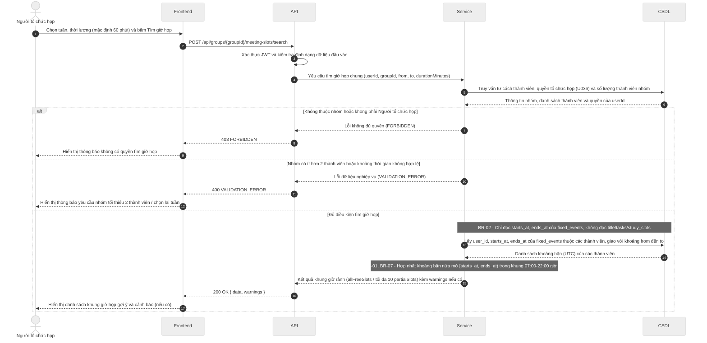

# Đặc tả API (API Spec) – StudySync

> Khung tài liệu theo Template 7. Chủ module viết endpoint của mình, Nhi review. Mỗi endpoint mới hoặc đổi đều cập nhật file này trong cùng PR.
> Ký hiệu: `<nội dung>` là chỗ cần điền (thay cả dấu ngoặc nhọn). Xóa các ghi chú *Hướng dẫn* khi dùng thật.

## Quy ước chung

| Mục | Quy ước |
| --- | --- |
| Định dạng | REST, gửi và trả JSON, mã hóa UTF-8 |
| Tiền tố đường dẫn | `/api` |
| Xác thực | Bearer token (JWT) trong header `Authorization: Bearer <token>` |
| Thời gian | Chuỗi ISO 8601 theo UTC, ví dụ `2026-11-05T13:00:00Z`; nhận cả dạng có mili giây (`2026-11-05T13:00:00.000Z`), không nhận offset như `+07:00` và không nhận chuỗi thiếu hậu tố `Z` (trả `400 VALIDATION_ERROR`, BR-07); dữ liệu API trả về luôn có mili giây, ví dụ `2026-11-05T13:00:00.000Z`; frontend tự hiển thị giờ Việt Nam |
| Tên trường JSON | camelCase cho toàn bộ (ví dụ `dueAt`, `startsAt`, `durationMinutes`). Backend đổi qua lại với tên cột snake_case của CSDL, không đổi tên cột theo API |
| Khoảng thời gian | Đối tượng `{ "startsAt": "...", "endsAt": "..." }` (kiểu `TimeSlot` trong `docs/interval-library.md`), hai giá trị theo dòng Thời gian ở trên, hiểu theo nửa mở `[startsAt, endsAt)`. Khoảng tìm kiếm gửi lên dùng `from` và `to`, cũng nửa mở `[from, to)` |
| Định danh | `id` là chuỗi UUID, theo kiểu khóa chính của CSDL |
| Việc đã xóa (từ #57) | Khung học còn lưu khi việc gốc bị xóa thì có `taskId: null`. API không trả tên việc cũ; giao diện hiện nhãn mặc định, ví dụ "Việc đã xóa" (đã chốt ở việc 3, `#56`) |
| Quyền riêng tư (BR-02) | API dành cho nhóm chỉ trả trạng thái bận hoặc rảnh, không trả tên sự kiện |
| Dạng phản hồi | Thành công bọc kết quả trong `data`; thành công nhưng có cảnh báo (BR-01, BR-04) thì thêm `warnings` ngang hàng với `data`; lỗi dùng `error`. Mỗi phản hồi chỉ có `data` hoặc `error` (trừ `GET /health`, xem mục "Dạng phản hồi thành công"), không bao giờ có cả hai; HTTP 204 (xóa thành công) không có nội dung. Chi tiết xem các mục bên dưới. |

## Dạng phản hồi thành công

> Trạng thái: **đã chốt** (Nhi, việc "Chốt quy ước chung của API", `#56`). Lý do: một số quy định nghiệp vụ (BR-01, BR-04) cho gọi thành công nhưng kèm cảnh báo, nên cần chỗ đặt cảnh báo tách khỏi các trường của đối tượng.

Áp dụng cho mọi phản hồi thành công có nội dung (HTTP 200, 201). HTTP 204 không có nội dung, xem mục "Mã HTTP khi thành công".

**Thành công thường:**

```json
{
  "data": { }
}
```

**Thành công kèm cảnh báo (vẫn HTTP 200 hoặc 201):**

```json
{
  "data": {
    "id": "550e8400-e29b-41d4-a716-446655440000",
    "title": "Ôn tập CSDL",
    "dueAt": "2026-11-08T10:00:00.000Z"
  },
  "warnings": [
    {
      "code": "DEADLINE_PASSED",
      "message": "Hạn hoàn thành đã qua so với thời điểm hiện tại (BR-04)."
    }
  ]
}
```

- `data`: nội dung chính của endpoint (đối tượng hoặc danh sách bọc trong đối tượng, ví dụ `data.slots`).
- `warnings`: chỉ có khi có cảnh báo, không trả mảng rỗng. Mỗi phần tử có dạng `{ code, message }`, có thể kèm `details` (xem mục "Mã HTTP khi thành công").
- Phản hồi lỗi (4xx, 5xx) dùng dạng riêng ở mục sau, không có `data`.
- Ngoại lệ duy nhất: `GET /health` (kiểm tra máy chủ còn chạy, đường dẫn nằm ngoài tiền tố `/api`) giữ nguyên dạng `{ "status": "ok", "time": "2026-11-05T13:00:00.000Z" }`, không bọc `data`. `time` theo dòng Thời gian ở Quy ước chung. Đã chốt ở việc 3 (`#56`).

Bảng mã cảnh báo dùng chung (đã chốt ở việc 3 – `#56`):

| Mã cảnh báo (`code`) | Quy tắc | Ý nghĩa / Khi nào trả về |
| --- | --- | --- |
| `FIXED_EVENT_OVERLAP` | BR-01 | Sự kiện cố định vừa tạo/nhập bị chồng thời gian với sự kiện cố định khác (vẫn cho lưu thành công kèm cảnh báo) |
| `DEADLINE_PASSED` | BR-04 | Việc cần làm được lưu với hạn hoàn thành (`dueAt`) đã qua so với thời điểm hiện tại |
| `MEMBER_NO_FIXED_EVENTS` | Yêu cầu 4.1 (U031) | Khi tìm giờ họp chung mà trong nhóm có thành viên chưa nhập sự kiện cố định nào trong tuần được chọn |

## Mã HTTP khi thành công

> Bổ sung của Nhi cho Quy ước chung (việc 3, `#56`).

| Mã HTTP | Khi nào | Nội dung trả về |
| --- | --- | --- |
| 200 | Đọc, sửa, hoặc thao tác không tạo tài nguyên mới (ví dụ tìm giờ họp, đề xuất khung giờ) thành công | Dạng phản hồi thành công ở trên |
| 201 | Tạo tài nguyên mới thành công | Dạng phản hồi thành công ở trên, `data` là tài nguyên vừa tạo |
| 204 | Xóa thành công | Body rỗng, không gửi chuỗi JSON nào (không trả `{ "data": null }` hay `{ "data": {} }`) |

Phần tử của `warnings` có thể kèm `details` (tùy chọn, cùng dạng `[{ "field", "issue" }]` với `error.details`) khi cảnh báo gắn với một trường cụ thể để frontend hiện ngay tại trường nhập. Ví dụ `DEADLINE_PASSED` kèm `"details": [{ "field": "dueAt", "issue": "đã qua" }]`.

## Dạng thông báo lỗi thống nhất

```json
{
  "error": {
    "code": "VALIDATION_ERROR",
    "message": "Thời lượng phải lớn hơn 0",
    "details": [{ "field": "durationMinutes", "issue": "phải lớn hơn 0" }]
  }
}
```

## Bảng mã lỗi dùng chung

| Mã HTTP | error.code | Khi nào |
| --- | --- | --- |
| 400 | VALIDATION_ERROR | Dữ liệu gửi lên sai định dạng hoặc thiếu trường bắt buộc |
| 401 | UNAUTHORIZED | Chưa đăng nhập hoặc token hết hạn |
| 403 | FORBIDDEN | Đã đăng nhập nhưng không có quyền (ví dụ không thuộc nhóm) |
| 404 | NOT_FOUND | Không tìm thấy tài nguyên |
| 409 | CONFLICT | Khung giờ do hệ thống xếp trùng lịch cố định (BR-01) hoặc dữ liệu bị trùng; hai sự kiện cố định chồng nhau (nhập tay hoặc import) không trả lỗi này mà chỉ cảnh báo |
| 413 | FILE_TOO_LARGE | File import (.ics, .csv, ảnh) vượt 5 MB, tính 1 MB = 1024 × 1024 byte (BR-05) |
| 422 | FILE_INVALID | File import sai định dạng hoặc có dòng không hợp lệ (kể cả tên việc quá 200 ký tự, BR-08); trả kèm tối đa 20 dòng lỗi đầu tiên (BR-06); với .ics báo theo sự kiện kèm số dòng bắt đầu khối VEVENT; lỗi gồm thiếu tên hoặc giờ bắt đầu, giờ kết thúc không sau giờ bắt đầu, TZID không nhận ra được, tệp không có sự kiện nào; mỗi phần tử details có dạng `{line?, issue}`: `line` bỏ trống khi lỗi cấp tệp (tệp rỗng, không có sự kiện, sai định dạng, ảnh), còn lỗi trong một VEVENT vẫn có `line` là dòng bắt đầu khối |
| 500 | INTERNAL_ERROR | Lỗi máy chủ, không lộ chi tiết kỹ thuật cho người dùng |

## Danh sách endpoint theo module (tổng quan, điền dần)

| Module | Phương thức và đường dẫn | Mô tả ngắn | Trạng thái |
| --- | --- | --- | --- |
| TV1 | `<POST /api/auth/register>` | `<Đăng ký>` | Nháp |
| TV2 | GET /api/events | Lấy danh sách sự kiện cố định theo khoảng thời gian | Nháp |
| TV2 | POST /api/events | Tạo mới sự kiện cố định thủ công | Nháp |
| TV2 | GET /api/events/{eventId} | Lấy chi tiết một sự kiện cố định | Nháp |
| TV2 | PATCH /api/events/{eventId} | Cập nhật thông tin sự kiện cố định | Nháp |
| TV2 | DELETE /api/events/{eventId} | Xóa sự kiện cố định | Nháp |
| TV2 | POST /api/events/import/ics | Nạp lịch từ tệp iCalendar (.ics) | Nháp |
| TV2 | POST /api/events/import/csv | Nạp lịch từ tệp bảng tính (.csv) | Nháp |
| TV2 | GET /api/tasks | Danh sách việc cần làm cá nhân | Nháp |
| TV2 | POST /api/tasks | Tạo việc cần làm mới | Nháp |
| TV2 | GET /api/tasks/{taskId} | Lấy chi tiết một việc cần làm | Nháp |
| TV2 | PATCH /api/tasks/{taskId} | Cập nhật việc cần làm hoặc đánh dấu hoàn thành | Nháp |
| TV2 | DELETE /api/tasks/{taskId} | Xóa việc cần làm | Nháp |
| TV2 | GET /api/schedule/week | Xem lịch tuần tổng hợp | Nháp |
| TV3 | `<POST /api/schedule/suggest>` | `<Đề xuất khung giờ học>` | Nháp |
| TV4 | `POST /api/groups/{groupId}/meeting-slots/search` | Tìm giờ họp chung | Nháp |
| TV5 | `<GET /api/groups/{groupId}/cards>` | `<Danh sách thẻ Kanban>` | Nháp |

## Mẫu một endpoint (sao chép cho mỗi endpoint)

````markdown
### <PHƯƠNG THỨC> /api/<đường-dẫn>
Module: TV<x> · Story: US-<xx> · Người viết: <tên> · Trạng thái: <Nháp / Đã chốt / Đã làm>
Mô tả: <Một câu, endpoint làm gì>
Quyền: <Ai gọi được: chủ tài khoản / thành viên nhóm / trưởng nhóm>

**Tham số đường dẫn và query**

| Tên | Kiểu | Bắt buộc | Mô tả |
| --- | --- | --- | --- |

**Nội dung gửi lên (body)**

```json
<JSON mẫu>
```

**Kết quả thành công (<mã HTTP>)**

```json
{ "data": { } }
```

**Cảnh báo có thể gặp** (xóa mục này nếu endpoint không trả cảnh báo)

| Mã cảnh báo (`warnings[].code`) | Điều kiện |
| --- | --- |

**Lỗi có thể gặp**

| Mã HTTP | error.code | Điều kiện |
| --- | --- | --- |

Ghi chú: <Quy định nghiệp vụ áp dụng, giới hạn, lưu ý cho frontend>
````

---

## TV1 – Tài khoản và nhóm

<!-- Vùng của TV1: chỉ sửa trong vùng này để tránh xung đột khi merge. -->

`<Thêm các endpoint của TV1 bên dưới theo mẫu ở trên, trạng thái ban đầu là Nháp.>`

---

## TV2 – Lịch, sự kiện cố định và việc cần làm

<!-- Vùng của TV2: chỉ sửa trong vùng này để tránh xung đột khi merge. -->

<!-- TV2:BEGIN -->

Trạng thái: Nháp · Người viết: Hưng · Người review: Thư H.A. · Cập nhật: 11/11/2026

Phạm vi: US-08 đến US-15. Use case: U011 đến U015. Mọi endpoint tuân thủ quy ước chung ở đầu tài liệu (RESTful, JSON UTF-8, tiền tố `/api`, camelCase, định danh UUID, thời gian ISO 8601 UTC có hậu tố `Z` và luôn có mili giây khi API trả về, dạng phản hồi `data`, `warnings`, `error`).

### Quy định nghiệp vụ áp dụng cho TV2

| Quy định | Nội dung áp dụng |
| --- | --- |
| **BR-01 (Trùng lịch cố định)** | Cho phép lưu sự kiện cố định trùng nhau vào CSDL kèm cảnh báo `FIXED_EVENT_OVERLAP`. Hai sự kiện tiếp giáp thời gian ($endsAt_1 = startsAt_2$) không tính là trùng lịch. Ràng buộc thời gian bắt buộc $endsAt > startsAt$. |
| **BR-02 (Bảo mật riêng tư)** | Mọi thông tin chi tiết sự kiện (`title`, `location`, `notes`, `kind`, `source`) và việc cần làm (`tasks`) là dữ liệu riêng tư của cá nhân. API nhóm (TV4) tìm giờ họp chỉ được trả `startsAt` và `endsAt` (biểu thị khung giờ "Bận"). |
| **BR-04 (Ràng buộc việc cần làm)** | Việc cần làm bắt buộc phải có hạn chót `dueAt`. Nếu tạo/sửa việc có hạn chót đã qua so với hiện tại, hệ thống vẫn cho lưu và trả cảnh báo `DEADLINE_PASSED`. Thời lượng ước tính `durationMinutes` mặc định là 60 phút (1 giờ) khi người dùng xóa trống hoặc không nhập. |
| **BR-05 (Giới hạn dung lượng tệp)** | Tệp nạp (`.ics`, `.csv`) có dung lượng tối đa 5 MB (chính xác 5.242.880 byte). Nếu vượt quá, API trả về ngay mã lỗi HTTP `413 FILE_TOO_LARGE`. |
| **BR-06 (Nguyên tắc dừng ngắt - Atomic Rejection)** | Nếu tệp import sai định dạng cấu trúc hoặc có bất kỳ dòng nào bị lỗi, hệ thống từ chối toàn bộ tệp (không lưu bất kỳ dòng nào vào CSDL), trả mã lỗi HTTP `422 FILE_INVALID` kèm danh sách tối đa 20 dòng lỗi đầu tiên (`details`) và tổng số lỗi thực tế (`totalErrors`). |
| **BR-07 (Chuẩn hóa múi giờ)** | Mọi mốc thời gian lưu trữ và truyền nhận qua API đều chuẩn hóa theo giờ quốc tế UTC (hậu tố `Z`). Giao diện người dùng tại Việt Nam chịu trách nhiệm hiển thị theo múi giờ `Asia/Ho_Chi_Minh` (UTC+7). Tuần bắt đầu từ Thứ 2 đến Chủ nhật. |
| **BR-08 (Giới hạn độ dài tên)** | Tên sự kiện cố định và tên việc cần làm có độ dài tối đa 200 ký tự sau khi chuẩn hóa Unicode NFC và cắt bỏ khoảng trắng hai đầu (`btrim`). Tối thiểu 1 ký tự sau khi cắt khoảng trắng. |

### Kiểu dữ liệu dùng chung trong TV2

**FixedEvent (Sự kiện cố định):**

```json
{
  "id": "11111111-2222-4333-8444-555555555555",
  "title": "Nhập môn Công nghệ phần mềm (Lý thuyết)",
  "kind": "class",
  "startsAt": "2026-11-16T00:30:00.000Z",
  "endsAt": "2026-11-16T04:10:00.000Z",
  "location": "Phòng C.42, CS1",
  "notes": "Buổi học lý thuyết hàng tuần",
  "source": "manual",
  "recurringRuleId": "33333333-4444-4555-8666-777777777777",
  "importedFileId": null,
  "hasOverlap": false,
  "createdAt": "2026-11-11T02:00:00.000Z",
  "updatedAt": "2026-11-11T02:00:00.000Z"
}
```

`kind` nhận một trong các giá trị: `class` (buổi học), `exam` (lịch thi), `work_shift` (ca làm thêm), `other` (việc cá nhân có giờ cố định khác).  
`source` nhận: `manual` (nhập tay), `ics` (tệp iCalendar), `csv` (tệp bảng tính).  
`hasOverlap` (boolean, tùy chọn): trường tính toán động (computed field) khi hiển thị lịch tuần (`GET /api/schedule/week`) hoặc truy vấn sự kiện, cho biết sự kiện có bị trùng khung thời gian với sự kiện cố định khác hay không (BR-01) để giao diện hiển thị cảnh báo; trường này không lưu thành cột trực tiếp trong bảng `fixed_events` của CSDL.

**Task (Việc cần làm cá nhân):**

```json
{
  "id": "55555555-6666-4777-8888-999999999999",
  "title": "Soạn thảo tài liệu CSDL và API module TV2",
  "dueAt": "2026-11-12T17:00:00.000Z",
  "priority": "high",
  "difficulty": "medium",
  "durationMinutes": 120,
  "isDone": false,
  "createdAt": "2026-11-11T01:00:00.000Z",
  "updatedAt": "2026-11-11T01:00:00.000Z"
}
```

`priority` nhận: `low`, `medium`, `high`.  
`difficulty` nhận: `easy`, `medium`, `hard`.

### Danh sách endpoint TV2

| Phương thức và đường dẫn | Mô tả ngắn | Story | Quyền | Trạng thái |
| --- | --- | --- | --- | --- |
| GET /api/events | Lấy danh sách sự kiện cố định theo khoảng thời gian | US-10, US-13 | Chủ tài khoản | Nháp |
| POST /api/events | Tạo mới sự kiện cố định thủ công | US-08 | Chủ tài khoản | Nháp |
| GET /api/events/{eventId} | Lấy chi tiết một sự kiện cố định | US-08 | Chủ tài khoản | Nháp |
| PATCH /api/events/{eventId} | Cập nhật thông tin sự kiện cố định | US-12 | Chủ tài khoản | Nháp |
| DELETE /api/events/{eventId} | Xóa sự kiện cố định | US-12 | Chủ tài khoản | Nháp |
| POST /api/events/import/ics | Nạp lịch từ tệp iCalendar (.ics) | US-11 | Chủ tài khoản | Nháp |
| POST /api/events/import/csv | Nạp lịch từ tệp bảng tính (.csv) | US-11, US-15 | Chủ tài khoản | Nháp |
| GET /api/tasks | Danh sách việc cần làm cá nhân | US-09, US-13 | Chủ tài khoản | Nháp |
| POST /api/tasks | Tạo việc cần làm mới | US-09 | Chủ tài khoản | Nháp |
| GET /api/tasks/{taskId} | Lấy chi tiết một việc cần làm | US-09 | Chủ tài khoản | Nháp |
| PATCH /api/tasks/{taskId} | Cập nhật việc cần làm hoặc đánh dấu hoàn thành | US-12, US-14 | Chủ tài khoản | Nháp |
| DELETE /api/tasks/{taskId} | Xóa việc cần làm | US-12 | Chủ tài khoản | Nháp |
| GET /api/schedule/week | Xem lịch tuần tổng hợp | US-10, US-15 | Chủ tài khoản | Nháp |

---

### GET /api/events

Module: TV2 · Story: US-10, US-13 · Người viết: Hưng · Trạng thái: Nháp  
Mô tả: Lấy danh sách sự kiện cố định của sinh viên đang đăng nhập trong một khoảng thời gian nửa mở `[from, to)`.  
Quyền: Chủ tài khoản (chỉ xem sự kiện của chính mình).

**Tham số query**

| Tên | Kiểu | Bắt buộc | Mô tả |
| --- | --- | --- | --- |
| `from` | string (ISO 8601 UTC) | Có | Mốc thời gian bắt đầu khoảng tìm kiếm (ví dụ: `2026-11-16T00:00:00.000Z`) |
| `to` | string (ISO 8601 UTC) | Có | Mốc thời gian kết thúc khoảng tìm kiếm (ví dụ: `2026-11-23T00:00:00.000Z`) |

**Nội dung gửi lên (body)**

Không có.

**Kết quả thành công (200)**

```json
{
  "data": {
    "events": [
      {
        "id": "11111111-2222-4333-8444-555555555555",
        "title": "Nhập môn Công nghệ phần mềm (Lý thuyết)",
        "kind": "class",
        "startsAt": "2026-11-16T00:30:00.000Z",
        "endsAt": "2026-11-16T04:10:00.000Z",
        "location": "Phòng C.42, CS1",
        "notes": "Buổi học lý thuyết hàng tuần",
        "source": "manual",
        "recurringRuleId": "33333333-4444-4555-8666-777777777777",
        "importedFileId": null,
        "createdAt": "2026-11-11T02:00:00.000Z",
        "updatedAt": "2026-11-11T02:00:00.000Z"
      }
    ]
  }
}
```

**Lỗi có thể gặp**

| Mã HTTP | error.code | Điều kiện |
| --- | --- | --- |
| 400 | VALIDATION_ERROR | Thiếu tham số `from` hoặc `to`, sai định dạng ISO 8601 thiếu hậu tố `Z` (BR-07), hoặc `to <= from` |
| 401 | UNAUTHORIZED | Chưa đăng nhập hoặc token hết hạn |
| 500 | INTERNAL_ERROR | Lỗi máy chủ |

Ghi chú: Khoảng thời gian tính theo nửa mở `[from, to)`. Hệ thống trả về mọi sự kiện có khoảng thời gian giao nhau với khoảng tìm kiếm: $startsAt < to \land endsAt > from$. Tiêu chuẩn sắp xếp áp dụng `ORDER BY starts_at ASC, ends_at ASC, id ASC` để đảm bảo thứ tự dữ liệu hoàn toàn tất định và nhất quán giữa các lần gọi.

---

### POST /api/events

Module: TV2 · Story: US-08 · Người viết: Hưng · Trạng thái: Nháp  
Mô tả: Thêm mới một sự kiện cố định thủ công vào lịch cá nhân.  
Quyền: Chủ tài khoản.

**Tham số đường dẫn và query**

Không có.

**Nội dung gửi lên (body)**

| Tên | Kiểu | Bắt buộc | Mô tả |
| --- | --- | --- | --- |
| `title` | string | Có | Tên sự kiện, tối đa 200 ký tự Unicode NFC sau khi cắt khoảng trắng hai đầu (BR-08) |
| `kind` | string | Không | Loại sự kiện: `class`, `exam`, `work_shift`, `other` (mặc định: `class`) |
| `startsAt` | string (ISO 8601 UTC) | Có | Thời điểm bắt đầu sự kiện (hậu tố `Z`, BR-07) |
| `endsAt` | string (ISO 8601 UTC) | Có | Thời điểm kết thúc sự kiện, bắt buộc sau `startsAt` (BR-01, BR-07) |
| `location` | string | Không | Địa điểm hoặc phòng học |
| `notes` | string | Không | Ghi chú thêm cho sự kiện |

```json
{
  "title": "Nhập môn Công nghệ phần mềm (Lý thuyết)",
  "kind": "class",
  "startsAt": "2026-11-16T00:30:00.000Z",
  "endsAt": "2026-11-16T04:10:00.000Z",
  "location": "Phòng C.42, CS1",
  "notes": "Buổi học lý thuyết hàng tuần"
}
```

**Kết quả thành công (201)**

*Trường hợp thành công không trùng lịch:*

```json
{
  "data": {
    "id": "11111111-2222-4333-8444-555555555555",
    "title": "Nhập môn Công nghệ phần mềm (Lý thuyết)",
    "kind": "class",
    "startsAt": "2026-11-16T00:30:00.000Z",
    "endsAt": "2026-11-16T04:10:00.000Z",
    "location": "Phòng C.42, CS1",
    "notes": "Buổi học lý thuyết hàng tuần",
    "source": "manual",
    "recurringRuleId": null,
    "importedFileId": null,
    "createdAt": "2026-11-11T02:00:00.000Z",
    "updatedAt": "2026-11-11T02:00:00.000Z"
  }
}
```

*Trường hợp thành công kèm cảnh báo trùng lịch (BR-01):*

```json
{
  "data": {
    "id": "11111111-2222-4333-8444-555555555555",
    "title": "Nhập môn Công nghệ phần mềm (Lý thuyết)",
    "kind": "class",
    "startsAt": "2026-11-16T00:30:00.000Z",
    "endsAt": "2026-11-16T04:10:00.000Z",
    "location": "Phòng C.42, CS1",
    "notes": "Buổi học lý thuyết hàng tuần",
    "source": "manual",
    "recurringRuleId": null,
    "importedFileId": null,
    "createdAt": "2026-11-11T02:00:00.000Z",
    "updatedAt": "2026-11-11T02:00:00.000Z"
  },
  "warnings": [
    {
      "code": "FIXED_EVENT_OVERLAP",
      "message": "Sự kiện cố định vừa tạo bị trùng thời gian với sự kiện khác trong lịch cá nhân",
      "details": [
        {
          "field": "startsAt",
          "issue": "Trùng thời gian với sự kiện: Luyện thi TOEIC (02:00 - 03:30 UTC)"
        }
      ]
    }
  ]
}
```

**Cảnh báo có thể gặp**

| Mã cảnh báo (`warnings[].code`) | Điều kiện |
| --- | --- |
| `FIXED_EVENT_OVERLAP` | Sự kiện vừa tạo bị chồng lấn thời gian với ít nhất một sự kiện cố định khác của người dùng ($startsAt < existing.endsAt \land endsAt > existing.startsAt$). Vẫn lưu thành công vào CSDL theo BR-01 |

**Lỗi có thể gặp**

| Mã HTTP | error.code | Điều kiện |
| --- | --- | --- |
| 400 | VALIDATION_ERROR | Tiêu đề để trống hoặc toàn khoảng trắng; tiêu đề quá 200 ký tự NFC (BR-08); thiếu `startsAt` hoặc `endsAt`; chuỗi thời gian thiếu hậu tố `Z` (BR-07); `endsAt <= startsAt` (thời gian kết thúc phải sau thời gian bắt đầu); `kind` không thuộc danh mục hợp lệ |
| 401 | UNAUTHORIZED | Chưa đăng nhập hoặc token hết hạn |
| 500 | INTERNAL_ERROR | Lỗi máy chủ |

Ghi chú: Hai sự kiện tiếp giáp giờ nhau ($endsAt_1 = startsAt_2$) không tính là trùng lịch (BR-01).

---

### GET /api/events/{eventId}

Module: TV2 · Story: US-08 · Người viết: Hưng · Trạng thái: Nháp  
Mô tả: Lấy thông tin chi tiết một sự kiện cố định theo mã định danh `eventId`.  
Quyền: Chủ tài khoản sở hữu sự kiện.

**Tham số đường dẫn**

| Tên | Kiểu | Bắt buộc | Mô tả |
| --- | --- | --- | --- |
| `eventId` | uuid | Có | Mã định danh sự kiện cố định |

**Nội dung gửi lên (body)**

Không có.

**Kết quả thành công (200)**

```json
{
  "data": {
    "id": "11111111-2222-4333-8444-555555555555",
    "title": "Nhập môn Công nghệ phần mềm (Lý thuyết)",
    "kind": "class",
    "startsAt": "2026-11-16T00:30:00.000Z",
    "endsAt": "2026-11-16T04:10:00.000Z",
    "location": "Phòng C.42, CS1",
    "notes": "Buổi học lý thuyết hàng tuần",
    "source": "manual",
    "recurringRuleId": "33333333-4444-4555-8666-777777777777",
    "importedFileId": null,
    "createdAt": "2026-11-11T02:00:00.000Z",
    "updatedAt": "2026-11-11T02:00:00.000Z"
  }
}
```

**Lỗi có thể gặp**

| Mã HTTP | error.code | Điều kiện |
| --- | --- | --- |
| 400 | VALIDATION_ERROR | `eventId` không phải định dạng UUID hợp lệ |
| 401 | UNAUTHORIZED | Chưa đăng nhập hoặc token hết hạn |
| 404 | NOT_FOUND | Không tìm thấy sự kiện, hoặc sự kiện thuộc người dùng khác |
| 500 | INTERNAL_ERROR | Lỗi máy chủ |

---

### PATCH /api/events/{eventId}

Module: TV2 · Story: US-12 · Người viết: Hưng · Trạng thái: Nháp  
Mô tả: Cập nhật thông tin sự kiện cố định (chỉ sửa đổi các trường được gửi lên trong body).  
Quyền: Chủ tài khoản sở hữu sự kiện.

**Tham số đường dẫn**

| Tên | Kiểu | Bắt buộc | Mô tả |
| --- | --- | --- | --- |
| `eventId` | uuid | Có | Mã định danh sự kiện cố định |

**Nội dung gửi lên (body)**

| Tên | Kiểu | Bắt buộc | Mô tả |
| --- | --- | --- | --- |
| `title` | string | Không | Tên sự kiện cập nhật, tối đa 200 ký tự (BR-08) |
| `kind` | string | Không | Loại sự kiện: `class`, `exam`, `work_shift`, `other` |
| `startsAt` | string (ISO 8601 UTC) | Không | Thời điểm bắt đầu mới (hậu tố `Z`, BR-07) |
| `endsAt` | string (ISO 8601 UTC) | Không | Thời điểm kết thúc mới, bắt buộc sau `startsAt` (BR-01, BR-07) |
| `location` | string | Không | Địa điểm hoặc phòng học (cho phép gửi `null` để xóa) |
| `notes` | string | Không | Ghi chú thêm (cho phép gửi `null` để xóa) |

```json
{
  "location": "Phòng C.43, CS1 (Đổi phòng học)",
  "notes": "Mang theo laptop để kiểm tra thực hành"
}
```

**Kết quả thành công (200)**

```json
{
  "data": {
    "id": "11111111-2222-4333-8444-555555555555",
    "title": "Nhập môn Công nghệ phần mềm (Lý thuyết)",
    "kind": "class",
    "startsAt": "2026-11-16T00:30:00.000Z",
    "endsAt": "2026-11-16T04:10:00.000Z",
    "location": "Phòng C.43, CS1 (Đổi phòng học)",
    "notes": "Mang theo laptop để kiểm tra thực hành",
    "source": "manual",
    "recurringRuleId": "33333333-4444-4555-8666-777777777777",
    "importedFileId": null,
    "createdAt": "2026-11-11T02:00:00.000Z",
    "updatedAt": "2026-11-11T04:30:00.000Z"
  }
}
```

**Cảnh báo có thể gặp**

| Mã cảnh báo (`warnings[].code`) | Điều kiện |
| --- | --- |
| `FIXED_EVENT_OVERLAP` | Mốc thời gian mới sau khi cập nhật bị chồng lấn với sự kiện cố định khác của người dùng (BR-01) |

**Lỗi có thể gặp**

| Mã HTTP | error.code | Điều kiện |
| --- | --- | --- |
| 400 | VALIDATION_ERROR | Tiêu đề rỗng hoặc quá 200 ký tự (BR-08); chuỗi thời gian sai định dạng thiếu `Z` (BR-07); mốc thời gian kết thúc không sau mốc bắt đầu; `kind` không hợp lệ |
| 401 | UNAUTHORIZED | Chưa đăng nhập hoặc token hết hạn |
| 404 | NOT_FOUND | Không tìm thấy sự kiện, hoặc sự kiện thuộc người dùng khác |
| 500 | INTERNAL_ERROR | Lỗi máy chủ |

---

### DELETE /api/events/{eventId}

Module: TV2 · Story: US-12 · Người viết: Hưng · Trạng thái: Nháp  
Mô tả: Xóa một sự kiện cố định khỏi lịch cá nhân hoặc xóa toàn bộ chuỗi sự kiện lặp (thực hiện xóa thật khỏi CSDL).  
Quyền: Chủ tài khoản sở hữu sự kiện.

**Tham số đường dẫn**

| Tên | Kiểu | Bắt buộc | Mô tả |
| --- | --- | --- | --- |
| `eventId` | uuid | Có | Mã định danh sự kiện cố định cần xóa |

**Tham số query**

| Tên | Kiểu | Bắt buộc | Mặc định | Mô tả |
| --- | --- | --- | --- | --- |
| `scope` | string | Không | `'single'` | Phạm vi xóa sự kiện:<br>- `single`: chỉ xóa sự kiện đơn lẻ được chỉ định (`eventId`). Nếu sự kiện thuộc chuỗi lặp, chỉ xóa buổi này còn quy tắc lặp và các buổi khác được bảo lưu.<br>- `all`: thực thi database transaction xóa toàn bộ các sự kiện có cùng `recurring_rule_id` và xóa luôn dòng `recurring_rules` tương ứng (nếu sự kiện là đơn lẻ không có `recurring_rule_id` thì tương đương `single`). |

**Nội dung gửi lên (body)**

Không có.

**Kết quả thành công (204)**

Phản hồi mã HTTP 204 No Content, body rỗng.

**Lỗi có thể gặp**

| Mã HTTP | error.code | Điều kiện |
| --- | --- | --- |
| 400 | VALIDATION_ERROR | `eventId` không phải định dạng UUID hợp lệ hoặc `scope` không thuộc `['single', 'all']` |
| 401 | UNAUTHORIZED | Chưa đăng nhập hoặc token hết hạn |
| 404 | NOT_FOUND | Không tìm thấy sự kiện, hoặc sự kiện thuộc người dùng khác |
| 500 | INTERNAL_ERROR | Lỗi máy chủ |

---

### POST /api/events/import/ics

Module: TV2 · Story: US-11 · Người viết: Hưng · Trạng thái: Nháp  
Mô tả: Nạp lịch từ tệp iCalendar (`.ics`) chuẩn RFC 5545 vào lịch cá nhân của sinh viên.  
Quyền: Chủ tài khoản.

**Tham số đường dẫn và query**

Không có.

**Nội dung gửi lên (body - multipart/form-data)**

| Tên trường | Kiểu | Bắt buộc | Mô tả |
| --- | --- | --- | --- |
| `file` | Binary | Có | Tệp `.ics` có dung lượng tối đa 5 MB (5.242.880 byte theo BR-05) |

**Kết quả thành công (200)**

*Trường hợp thành công hoàn toàn:*

```json
{
  "data": {
    "importedFileId": "44444444-5555-4666-8777-888888888888",
    "fileName": "thoi_khoa_bieu_hoc_ky_1.ics",
    "totalEvents": 7,
    "message": "Nạp lịch thành công 7 sự kiện"
  }
}
```

*Trường hợp thành công kèm cảnh báo trùng lịch cố định (BR-01):*

```json
{
  "data": {
    "importedFileId": "44444444-5555-4666-8777-888888888888",
    "fileName": "thoi_khoa_bieu_hoc_ky_1.ics",
    "totalEvents": 7,
    "message": "Nạp lịch thành công 7 sự kiện"
  },
  "warnings": [
    {
      "code": "FIXED_EVENT_OVERLAP",
      "message": "Có sự kiện trong tệp nạp bị trùng thời gian với sự kiện cố định đã có trong lịch cá nhân",
      "details": [
        {
          "field": "events[2]",
          "issue": "Sự kiện 'Kiến trúc phần mềm' bị trùng với lịch hiện có vào ngày 18/11/2026"
        }
      ]
    }
  ]
}
```

**Cảnh báo có thể gặp**

| Mã cảnh báo (`warnings[].code`) | Điều kiện |
| --- | --- |
| `FIXED_EVENT_OVERLAP` | Một hoặc nhiều sự kiện nạp vào bị trùng khung thời gian với sự kiện cố định đã tồn tại trong lịch cá nhân (BR-01) |

**Lỗi có thể gặp**

| Mã HTTP | error.code | Điều kiện |
| --- | --- | --- |
| 400 | VALIDATION_ERROR | Không đính kèm tệp, tệp không có đuôi mở rộng `.ics`, hoặc phần mở rộng tệp bị cấm |
| 401 | UNAUTHORIZED | Chưa đăng nhập hoặc token hết hạn |
| 413 | FILE_TOO_LARGE | Dung lượng tệp vượt quá ngưỡng tối đa 5 MB ($5 \times 1024 \times 1024 = 5.242.880\text{ byte}$ theo BR-05) |
| 422 | FILE_INVALID | Tệp rỗng (0 bytes); tệp sai định dạng RFC 5545 (thiếu `BEGIN:VCALENDAR`, khối lồng mồ côi, thẻ con `VALARM` chưa đóng); thiếu thuộc tính bắt buộc `DTSTART`, `SUMMARY`, `UID`; sự kiện cả ngày thiếu mốc giờ cụ thể; thời gian kết thúc không sau thời gian bắt đầu ($DTEND \le DTSTART$); tên sự kiện vượt quá 200 ký tự NFC (BR-08). Toàn bộ tệp bị từ chối và trả tối đa 20 dòng lỗi đầu tiên (BR-06) |
| 500 | INTERNAL_ERROR | Lỗi máy chủ |

Ví dụ phản hồi lỗi 413 (BR-05):

```json
{
  "error": {
    "code": "FILE_TOO_LARGE",
    "message": "Dung lượng tệp vượt quá giới hạn tối đa 5 MB (BR-05)"
  }
}
```

Ví dụ phản hồi lỗi 422 (BR-06):

```json
{
  "error": {
    "code": "FILE_INVALID",
    "message": "Phát hiện 25 lỗi trong tệp (đang hiển thị 20 lỗi đầu tiên)",
    "totalErrors": 25,
    "details": [
      { "line": 9, "issue": "Sự kiện thiếu thuộc tính bắt buộc DTSTART" },
      { "line": 17, "issue": "Chuỗi thời gian không hợp lệ: Ngày 31/04 không tồn tại" },
      { "line": 24, "issue": "Thời gian kết thúc phải sau thời gian bắt đầu" },
      { "line": 26, "issue": "Sự kiện thiếu tiêu đề (SUMMARY)" }
    ]
  }
}
```

Ghi chú: Toàn bộ quá trình nạp tệp thực thi trong một Database Transaction (nguyên tắc Atomic Rejection theo BR-06).

---

### POST /api/events/import/csv

Module: TV2 · Story: US-11, US-15 · Người viết: Hưng · Trạng thái: Nháp  
Mô tả: Nạp thời khóa biểu từ tệp bảng tính CSV vào lịch cá nhân của sinh viên.  
Quyền: Chủ tài khoản.

**Tham số đường dẫn và query**

Không có.

**Nội dung gửi lên (body - multipart/form-data)**

| Tên trường | Kiểu | Bắt buộc | Mô tả |
| --- | --- | --- | --- |
| `file` | Binary | Có | Tệp `.csv` có dung lượng tối đa 5 MB (5.242.880 byte theo BR-05) |

**Kết quả thành công (200)**

```json
{
  "data": {
    "importedFileId": "55555555-6666-4777-8888-999999999999",
    "fileName": "thoi_khoa_bieu.csv",
    "totalEvents": 14,
    "message": "Nạp thời khóa biểu thành công 14 buổi học"
  }
}
```

**Cảnh báo có thể gặp**

| Mã cảnh báo (`warnings[].code`) | Điều kiện |
| --- | --- |
| `FIXED_EVENT_OVERLAP` | Một hoặc nhiều buổi học nạp vào bị trùng khung thời gian với sự kiện cố định đã tồn tại trong lịch cá nhân (BR-01) |

**Lỗi có thể gặp**

| Mã HTTP | error.code | Điều kiện |
| --- | --- | --- |
| 400 | VALIDATION_ERROR | Không đính kèm tệp hoặc tệp không có đuôi mở rộng `.csv` |
| 401 | UNAUTHORIZED | Chưa đăng nhập hoặc token hết hạn |
| 413 | FILE_TOO_LARGE | Dung lượng tệp vượt quá 5 MB (BR-05) |
| 422 | FILE_INVALID | Tệp rỗng; thiếu các cột bắt buộc (`Tên môn học`, `Thứ trong tuần`, `Ngày bắt đầu`, `Ngày kết thúc`, `Giờ bắt đầu`, `Giờ kết thúc`, `Phòng học` theo US-15 AC1); dấu ngoặc kép không đóng; thứ trong tuần ghi sai; ngày tháng không tồn tại (31/02, 31/04); giờ kết thúc không sau giờ bắt đầu; tên môn học vượt quá 200 ký tự (BR-08). Trả tối đa 20 dòng lỗi đầu tiên kèm `totalErrors` (BR-06) |
| 500 | INTERNAL_ERROR | Lỗi máy chủ |

Ví dụ phản hồi lỗi 413 (BR-05):

```json
{
  "error": {
    "code": "FILE_TOO_LARGE",
    "message": "Dung lượng tệp vượt quá giới hạn tối đa 5 MB (BR-05)"
  }
}
```

Ví dụ phản hồi lỗi 422 (BR-06):

```json
{
  "error": {
    "code": "FILE_INVALID",
    "message": "Phát hiện 22 lỗi trong tệp (đang hiển thị 20 lỗi đầu tiên)",
    "totalErrors": 22,
    "details": [
      { "line": 3, "issue": "Thiếu cột bắt buộc 'Giờ kết thúc'" },
      { "line": 4, "issue": "Giá trị 'Thứ 9' ở cột Thứ trong tuần không hợp lệ" },
      { "line": 5, "issue": "Chuỗi thời gian không hợp lệ: Ngày 31/02 không tồn tại" },
      { "line": 6, "issue": "Thời gian kết thúc phải sau thời gian bắt đầu" }
    ]
  }
}
```

Ghi chú: Đối với tệp CSV, nếu ô `Phòng học` để trống, hệ thống tự động gán giá trị mặc định là `(Trực tuyến)` theo US-15 AC1.

---

### GET /api/tasks

Module: TV2 · Story: US-09, US-13 · Người viết: Hưng · Trạng thái: Nháp  
Mô tả: Lấy danh sách việc cần làm cá nhân của sinh viên, hỗ trợ lọc theo trạng thái hoàn thành và sắp xếp theo hạn chót.  
Quyền: Chủ tài khoản.

**Tham số query**

| Tên | Kiểu | Bắt buộc | Mô tả |
| --- | --- | --- | --- |
| `isDone` | boolean | Không | Lọc theo trạng thái hoàn thành (`true`: đã xong, `false`: chưa xong). Bỏ trống để lấy toàn bộ |
| `sortBy` | string | Không | Trường sắp xếp: `dueAt` (mặc định) hoặc `createdAt` |
| `order` | string | Không | Thứ tự sắp xếp: `asc` (tăng dần, mặc định) hoặc `desc` (giảm dần) |

**Nội dung gửi lên (body)**

Không có.

**Kết quả thành công (200)**

```json
{
  "data": {
    "tasks": [
      {
        "id": "55555555-6666-4777-8888-999999999999",
        "title": "Soạn thảo tài liệu CSDL và API module TV2",
        "dueAt": "2026-11-12T17:00:00.000Z",
        "priority": "high",
        "difficulty": "medium",
        "durationMinutes": 120,
        "isDone": false,
        "createdAt": "2026-11-11T01:00:00.000Z",
        "updatedAt": "2026-11-11T01:00:00.000Z"
      }
    ]
  }
}
```

**Lỗi có thể gặp**

| Mã HTTP | error.code | Điều kiện |
| --- | --- | --- |
| 400 | VALIDATION_ERROR | Tham số query sai định dạng (ví dụ `isDone` không phải boolean, `sortBy` ngoài danh mục) |
| 401 | UNAUTHORIZED | Chưa đăng nhập hoặc token hết hạn |
| 500 | INTERNAL_ERROR | Lỗi máy chủ |

Ghi chú: Tiêu chuẩn sắp xếp áp dụng `ORDER BY due_at ASC, created_at ASC, id ASC` (hoặc theo tham số `sortBy`, `order` và luôn có `id ASC` làm tiêu chí phụ cuối cùng) nhằm đảm bảo kết quả truy vấn luôn có thứ tự tất định.

---

### POST /api/tasks

Module: TV2 · Story: US-09 · Người viết: Hưng · Trạng thái: Nháp  
Mô tả: Tạo mới việc cần làm cá nhân có hạn chót bắt buộc, độ ưu tiên, độ khó và thời lượng ước tính.  
Quyền: Chủ tài khoản.

**Tham số đường dẫn và query**

Không có.

**Nội dung gửi lên (body)**

| Tên | Kiểu | Bắt buộc | Mô tả |
| --- | --- | --- | --- |
| `title` | string | Có | Tên việc cần làm, tối đa 200 ký tự Unicode NFC (BR-08) |
| `dueAt` | string (ISO 8601 UTC) | Có | Hạn chót hoàn thành việc gồm cả ngày và giờ (hậu tố `Z`, BR-04, BR-07) |
| `priority` | string | Không | Mức độ ưu tiên: `low`, `medium`, `high` (mặc định: `medium`) |
| `difficulty` | string | Không | Mức độ khó: `easy`, `medium`, `hard` (mặc định: `medium`) |
| `durationMinutes` | integer | Không | Thời lượng ước tính tính theo phút (mặc định: `60` phút, tức 1 giờ theo BR-04) |

```json
{
  "title": "Soạn thảo tài liệu CSDL và API module TV2",
  "dueAt": "2026-11-12T17:00:00.000Z",
  "priority": "high",
  "difficulty": "medium",
  "durationMinutes": 120
}
```

**Kết quả thành công (201)**

*Trường hợp thành công bình thường:*

```json
{
  "data": {
    "id": "55555555-6666-4777-8888-999999999999",
    "title": "Soạn thảo tài liệu CSDL và API module TV2",
    "dueAt": "2026-11-12T17:00:00.000Z",
    "priority": "high",
    "difficulty": "medium",
    "durationMinutes": 120,
    "isDone": false,
    "createdAt": "2026-11-11T01:00:00.000Z",
    "updatedAt": "2026-11-11T01:00:00.000Z"
  }
}
```

*Trường hợp hạn chót đã qua so với thời điểm tạo (BR-04):*

```json
{
  "data": {
    "id": "55555555-6666-4777-8888-999999999999",
    "title": "Soạn thảo tài liệu CSDL và API module TV2",
    "dueAt": "2026-11-10T17:00:00.000Z",
    "priority": "high",
    "difficulty": "medium",
    "durationMinutes": 120,
    "isDone": false,
    "createdAt": "2026-11-11T01:00:00.000Z",
    "updatedAt": "2026-11-11T01:00:00.000Z"
  },
  "warnings": [
    {
      "code": "DEADLINE_PASSED",
      "message": "Hạn hoàn thành đã qua so với thời điểm hiện tại (BR-04)",
      "details": [
        {
          "field": "dueAt",
          "issue": "Hạn chót đã qua"
        }
      ]
    }
  ]
}
```

**Cảnh báo có thể gặp**

| Mã cảnh báo (`warnings[].code`) | Điều kiện |
| --- | --- |
| `DEADLINE_PASSED` | Hạn chót `dueAt` được thiết lập ở mốc thời gian trong quá khứ so với thời điểm gọi API. Vẫn cho phép lưu thành công theo quy định BR-04 |

**Lỗi có thể gặp**

| Mã HTTP | error.code | Điều kiện |
| --- | --- | --- |
| 400 | VALIDATION_ERROR | Tiêu đề để trống hoặc quá 200 ký tự (BR-08); thiếu `dueAt` (hạn chót là bắt buộc theo BR-04); `dueAt` sai định dạng ISO 8601 thiếu `Z` (BR-07); `durationMinutes <= 0`; `priority` hoặc `difficulty` ngoài danh mục |
| 401 | UNAUTHORIZED | Chưa đăng nhập hoặc token hết hạn |
| 500 | INTERNAL_ERROR | Lỗi máy chủ |

---

### GET /api/tasks/{taskId}

Module: TV2 · Story: US-09 · Người viết: Hưng · Trạng thái: Nháp  
Mô tả: Lấy chi tiết thông tin một việc cần làm theo `taskId`.  
Quyền: Chủ tài khoản.

**Tham số đường dẫn**

| Tên | Kiểu | Bắt buộc | Mô tả |
| --- | --- | --- | --- |
| `taskId` | uuid | Có | Mã định danh việc cần làm |

**Nội dung gửi lên (body)**

Không có.

**Kết quả thành công (200)**

```json
{
  "data": {
    "id": "55555555-6666-4777-8888-999999999999",
    "title": "Soạn thảo tài liệu CSDL và API module TV2",
    "dueAt": "2026-11-12T17:00:00.000Z",
    "priority": "high",
    "difficulty": "medium",
    "durationMinutes": 120,
    "isDone": false,
    "createdAt": "2026-11-11T01:00:00.000Z",
    "updatedAt": "2026-11-11T01:00:00.000Z"
  }
}
```

**Lỗi có thể gặp**

| Mã HTTP | error.code | Điều kiện |
| --- | --- | --- |
| 400 | VALIDATION_ERROR | `taskId` không đúng định dạng UUID |
| 401 | UNAUTHORIZED | Chưa đăng nhập hoặc token hết hạn |
| 404 | NOT_FOUND | Không tìm thấy việc cần làm, hoặc việc thuộc tài khoản khác |
| 500 | INTERNAL_ERROR | Lỗi máy chủ |

---

### PATCH /api/tasks/{taskId}

Module: TV2 · Story: US-12, US-14 · Người viết: Hưng · Trạng thái: Nháp  
Mô tả: Cập nhật thông tin việc cần làm hoặc đánh dấu hoàn thành/chưa hoàn thành (`isDone`).  
Quyền: Chủ tài khoản.

**Tham số đường dẫn**

| Tên | Kiểu | Bắt buộc | Mô tả |
| --- | --- | --- | --- |
| `taskId` | uuid | Có | Mã định danh việc cần làm |

**Nội dung gửi lên (body)**

| Tên | Kiểu | Bắt buộc | Mô tả |
| --- | --- | --- | --- |
| `title` | string | Không | Tên việc cần làm cập nhật (tối đa 200 ký tự, BR-08) |
| `dueAt` | string (ISO 8601 UTC) | Không | Hạn chót mới (BR-04, BR-07) |
| `priority` | string | Không | `low`, `medium`, `high` |
| `difficulty` | string | Không | `easy`, `medium`, `hard` |
| `durationMinutes` | integer | Không | Thời lượng ước tính mới tính bằng phút (phải lớn hơn 0) |
| `isDone` | boolean | Không | Trạng thái hoàn thành (`true`: đã xong, `false`: chưa xong) |

```json
{
  "isDone": true
}
```

**Kết quả thành công (200)**

```json
{
  "data": {
    "id": "55555555-6666-4777-8888-999999999999",
    "title": "Soạn thảo tài liệu CSDL và API module TV2",
    "dueAt": "2026-11-12T17:00:00.000Z",
    "priority": "high",
    "difficulty": "medium",
    "durationMinutes": 120,
    "isDone": true,
    "createdAt": "2026-11-11T01:00:00.000Z",
    "updatedAt": "2026-11-11T05:00:00.000Z"
  }
}
```

**Cảnh báo có thể gặp**

| Mã cảnh báo (`warnings[].code`) | Điều kiện |
| --- | --- |
| `DEADLINE_PASSED` | Hạn chót `dueAt` được cập nhật sang một mốc thời gian trong quá khứ (BR-04) |

**Lỗi có thể gặp**

| Mã HTTP | error.code | Điều kiện |
| --- | --- | --- |
| 400 | VALIDATION_ERROR | Tiêu đề rỗng hoặc quá 200 ký tự (BR-08); `dueAt` sai định dạng thiếu `Z` (BR-07); `durationMinutes <= 0`; `priority` hoặc `difficulty` không hợp lệ |
| 401 | UNAUTHORIZED | Chưa đăng nhập hoặc token hết hạn |
| 404 | NOT_FOUND | Không tìm thấy việc cần làm, hoặc việc thuộc tài khoản khác |
| 500 | INTERNAL_ERROR | Lỗi máy chủ |

---

### DELETE /api/tasks/{taskId}

Module: TV2 · Story: US-12 · Người viết: Hưng · Trạng thái: Nháp  
Mô tả: Xóa việc cần làm cá nhân khỏi CSDL (thực hiện xóa thật).  
Quyền: Chủ tài khoản.

**Tham số đường dẫn**

| Tên | Kiểu | Bắt buộc | Mô tả |
| --- | --- | --- | --- |
| `taskId` | uuid | Có | Mã định danh việc cần làm cần xóa |

**Nội dung gửi lên (body)**

Không có.

**Kết quả thành công (204)**

Phản hồi mã HTTP 204 No Content, body rỗng.

**Lỗi có thể gặp**

| Mã HTTP | error.code | Điều kiện |
| --- | --- | --- |
| 400 | VALIDATION_ERROR | `taskId` không đúng định dạng UUID |
| 401 | UNAUTHORIZED | Chưa đăng nhập hoặc token hết hạn |
| 404 | NOT_FOUND | Không tìm thấy việc cần làm, hoặc việc thuộc tài khoản khác |
| 500 | INTERNAL_ERROR | Lỗi máy chủ |

Ghi chú: Khi việc cần làm bị xóa, các bản ghi khung giờ học đề xuất (`study_slots`) liên kết với việc này sẽ được cập nhật trường `task_id = NULL` (thực hiện trong cùng Database Transaction theo quy ước #56 và #57); giao diện hiển thị nhãn mặc định "Việc đã xóa".

---

### GET /api/schedule/week

Module: TV2 · Story: US-10, US-15 · Người viết: Hưng · Trạng thái: Nháp  
Mô tả: Xem lịch tổng hợp trong một tuần (từ Thứ 2 đến Chủ nhật) gồm sự kiện cố định, việc cần làm có hạn trong tuần và các khung giờ học đề xuất của TV3.  
Quyền: Chủ tài khoản.

**Tham số query**

| Tên | Kiểu | Bắt buộc | Mô tả |
| --- | --- | --- | --- |
| `weekStart` | string (ISO 8601 UTC) | Có | Mốc thời gian bắt đầu của tuần (Thứ Hai, 00:00:00 UTC; ví dụ: `2026-11-16T00:00:00.000Z`) |

**Nội dung gửi lên (body)**

Không có.

**Kết quả thành công (200)**

```json
{
  "data": {
    "weekStart": "2026-11-16T00:00:00.000Z",
    "weekEnd": "2026-11-23T00:00:00.000Z",
    "fixedEvents": [
      {
        "id": "11111111-2222-4333-8444-555555555555",
        "title": "Nhập môn Công nghệ phần mềm (Lý thuyết)",
        "kind": "class",
        "startsAt": "2026-11-16T00:30:00.000Z",
        "endsAt": "2026-11-16T04:10:00.000Z",
        "location": "Phòng C.42, CS1",
        "notes": "Buổi học lý thuyết hàng tuần",
        "source": "manual",
        "hasOverlap": false
      }
    ],
    "tasks": [
      {
        "id": "55555555-6666-4777-8888-999999999999",
        "title": "Soạn thảo tài liệu CSDL và API module TV2",
        "dueAt": "2026-11-18T17:00:00.000Z",
        "priority": "high",
        "difficulty": "medium",
        "durationMinutes": 120,
        "isDone": false
      }
    ],
    "studySlots": [
      {
        "id": "77777777-8888-4999-9000-111111111111",
        "taskId": "55555555-6666-4777-8888-999999999999",
        "taskTitle": "Soạn thảo tài liệu CSDL và API module TV2",
        "startsAt": "2026-11-17T02:00:00.000Z",
        "endsAt": "2026-11-17T04:00:00.000Z",
        "status": "scheduled"
      }
    ]
  }
}
```

**Lỗi có thể gặp**

| Mã HTTP | error.code | Điều kiện |
| --- | --- | --- |
| 400 | VALIDATION_ERROR | Thiếu `weekStart` hoặc chuỗi thời gian sai định dạng ISO 8601 thiếu `Z` (BR-07) |
| 401 | UNAUTHORIZED | Chưa đăng nhập hoặc token hết hạn |
| 500 | INTERNAL_ERROR | Lỗi máy chủ |

Ghi chú: Lịch tuần được tính theo khoảng nửa mở 7 ngày `[weekStart, weekEnd)`. Tiêu chuẩn sắp xếp: `fixedEvents` sắp theo `starts_at ASC, ends_at ASC, id ASC`; `tasks` sắp theo `due_at ASC, created_at ASC, id ASC`; `studySlots` sắp theo `starts_at ASC, ends_at ASC, id ASC`. Frontend nhận dữ liệu UTC và tự động phân bổ vào 7 cột Thứ Hai đến Chủ Nhật theo giờ địa phương Việt Nam (`Asia/Ho_Chi_Minh`, UTC+7).

---

### Xác nhận liên module và lưu ý cho người review (Thư H.A.)

1. **Xác nhận quyết định bảng `tasks` dùng chung với TV3 (quy ước #57 & PR #83):**
   - Bảng `tasks` thuộc quyền quản lý trực tiếp của TV2 (nghiệp vụ `U012`) nhưng đóng vai trò là dữ liệu đầu vào cốt lõi cho thuật toán xếp lịch tự động `study_slots` của TV3 (Nhi). Cột `duration_minutes` mặc định 60 phút (1 giờ) khi người dùng xóa trống hoặc không nhập (`BR-04`, quy ước `#57`).
   - Khi sinh viên xóa một việc cần làm (`DELETE /api/tasks/{taskId}`), giao dịch xóa của TV2 tự động cập nhật các khung học liên kết trong CSDL thành `task_id = NULL` (mục 1.5, `#56`, `#57`), giữ nguyên các khung học đã xếp trên lịch với nhãn hiển thị mặc định "Việc đã xóa".
2. **Tiêu chuẩn sắp xếp tất định (Sorting Determinism):**
   - Toàn bộ các endpoint trả về danh sách lịch và việc (`GET /api/events`, `GET /api/tasks`, `GET /api/schedule/week`) đều được gắn khóa chính `id ASC` làm tiêu chí tie-breaker phụ cuối cùng, đảm bảo dữ liệu hiển thị không bao giờ bị xáo trộn ngẫu nhiên giữa các lần truy vấn.
3. **Cấu trúc cảnh báo khi import tệp có sự kiện trùng lịch (BR-01):**
   - Khi nạp tệp `.ics` hoặc `.csv` chứa nhiều sự kiện mà có các sự kiện bị trùng với lịch cá nhân đã tồn tại, hệ thống vẫn lưu toàn bộ tệp thành công và trả về mã cảnh báo `FIXED_EVENT_OVERLAP` kèm danh sách chi tiết các sự kiện trùng trong mảng `warnings[0].details`.
4. **Chính sách từ chối sự kiện cả ngày trong RFC 5545 (`VALUE=DATE`):**
   - Theo yêu cầu TV3 và bộ kiểm thử mẫu `err_D7_allday_missing_time.ics`, hệ thống hiện từ chối các sự kiện thiếu mốc giờ cụ thể (HTTP 422) vì không thể đưa vào thuật toán tính khoảng rảnh chung. Đề xuất giữ nguyên chính sách từ chối này ở phiên bản v0.1.
5. **Kế hoạch mở rộng nạp nhiều tệp đồng thời:**
   - Hiện tại hai endpoint `/api/events/import/ics` và `/api/events/import/csv` chỉ tiếp nhận 1 tệp duy nhất cho mỗi lượt gọi (`file`). Nếu người dùng có nhu cầu kéo thả hàng loạt nhiều tệp cùng lúc tại giao diện, đề xuất bổ sung endpoint batch ở giai đoạn Sprint 2.

<!-- TV2:END -->

---

## TV3 – Đề xuất khung giờ học

<!-- Vùng của TV3: chỉ sửa trong vùng này để tránh xung đột khi merge. -->

`<Thêm các endpoint của TV3 bên dưới theo mẫu ở trên, trạng thái ban đầu là Nháp.>`

---

## TV4 – Họp nhóm, lời mời và nhắc việc

<!-- Vùng của TV4: chỉ sửa trong vùng này để tránh xung đột khi merge. -->

`<Thêm các endpoint của TV4 bên dưới theo mẫu ở trên, trạng thái ban đầu là Nháp.>`

---

## TV5 – Kanban và thống kê

<!-- Vùng của TV5: chỉ sửa trong vùng này để tránh xung đột khi merge. -->

`<Thêm các endpoint của TV5 bên dưới theo mẫu ở trên, trạng thái ban đầu là Nháp.>`

---

## Ví dụ điền sẵn: `POST /api/groups/{groupId}/meeting-slots/search` (TV4)

> Ví dụ minh họa cách điền một endpoint theo mẫu trên. Xóa hoặc chuyển vào vùng TV4 khi viết bản chính thức ở việc 11 (`#77`).

### `POST /api/groups/{groupId}/meeting-slots/search`

Mô tả: Tìm các khung giờ họp chung của nhóm trong tuần được chọn dựa trên khoảng bận (`starts_at`, `ends_at`) từ sự kiện cố định của các thành viên (US-23, U031).  
Module: TV4 · Story: US-23 · Người viết: Thư Q.A. · Trạng thái: Nháp  
Quyền: Người tổ chức họp của nhóm (gồm Trưởng nhóm hoặc Thành viên nhóm được Trưởng nhóm ủy quyền theo U036).  

Tham số đường dẫn (Path parameters):

| Tên | Kiểu | Bắt buộc | Mô tả |
| --- | --- | --- | --- |
| `groupId` | `uuid` | Có | Mã nhóm cần tìm giờ họp chung |

Dữ liệu gửi lên (Request body):

```json
{
  "from": "2026-11-08T17:00:00.000Z",
  "to": "2026-11-15T17:00:00.000Z",
  "durationMinutes": 60
}
```

Phản hồi thành công (`200 OK`):

```json
{
  "data": {
    "allFreeSlots": [
      {
        "startsAt": "2026-11-10T01:00:00.000Z",
        "endsAt": "2026-11-10T03:00:00.000Z",
        "availableCount": 5,
        "totalMembers": 5,
        "busyMembers": []
      }
    ],
    "partialSlots": []
  },
  "warnings": [
    {
      "code": "MEMBER_NO_FIXED_EVENTS",
      "message": "Thành viên Nguyễn Văn B chưa nhập sự kiện cố định nào trong tuần được chọn."
    }
  ]
}
```

Lỗi có thể gặp:

| HTTP | Mã lỗi (`code`) | Khi nào xảy ra |
| --- | --- | --- |
| `400` | `VALIDATION_ERROR` | Nhóm có ít hơn 2 thành viên; khoảng `[from, to)` không hợp lệ hoặc tuần đã qua hoàn toàn; `durationMinutes <= 0` hoặc `> 900` (vượt quá khung 07:00–22:00 giờ VN) |
| `401` | `UNAUTHORIZED` | Chưa đăng nhập hoặc token không hợp lệ / hết hạn |
| `403` | `FORBIDDEN` | Người gọi không thuộc nhóm hoặc là thành viên thường chưa được Trưởng nhóm ủy quyền tổ chức họp (U031, U036) |
| `404` | `NOT_FOUND` | Không tìm thấy nhóm với `groupId` đã truyền |

Ghi chú:
- Khoảng thời gian tìm kiếm hiểu theo nửa mở `[from, to)` tính bằng UTC (BR-01, BR-07), chỉ xét trong khung hoạt động `07:00–22:00` giờ Việt Nam mỗi ngày và loại bỏ các mốc thời gian đã qua so với hiện tại (yêu cầu 4.1).
- `durationMinutes` mặc định là `60` phút nếu client không truyền (bước nhảy 30 phút).
- Chỉ coi sự kiện cố định (`fixed_events`) là bận; không lấy tên/chi tiết sự kiện cố định (BR-02) và không coi việc cần làm (`tasks`) hay khung giờ học (`study_slots`) là bận.
- Nếu không có khung nào cả nhóm cùng rảnh (`allFreeSlots` rỗng), hệ thống trả tối đa 10 khung giờ có nhiều thành viên rảnh nhất trong `partialSlots` (xếp giảm dần theo số người rảnh, ưu tiên thời gian sớm hơn) kèm danh sách tên hiển thị của các thành viên bận (`busyMembers`) ở từng khung (U031).

---

## Sơ đồ tuần tự mẫu

> Mọi sơ đồ tuần tự của nhóm viết bằng Mermaid trong khối ```` ```mermaid ````, theo quy ước ở danh sách dưới. Sơ đồ của từng module đặt ở vùng của module đó (hoặc file riêng trong `docs/`), lấy sơ đồ này làm mẫu.

Quy ước trình bày sơ đồ tuần tự (Sequence Diagram):
- Giữ cố định thứ tự 5 cột từ trái sang phải: `Tác nhân` → `Frontend` → `API` → `Service` → `CSDL`.
- Quy ước đặt mã viết tắt cho tác nhân (`actor`): `ND` (Người dùng / Sinh viên), `TVN` (Thành viên nhóm), `TN` (Trưởng nhóm), `NTH` (Người tổ chức họp – gồm Trưởng nhóm hoặc Thành viên nhóm được ủy quyền), hoặc tác nhân hệ thống `Timer` (`Bộ hẹn giờ` cho U035).
- Bật `autonumber`, dùng khối `alt`/`else` cho rẽ nhánh kiểm tra điều kiện/lỗi và dùng `Note` để gắn mã quy tắc nghiệp vụ (`BR-xx`). Không dùng dấu `;` hoặc `#` trong nhãn thông điệp để tránh lỗi parser của Mermaid trên GitHub.


