# Kiến trúc backend và thiết kế lớp – StudySync

Trạng thái: Nháp chờ review (#106) · Người soạn: Nhi · Người review: Thư H.A. · Ngày cập nhật: 18/11/2026

Tài liệu này mô tả cách backend StudySync chia tầng (Controller, Service, Repository, Domain/Entity), sơ đồ lớp (Class Diagram) của các thực thể nghiệp vụ cốt lõi ở cả 5 module TV1–TV5 và quy ước mỗi tầng được làm gì, không được làm gì. Đây là đầu vào cho việc dựng khung mã ở #115 và thiết kế chi tiết từng module ở #110–#114.

Căn cứ: [`data-dictionary.md`](./data-dictionary.md) (14 bảng, Bảng 4.1 và 4.2), [`api.md`](./api.md) (endpoint và sơ đồ tuần tự 5 module), [`interval-library.md`](./interval-library.md), mã hiện có ở `backend/src` (`config/db.ts`, `utils/interval.ts`, `utils/validation.ts`), mục 1 báo cáo M3 (kiến trúc ba tầng) và các quy định nghiệp vụ BR-01 đến BR-08.

Tên lớp, thuộc tính và phương thức viết bằng tiếng Anh theo quy ước TypeScript (lớp PascalCase, thuộc tính và phương thức camelCase). Mỗi thuộc tính của lớp thực thể tương ứng một cột cùng tên ở dạng snake_case trong từ điển dữ liệu, ví dụ `dueAt` ↔ `due_at`. Tài liệu không thêm cột hay bảng nào ngoài từ điển.

## 1. Kiến trúc phân tầng của backend

### 1.1 Bốn tầng và luồng xử lý một yêu cầu

Mục 1 báo cáo M3 chia hệ thống thành ba tầng: trình bày (frontend), ứng dụng (backend) và dữ liệu (PostgreSQL). Tài liệu này chia nhỏ tầng ứng dụng thành bốn tầng theo kiến trúc phân lớp (Layered Architecture). Trong các sơ đồ tuần tự ở `api.md`, cột "API" tương ứng Route và Controller, cột "Service" là tầng Service, còn mũi tên từ Service tới "CSDL" đi qua Repository.

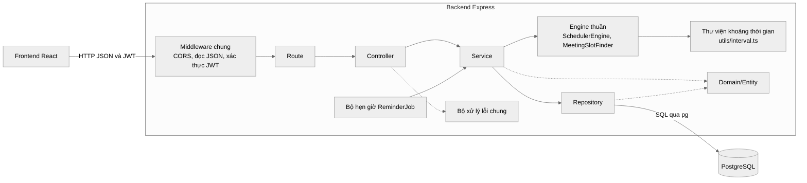

Hình 1: Luồng xử lý một yêu cầu qua các tầng của backend

Luồng chuẩn của một yêu cầu: middleware xác thực JWT và gắn `userId` vào yêu cầu, Route chuyển tới phương thức của Controller, Controller kiểm tra định dạng dữ liệu rồi gọi Service, Service kiểm tra quyền, áp dụng quy định nghiệp vụ, mở transaction khi cần và gọi Repository, Repository chạy câu SQL rồi trả về đối tượng Entity. Kết quả đi ngược lên, Controller đổi Entity sang JSON theo `api.md`. Lỗi ở bất kỳ tầng nào được ném dưới dạng `AppError` và bộ xử lý lỗi chung đổi sang dạng `{ "error": { code, message, details } }`.

Bộ hẹn giờ (`ReminderJob`, tác nhân Bộ hẹn giờ ở U035) không đi qua HTTP. Nó gọi thẳng `ReminderService`, giống sơ đồ tuần tự số 5 của TV4.

### 1.2 Trách nhiệm của từng tầng

Bảng 1: Trách nhiệm của các tầng

| Tầng | Được làm | Không được làm | Ví dụ |
| --- | --- | --- | --- |
| Route | Khai báo đường dẫn, phương thức HTTP, gắn middleware (xác thực, nhận tệp) và trỏ tới phương thức Controller | Chứa logic, gọi Service hay Repository | `router.post('/groups/:groupId/cards', authenticate, kanbanController.create)` |
| Controller (API) | Đọc `params`, `query`, `body`; kiểm tra kiểu, trường bắt buộc, định dạng thời gian ISO 8601 có hậu tố Z (BR-07); gọi đúng một phương thức Service; đổi kết quả sang JSON camelCase và chọn mã HTTP 200, 201, 204 | Kiểm tra quyền theo nhóm, áp dụng BR, gọi Repository, mở transaction, viết SQL | `KanbanController.create` kiểm tra `title` là chuỗi, `dueAt` đúng định dạng rồi gọi `KanbanService.createCard` |
| Service (Business Logic) | Kiểm tra quyền (thành viên nhóm, Trưởng nhóm, Người tổ chức họp); áp dụng BR-01 đến BR-08 và quy tắc của use case; mở transaction và khóa dòng; phối hợp nhiều Repository; gọi Engine; sinh cảnh báo `warnings`; lấy giờ hiện tại | Đọc `req`, `res`; viết SQL trực tiếp; trả mã HTTP | `GroupService.leaveGroup` khóa dòng nhóm, chuyển Trưởng nhóm, xóa thành viên, gỡ giao thẻ Kanban trong một transaction |
| Engine (thuộc tầng Service) | Tính toán thuần trên dữ liệu đã nạp: xếp lịch (TV3), tìm giờ rảnh chung (TV4), dùng thư viện khoảng thời gian | Đọc ghi CSDL, đọc giờ hiện tại, sửa dữ liệu đầu vào | `SchedulerEngine.planSlots(tasks, busy, window)` |
| Repository (Data Access) | Viết và chạy SQL có tham số (`$1`, `$2`); đổi dòng snake_case sang Entity camelCase và ngược lại; khóa dòng `FOR UPDATE`, `FOR SHARE` theo yêu cầu của Service; chỉ chọn đúng các cột được phép (BR-02) | Kiểm tra quyền, áp dụng BR, tự mở transaction, gọi Service | `FixedEventRepository.findBusyIntervals(userIds, from, to)` chỉ chọn `user_id`, `starts_at`, `ends_at` |
| Domain/Entity | Giữ dữ liệu của một dòng; các phương thức nghiệp vụ thuần trên chính đối tượng (đổi trạng thái hợp lệ, kiểm tra hết hạn, đổi sang `TimeInterval`); hằng số nghiệp vụ | Truy cập CSDL, gọi Service, đọc giờ hệ thống (giờ hiện tại luôn truyền vào qua tham số `now`) | `StudySlot.markStudied(now)`, `InvitationLink.isValidAt(now)` |

Tầng dữ liệu (PostgreSQL) giữ nguyên vai trò ở mục 1 M3: lưu trữ và bảo đảm toàn vẹn bằng khóa chính, khóa ngoại, NOT NULL, CHECK. CSDL không chứa logic nghiệp vụ, ngoài trigger dùng chung `set_updated_at()`.

### 1.3 Quy tắc phụ thuộc giữa các tầng

1. Chỉ gọi xuống tầng dưới liền kề: Controller → Service → Repository. Không có lời gọi ngược lên và không nhảy tầng (Controller không gọi Repository).
2. Domain/Entity không phụ thuộc tầng nào. Các tầng khác đều được dùng Entity.
3. Engine và thư viện khoảng thời gian là hàm hoặc lớp thuần, chỉ Service gọi.
4. Mỗi bảng có đúng một Repository, nằm trong module sở hữu bảng đó theo từ điển dữ liệu. Service của module khác được gọi Repository đó trong hai trường hợp: đọc qua phương thức chỉ trả các cột được phép, hoặc ghi chéo module đã ghi ở bảng "Giao dịch nhiều bảng" của từ điển (mục 4.3). Bảng 2 liệt kê đủ các trường hợp này. Muốn thêm trường hợp mới thì bổ sung vào bảng và nêu trong Pull Request.
5. Service gọi Service của module khác chỉ khi cần dùng lại cả một quy tắc nghiệp vụ, ví dụ kiểm tra tư cách thành viên (`MembershipService`) hay tính lại mốc nhắc việc (`ReminderService`). Không để hai Service gọi vòng lẫn nhau.

Bảng 2: Các phụ thuộc chéo module được phép

| Bên gọi | Bên được gọi | Mục đích | Căn cứ |
| --- | --- | --- | --- |
| `GroupService` (TV1) | `KanbanCardRepository.unassignMember` (TV5) | Rời nhóm thì thẻ đang giao cho người rời về chưa giao, cùng transaction | U007, U043, Giao dịch TV1 |
| `TaskService` (TV2) | `StudySlotRepository.deleteOpenSlotsOfTask` (TV3) | Xóa hoặc hoàn thành việc thì xóa khung `proposed` và khung `scheduled` chưa bắt đầu, cùng transaction | Yêu cầu 3.19, Giao dịch TV2, TV3 |
| `TaskService` (TV2) | `ReminderService.syncForTask` (TV4) | Lưu, sửa, hoàn thành việc thì tạo hoặc hủy mốc nhắc 24 giờ và 1 giờ trước hạn | U035, sơ đồ tuần tự TV4 số 5 |
| `WeekScheduleService` (TV2) | `StudySlotRepository.listForWeek` (TV3) | Lịch tuần lấy khung `scheduled`, `studied`, `missed`, không lấy `proposed` | BR-03, `GET /api/schedule/week` |
| `SchedulerService` (TV3) | `TaskRepository`, `FixedEventRepository` (TV2) | Đọc việc chưa hoàn thành và khoảng bận của chính sinh viên | Vùng TV3 từ điển dữ liệu |
| `MeetingSlotService` (TV4) | `FixedEventRepository.findBusyIntervals` (TV2) | Chỉ đọc `starts_at`, `ends_at` của thành viên nhóm | BR-02, yêu cầu 4.1 |
| `MeetingPermissionService` (TV4) | `GroupMemberRepository.setMeetingPermission` (TV1) | Bật, tắt quyền tổ chức họp | U036 |
| `MeetingSlotService`, `MeetingProposalService` (TV4) | `GroupMemberRepository` (TV1) | Đọc danh sách thành viên hiện tại và tên hiển thị (`displayName`) để tìm giờ họp chung, tạo lời mời và tính phản hồi | U031, U032, U034 |
| `MeetingProposalService` (TV4) | `GroupRepository.lockForUpdate` (TV1) | Khóa dòng nhóm khi tạo đề xuất họp để xếp hàng các lần gửi đồng thời và đồng bộ với rời nhóm | U032, Giao dịch TV1 |
| `MeetingSlotService`, `MeetingProposalService`, `MeetingPermissionService` (TV4), `KanbanService` (TV5) | `MembershipService` (TV1) | Kiểm tra người gọi thuộc nhóm, là Trưởng nhóm hoặc Người tổ chức họp | BR-02, mục 4.8 |
| `StatisticsService` (TV5) | `StudySlotRepository.sumStudiedMinutesByDay` (TV3) | Cộng thời lượng khung `studied` của chính người đăng nhập | US-33, U045 |

### 1.4 Transaction và khóa dòng

- Service là tầng duy nhất mở transaction, qua hàm dùng chung `withTransaction(work)` đặt cạnh `config/db.ts`. Hàm lấy một `PoolClient` từ `pool`, chạy `BEGIN`, gọi `work(client)`, rồi `COMMIT`, hoặc `ROLLBACK` nếu `work` ném lỗi, và luôn trả client về pool.
- Mọi phương thức Repository nhận tham số cuối là `db: Queryable` (kiểu chung của `Pool` và `PoolClient`). Khi chạy trong transaction, Service truyền client của transaction, nhờ vậy nhiều Repository của nhiều module cùng ghi trong một transaction mà không Repository nào tự mở transaction.
- Khóa dòng là phương thức riêng của Repository, ví dụ `GroupRepository.lockForUpdate(groupId, db)` (`SELECT id FROM groups WHERE id = $1 FOR UPDATE`), `ScheduleProposalRepository.lockById`. Service quyết định khi nào khóa, theo đúng thứ tự ở các bảng Giao dịch của từ điển dữ liệu.

### 1.5 Xử lý lỗi

Service và Controller ném lỗi thuộc lớp con của `AppError` (Hình 14). Mỗi lớp con gắn sẵn mã HTTP và `error.code` theo Bảng mã lỗi dùng chung của `api.md`. Middleware `errorHandler` đặt cuối chuỗi middleware, đổi `AppError` sang dạng lỗi thống nhất. Lỗi khác (lỗi lập trình, mất kết nối CSDL) trả `500 INTERNAL_ERROR` và không lộ chi tiết kỹ thuật. Mã lỗi riêng của module (ví dụ `NO_MAKEUP_SLOT` của TV3) truyền qua tham số `code` của lớp con tương ứng.

Cảnh báo (BR-01, BR-04) không phải lỗi. Service trả kèm danh sách `warnings` trong kết quả, Controller đặt ngang hàng với `data`.

### 1.6 Ánh xạ dữ liệu và quyền riêng tư

- Repository đổi tên cột snake_case sang thuộc tính camelCase của Entity. `timestamptz` thành `Date`, `uuid` thành `string`, cột trạng thái thành kiểu liệt kê (Bảng 3).
- Controller đổi Entity sang JSON theo `api.md`: thời điểm thành chuỗi ISO 8601 có mili giây và hậu tố Z (qua `toSlot` hoặc `toISOString()`), chỉ đưa ra các trường endpoint quy định. `passwordHash` không bao giờ rời tầng Service. `email` của người khác không bao giờ có trong JSON (BR-02).
- Dữ liệu lịch dùng cho nhóm chỉ đi qua `FixedEventRepository.findBusyIntervals`, phương thức chỉ chọn ba cột `user_id`, `starts_at`, `ends_at`. Không có phương thức nào trả `tasks` hay `study_slots` của người khác.

### 1.7 Cấu trúc thư mục đề xuất

Đề xuất để #115 dựng khung mã, chia theo module rồi theo tầng:

```text
backend/src/
  app.ts, server.ts
  config/            env.ts, db.ts (pool, query, withTransaction)
  middleware/        authenticate.ts, error-handler.ts
  shared/            base-entity.ts, base-repository.ts, errors.ts, time-range.ts
  utils/             interval.ts, validation.ts (đã có)
  modules/
    auth/            auth.routes.ts, auth.controller.ts, auth.service.ts, password-hasher.ts, token-signer.ts
    groups/          group.entity.ts, group-member.entity.ts, invitation-link.entity.ts, group.repository.ts, ...
    calendar/        fixed-event.entity.ts, task.entity.ts, ..., ics-parser.ts, csv-parser.ts
    scheduler/       schedule-proposal.entity.ts, study-slot.entity.ts, scheduler.engine.ts, ...
    meetings/        meeting-proposal.entity.ts, ..., meeting-slot.finder.ts, reminder.job.ts
    kanban/          kanban-card.entity.ts, kanban.service.ts, statistics.service.ts, ...
```

Mỗi tệp chứa một lớp, tên tệp kebab-case kèm hậu tố tầng (`.entity.ts`, `.repository.ts`, `.service.ts`, `.controller.ts`, `.routes.ts`). Test đặt ở `backend/tests` theo cấu trúc tương ứng.

## 2. Sơ đồ lớp

### 2.1 Quy ước vẽ

Sơ đồ viết bằng Mermaid `classDiagram`, header `%%{init: {'theme': 'neutral'}}%%` như các sơ đồ khác của nhóm. Ký hiệu thành viên: `+` công khai, `-` riêng tư, `#` bảo vệ; thành viên gạch chân là tĩnh (static); tên in nghiêng là lớp trừu tượng hoặc phương thức trừu tượng.

Loại quan hệ giữa các lớp thực thể được chọn theo hành vi `ON DELETE` của khóa ngoại tương ứng ở Bảng 4.2 từ điển dữ liệu, để sơ đồ lớp và ERD không mâu thuẫn:

Bảng 3: Ánh xạ quan hệ hướng đối tượng với CSDL

| Quan hệ | Ký hiệu Mermaid | Khi dùng | Số lượng |
| --- | --- | --- | --- |
| Kế thừa (Inheritance) | `<\|--` | Lớp con mở rộng lớp cha: 14 lớp thực thể kế thừa `BaseEntity`; các lớp lỗi kế thừa `AppError`; Repository kế thừa `BaseRepository` | |
| Hiện thực (Realization) | `<\|..` | Lớp cài đặt một giao diện: `FixedEvent`, `StudySlot`, `MeetingProposal` hiện thực `TimeRange`; `IcsParser`, `CsvParser` hiện thực `CalendarFileParser` | |
| Hợp thành (Composition) | `*--` | Khóa ngoại `ON DELETE CASCADE`: phần không tồn tại khi mất toàn thể | 7 |
| Kết tập (Aggregation) | `o--` | Khóa ngoại `ON DELETE SET NULL`: phần vẫn tồn tại khi mất toàn thể | 4 (khóa ngoại tự tham chiếu `replaces_slot_id` vẽ là liên kết) |
| Liên kết (Association) | `-->` | Khóa ngoại `ON DELETE RESTRICT` tới `users` và tham chiếu tự thân của `StudySlot` | 13 |
| Phụ thuộc (Dependency) | `..>` | Một lớp chỉ dùng lớp kia trong lúc chạy phương thức (tham số, giá trị trả về, gọi hàm), không giữ tham chiếu lâu dài | |

Tổng cộng 7 + 4 + 13 = 24 quan hệ, khớp 24 khóa ngoại ở Bảng 4.1 và 4.2 của từ điển dữ liệu.

Kiểu dữ liệu: `uuid` → `string`; `timestamptz` → `Date`; `varchar`, `text` → `string`; `integer` → `number`; `boolean` → `boolean`; cột cho phép rỗng → `T | null`; cột trạng thái có CHECK liệt kê → kiểu liệt kê (enumeration), giá trị đúng như từ điển.

### 2.2 Lớp cơ sở và giao diện dùng chung

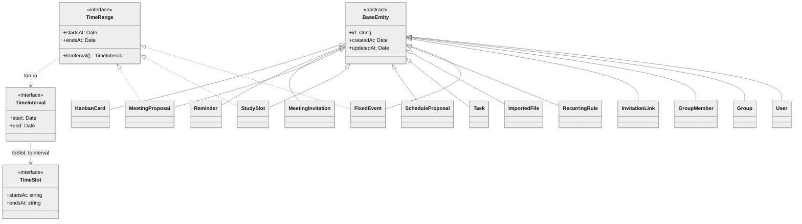

Hình 2: Lớp cơ sở BaseEntity, giao diện TimeRange và kiểu dữ liệu của thư viện khoảng thời gian

- `BaseEntity` gom ba cột chung mọi bảng đều có (mục 1.3, 1.4 từ điển): `id` (uuid), `created_at`, `updated_at`. Lớp trừu tượng, không tạo đối tượng trực tiếp.
- `TimeRange` là giao diện cho thực thể có khoảng thời gian `[startsAt, endsAt)` nửa mở (BR-01). Phương thức `toInterval()` trả `TimeInterval` để đưa vào thư viện `utils/interval.ts`. Ba lớp hiện thực: `FixedEvent`, `StudySlot`, `MeetingProposal`.
- `TimeInterval` và `TimeSlot` là hai kiểu đã có trong `utils/interval.ts` (mục 1.3 M3). `TimeInterval` dùng bên trong backend, `TimeSlot` dùng ở ranh giới API.

### 2.3 Sơ đồ lớp tổng thể

Sơ đồ tổng thể chỉ ghi tên lớp và quan hệ để đọc được trên một trang. Thuộc tính, phương thức và kiểu dữ liệu ở sơ đồ chi tiết từng module (mục 2.4 đến 2.8).

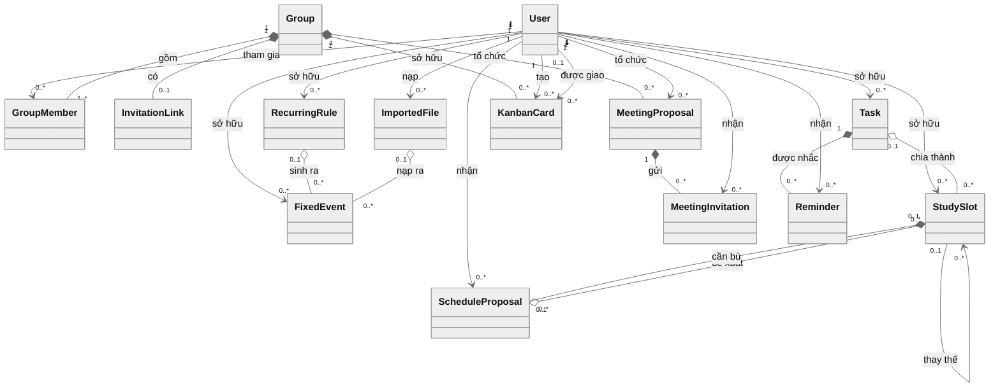

Hình 3: Sơ đồ lớp tổng thể các thực thể nghiệp vụ của 5 module

Đọc sơ đồ:

- Quan hệ giữa `User` và `Group` là nhiều – nhiều qua lớp `GroupMember`. Tương tự, `MeetingProposal` và `User` nhiều – nhiều qua `MeetingInvitation`.
- 7 quan hệ hợp thành ứng với 7 khóa ngoại CASCADE: nhóm bị xóa (thành viên cuối cùng rời, U007) kéo theo thành viên, liên kết mời, đề xuất họp (và lời mời của chúng), thẻ Kanban; việc bị xóa kéo theo nhắc việc (U035); khung "Bỏ lỡ" bị xóa kéo theo các lượt đề xuất bù của nó.
- 4 quan hệ kết tập ứng với SET NULL: khung "Đã học", "Bỏ lỡ" còn lại khi việc bị xóa để thống kê (yêu cầu 3.19); khung đã chấp nhận còn khi lượt đề xuất bị dọn; sự kiện cố định còn khi xóa quy tắc lặp hoặc nhật ký tệp nạp.
- Dữ liệu cá nhân (`FixedEvent`, `Task`, `StudySlot`, ...) chỉ liên kết với `User`, không với `Group`. Vì vậy xóa nhóm không ảnh hưởng lịch cá nhân (mục 4.8 tài liệu dự án).

### 2.4 Module TV1 – Tài khoản và nhóm

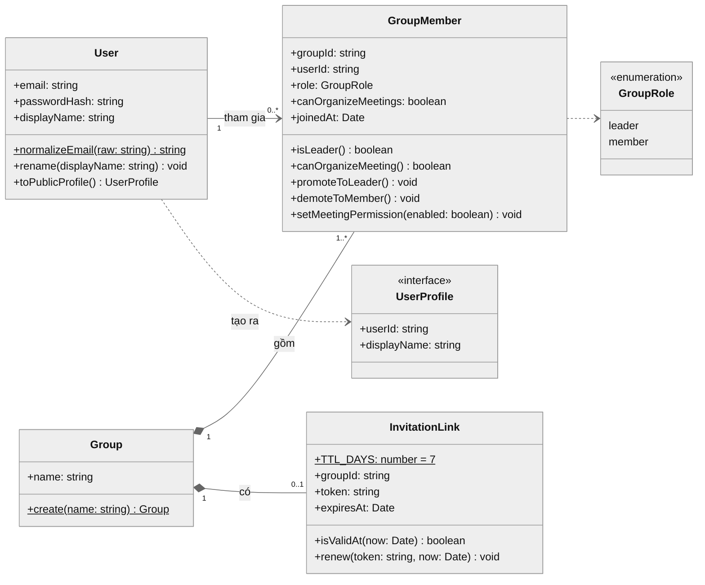

Hình 4: Sơ đồ lớp module TV1 – Tài khoản và nhóm

Bảng 4: Phương thức chính của các lớp thực thể TV1

| Lớp | Phương thức | Xử lý |
| --- | --- | --- |
| `User` | `normalizeEmail(raw)` (tĩnh) | Trả `lower(trim(raw))`, dùng trước khi tìm hoặc lưu email, khớp CHECK `ck_users_email_normalized` |
| `User` | `rename(displayName)` | Chuẩn hóa NFC, cắt khoảng trắng, kiểm tra 1–100 ký tự bằng `validateDisplayName` (BR-08); sai thì ném `ValidationError` |
| `User` | `toPublicProfile()` | Trả `{ userId, displayName }`, không có `email`, `passwordHash`. Dùng khi hiện thành viên cho người khác (BR-02) |
| `Group` | `create(name)` (tĩnh) | Kiểm tra tên nhóm 1–100 ký tự bằng `validateGroupName` (BR-08), tạo đối tượng chưa lưu |
| `GroupMember` | `isLeader()` | `role === 'leader'` |
| `GroupMember` | `canOrganizeMeeting()` | `isLeader() \|\| canOrganizeMeetings`. Trưởng nhóm mặc nhiên có quyền dù cột lưu `false` (U036) |
| `GroupMember` | `promoteToLeader()`, `demoteToMember()` | Đổi `role`. Khi lên Trưởng nhóm thì đặt `canOrganizeMeetings = false`. Service gọi `demoteToMember` cho Trưởng nhóm cũ trước rồi mới `promoteToLeader` người mới, vì chỉ mục `uq_group_members_one_leader_per_group` |
| `GroupMember` | `setMeetingPermission(enabled)` | Đổi `canOrganizeMeetings`; ném `ValidationError` nếu đối tượng là Trưởng nhóm |
| `InvitationLink` | `isValidAt(now)` | `expiresAt > now` |
| `InvitationLink` | `renew(token, now)` | Đặt mã mới và `expiresAt = now + 7 ngày` (U004). Mã cũ hết hiệu lực ngay |

### 2.5 Module TV2 – Lịch, sự kiện cố định và việc cần làm

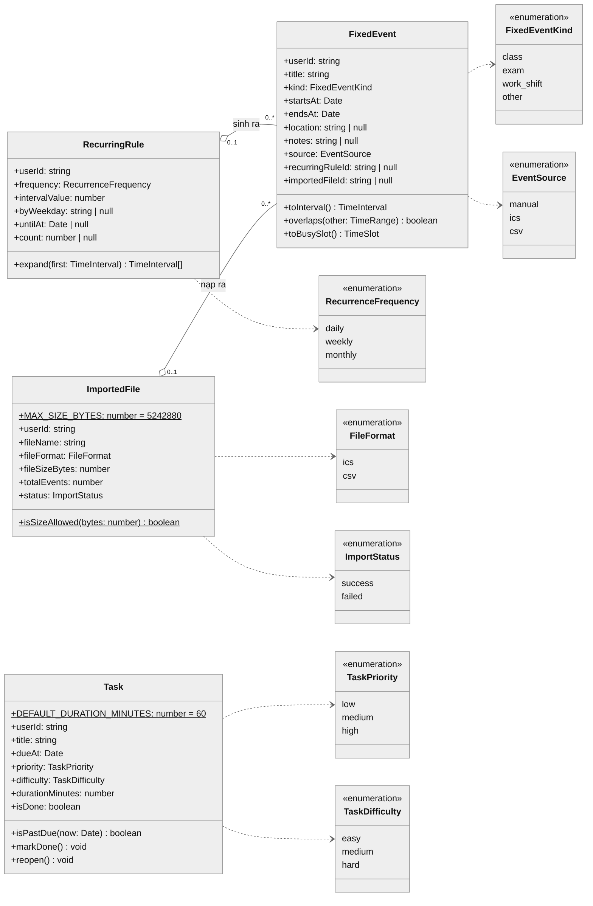

Hình 5: Sơ đồ lớp module TV2 – Lịch, sự kiện cố định và việc cần làm

Bốn lớp đều liên kết `User "1" --> "0..*"` qua cột `user_id` (Hình 3), không vẽ lại ở đây cho gọn.

Bảng 5: Phương thức chính của các lớp thực thể TV2

| Lớp | Phương thức | Xử lý |
| --- | --- | --- |
| `FixedEvent` | `toInterval()` | Trả `{ start: startsAt, end: endsAt }` cho thư viện khoảng thời gian |
| `FixedEvent` | `overlaps(other)` | Gọi `hasOverlap`: chạm nhau không tính là trùng (BR-01). Service dùng để sinh cảnh báo `FIXED_EVENT_OVERLAP`, không chặn lưu |
| `FixedEvent` | `toBusySlot()` | Chỉ trả `startsAt`, `endsAt` dạng `TimeSlot`, không có tên, loại, địa điểm (BR-02) |
| `RecurringRule` | `expand(first)` | Sinh các buổi lặp từ buổi đầu theo `frequency`, `intervalValue`, `byWeekday`, dừng ở `untilAt` hoặc `count` |
| `ImportedFile` | `isSizeAllowed(bytes)` (tĩnh) | `1 <= bytes <= 5 242 880` (BR-05); sai thì Service ném `FileTooLargeError` |
| `Task` | `isPastDue(now)` | `dueAt < now`. Service vẫn lưu và trả cảnh báo `DEADLINE_PASSED` (U012) |
| `Task` | `markDone()`, `reopen()` | Đổi `isDone`. Phần dọn khung giờ học và nhắc việc do `TaskService` làm trong cùng transaction (Bảng 2) |

Bộ đọc tệp lịch có giao diện chung `CalendarFileParser` với phương thức `parse(content): ParseResult`, hai lớp hiện thực `IcsParser` (RFC 5545) và `CsvParser` (RFC 4180). `ParseResult` gồm danh sách sự kiện hợp lệ và tối đa 20 lỗi đầu tiên (BR-06). Hai lớp này thuộc tầng Service, không phải thực thể, nên vẽ ở Hình 10.

### 2.6 Module TV3 – Đề xuất khung giờ học

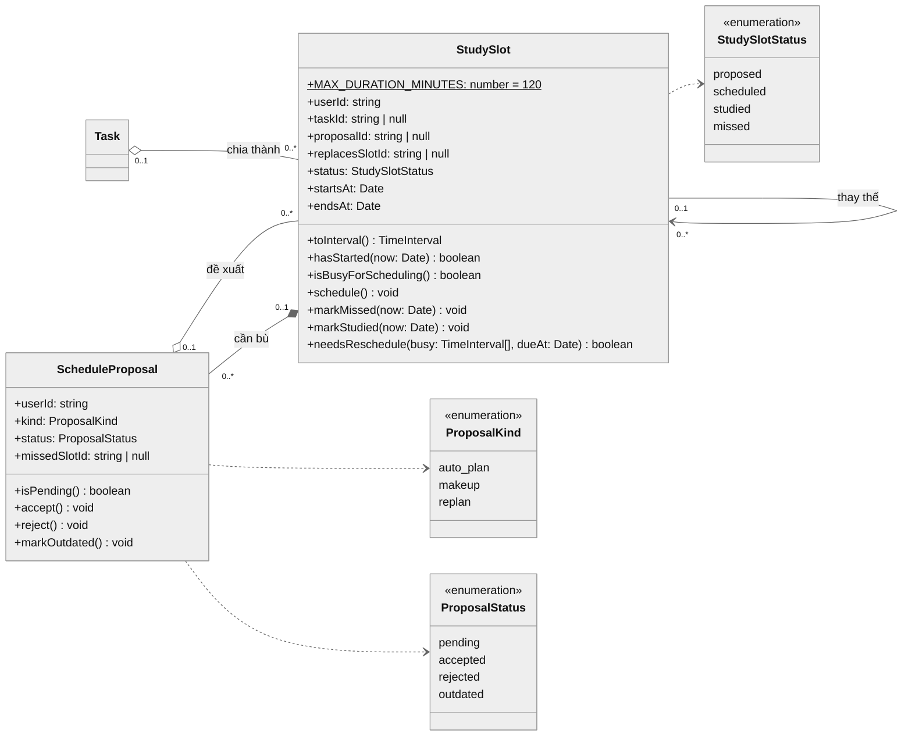

Hình 6: Sơ đồ lớp module TV3 – Đề xuất khung giờ học

Bảng 6: Phương thức chính của các lớp thực thể TV3

| Lớp | Phương thức | Xử lý |
| --- | --- | --- |
| `ScheduleProposal` | `isPending()` | `status === 'pending'` |
| `ScheduleProposal` | `accept()`, `reject()`, `markOutdated()` | Chuyển từ `pending` sang trạng thái tương ứng. Gọi khi không ở `pending` thì ném `ConflictError` (409); riêng trường hợp đã `accepted` thì Service trả lại kết quả cũ, không gọi `accept()` lần hai (yêu cầu 3.8, 3.13) |
| `StudySlot` | `hasStarted(now)` | `startsAt <= now` |
| `StudySlot` | `isBusyForScheduling()` | `status` là `scheduled` hoặc `studied`. Khung `proposed`, `missed` không tính bận (yêu cầu 3.1) |
| `StudySlot` | `schedule()` | `proposed` → `scheduled` khi sinh viên chấp nhận (BR-03) |
| `StudySlot` | `markMissed(now)` | `scheduled` → `missed`, chỉ khi `hasStarted(now)` (US-19). Điều kiện "không phải khung Cần xếp lại" do Service kiểm tra bằng `needsReschedule` trước khi gọi |
| `StudySlot` | `markStudied(now)` | `scheduled` → `studied`, chỉ khi `hasStarted(now)` và không phải khung "Cần xếp lại" (Service kiểm tra như trên). Khung đã `studied` thì không đổi gì (yêu cầu 3.20) |
| `StudySlot` | `needsReschedule(busy, dueAt)` | Trạng thái "Cần xếp lại", không lưu: khung `scheduled` giao với một khoảng bận hoặc kết thúc sau `dueAt` của việc (yêu cầu 3.18) |

Engine xếp lịch `SchedulerEngine` là lớp thuần của tầng Service (Hình 11), không phải thực thể: nhận danh sách `Task`, khoảng bận và phạm vi 7 ngày, trả các khung đề xuất chưa lưu.

### 2.7 Module TV4 – Họp nhóm, lời mời và nhắc việc

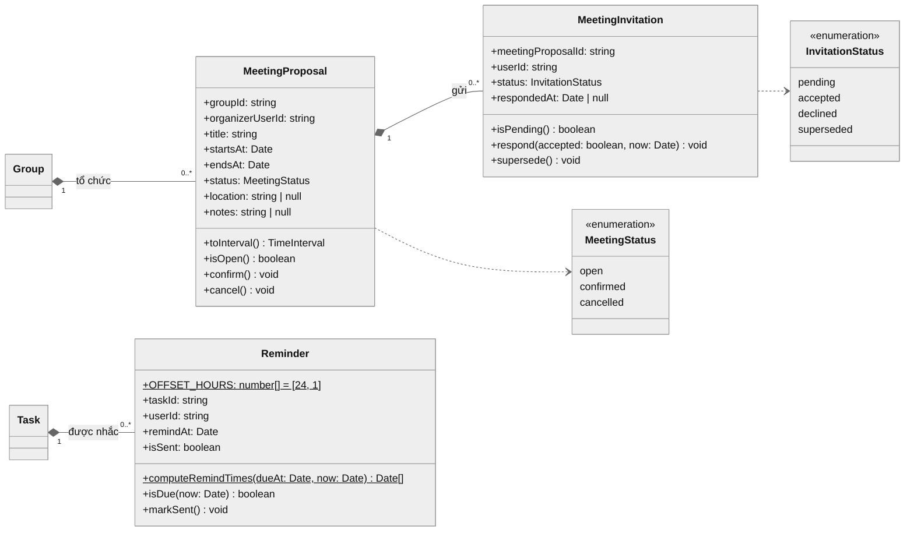

Hình 7: Sơ đồ lớp module TV4 – Họp nhóm, lời mời và nhắc việc

Bảng 7: Phương thức chính của các lớp thực thể TV4

| Lớp | Phương thức | Xử lý |
| --- | --- | --- |
| `MeetingProposal` | `isOpen()` | `status === 'open'` |
| `MeetingProposal` | `confirm()`, `cancel()` | `open` → `confirmed` hoặc `cancelled` (U032). Hủy thì giữ dòng để lưu vết, không xóa |
| `MeetingInvitation` | `respond(accepted, now)` | Đổi sang `accepted` hoặc `declined` và đặt `respondedAt = now` (U033). Lời mời `superseded` thì ném `ConflictError` |
| `MeetingInvitation` | `supersede()` | `pending` → `superseded` khi Người tổ chức họp gửi đề xuất mới trong nhóm (U032 4a). Lời mời đã phản hồi giữ nguyên |
| `Reminder` | `computeRemindTimes(dueAt, now)` (tĩnh) | Trả các mốc `dueAt − 24 giờ` và `dueAt − 1 giờ`, bỏ mốc đã qua `now`, không gửi bù (US-28) |
| `Reminder` | `isDue(now)` | `!isSent && remindAt <= now` |
| `Reminder` | `markSent()` | Đặt `isSent = true`, mỗi mốc gửi tối đa một lần (U035) |

Lớp tìm giờ rảnh chung `MeetingSlotFinder` (thuần, dùng `intersectIntervalLists`, `countCoveringLists`) và bộ hẹn giờ `ReminderJob` thuộc tầng Service, vẽ ở Hình 12.

### 2.8 Module TV5 – Kanban và thống kê

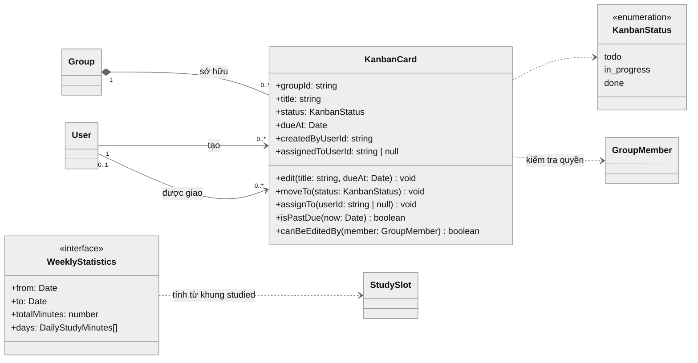

Hình 8: Sơ đồ lớp module TV5 – Kanban và thống kê

Bảng 8: Phương thức chính của lớp thực thể TV5

| Lớp | Phương thức | Xử lý |
| --- | --- | --- |
| `KanbanCard` | `edit(title, dueAt)` | Kiểm tra tên 1–200 ký tự bằng `validateKanbanCardTitle` (BR-08), đổi tên và hạn chót |
| `KanbanCard` | `moveTo(status)` | Đổi sang một trong ba cột cố định `todo`, `in_progress`, `done` (U042) |
| `KanbanCard` | `assignTo(userId)` | Giao cho một thành viên hoặc bỏ giao khi `userId = null` (U043). Service kiểm tra người gọi là Trưởng nhóm và người được giao đang là thành viên nhóm |
| `KanbanCard` | `isPastDue(now)` | `dueAt < now`, dùng cho cảnh báo hạn đã qua |
| `KanbanCard` | `canBeEditedBy(member)` | Người tạo thẻ hoặc Trưởng nhóm được sửa, xóa (U046) |

Thống kê tuần không có bảng riêng. `WeeklyStatistics` là kiểu kết quả do `StatisticsService` tính từ khung `studied` của chính người đăng nhập (US-33, U045), không phải thực thể lưu trữ.

### 2.9 Sơ đồ lớp tầng xử lý

Tầng xử lý của mỗi module vẽ thành một sơ đồ riêng (Hình 9 đến Hình 13), đọc từ trái sang phải theo luồng Controller → Service → Repository. Lớp của module khác vẽ ở dạng hộp chỉ có tên, kèm ghi chú module sở hữu, đúng các phụ thuộc chéo ở Bảng 2. Lớp Controller chỉ ghi tên vì mỗi phương thức của nó ứng đúng một endpoint ở `api.md`. Để sơ đồ gọn, phương thức Repository không ghi tham số cuối `db: Queryable` (mục 1.4), dù mọi phương thức Repository đều có tham số này.

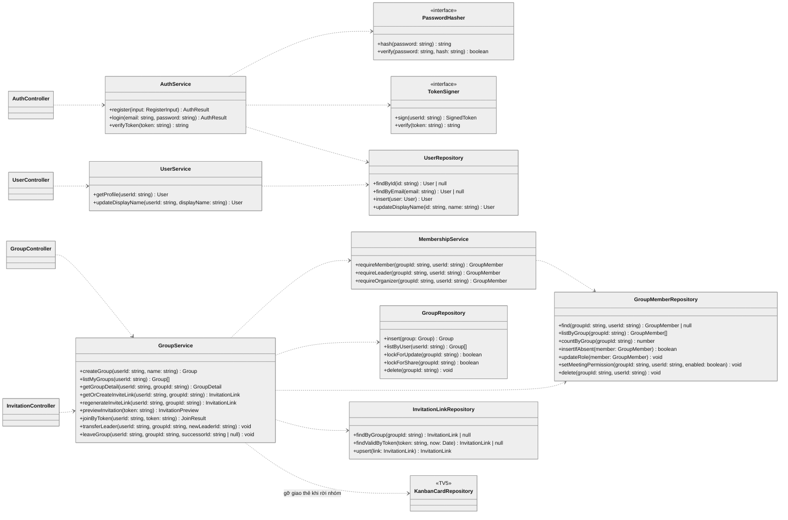

Hình 9: Sơ đồ lớp tầng xử lý module TV1

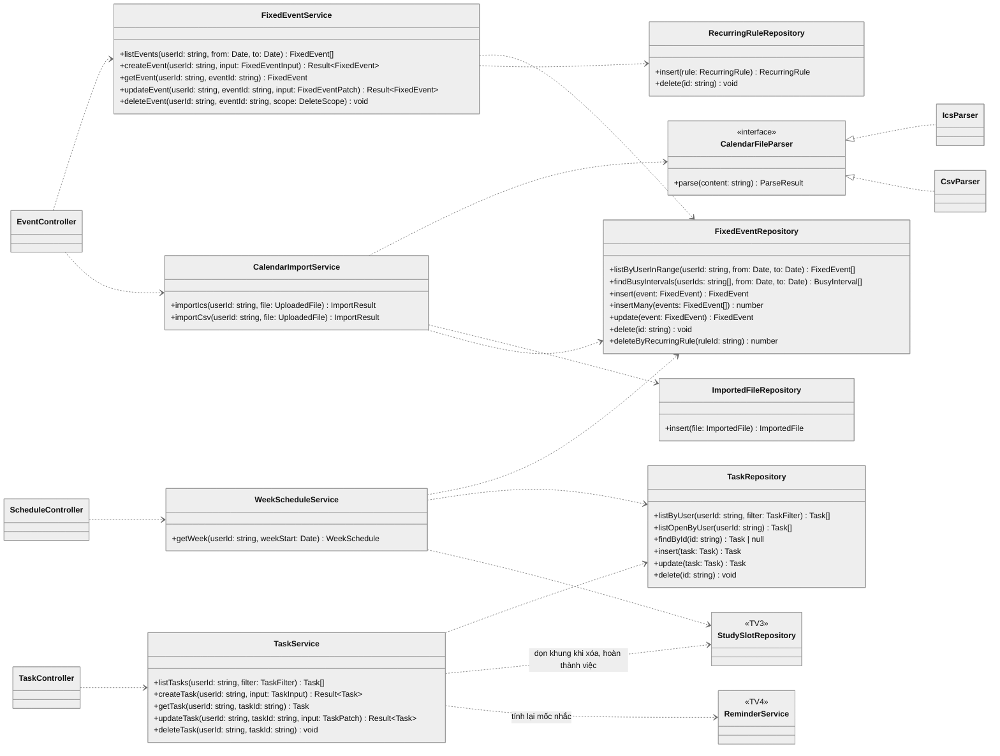

Hình 10: Sơ đồ lớp tầng xử lý module TV2

`Result<T>` là kiểu trả về gồm `data: T` và `warnings` (BR-01, BR-04). `BusyInterval` chỉ có `userId`, `startsAt`, `endsAt` (BR-02).

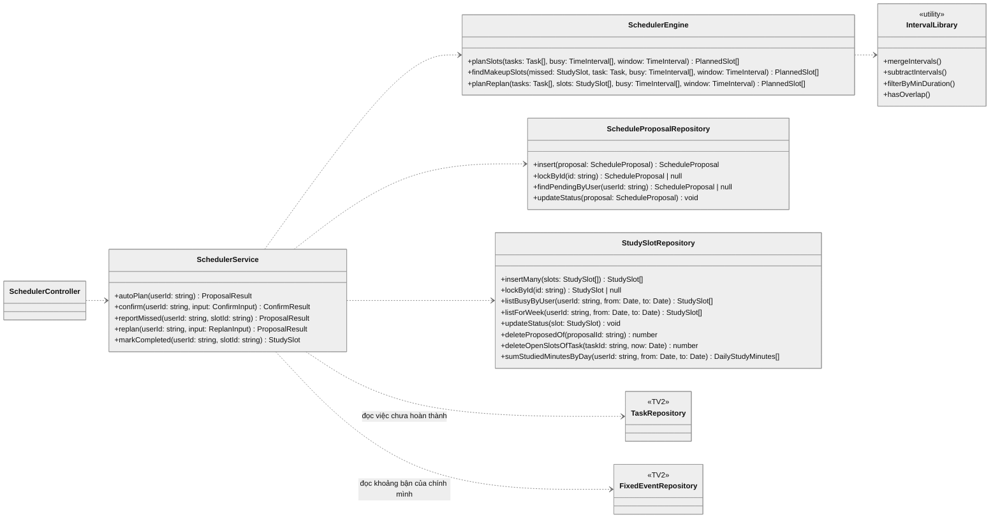

Hình 11: Sơ đồ lớp tầng xử lý module TV3

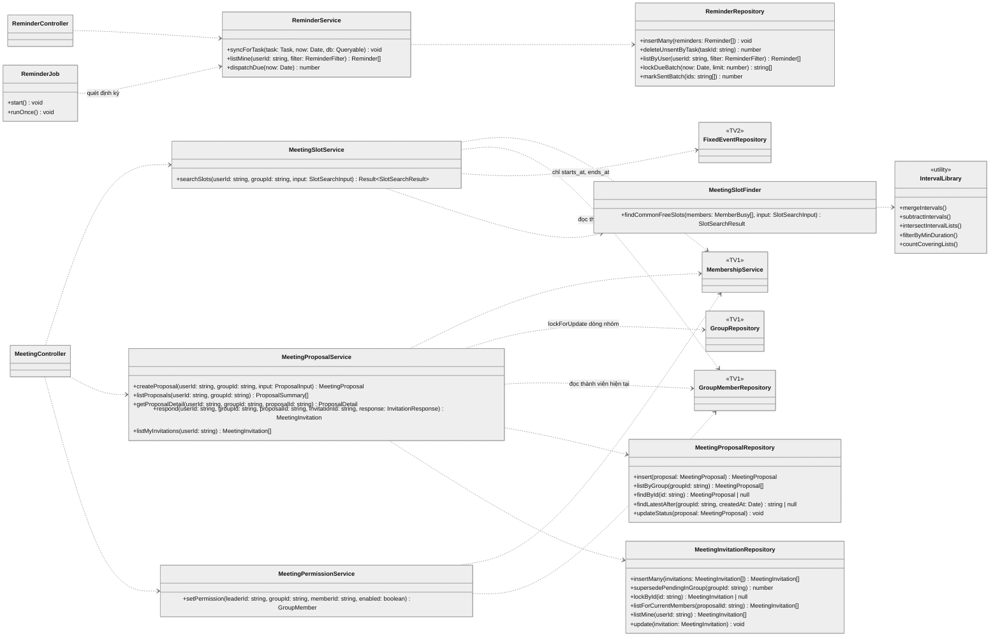

Hình 12: Sơ đồ lớp tầng xử lý module TV4

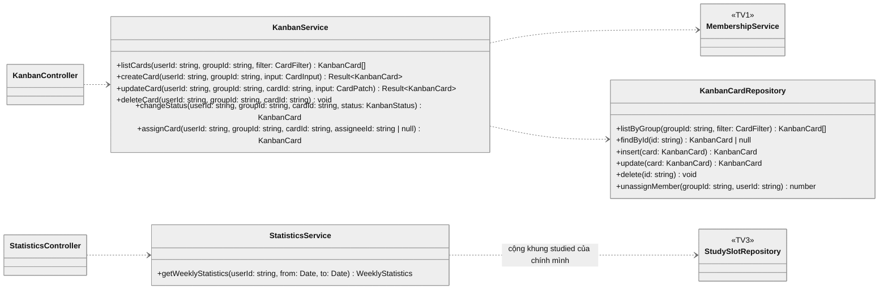

Hình 13: Sơ đồ lớp tầng xử lý module TV5

Bảng 9: Phương thức chính của tầng Service

| Module | Lớp | Phương thức chính | Endpoint, use case |
| --- | --- | --- | --- |
| TV1 | `AuthService` | `register(input)`, `login(email, password)`, `verifyToken(token)` | `POST /api/auth/register`, `POST /api/auth/login`; `verifyToken` dùng trong middleware `authenticate` |
| TV1 | `UserService` | `getProfile(userId)`, `updateDisplayName(userId, displayName)` | `GET`, `PATCH /api/users/me` |
| TV1 | `GroupService` | `createGroup(userId, name)`, `listMyGroups(userId)`, `getGroupDetail(userId, groupId)`, `getOrCreateInviteLink(userId, groupId)`, `regenerateInviteLink(userId, groupId)`, `previewInvitation(token)`, `joinByToken(userId, token)`, `transferLeader(userId, groupId, newLeaderId)`, `leaveGroup(userId, groupId, successorId)` | 9 endpoint nhóm và lời mời của TV1, U003–U007 |
| TV1 | `MembershipService` | `requireMember(groupId, userId)`, `requireLeader(groupId, userId)`, `requireOrganizer(groupId, userId)` | Trả `GroupMember` hoặc ném `ForbiddenError` (403). Dùng chung cho TV1, TV4, TV5 |
| TV2 | `FixedEventService` | `listEvents(userId, from, to)`, `createEvent(userId, input)`, `getEvent(userId, eventId)`, `updateEvent(userId, eventId, input)`, `deleteEvent(userId, eventId, scope)` | `/api/events`, U011, US-12 |
| TV2 | `CalendarImportService` | `importIcs(userId, file)`, `importCsv(userId, file)` | Nạp nguyên tử: lỗi bất kỳ dòng nào thì không ghi gì (BR-05, BR-06), U014, U015 |
| TV2 | `TaskService` | `listTasks(userId, filter)`, `createTask(userId, input)`, `getTask(userId, taskId)`, `updateTask(userId, taskId, input)`, `deleteTask(userId, taskId)` | `/api/tasks`, U012 |
| TV2 | `WeekScheduleService` | `getWeek(userId, weekStart)` | `GET /api/schedule/week` |
| TV3 | `SchedulerService` | `autoPlan(userId)`, `confirm(userId, input)`, `reportMissed(userId, slotId)`, `replan(userId, input)`, `markCompleted(userId, slotId)` | 5 endpoint `/api/scheduler/*`, U021–U024 |
| TV3 | `SchedulerEngine` | `planSlots(tasks, busy, window)`, `findMakeupSlots(missedSlot, task, busy, window)`, `planReplan(tasks, slots, busy, window)` | Hàm thuần, không đọc CSDL, không đọc giờ hiện tại |
| TV4 | `MeetingSlotService` | `searchSlots(userId, groupId, input)` | `POST /api/groups/{groupId}/meeting-slots/search`, U031 |
| TV4 | `MeetingSlotFinder` | `findCommonFreeSlots(members, input)` | Hàm thuần: trả khung cả nhóm cùng rảnh hoặc tối đa 10 khung nhiều người rảnh nhất kèm `score` và `rank` |
| TV4 | `MeetingProposalService` | `createProposal(userId, groupId, input)`, `listProposals(userId, groupId)`, `getProposalDetail(userId, groupId, proposalId)`, `respond(userId, groupId, proposalId, invitationId, response)`, `listMyInvitations(userId)` | U032–U034 |
| TV4 | `MeetingPermissionService` | `setPermission(leaderId, groupId, memberId, enabled)` | `PATCH .../meeting-permission`, U036 |
| TV4 | `ReminderService` | `syncForTask(task, now, db)`, `listMine(userId, filter)`, `dispatchDue(now)` | U035, `GET /api/users/me/reminders` |
| TV4 | `ReminderJob` | `start()`, `runOnce()` | Bộ hẹn giờ quét định kỳ (mặc định 60 giây), gọi `ReminderService.dispatchDue` |
| TV5 | `KanbanService` | `listCards(userId, groupId, filter)`, `createCard(userId, groupId, input)`, `updateCard(...)`, `deleteCard(...)`, `changeStatus(...)`, `assignCard(...)` | 6 endpoint `/api/groups/{groupId}/cards`, U041–U044, U046 |
| TV5 | `StatisticsService` | `getWeeklyStatistics(userId, from, to)` | `GET /api/statistics/weekly`, U045 |

Tên phương thức Repository theo mẫu `findById`, `findBy<Điều kiện>`, `listBy<Điều kiện>`, `insert`, `update`, `delete`, `lockForUpdate`. Các phương thức gọi chéo module đã nêu ở Bảng 2.

### 2.10 Lớp hạ tầng dùng chung

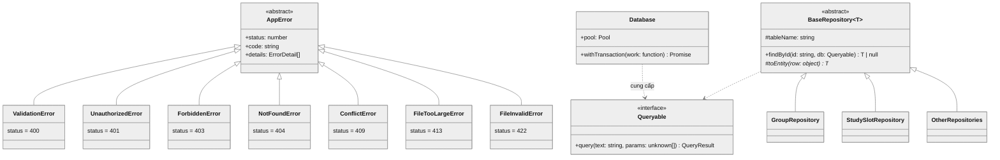

Hình 14: Lớp lỗi AppError, lớp cơ sở BaseRepository và Database

- `AppError` có 7 lớp con ứng với 7 mã lỗi dùng chung của `api.md` (`500 INTERNAL_ERROR` do `errorHandler` tự trả, không có lớp con).
- `BaseRepository<T>` gom phương thức chung `findById` và yêu cầu lớp con cài đặt `toEntity(row)`. Cả 14 Repository kế thừa lớp này (sơ đồ chỉ vẽ 2 lớp làm ví dụ).
- `Database` bọc `pool` đã có ở `config/db.ts` và thêm `withTransaction` (mục 1.4).

## 3. Lựa chọn chờ review

Các điểm sau là đề xuất của tài liệu này, chưa có trong tài liệu nào khác của nhóm. Người review hoặc chủ module có thể đổi.

1. Chia tầng ứng dụng thành Route, Controller, Service, Repository, Domain/Entity, và để kiểm tra định dạng ở Controller (mục 1 M3 ghi chung là "route", nay tách rõ).
2. Chọn loại quan hệ theo `ON DELETE` (Bảng 3), riêng khóa ngoại tự tham chiếu `replaces_slot_id` vẽ là liên kết.
3. Thêm lớp dùng chung `MembershipService` (TV1) cho các module có kiểm tra quyền theo nhóm, và tách `MeetingPermissionService` khỏi `MeetingProposalService`.
4. Giờ hiện tại luôn truyền vào phương thức Entity qua tham số `now` để test được mà không giả lập đồng hồ.
5. Cấu trúc thư mục ở mục 1.7, để #115 chốt.

Ngoài phạm vi tài liệu này: nơi triển khai (hosting), thuật toán băm mật khẩu và nơi frontend lưu token. Sơ đồ chỉ ghi giao diện `PasswordHasher` và `TokenSigner`, phần cài đặt cụ thể theo các mục tương ứng của M3.
