# Từ điển dữ liệu StudySync

Trạng thái: Đã tích hợp 5 module & ERD v1 (Chờ Nhi review #73) · Người soạn: Thư H.A., Thư Q.A. · Người review: Nhi · Ngày cập nhật: 13/11/2026

Phần 1 là quy ước thiết kế cơ sở dữ liệu (CSDL), Phần 2 là quyết định chọn công cụ migration và quy trình dùng chung. Từ điển từng bảng theo module đặt từ Phần 3 trở đi, theo khung của Thư Q.A. (việc 1 ở Task Tuần 4) và Template 8, cập nhật cùng Pull Request với migration. Số hiệu "việc" trong tài liệu này là số thứ tự ở tab Task Tuần 4.

Căn cứ: mục 4.8 tài liệu dự án, BR-01, BR-02, BR-04, BR-07, BR-08, báo cáo Yêu cầu (M2), Template 7 và Template 8.

## Phần 1. Quy ước thiết kế CSDL

Quy ước áp dụng cho mọi bảng của mọi module. Chủ module muốn làm khác thì nêu lý do trong Pull Request để cả nhóm đồng ý trước, không tự đặt riêng.

### 1.1 Nguyên tắc chung

- PostgreSQL từ phiên bản 14 trở lên, để dùng `gen_random_uuid()` có sẵn mà không cần cài extension và tương thích hoàn toàn với các công cụ bản mới. CSDL mã hóa UTF8, dùng schema `public`.
- Mọi thay đổi lược đồ đi qua migration nằm trong repo. Không sửa tay trên môi trường chạy thật.
- Tên bảng, cột, ràng buộc viết bằng tiếng Anh, chữ thường, không dấu, nối bằng gạch dưới. Tiếng Việt chỉ xuất hiện ở cột Ý nghĩa và phần mô tả trong tài liệu này.
- Cột mặc định là NOT NULL. Cột cho phép rỗng phải nêu lý do ở cột Ý nghĩa của từ điển.
- Thao tác ghi nhiều bảng trong cùng một nghiệp vụ chạy trong một transaction. Ví dụ tạo nhóm và dòng `group_members` của Trưởng nhóm (U003), hoặc chuyển vai trò Trưởng nhóm rồi xóa tư cách thành viên của người rời nhóm (U007), để không có lúc nhóm thiếu Trưởng nhóm.

### 1.2 Đặt tên

Bảng 1.1: Quy ước đặt tên

| **Đối tượng** | **Quy ước** | **Ví dụ** |
| :-- | :-- | :-- |
| Bảng | Danh từ số nhiều. Bảng nối đặt theo ý nghĩa của quan hệ, không ghép máy móc tên hai bảng | `users`, `groups`, `group_members`, `fixed_events` |
| Cột | Danh từ số ít, không lặp lại tên bảng | `title` (không phải `task_title`) |
| Khóa chính | Luôn là `id` | `id` |
| Khóa ngoại | Tên thực thể số ít cộng `_id`. Khi cột mang một vai trò riêng thì dùng vai trò cộng `_user_id` | `group_id`, `created_by_user_id` |
| Thời điểm | Hậu tố `_at` | `starts_at`, `ends_at`, `due_at` |
| Thời lượng | Hậu tố là đơn vị | `duration_minutes` |
| Đúng/sai | Tiền tố `is_` hoặc `has_` | `is_done` |
| Mật khẩu | Chỉ lưu bản băm | `password_hash` |

Tên bảng và cột không trùng từ khóa SQL (ví dụ `user`, `order`), đó cũng là một lý do dùng số nhiều.

Tên trường JSON của giao diện lập trình ứng dụng (API) do Nhi chốt ở việc 3. Backend chịu trách nhiệm đổi qua lại giữa tên cột của CSDL và tên trường của API, không đổi tên cột theo API.

### 1.3 Khóa chính và khóa ngoại

- Mọi bảng, kể cả bảng nối, có cột `id` kiểu `uuid`, là khóa chính, mặc định `gen_random_uuid()`. Không dùng `serial` hay `bigserial`, vì `id` lộ ra API không được cho biết số lượng hay thứ tự dòng. Mã trong liên kết mời vẫn là cột riêng, sinh ngẫu nhiên và có hạn 7 ngày (U004), không dùng `id`.
- Bảng nối thêm ràng buộc duy nhất cho cặp khóa ngoại, ví dụ `group_members` duy nhất theo `group_id` và `user_id` (U005: mỗi Sinh viên chỉ có một dòng thành viên trong mỗi nhóm).
- Khóa ngoại luôn là ràng buộc thật, đặt tên theo mục 1.6 và ghi rõ `ON DELETE` theo mục 1.5. Không để mặc định ngầm.
- Mỗi cột khóa ngoại có chỉ mục, hoặc đứng đầu một chỉ mục duy nhất, vì PostgreSQL không tự tạo chỉ mục cho khóa ngoại.

### 1.4 Kiểu dữ liệu và quy tắc cột

Bảng 1.2: Kiểu dữ liệu chuẩn

| **Dữ liệu** | **Kiểu** | **Ghi chú** |
| :-- | :-- | :-- |
| Khóa chính, khóa ngoại | `uuid` | |
| Thời điểm | `timestamptz` | Lưu theo giờ phối hợp quốc tế (UTC), BR-07. Không dùng `timestamp` không múi giờ |
| Khoảng thời gian | Hai cột `starts_at`, `ends_at`, kèm CHECK `ends_at > starts_at` | Hiểu theo nửa mở `[starts_at, ends_at)`, nên khung nối tiếp không tính là trùng (BR-01) |
| Tên nhóm, tên hiển thị ở hồ sơ | `varchar(100)` | BR-08 |
| Tên việc, sự kiện cố định, thẻ Kanban | `varchar(200)` | BR-08 |
| Văn bản tùy chọn chưa có giới hạn nghiệp vụ (địa điểm, ghi chú của sự kiện cố định) | `text`, cho phép rỗng | BR-08 chưa quy định độ dài cho các trường này. Muốn giới hạn thì bổ sung vào BR-08 trước, rồi đổi sang `varchar(n)` |
| Trạng thái, loại | `varchar(30)` kèm CHECK liệt kê giá trị | Giá trị lưu là mã tiếng Anh snake_case không dấu (ví dụ `scheduled`, `missed`), nhãn tiếng Việt như "Đã xếp", "Bỏ lỡ" do ứng dụng gắn (yêu cầu A1 của báo cáo Yêu cầu). Không dùng kiểu ENUM của PostgreSQL, vì đổi hoặc bỏ một giá trị ENUM khó hơn nhiều khi viết migration và rollback. Nới độ dài khi giá trị dài hơn 30 ký tự |
| Mức có thứ tự (độ ưu tiên, độ khó) | `varchar(30)` kèm CHECK liệt kê giá trị | Lưu chuỗi mã tiếng Anh chữ thường không dấu: `priority IN ('low', 'medium', 'high')`; `difficulty IN ('easy', 'medium', 'hard')` (US-09, yêu cầu 2.3). Nhãn Thấp/Trung bình/Cao và Dễ/Trung bình/Khó do ứng dụng gắn. Không dùng ENUM để thuận tiện migration và rollback |
| Thời lượng | `integer`, đơn vị phút | Giao diện nhập theo giờ, bước 0,5 (yêu cầu 2.3), nên 1,5 giờ lưu là 90. Chỉ việc cần làm có thời lượng, mặc định 60 (BR-04). Thẻ Kanban không có cột này |
| Đúng/sai | `boolean NOT NULL DEFAULT false` | |
| Mật khẩu | `text` | Chỉ lưu bản băm, không lưu thô |

Quy tắc cho cột tên (BR-08):

- NOT NULL, kèm CHECK `char_length(cột) >= 1`.
- Lớp phòng thủ phụ ở CSDL: thêm CHECK `cột = btrim(cột)` để bắt trường hợp ứng dụng quên cắt khoảng trắng đầu/cuối trước khi lưu (lưu ý `btrim` của PostgreSQL cắt dấu cách chuẩn ASCII).
- Ứng dụng chuẩn hóa NFC và cắt khoảng trắng đầu cuối trước khi ghi, CSDL lưu đúng chuỗi đó. CSDL không tự chuẩn hóa.
- Vì CSDL mã hóa UTF8, `char_length` và `varchar(n)` đếm theo ký tự Unicode, khớp cách đếm theo code point của BR-08.

Quy tắc cho thời gian (BR-07):

- Mọi cột thời gian là `timestamptz`, không lưu giờ địa phương. Việc đổi sang giờ Việt Nam chỉ làm ở lớp hiển thị và biểu mẫu nhập.
- API nhận chuỗi ISO 8601 hậu tố Z và luôn trả có phần mili giây (Template 7).

Cột chung:

- Mọi bảng có `created_at` và `updated_at`, kiểu `timestamptz NOT NULL DEFAULT now()`.
- `updated_at` do trigger dùng chung `set_updated_at()` cập nhật. Hàm này tạo một lần ở migration khởi tạo, mỗi bảng gắn trigger trong migration tạo bảng đó.

### 1.5 Cơ chế xóa

Xóa thật. Không dùng xóa mềm, nghĩa là không có cột `deleted_at` hay `is_deleted`. Lý do rút từ chính các quy tắc của dự án:

- US-12 xóa sự kiện cố định và việc cần làm khỏi CSDL để bỏ dữ liệu nhập sai, U046 ghi thẻ Kanban đã xóa không khôi phục được, mục 4.8 ghi nhóm bị xóa cùng dữ liệu riêng của nhóm khi người cuối cùng rời (U007).
- Nhắc việc không gửi cho việc đã xóa (U035).
- Xóa mềm buộc mọi truy vấn phải nhớ lọc dòng đã xóa. Quên một chỗ thì engine xếp lịch tính nhầm sự kiện đã xóa (BR-01), hoặc API nhóm trả dữ liệu không còn tồn tại (BR-02).

Trạng thái nghiệp vụ như "đã thay thế" của lời mời họp (U032) hay "bỏ lỡ" của khung giờ học đề xuất là giá trị của cột trạng thái, không phải xóa.

Mỗi khóa ngoại phải ghi rõ một trong ba kiểu `ON DELETE` ở Bảng 1.3.

Bảng 1.3: Quy tắc ON DELETE

| **Trường hợp** | **ON DELETE** | **Ví dụ minh họa (Thư H.A. chốt chính thức ở việc 15)** |
| :-- | :-- | :-- |
| Dòng con thuộc trọn về dòng cha, mất cha thì vô nghĩa | `CASCADE` | `group_members.group_id`, `kanban_cards.group_id`, `meeting_proposals.group_id`, `meeting_invitations.meeting_proposal_id`, `reminders.task_id` (mục 4.8: xóa nhóm kéo theo các dữ liệu riêng của nhóm) |
| Tham chiếu tùy chọn, mất cha thì dòng con vẫn có nghĩa | `SET NULL` (cột phải cho phép rỗng) | `study_slots.task_id`: khung "Đã học" và "Bỏ lỡ" được giữ lại khi việc cần làm bị xóa để còn thống kê (yêu cầu 3.19 của báo cáo Yêu cầu), nên không xóa theo việc |
| Cha không được xóa khi còn con | `RESTRICT` | Mọi khóa ngoại trỏ tới `users.id`, kể cả `created_by_user_id` |

Ba quy tắc đi kèm Bảng 1.3:

- Dữ liệu cá nhân (sự kiện cố định, việc cần làm, khung giờ học đề xuất) chỉ có khóa ngoại tới `users`, không tới `groups`. Nhờ vậy khi nhóm bị xóa, lịch và việc cá nhân giữ nguyên như mục 4.8 yêu cầu.
- Tài khoản không bị xóa trong phạm vi hiện tại vì không có story xóa tài khoản, nên khóa ngoại tới `users` dùng `RESTRICT`.
- Một số việc dọn dẹp khi rời nhóm do ứng dụng làm cùng lúc xóa dòng `group_members`, không dựa vào khóa ngoại: thẻ Kanban về trạng thái chưa giao khi người được giao rời nhóm (U043), phản hồi lời mời họp của người rời nhóm không còn được tính (U033, U034), quyền ủy quyền tổ chức họp tự mất (U036). Chủ module TV4 và TV5 chọn cách làm cụ thể trong từ điển của mình.

### 1.6 Tên ràng buộc, chỉ mục, trigger

Đặt tên rõ để thông báo lỗi và file migration đọc được ngay (Bảng 1.4).

Bảng 1.4: Mẫu tên ràng buộc, chỉ mục và trigger

| **Loại** | **Mẫu** | **Ví dụ** |
| :-- | :-- | :-- |
| Khóa chính | `pk_<bảng>` | `pk_users` |
| Khóa ngoại | `fk_<bảng>_<cột>` | `fk_fixed_events_user_id` |
| Duy nhất | `uq_<bảng>_<cột>...` | `uq_users_email`, `uq_group_members_group_id_user_id` |
| CHECK | `ck_<bảng>_<quy tắc>` | `ck_groups_name_not_empty`, `ck_fixed_events_ends_after_starts` |
| Chỉ mục | `idx_<bảng>_<cột>...` | `idx_fixed_events_user_id_starts_at` |
| Trigger | `trg_<bảng>_<việc>` | `trg_tasks_set_updated_at` |

PostgreSQL cắt tên dài quá 63 byte. Tên nào vượt thì rút gọn phần quy tắc hoặc danh sách cột, giữ tiền tố, và ghi tên đầy đủ vào phần Ghi chú của bảng trong từ điển.

### 1.7 Quyền riêng tư (BR-02)

Mỗi bảng có nội dung riêng tư ghi dòng Quyền riêng tư trong từ điển (đã có ở mẫu Template 8). Dữ liệu lịch dùng cho nhóm chỉ gồm `starts_at` và `ends_at` của `fixed_events`. Mọi cột còn lại của `fixed_events` (tên, loại, địa điểm, ghi chú) và toàn bộ `tasks`, `study_slots` không được trả cho nhóm, vì khung giờ học và việc cần làm không được coi là bận khi tìm giờ họp (yêu cầu 4.1). Quyền được kiểm tra ở API, không chỉ ẩn ở giao diện (mục 4.8).

### 1.8 Chỗ khác với bản đề xuất ở Template 8

Template 8 ghi các quy ước này là đề xuất, chốt ở Tuần 4. Bản chốt khác ba điểm:

1. Khóa chính chốt là `uuid` (Template 8 ghi "uuid hoặc bigint").
2. Cột khóa ngoại có vai trò riêng dùng `<vai trò>_user_id`, ví dụ `created_by_user_id`, thay cho `created_by` ở dòng `kanban_cards` trong danh sách bảng dự kiến.
3. Tiền tố `fk_` dùng đặt tên ràng buộc khóa ngoại, không đặt cho tên cột. Tên cột khóa ngoại giữ dạng `<thực thể số ít>_id` như Template 8.

## Phần 2. Công cụ migration

### 2.1 Quyết định

Dùng node-pg-migrate, viết migration bằng TypeScript, lưu ở `backend/migrations/`. Công cụ đọc chuỗi kết nối từ biến `DATABASE_URL`, đã có sẵn trong `backend/.env.example`.

### 2.2 So sánh ba lựa chọn

Bảng 2.1: So sánh node-pg-migrate, Knex và Prisma Migrate

| **Tiêu chí** | **node-pg-migrate** | **Knex** | **Prisma Migrate** |
| :-- | :-- | :-- | :-- |
| Rollback | Có `up`, `down`, `redo`; down viết tường minh được | Có `migrate:rollback` theo từng batch, có `--all` | Không hỗ trợ down. Muốn lùi phải tự sinh file SQL bằng `migrate diff`, chạy bằng `db execute` rồi đánh dấu bằng `migrate resolve --rolled-back` |
| Phạm vi | Chỉ PostgreSQL, API gần SQL, có chỗ chèn SQL thô | Query builder cho nhiều CSDL, migration là một phần | Nguồn sự thật là file `schema.prisma`, kéo theo công cụ ánh xạ đối tượng quan hệ (ORM) và bước `prisma generate` |
| TypeScript | Hỗ trợ file `.ts`. Tích hợp sẵn jiti từ bản 9 để nạp TypeScript cho cả CommonJS lẫn ESM | Cần `knexfile` và `ts-node`; cấu hình nạp TypeScript phức tạp hơn khi kết hợp nodenext/ESM | Có, qua client sinh tự động |
| Kết nối | Mặc định đọc `DATABASE_URL` | Cấu hình trong `knexfile` | Cấu hình riêng cho Prisma |
| Phụ thuộc thêm | `pg` | Knex, `pg`, `ts-node` | Prisma CLI, engine và client sinh ra |
| Phù hợp tích hợp liên tục và triển khai liên tục (CI/CD) | Một lệnh `up` | Một lệnh `migrate:latest` | `migrate deploy` trên môi trường chạy thật; `migrate dev` cần shadow database |

Nguồn: tài liệu của node-pg-migrate, Knex và Prisma, tra ngày 09/11/2026 (xem mục 2.7).

### 2.3 Vì sao chọn node-pg-migrate

- Cần rollback khi làm nhóm. Chỉ hai công cụ còn lại có down dùng được, và Prisma phải làm thủ công.
- Nhóm đã chọn Node.js, Express và PostgreSQL (D3) nhưng chưa quyết định ORM. Chọn Prisma là chọn luôn cách truy vấn của cả backend, việc đó thuộc quyền Nhi và nằm ngoài việc 4. node-pg-migrate không ràng buộc cách truy vấn.
- Phần lớn việc của dự án là bảng, CHECK, khóa ngoại, trigger `updated_at`. Viết gần SQL thì Thư H.A., Nhi và Thư Q.A. (điểm CSDL 3 đến 4 trên 4) review dễ, còn Hưng làm migration khởi tạo (việc 16) chỉ cần đọc vài ví dụ.
- Dùng được `DATABASE_URL` sẵn có, một lệnh `up` đủ cho GitHub Actions và bước triển khai ở mục 4.10.

### 2.4 Rủi ro và cách giảm

- Phiên bản công cụ và yêu cầu môi trường: Cài bản ổn định `node-pg-migrate@9.0.0` (dist-tag `latest`, tra qua npm ngày 09/11/2026), cài bằng `--save-exact` để mọi người cùng một bản, ghi số bản vào `backend/README.md`. Về yêu cầu Node.js: `node-pg-migrate@9.0.0` yêu cầu Node từ 20.11 (`>=20.11.0`); hiện tại `backend/package.json` đã chốt `engines: { "node": ">=22.12" }`, file `.nvmrc` là 24 và CI chạy Node 24 nên hoàn toàn đáp ứng tốt. Về CSDL: sử dụng PostgreSQL từ phiên bản 14 trở lên.
- Mô-đun hóa (ESM và CommonJS): Dự án backend hiện dùng TypeScript với cấu hình `module: nodenext` (chưa bật `"type": "module"` trong `package.json`). `node-pg-migrate` từ bản 9 tích hợp `jiti` để nạp TypeScript, hỗ trợ cả hai định dạng. Cần kiểm tra kỹ cờ/lệnh chạy ở việc 16 khi chạy thử lệnh migration.
- Chỉ dùng được với PostgreSQL. Chấp nhận, vì D3 đã cố định PostgreSQL.
- Cú pháp lệnh, đặc biệt cờ chọn ngôn ngữ TypeScript, khác nhau giữa các bản. Người làm việc 16 ghi đúng lệnh đã chạy thử vào `backend/README.md`, tài liệu này không chép lại.

### 2.5 Quy trình dùng chung

Cú pháp cụ thể theo `backend/README.md`. Các bước dưới đây gọi bốn script trong `backend/package.json`: `migrate:create`, `migrate:up`, `migrate:down`, `migrate:redo`.

1. Tạo migration bằng `migrate:create <mô-tả-ngắn>`, không tự đặt tên file. Công cụ gắn dấu thời gian vào đầu tên. Mô tả viết tiếng Anh không dấu, bắt đầu bằng động từ, ví dụ `create-users`, `add-due-at-to-tasks`.
2. Một migration làm một việc. Mỗi migration có cả `up` và `down` viết tường minh, `down` đảo đúng những gì `up` làm, gồm cả chỉ mục, ràng buộc và trigger. Không dựa vào down tự suy ra.
3. Chỉ dùng migration để đổi lược đồ. Dữ liệu mẫu cho demo để ngoài thư mục `migrations/`.
4. Trước khi mở Pull Request, chạy `migrate:up`, rồi `migrate:down`, rồi `migrate:up` lại trên CSDL máy cá nhân để chắc cả hai chiều chạy được. Dữ liệu thử là dữ liệu giả (mục 4.9), nên khi hỏng có thể xóa CSDL cục bộ, tạo lại và chạy `migrate:up`.
5. Pull Request có migration phải cập nhật bảng tương ứng trong file này (mục kiểm tra "Nếu đổi CSDL" ở Template 2), điền "có migration mới" ở mục Ảnh hưởng đến phần khác và gắn Thư H.A. review. Migration của Thư H.A. do Nhi review (mục 4.4).
6. Không sửa migration đã merge vào `main`. Muốn đổi thì tạo migration mới. Migration chưa merge thì tự do sửa hoặc xóa.
7. Hai người cùng tạo migration trên hai nhánh có thể gặp lỗi thứ tự khi migration của người merge sau mang dấu thời gian cũ hơn migration đã chạy. Cách xử lý: đổi tên file của mình (chưa merge) sang dấu thời gian mới hơn rồi chạy lại.
8. Lùi migration khi phát triển: ở máy cá nhân dùng `migrate:down` (từng bước). Nếu migration đã merge vào `main` mà gây lỗi, không sửa tay CSDL và không chỉ revert bằng Git. Tạo migration mới sửa tiếp. Chỉ chạy `down` trên môi trường chạy thật khi Thư H.A. quyết định, sau khi sao lưu thêm CSDL (ngoài lịch sao lưu ở mục 4.10).
9. Tích hợp liên tục (CI), đề xuất làm ở việc 16 hoặc Pull Request riêng của Thư H.A.: job GitHub Actions dựng một PostgreSQL trống, chạy `up`, chạy toàn bộ `down` về trống, rồi `up` lại để bắt migration có `down` hỏng.
10. Môi trường chạy thật: chạy `up` trước khi bản backend mới chạy. Cách chạy (trong bước triển khai hay chạy tay) chốt cùng lúc chọn hosting ở việc 17. Nếu dịch vụ hosting bắt buộc kết nối SSL thì đặt `PGSSLMODE` theo tài liệu của công cụ.

### 2.6 Việc kéo theo

- Việc 16 (Hưng): cài node-pg-migrate bản 9.0.0 theo mục 2.4, thêm bốn script ở mục 2.5, ghi phiên bản và lệnh vào `backend/README.md`, ghi PostgreSQL từ 14 vào phần Yêu cầu môi trường.
- Thư H.A. báo Kiên sửa Template 8 ở bản gộp theo mục 1.8 (sửa ở tab riêng theo ghi chú đầu doc Templates).
- Việc 3 (Nhi): chốt kiểu tên trường JSON (mục 1.2).
- Việc 10 (Nhi): `study_slots.task_id` cho phép rỗng (Bảng 1.3). Đã chốt ở Issue #56: khung "Đã học" và "Bỏ lỡ" của việc đã xóa không lưu tên việc, CSDL giữ nguyên (không thêm cột). API trả `taskId: null`, giao diện hiện nhãn mặc định, ví dụ "Việc đã xóa" (xem Quy ước chung trong `docs/api.md`).
- Việc 9 (Hưng) và việc 15 (Thư H.A.): ví dụ `fixed_events` ở Template 8 chưa có cột địa điểm và ghi chú, trong khi U011 cho nhập hai trường này. Bổ sung theo Bảng 1.2.

### 2.7 Nguồn tham khảo

1. node-pg-migrate, trang Upgrading và tài liệu chính: https://salsita.github.io/node-pg-migrate/upgrading
2. Knex, Migrations: https://knexjs.org/guide/migrations
3. Prisma, Generating down migrations: https://www.prisma.io/docs/orm/prisma-migrate/workflows/generating-down-migrations

## Phần 3. Từ điển bảng theo module

> Khung tài liệu theo Template 8 và các quy ước đã chốt ở Phần 1. Bản tích hợp đầy đủ 14 bảng CSDL của 5 module.
> Thư H.A. sở hữu lược đồ và chốt tên bảng khi vẽ ERD; Thư Q.A. cùng vẽ ERD và viết từ điển.

### Tổng quan bảng theo module và Ánh xạ Báo cáo M3

Bảng sau tổng hợp 14 bảng CSDL của 5 module, kèm đối chiếu số thứ tự Bảng trong Báo cáo Phân tích thiết kế M3 (mục 2.3). Do thiết kế chi tiết mở rộng từ 10 bảng gợi ý ban đầu lên 14 bảng, các bảng trong M3 mục 2.3 được đánh số liên tục từ Bảng 2.2 đến Bảng 2.15:

| Module | Bảng | Thực thể | Ánh xạ M3 (mục 2.3) | Trạng thái |
| --- | --- | --- | --- | --- |
| TV1 | `users` | Người dùng | Bảng 2.2 | Đã tích hợp (Chờ review) |
| TV1 | `groups` | Nhóm | Bảng 2.3 | Đã tích hợp (Chờ review) |
| TV1 | `group_members` | Thành viên nhóm | Bảng 2.4 | Đã tích hợp (Chờ review) |
| TV1 | `invitation_links` | Liên kết mời | Bảng 2.5 | Đã tích hợp (Chờ review) |
| TV2 | `fixed_events` | Sự kiện cố định | Bảng 2.6 | Đã tích hợp (Chờ review) |
| TV2 | `tasks` | Việc cần làm (dùng chung với TV3) | Bảng 2.7 | Đã tích hợp (Chờ review) |
| TV2 | `recurring_rules` | Quy tắc lặp sự kiện | Bảng 2.8 | Đã tích hợp (Chờ review) |
| TV2 | `imported_files` | Lịch sử tệp nạp | Bảng 2.9 | Đã tích hợp (Chờ review) |
| TV3 | `schedule_proposals` | Lượt đề xuất xếp lịch | Bảng 2.10 | Đã tích hợp (Chờ review) |
| TV3 | `study_slots` | Khung giờ học đề xuất | Bảng 2.11 | Đã tích hợp (Chờ review) |
| TV4 | `meeting_proposals` | Đề xuất buổi họp | Bảng 2.12 | Đã tích hợp (Chờ review) |
| TV4 | `meeting_invitations` | Lời mời | Bảng 2.13 | Đã tích hợp (Chờ review) |
| TV4 | `reminders` | Nhắc việc | Bảng 2.14 | Đã tích hợp (Chờ review) |
| TV5 | `kanban_cards` | Thẻ Kanban | Bảng 2.15 | Đã tích hợp (Chờ review) |

---

### TV1 – Tài khoản và nhóm

<!-- Vùng của TV1: chỉ sửa trong vùng này để tránh xung đột khi merge. -->

#### users

Mô tả: Mỗi dòng là một tài khoản StudySync của sinh viên (thực thể: Người dùng).  
Module: TV1 · Migration tạo bảng: Issue #69 (việc 16) · Người sở hữu: Thư H.A.  

| Tên cột | Kiểu | Cho phép rỗng | Khóa, ràng buộc | Mặc định | Ý nghĩa |
| --- | --- | --- | --- | --- | --- |
| id | uuid | Không | Khóa chính (`pk_users`) | gen_random_uuid() | Mã tài khoản (UUID v4) |
| email | varchar(254) | Không | Duy nhất (`uq_users_email`); CHECK `ck_users_email_normalized`: `email = lower(btrim(email))` | | Địa chỉ email dùng để đăng nhập; chuẩn hóa chữ thường và cắt khoảng trắng hai đầu |
| password_hash | text | Không | | | Bản băm mật khẩu bảo mật bằng bcrypt (bcryptjs, cost 10); không bao giờ lưu mật khẩu thô |
| display_name | varchar(100) | Không | CHECK `ck_users_display_name_not_empty`: `char_length(display_name) >= 1`; CHECK `ck_users_display_name_trimmed`: `display_name = btrim(display_name)` | | Tên hiển thị của sinh viên; lưu chuỗi NFC đã cắt khoảng trắng, dài 1–100 code point (BR-08) |
| created_at | timestamptz | Không | | now() | Thời điểm tạo tài khoản (UTC, BR-07) |
| updated_at | timestamptz | Không | Trigger `trg_users_set_updated_at` | now() | Thời điểm sửa đổi hồ sơ gần nhất (UTC, BR-07) |

Quyền riêng tư: `email` và `password_hash` là dữ liệu riêng tư tuyệt đối, không được trả về cho các thành viên khác trong nhóm (BR-02, mục 1.7). `password_hash` tuyệt đối không bao giờ được trả qua API trong bất kỳ trường hợp nào.  
Ghi chú: 
- Backend chuẩn hóa email bằng `lower(btrim(email))` trước khi kiểm tra trùng hoặc lưu vào CSDL. Ràng buộc CHECK `ck_users_email_normalized` đóng vai trò lớp phòng thủ phụ ở CSDL nhằm ngăn chặn việc lách ràng buộc `uq_users_email` qua chữ hoa/chữ thường. Ràng buộc duy nhất `uq_users_email` tự động tạo chỉ mục duy nhất.
- Tên hiển thị `display_name` dài từ 1–100 ký tự sau khi chuẩn hóa NFC và cắt khoảng trắng; không được để rỗng hoặc chỉ chứa khoảng trắng (BR-08).
- Mật khẩu hợp lệ từ 8 đến 72 ký tự, gồm cả chữ cái và chữ số; backend kiểm tra thêm `Buffer.byteLength(password, 'utf8') <= 72` do giới hạn 72 byte của thuật toán bcrypt (bcryptjs, cost 10).
- Tài khoản người dùng không bị xóa trong phạm vi v0.1 (mục 1.5; mọi khóa ngoại từ các bảng khác trỏ về `users.id` đều dùng `ON DELETE RESTRICT`).

#### groups

Mô tả: Mỗi dòng là một nhóm đồ án hoặc nhóm học tập của sinh viên (thực thể: Nhóm); Trưởng nhóm được biểu diễn qua vai trò `leader` trong bảng `group_members`.  
Module: TV1 · Migration tạo bảng: Issue #69 (việc 16) · Người sở hữu: Thư H.A.  

| Tên cột | Kiểu | Cho phép rỗng | Khóa, ràng buộc | Mặc định | Ý nghĩa |
| --- | --- | --- | --- | --- | --- |
| id | uuid | Không | Khóa chính (`pk_groups`) | gen_random_uuid() | Mã nhóm (UUID v4) |
| name | varchar(100) | Không | CHECK `ck_groups_name_not_empty`: `char_length(name) >= 1`; CHECK `ck_groups_name_trimmed`: `name = btrim(name)` | | Tên nhóm đồ án; lưu chuỗi NFC đã cắt khoảng trắng, dài 1–100 code point (BR-08) |
| created_at | timestamptz | Không | | now() | Thời điểm tạo nhóm (UTC, BR-07) |
| updated_at | timestamptz | Không | Trigger `trg_groups_set_updated_at` | now() | Thời điểm sửa thông tin nhóm gần nhất (UTC, BR-07) |

Quyền riêng tư: Tên nhóm hiển thị cho các thành viên trong nhóm và hiển thị trên màn hình lời mời công khai (`GET /api/invitations/{token}`). Chỉ thành viên nhóm mới được xem các dữ liệu và tài nguyên bên trong nhóm.  
Ghi chú: 
- Cho phép nhiều nhóm trùng tên nhau (không đặt ràng buộc UNIQUE trên cột `name`).
- Mỗi nhóm bắt buộc phải có đúng một Trưởng nhóm. Nghiệp vụ tạo nhóm và tạo dòng thành viên Trưởng nhóm (`group_members`) phải thực hiện trong cùng một transaction (US-03, U003, mục 1.1).
- Khi thành viên cuối cùng rời nhóm, nhóm bị xóa vĩnh viễn khỏi CSDL trong một transaction (US-07, U007, mục 1.5). Khóa ngoại `ON DELETE CASCADE` ở các bảng liên quan sẽ tự động xóa dòng thành viên, liên kết mời và toàn bộ dữ liệu riêng của nhóm (thẻ Kanban TV5, đề xuất họp TV4).

#### group_members

Mô tả: Mỗi dòng ghi nhận tư cách thành viên, vai trò và quyền hạn của một người dùng trong một nhóm cụ thể (thực thể: Thành viên nhóm; bảng nối giữa `users` và `groups`).  
Module: TV1 · Migration tạo bảng: Issue #69 (việc 16) · Người sở hữu: Thư H.A.  

| Tên cột | Kiểu | Cho phép rỗng | Khóa, ràng buộc | Mặc định | Ý nghĩa |
| --- | --- | --- | --- | --- | --- |
| id | uuid | Không | Khóa chính (`pk_group_members`) | gen_random_uuid() | Mã tư cách thành viên (UUID v4) |
| group_id | uuid | Không | Khóa ngoại `fk_group_members_group_id` → `groups.id` (`ON DELETE CASCADE`); Duy nhất cặp với `user_id` (`uq_group_members_group_id_user_id`) | | Nhóm tham gia |
| user_id | uuid | Không | Khóa ngoại `fk_group_members_user_id` → `users.id` (`ON DELETE RESTRICT`); Duy nhất cặp với `group_id` (`uq_group_members_group_id_user_id`) | | Người dùng là thành viên |
| role | varchar(30) | Không | CHECK `ck_group_members_role`: `role IN ('leader', 'member')` | `'member'` | Vai trò trong nhóm (`leader`: Trưởng nhóm, `member`: Thành viên nhóm) |
| can_organize_meetings | boolean | Không | | false | Quyền ủy quyền tổ chức họp (U036, TV4); Trưởng nhóm mặc nhiên có quyền (cột lưu `false`), Thành viên nhóm được Trưởng nhóm ủy quyền nhận `true`; tự mất khi rời nhóm (US-07) |
| joined_at | timestamptz | Không | | now() | Thời điểm tham gia nhóm (UTC, BR-07) |
| created_at | timestamptz | Không | | now() | Thời điểm tạo dòng thành viên (UTC, BR-07) |
| updated_at | timestamptz | Không | Trigger `trg_group_members_set_updated_at` | now() | Thời điểm sửa gần nhất (UTC, BR-07) |

Quyền riêng tư: API danh sách thành viên (`GET /api/groups/{groupId}`) chỉ trả `userId`, `displayName`, `role`, `canOrganizeMeetings` và `joinedAt`. Tuyệt đối không trả `email` của thành viên khác và không làm lộ tiêu đề, mô tả sự kiện riêng tư của thành viên (BR-02, mục 1.7).  
Ghi chú: 
- Ràng buộc duy nhất `uq_group_members_group_id_user_id` trên `(group_id, user_id)` bảo đảm mỗi người dùng chỉ có duy nhất một dòng thành viên trong một nhóm (U005). Vì `group_id` đứng đầu chỉ mục duy nhất này nên đã thỏa mãn quy tắc chỉ mục khóa ngoại mục 1.3.
- Chỉ mục `idx_group_members_user_id` trên `(user_id)` được tạo tường minh để tăng tốc truy vấn danh sách nhóm của một người dùng (`GET /api/groups`) và thỏa mãn quy tắc mục 1.3 ("Mỗi cột khóa ngoại có chỉ mục, hoặc đứng đầu một chỉ mục duy nhất").
- Chỉ mục duy nhất có điều kiện (partial unique index) `uq_group_members_one_leader_per_group` trên `(group_id) WHERE role = 'leader'` để đảm bảo tại mức CSDL mỗi nhóm có tối đa một Trưởng nhóm tại mọi thời điểm. Do chỉ mục unique này không thể hoãn kiểm tra (non-deferrable), **mọi thao tác đổi Trưởng nhóm phải bỏ vai trò leader cũ trước khi gán leader mới**.
- Giữ cả `joined_at` và `created_at`: `joined_at` mang ý nghĩa nghiệp vụ (thời điểm gia nhập nhóm, dùng để sắp xếp danh sách thành viên), còn `created_at` là cột kiểm toán hệ thống (audit trail) theo quy ước chuẩn của mục 1.4.
- Cột `can_organize_meetings`: Giữ tên theo quy ước giao diện API và use case U036 (TV4); Trưởng nhóm mặc nhiên có quyền tổ chức họp (cột lưu `false` nhưng ở tầng API/nghiệp vụ coi như luôn có quyền), thành viên thường được Trưởng nhóm ủy quyền sẽ lưu `true`. Quyền này tự mất khi thành viên rời nhóm (US-07).
- Khi chuyển Trưởng nhóm hoặc rời nhóm, các thao tác UPDATE/DELETE phải chạy trong một transaction (xem bảng Giao dịch TV1 nhiều bảng bên dưới).

#### invitation_links

Mô tả: Mỗi dòng lưu thông tin liên kết mời hiện hành của một nhóm đồ án (thực thể: Liên kết mời); mỗi nhóm duy trì tối đa một liên kết mời còn hiệu lực.  
Module: TV1 · Migration tạo bảng: Issue #69 (việc 16) · Người sở hữu: Thư H.A.  

| Tên cột | Kiểu | Cho phép rỗng | Khóa, ràng buộc | Mặc định | Ý nghĩa |
| --- | --- | --- | --- | --- | --- |
| id | uuid | Không | Khóa chính (`pk_invitation_links`) | gen_random_uuid() | Mã dòng liên kết (UUID v4) |
| group_id | uuid | Không | Khóa ngoại `fk_invitation_links_group_id` → `groups.id` (`ON DELETE CASCADE`); Duy nhất (`uq_invitation_links_group_id`) | | Nhóm được mời vào; mỗi nhóm có tối đa 1 dòng liên kết mời hiện hành |
| token | text | Không | Duy nhất (`uq_invitation_links_token`) | | Chuỗi mã ngẫu nhiên bảo mật độ dài cao (ví dụ 32 bytes base64url) gửi trong URL mời |
| expires_at | timestamptz | Không | | | Thời điểm hết hạn của liên kết, tính bằng thời điểm tạo hoặc tạo lại cộng 7 ngày (U004, yêu cầu 1.6) |
| created_at | timestamptz | Không | | now() | Thời điểm tạo hoặc làm mới liên kết mời (UTC, BR-07) |
| updated_at | timestamptz | Không | Trigger `trg_invitation_links_set_updated_at` | now() | Thời điểm sửa gần nhất (UTC, BR-07) |

Quyền riêng tư: `token` chỉ trả cho Trưởng nhóm của nhóm đó (hoặc xuất hiện trong đường dẫn lời mời chia sẻ cho người được mời); không lộ công khai qua API danh sách thành viên hay chi tiết nhóm. Endpoint xem lời mời công khai (`GET /api/invitations/{token}`) chỉ nhận token để tra cứu và trả `groupName`, `expiresAt`, không trả `groupId`, số lượng hay danh sách thành viên nhóm.  
Ghi chú: 
- Ràng buộc duy nhất `uq_invitation_links_group_id` đảm bảo mỗi nhóm chỉ có đúng 1 dòng liên kết mời trong CSDL.
- Lưu trữ token thô: Liên kết mời có hạn 7 ngày, chỉ trao quyền tham gia nhóm và vốn được chia sẻ công khai vào nhóm chat sinh viên, nên việc lưu trực tiếp `token` dạng text là phù hợp và đáp ứng yêu cầu 1.6 (U004) để backend có thể trả lại đúng liên kết còn hạn khi Trưởng nhóm gọi `POST /api/groups/{groupId}/invite-link`. Ràng buộc duy nhất `uq_invitation_links_token` tự động tạo chỉ mục tìm kiếm nhanh và an toàn.
- Khi Trưởng nhóm yêu cầu tạo lại liên kết (`POST /api/groups/{groupId}/invite-link/regenerate`), hệ thống UPDATE `token` mới và gia hạn `expires_at = now() + interval '7 days'` trên dòng hiện có, làm cho liên kết cũ lập tức vô hiệu (U004).
- Khóa ngoại `fk_invitation_links_group_id` sử dụng `ON DELETE CASCADE`: khi nhóm bị xóa, liên kết mời của nhóm sẽ tự động bị xóa theo (mục 1.5).

#### Giao dịch TV1 nhiều bảng

Các thao tác sau tác động trên nhiều bảng hoặc đòi hỏi tính nhất quán cao, bắt buộc phải thực thi trong cùng một database transaction (mục 1.1 và 1.5). Sử dụng cơ chế khóa dòng (`SELECT ... FOR UPDATE` trên bảng `groups`) khi thực hiện các nghiệp vụ thay đổi vai trò hoặc rời nhóm để ngăn chặn tranh chấp dữ liệu (race conditions):

| Nghiệp vụ | Thao tác nguyên tử trong 1 Transaction |
| --- | --- |
| **Tạo nhóm (US-03, U003)** | 1. INSERT vào bảng `groups` để tạo nhóm mới. 2. INSERT vào bảng `group_members` gán người tạo vai trò `role = 'leader'`, `can_organize_meetings = false`. *(Rollback toàn bộ nếu bất kỳ thao tác nào thất bại, bảo đảm không bao giờ có nhóm thiếu Trưởng nhóm).* |
| **Chuyển Trưởng nhóm (US-07, U007)** | 1. Khóa dòng nhóm: `SELECT id FROM groups WHERE id = $1 FOR UPDATE`. 2. Xác minh người thực hiện hiện là `leader` và người nhận (`userId`) đang là `member` của nhóm. 3. UPDATE `group_members` của Trưởng nhóm cũ thành `role = 'member'` (hạ vai trò leader cũ trước). 4. UPDATE `group_members` của người nhận thành `role = 'leader'` và đặt `can_organize_meetings = false` (gán leader mới sau, tuân thủ `uq_group_members_one_leader_per_group`). |
| **Trưởng nhóm rời nhóm (US-07, U007)** | 1. Khóa dòng nhóm: `SELECT id FROM groups WHERE id = $1 FOR UPDATE`. 2. Đếm số thành viên nhóm. Nếu còn thành viên khác, bắt buộc có `successorId` hợp lệ là một `member` khác của nhóm. 3. UPDATE `group_members` của Trưởng nhóm cũ thành `role = 'member'` (hạ vai trò leader cũ trước để không vi phạm partial unique index `uq_group_members_one_leader_per_group`). 4. UPDATE `group_members` của `successorId` thành `role = 'leader'` và `can_organize_meetings = false` (gán leader mới sau). 5. DELETE dòng `group_members` của Trưởng nhóm cũ. 6. Xử lý dọn dữ liệu liên module: quyền ủy quyền họp tự mất; chuyển các thẻ Kanban TV5 đang giao cho người này về trạng thái chưa giao (`assigned_to_user_id = NULL`); phản hồi lời mời họp của người rời nhóm (U033, U034) do TV4 xử lý lọc theo thành viên hiện tại trong cùng transaction. |
| **Thành viên thường rời nhóm (US-07, U007)** | 1. Khóa dòng nhóm: `SELECT id FROM groups WHERE id = $1 FOR UPDATE`. 2. Xác minh người thực hiện là `member`. 3. DELETE dòng `group_members` của thành viên. 4. Quyền ủy quyền họp `can_organize_meetings` tự mất; các thẻ Kanban TV5 được giao cho người này được chuyển về trạng thái chưa giao (`assigned_to_user_id = NULL`); phản hồi lời mời họp của người rời nhóm (U033, U034) do TV4 xử lý trong cùng transaction. |
| **Thành viên cuối cùng rời nhóm (US-07, U007, mục 4.8)** | 1. Khóa dòng nhóm: `SELECT id FROM groups WHERE id = $1 FOR UPDATE`. 2. Xác nhận số lượng thành viên nhóm bằng 1. 3. DELETE dòng `groups`. Khóa ngoại `ON DELETE CASCADE` tự động xóa dòng `group_members` cuối cùng, dòng `invitation_links` và toàn bộ dữ liệu riêng của nhóm (thẻ Kanban TV5, đề xuất họp TV4). 4. Toàn bộ lịch cá nhân (`fixed_events`), việc cần làm (`tasks`) và khung giờ học (`study_slots`) của người dùng được giữ nguyên hoàn toàn (mục 1.5, 4.8). |
| **Tham gia nhóm bằng liên kết mời (US-05, U005)** | 1. Khóa chia sẻ dòng nhóm: `SELECT id FROM groups WHERE id = $1 FOR SHARE;` (kiểm tra nhóm còn tồn tại; nếu nhóm vừa bị xóa bởi thành viên cuối cùng rời nhóm thì trả 404 NOT_FOUND thay vì lỗi khóa ngoại 500). 2. INSERT vào `group_members` với `group_id`, `user_id`, `role = 'member'`, `can_organize_meetings = false` kèm `ON CONFLICT (group_id, user_id) DO NOTHING`. |

Quy trình lấy hoặc tạo liên kết mời (`POST /api/groups/{groupId}/invite-link`): Backend khóa dòng nhóm (`SELECT id FROM groups WHERE id = $1 FOR UPDATE`). Nếu nhóm đã có dòng trong `invitation_links` với `expires_at > now()`, hệ thống trả lại đúng liên kết hiện hành đó (HTTP 200). Nếu chưa có hoặc liên kết cũ đã hết hạn, hệ thống sinh `token` ngẫu nhiên mới và gia hạn `expires_at = now() + interval '7 days'` (HTTP 201). Thao tác tạo lại liên kết mời (`POST /api/groups/{groupId}/invite-link/regenerate`) luôn tạo `token` mới và đặt lại hạn 7 ngày trên dòng hiện có, vô hiệu hóa liên kết cũ ngay lập tức.

---

### TV2 – Lịch, sự kiện cố định và việc cần làm

<!-- Vùng của TV2: chỉ sửa trong vùng này để tránh xung đột khi merge. -->

<!-- TV2:BEGIN -->

Trạng thái: Đã tích hợp (Chờ review) · Người viết: Hưng · Người review: Thư H.A. · Cập nhật: 13/11/2026

Phạm vi: US-08 đến US-15 (Use Case U011 đến U015, mục 3.2.1 Bảng 3.2 yêu cầu 2.1 đến 2.12 của Báo cáo Yêu cầu M2). Module TV2 quản lý các thực thể: sự kiện cố định (`fixed_events`), việc cần làm (`tasks`, dùng chung với TV3 theo quy ước #57), quy tắc lặp (`recurring_rules`) và nhật ký tệp nạp (`imported_files`).

#### fixed_events

Mô tả: Mỗi dòng là một sự kiện cố định không dời được của sinh viên (buổi học trên lớp, lịch thi, ca làm thêm hoặc việc cá nhân có giờ cố định theo U011; thực thể: Sự kiện cố định).  
Module: TV2 · Migration tạo bảng: Việc #69 (Sprint 1) · Người sở hữu: Hưng  

| Tên cột | Kiểu | Cho phép rỗng | Khóa, ràng buộc | Mặc định | Ý nghĩa |
| --- | --- | --- | --- | --- | --- |
| id | uuid | Không | Khóa chính (`pk_fixed_events`) | gen_random_uuid() | Mã sự kiện cố định (UUID v4) |
| user_id | uuid | Không | Khóa ngoại `fk_fixed_events_user_id` → `users.id` (`ON DELETE RESTRICT`) | | Chủ sở hữu sự kiện (sinh viên) |
| title | varchar(200) | Không | CHECK `ck_fixed_events_title_not_empty`: `char_length(title) >= 1`; CHECK `ck_fixed_events_title_trimmed`: `title = btrim(title)` | | Tên sự kiện; lưu chuỗi NFC đã cắt khoảng trắng hai đầu, dài 1–200 code point (BR-08) |
| kind | varchar(30) | Không | CHECK `ck_fixed_events_kind`: `kind IN ('class', 'exam', 'work_shift', 'other')` | `'class'` | Loại sự kiện (`class`: buổi học, `exam`: lịch thi, `work_shift`: ca làm thêm, `other`: việc cá nhân khác có giờ cố định) |
| starts_at | timestamptz | Không | | | Thời điểm bắt đầu sự kiện (UTC, BR-07) |
| ends_at | timestamptz | Không | CHECK `ck_fixed_events_ends_after_starts`: `ends_at > starts_at` | | Thời điểm kết thúc sự kiện (UTC, hiểu theo khoảng nửa mở `[starts_at, ends_at)` – BR-01, BR-07) |
| location | text | Có | | NULL | Địa điểm hoặc phòng học (tùy chọn khi tạo/sửa ở U011; nạp từ CSV nếu ô phòng học để trống tự gán `(Trực tuyến)` theo US-15 AC1) |
| notes | text | Có | | NULL | Ghi chú thêm cho sự kiện (tùy chọn khi tạo/sửa ở U011; cho phép rỗng vì người dùng không bắt buộc nhập) |
| source | varchar(30) | Không | CHECK `ck_fixed_events_source`: `source IN ('manual', 'ics', 'csv')` | `'manual'` | Nguồn nhập sự kiện (`manual`: nhập thủ công, `ics`: nạp tệp iCalendar, `csv`: nạp tệp bảng tính) |
| recurring_rule_id | uuid | Có | Khóa ngoại `fk_fixed_events_recurring_rule_id` → `recurring_rules.id` (`ON DELETE SET NULL`) | NULL | Tham chiếu đến quy tắc lặp nếu sự kiện thuộc một chuỗi lặp; NULL nếu là sự kiện đơn lẻ |
| imported_file_id | uuid | Có | Khóa ngoại `fk_fixed_events_imported_file_id` → `imported_files.id` (`ON DELETE SET NULL`) | NULL | Tham chiếu đến tệp đã nạp nếu sự kiện được import từ file; NULL nếu nhập thủ công |
| created_at | timestamptz | Không | | now() | Thời điểm tạo bản ghi (UTC, BR-07) |
| updated_at | timestamptz | Không | Trigger `trg_fixed_events_set_updated_at` | now() | Thời điểm sửa bản ghi gần nhất (UTC, BR-07) |

Quyền riêng tư: API nhóm (tìm giờ họp chung TV4) chỉ được truy vấn `starts_at` và `ends_at` (biểu diễn trạng thái "Bận") để xác định giờ rảnh chung; mọi cột còn lại (`title`, `kind`, `location`, `notes`, `source`, `recurring_rule_id`, `imported_file_id`) tuyệt đối không trả cho thành viên khác trong nhóm (BR-02, mục 1.7).  
Ghi chú:
- Chỉ mục (bắt buộc cho toàn bộ khóa ngoại và truy vấn thời gian; mọi tên định danh <= 63 byte):
  - `idx_fixed_events_user_id_starts_at` (34 byte) trên `(user_id, starts_at ASC)`: phục vụ truy vấn lịch cá nhân theo khoảng thời gian tuần, kiểm tra va chạm trùng lịch cố định (BR-01) và tìm kiếm giờ rảnh chung cho TV4.
  - `idx_fixed_events_recurring_rule_id` (34 byte) trên `(recurring_rule_id)`: lập chỉ mục cho khóa ngoại `recurring_rule_id` (`ON DELETE SET NULL`) phục vụ quản lý và cập nhật/xóa theo chuỗi sự kiện lặp.
  - `idx_fixed_events_imported_file_id` (33 byte) trên `(imported_file_id)`: lập chỉ mục cho khóa ngoại `imported_file_id` (`ON DELETE SET NULL`) phục vụ tra cứu các sự kiện theo đợt nạp tệp.
- Ràng buộc và Trigger: Ràng buộc `ck_fixed_events_ends_after_starts` bắt buộc thời gian kết thúc phải sau thời gian bắt đầu ($ends\_at > starts\_at$). Trigger `trg_fixed_events_set_updated_at` gọi hàm `set_updated_at()` cập nhật `updated_at` tự động.
- Quy tắc xóa: Xóa thật khỏi CSDL khi sinh viên xóa sự kiện (US-12, mục 1.5).
- Tiêu chuẩn sắp xếp tất định: Các truy vấn lấy sự kiện áp dụng `ORDER BY starts_at ASC, ends_at ASC, id ASC` để đảm bảo thứ tự dữ liệu hoàn toàn nhất quán.

#### tasks

Mô tả: Mỗi dòng là một việc cần làm cá nhân có hạn chót do sinh viên tạo (thực thể: Việc cần làm; U012, US-09, US-12, US-13, US-14; dùng chung với TV3 cho thuật toán xếp lịch theo quy ước #57).  
Module: TV2 · Migration tạo bảng: Việc #69 (Sprint 1) · Người sở hữu: Hưng  

| Tên cột | Kiểu | Cho phép rỗng | Khóa, ràng buộc | Mặc định | Ý nghĩa |
| --- | --- | --- | --- | --- | --- |
| id | uuid | Không | Khóa chính (`pk_tasks`) | gen_random_uuid() | Mã việc cần làm (UUID v4) |
| user_id | uuid | Không | Khóa ngoại `fk_tasks_user_id` → `users.id` (`ON DELETE RESTRICT`) | | Sinh viên sở hữu việc cần làm |
| title | varchar(200) | Không | CHECK `ck_tasks_title_not_empty`: `char_length(title) >= 1`; CHECK `ck_tasks_title_trimmed`: `title = btrim(title)` | | Tên việc cần làm; lưu chuỗi NFC đã cắt khoảng trắng hai đầu, dài 1–200 code point (BR-08) |
| due_at | timestamptz | Không | | | Hạn chót hoàn thành bắt buộc gồm cả ngày và giờ, lưu UTC (BR-04, BR-07); cho phép lưu hạn chót đã qua so với hiện tại kèm cảnh báo `DEADLINE_PASSED` ở API (U012) |
| priority | varchar(30) | Không | CHECK `ck_tasks_priority`: `priority IN ('low', 'medium', 'high')` | `'medium'` | Mức độ ưu tiên của việc (`low`: thấp, `medium`: trung bình, `high`: cao; US-09, yêu cầu 2.3) |
| difficulty | varchar(30) | Không | CHECK `ck_tasks_difficulty`: `difficulty IN ('easy', 'medium', 'hard')` | `'medium'` | Mức độ khó của việc (`easy`: dễ, `medium`: trung bình, `hard`: khó; US-09, yêu cầu 2.3) |
| duration_minutes | integer | Không | CHECK `ck_tasks_duration_positive`: `duration_minutes > 0` | `60` | Thời lượng ước tính cần để hoàn thành việc, tính theo phút; mặc định là 60 phút (1 giờ) khi người dùng xóa trống hoặc không nhập (BR-04, quy ước #57) |
| is_done | boolean | Không | | `false` | Trạng thái hoàn thành việc (`false`: chưa xong, `true`: đã hoàn thành; U012, US-14) |
| created_at | timestamptz | Không | | now() | Thời điểm tạo việc (UTC, BR-07) |
| updated_at | timestamptz | Không | Trigger `trg_tasks_set_updated_at` | now() | Thời điểm sửa việc gần nhất (UTC, BR-07) |

Quyền riêng tư: Việc cần làm là dữ liệu cá nhân riêng tư tuyệt đối, không bao giờ được chia sẻ cho người khác trong nhóm hoặc tính vào trạng thái bận khi tìm giờ họp (BR-02, yêu cầu 4.1).  
Ghi chú:
- Bảng `tasks` thuộc quyền quản lý trực tiếp của TV2 (nghiệp vụ U012), nhưng được TV3 đọc để thuật toán xếp lịch tự động phân bổ các khung giờ học (`study_slots`).
- Chỉ mục (bắt buộc cho khóa ngoại và các trường lọc/sắp xếp; mọi tên định danh <= 63 byte):
  - `idx_tasks_user_id_due_at` (24 byte) trên `(user_id, due_at ASC)`: lập chỉ mục cho khóa ngoại `user_id`, phục vụ truy vấn danh sách việc cần làm sắp xếp theo hạn chót và nạp dữ liệu đầu vào cho thuật toán xếp lịch TV3.
  - `idx_tasks_user_id_is_done` (25 byte) trên `(user_id, is_done)`: hỗ trợ lọc nhanh các việc chưa hoàn thành (`is_done = false`).
- Quy tắc sắp xếp tất định: Danh sách việc cần làm áp dụng `ORDER BY due_at ASC, created_at ASC, id ASC` để tránh hiện tượng hoán đổi thứ tự giữa các lần truy vấn.
- Quy tắc xóa (mục 1.5, #56, #57, TV2-TV3-TV4): Xóa thật khỏi CSDL khi sinh viên xóa việc (US-12, mục 1.5). Khi việc bị xóa, giao dịch xóa thực hiện đồng thời: (1) xóa các khung giờ học đề xuất (`study_slots`) đang chờ (`status = 'proposed'`) và các khung đã xếp (`status = 'scheduled'`) chưa bắt đầu; (2) các khung đã học (`studied`) và bỏ lỡ (`missed`) trong quá khứ được giữ lại với `task_id = NULL` (qua `ON DELETE SET NULL`) để phục vụ thống kê tuần của TV5 (US-33, yêu cầu 3.19, #56, #57) kèm nhãn hiển thị "Việc đã xóa"; (3) toàn bộ thông báo nhắc việc (`reminders`) gắn với việc này tự động bị xóa qua khóa ngoại `ON DELETE CASCADE` (U035: không gửi nhắc việc cho việc đã xóa). Trigger `trg_tasks_set_updated_at` tự động cập nhật `updated_at`.

#### recurring_rules

Mô tả: Mỗi dòng lưu quy tắc lặp định kỳ cho các sự kiện lặp (lịch học hàng tuần, lặp theo thứ, hoặc từ thuộc tính `RRULE` chuẩn RFC 5545; thực thể: Quy tắc lặp sự kiện).  
Module: TV2 · Migration tạo bảng: Việc #69 (Sprint 1) · Người sở hữu: Hưng  

| Tên cột | Kiểu | Cho phép rỗng | Khóa, ràng buộc | Mặc định | Ý nghĩa |
| --- | --- | --- | --- | --- | --- |
| id | uuid | Không | Khóa chính (`pk_recurring_rules`) | gen_random_uuid() | Mã quy tắc lặp (UUID v4) |
| user_id | uuid | Không | Khóa ngoại `fk_recurring_rules_user_id` → `users.id` (`ON DELETE RESTRICT`) | | Sinh viên sở hữu quy tắc lặp |
| frequency | varchar(30) | Không | CHECK `ck_recurring_rules_frequency`: `frequency IN ('daily', 'weekly', 'monthly')` | | Chu kỳ lặp lại (`daily`: hàng ngày, `weekly`: hàng tuần, `monthly`: hàng tháng) |
| interval_value | integer | Không | CHECK `ck_recurring_rules_interval_value`: `interval_value >= 1` | `1` | Bước lặp (ví dụ `1` là mỗi tuần, `2` là cách tuần / mỗi 2 tuần) |
| by_weekday | varchar(50) | Có | | NULL | Danh sách thứ trong tuần áp dụng lặp (chuỗi các mã thứ chuẩn RFC 5545 cách nhau bởi dấu phẩy, ví dụ `'MO,WE,FR'` cho Thứ 2, Thứ 4, Thứ 6; hoặc NULL nếu lặp theo ngày đơn) |
| until_at | timestamptz | Có | | NULL | Mốc thời điểm kết thúc chuỗi lặp (lưu UTC, BR-07); NULL nếu chuỗi lặp không giới hạn bằng mốc thời gian |
| count | integer | Có | CHECK `ck_recurring_rules_count`: `count IS NULL OR count >= 1` | NULL | Số lần lặp tối đa; đối với chuỗi lặp không giới hạn trong file `.ics`, hệ thống tự động giới hạn tối đa 150 buổi theo US-11 AC11 để chống quá tải |
| created_at | timestamptz | Không | | now() | Thời điểm tạo quy tắc (UTC) |
| updated_at | timestamptz | Không | Trigger `trg_recurring_rules_set_updated_at` | now() | Thời điểm sửa quy tắc gần nhất (UTC) |

Quyền riêng tư: Dữ liệu cá nhân của sinh viên, không công khai cho người khác trong nhóm (BR-02).  
Ghi chú:
- Chỉ mục (mọi tên định danh <= 63 byte): `idx_recurring_rules_user_id` (27 byte) trên `(user_id)` phục vụ tra cứu quy tắc lặp của sinh viên.
- Xóa thật khỏi CSDL. Khi xóa một sự kiện trong chuỗi qua API `DELETE /api/events/{eventId}`, mặc định `scope=single` chỉ xóa buổi chỉ định; nếu người dùng chọn xóa toàn bộ chuỗi (`scope=all`), database transaction sẽ xóa toàn bộ các dòng `fixed_events` có cùng `recurring_rule_id` và xóa dòng `recurring_rules` tương ứng. Khi xóa trực tiếp dòng `recurring_rules`, các sự kiện con còn lại trong `fixed_events` được gán `recurring_rule_id = NULL` (`ON DELETE SET NULL`). Trigger `trg_recurring_rules_set_updated_at` tự động cập nhật `updated_at`.

#### imported_files

Mô tả: Mỗi dòng lưu nhật ký và siêu dữ liệu của một tệp lịch (`.ics` hoặc `.csv`) do sinh viên nạp vào hệ thống (thực thể: Nhật ký tệp nạp; US-11, US-15, U014, U015).  
Module: TV2 · Migration tạo bảng: Việc #69 (Sprint 1) · Người sở hữu: Hưng  

| Tên cột | Kiểu | Cho phép rỗng | Khóa, ràng buộc | Mặc định | Ý nghĩa |
| --- | --- | --- | --- | --- | --- |
| id | uuid | Không | Khóa chính (`pk_imported_files`) | gen_random_uuid() | Mã nhật ký tệp nạp (UUID v4) |
| user_id | uuid | Không | Khóa ngoại `fk_imported_files_user_id` → `users.id` (`ON DELETE RESTRICT`) | | Sinh viên thực hiện nạp tệp |
| file_name | varchar(255) | Không | | | Tên gốc của tệp khi người dùng tải lên (ví dụ `tkb_hoc_ky_1.ics`, `lich_thi.csv`) |
| file_format | varchar(30) | Không | CHECK `ck_imported_files_format`: `file_format IN ('ics', 'csv')` | | Định dạng tệp nạp (`ics`: iCalendar, `csv`: Bảng tính) |
| file_size_bytes | integer | Không | CHECK `ck_imported_files_size`: `file_size_bytes >= 1 AND file_size_bytes <= 5242880` | | Dung lượng tệp tính bằng byte (tối đa đúng 5.242.880 byte theo BR-05) |
| total_events | integer | Không | CHECK `ck_imported_files_total_events`: `total_events >= 0` | `0` | Tổng số sự kiện cố định được phân tích và lưu thành công vào CSDL từ tệp này |
| status | varchar(30) | Không | CHECK `ck_imported_files_status`: `status IN ('success', 'failed')` | `'success'` | Trạng thái xử lý tệp (`success`: thành công, `failed`: thất bại; dự phòng cho xử lý nền) |
| created_at | timestamptz | Không | | now() | Thời điểm sinh viên nạp tệp vào hệ thống (UTC, BR-07) |
| updated_at | timestamptz | Không | Trigger `trg_imported_files_set_updated_at` | now() | Thời điểm sửa bản ghi gần nhất (UTC, BR-07) |

Quyền riêng tư: Dữ liệu nhật ký cá nhân của tài khoản sinh viên, không chia sẻ cho người khác trong nhóm (BR-02).  
Ghi chú:
- Ý nghĩa giá trị `'failed'` của cột `status`: Được thiết kế dự phòng cho kịch bản nạp tệp bất đồng bộ qua hàng đợi nền (background queue) trong tương lai. Ở luồng API đồng bộ hiện tại của TV2, theo nguyên tắc dừng ngắt BR-06 (Atomic Rejection), nếu tệp có bất kỳ lỗi định dạng hay dòng sai sót nào thì toàn bộ database transaction bị hủy bỏ (rollback) và không lưu bất kỳ bản ghi nào vào CSDL, do đó các bản ghi nhật ký nạp tệp được lưu thành công ở luồng đồng bộ hiện tại luôn mang trạng thái `'success'`.
- Chỉ mục (mọi tên định danh <= 63 byte): `idx_imported_files_user_id_created_at` (37 byte) trên `(user_id, created_at DESC)` hỗ trợ truy vấn hiển thị lịch sử nạp tệp của người dùng theo thứ tự thời gian mới nhất.
- Trigger: `trg_imported_files_set_updated_at` (33 byte) gọi hàm `set_updated_at()` cập nhật `updated_at` tự động tuân thủ chuẩn Cột chung của Template 8.
- Khi người dùng xóa nhật ký nạp tệp, các sự kiện đã lưu trong `fixed_events` được giữ nguyên và `imported_file_id` được đặt `SET NULL`.

#### Giao dịch TV2 nhiều bảng (Database Transactions)

Các thao tác sau tác động trên nhiều bảng hoặc đòi hỏi tính nguyên tử cao, bắt buộc phải thực thi trong cùng một database transaction (mục 1.1 và 1.5):

| Nghiệp vụ | Thao tác nguyên tử trong 1 Transaction |
| --- | --- |
| **Nạp tệp lịch nguyên tử (Atomic File Rejection - BR-06, US-11, US-15)** | 1. Đọc và kiểm tra toàn bộ tệp (kiểm tra dung lượng $\le 5\text{ MB}$ theo BR-05, kiểm tra cấu trúc RFC 5545 / RFC 4180, kiểm tra logic thời gian $ends\_at > starts\_at$, kiểm tra độ dài tên $\le 200$ ký tự theo BR-08). 2. Nếu phát hiện bất kỳ lỗi nào, **hủy bỏ toàn bộ**, không ghi bất kỳ dòng nào vào CSDL, phản hồi HTTP 422 kèm danh sách tối đa 20 dòng lỗi đầu tiên (BR-06). 3. Nếu tệp hoàn toàn hợp lệ: Mở Transaction $\rightarrow$ INSERT 1 dòng vào `imported_files` $\rightarrow$ INSERT các dòng vào `recurring_rules` (nếu có sự kiện lặp) $\rightarrow$ BATCH INSERT toàn bộ sự kiện vào `fixed_events` (gắn `imported_file_id` và `recurring_rule_id`) $\rightarrow$ Commit Transaction. *(Bảo đảm nguyên tắc Atomic Rejection: hoặc toàn bộ sự kiện được lưu, hoặc không có bản ghi rác nào lọt vào CSDL).* |
| **Xóa việc cần làm có khung giờ học liên kết (US-12, #56, #57, TV2-TV3-TV4)** | 1. Mở Transaction. 2. DELETE các dòng `study_slots` có `task_id = $1` và (`status = 'proposed'` HOẶC (`status = 'scheduled'` VÀ `starts_at > now()`)). 3. UPDATE các dòng `study_slots` còn lại (`status IN ('studied', 'missed')`) có `task_id = $1` đặt thành `task_id = NULL`. 4. DELETE dòng `tasks` có `id = $1`. Khóa ngoại `fk_reminders_task_id` (`ON DELETE CASCADE`) tự động xóa sạch các nhắc việc liên quan ở TV4. 5. Commit Transaction. *(Bảo đảm dọn sạch khung học tương lai và nhắc việc, giữ nguyên khung đã học/bỏ lỡ cho thống kê và tránh vi phạm khóa ngoại).* |
| **Xóa chuỗi sự kiện lặp (U011, US-12, DELETE /api/events/{eventId}?scope=all)** | Khi người dùng xác nhận xóa toàn bộ chuỗi lặp (`scope=all`): Mở Transaction $\rightarrow$ DELETE toàn bộ các dòng `fixed_events` có `recurring_rule_id = $1` $\rightarrow$ DELETE dòng `recurring_rules` có `id = $1` $\rightarrow$ Commit Transaction. |

#### Dữ liệu mẫu TV2

Bảng 3.2: Dữ liệu mẫu minh họa các bảng Module TV2

*Bảng `fixed_events`:*

| id | user_id | title | kind | starts_at | ends_at | location | notes | source | recurring_rule_id | imported_file_id | created_at | updated_at |
| --- | --- | --- | --- | --- | --- | --- | --- | --- | --- | --- | --- | --- |
| `11111111-2222-4333-8444-555555555555` | `0b8f6f5e-2c1a-4c7e-9d4b-3a5f1e7c9a10` | `Nhập môn Công nghệ phần mềm (Lý thuyết)` | `class` | `2026-11-16 00:30:00+00` | `2026-11-16 04:10:00+00` | `Phòng C.42, CS1` | `Buổi học lý thuyết hàng tuần` | `manual` | `33333333-4444-4555-8666-777777777777` | NULL | `2026-11-11 02:00:00+00` | `2026-11-11 02:00:00+00` |
| `22222222-3333-4444-8555-666666666666` | `0b8f6f5e-2c1a-4c7e-9d4b-3a5f1e7c9a10` | `Thi giữa kỳ Cơ sở dữ liệu` | `exam` | `2026-11-18 01:00:00+00` | `2026-11-18 02:30:00+00` | `Phòng E.201, CS2` | `Lịch thi tập trung mang theo thẻ SV` | `ics` | NULL | `44444444-5555-4666-8777-888888888888` | `2026-11-11 03:30:00+00` | `2026-11-11 03:30:00+00` |

*Bảng `tasks`:*

| id | user_id | title | due_at | priority | difficulty | duration_minutes | is_done | created_at | updated_at |
| --- | --- | --- | --- | --- | --- | --- | --- | --- | --- |
| `55555555-6666-4777-8888-999999999999` | `0b8f6f5e-2c1a-4c7e-9d4b-3a5f1e7c9a10` | `Soạn thảo tài liệu CSDL và API module TV2` | `2026-11-12 17:00:00+00` | `high` | `medium` | `120` | `false` | `2026-11-11 01:00:00+00` | `2026-11-11 01:00:00+00` |
| `66666666-7777-4888-8999-000000000000` | `0b8f6f5e-2c1a-4c7e-9d4b-3a5f1e7c9a10` | `Đọc tài liệu RFC 5545 và chuẩn bị test case` | `2026-11-13 10:00:00+00` | `medium` | `easy` | `60` | `true` | `2026-11-11 01:30:00+00` | `2026-11-11 04:00:00+00` |

*Bảng `recurring_rules`:*

| id | user_id | frequency | interval_value | by_weekday | until_at | count | created_at | updated_at |
| --- | --- | --- | --- | --- | --- | --- | --- | --- |
| `33333333-4444-4555-8666-777777777777` | `0b8f6f5e-2c1a-4c7e-9d4b-3a5f1e7c9a10` | `weekly` | `1` | `'MO'` | `2027-01-15 17:00:00+00` | `15` | `2026-11-11 02:00:00+00` | `2026-11-11 02:00:00+00` |

*Bảng `imported_files`:*

| id | user_id | file_name | file_format | file_size_bytes | total_events | status | created_at | updated_at |
| --- | --- | --- | --- | --- | --- | --- | --- | --- |
| `44444444-5555-4666-8777-888888888888` | `0b8f6f5e-2c1a-4c7e-9d4b-3a5f1e7c9a10` | `thoi_khoa_bieu_hoc_ky_1.ics` | `ics` | `24576` | `7` | `success` | `2026-11-11 03:30:00+00` | `2026-11-11 03:30:00+00` |

<!-- TV2:END -->

---

### TV3 – Đề xuất khung giờ học

Trạng thái: Đã tích hợp (Chờ review) · Người viết: Nhi · Người review: Thư H.A. · Cập nhật: 13/11/2026

Phạm vi: US-17 đến US-22 (Use Case U021 đến U024, yêu cầu 3.1 đến 3.21 của báo cáo Yêu cầu M2). Module TV3 sở hữu hai bảng: lượt đề xuất đang chờ sinh viên xác nhận (`schedule_proposals`) và khung giờ học (`study_slots`). TV3 chỉ đọc `tasks` (bảng của TV2, xem vùng TV2) và `starts_at`, `ends_at` của `fixed_events` của chính sinh viên.

Ánh xạ nhãn trên giao diện và giá trị lưu (Bảng 1.2, cột trạng thái dùng mã tiếng Anh, nhãn tiếng Việt do ứng dụng gắn):

| Nhãn trên giao diện | Lưu ở đâu | Ghi chú |
| --- | --- | --- |
| Khung đề xuất đang chờ (chưa hiện trên lịch tuần) | `study_slots.status = 'proposed'` | BR-03: không hiện trên lịch tuần, không tính vào thời lượng đã xếp, không tính thống kê |
| "Đã xếp" | `study_slots.status = 'scheduled'` | |
| "Đã học" | `study_slots.status = 'studied'` | TV5 (`GET /api/statistics/weekly`) chỉ cộng giá trị này |
| "Bỏ lỡ" | `study_slots.status = 'missed'` | |
| "Cần xếp lại" | Không lưu, tính khi đọc | Khung `scheduled` đang giao với sự kiện cố định hoặc kết thúc sau hạn chót hiện tại của việc (yêu cầu 3.18). Tự trở lại "Đã xếp" khi hết lý do, nên không lưu thành trạng thái |
| "Chưa xếp", "Còn X giờ chưa xếp" | Không lưu, tính khi đọc | Nhãn của việc cần làm: thời lượng của việc trừ tổng thời lượng các khung `scheduled` (trừ khung "Cần xếp lại") và `studied` (yêu cầu 3.5) |

#### schedule_proposals

Mô tả: Mỗi dòng là một lượt đề xuất của hệ thống: đề xuất xếp lịch (US-17), khung giờ bù (US-20) hoặc tái xếp lịch (US-21). Các khung trong lượt đề xuất là các dòng `study_slots` có `status = 'proposed'` trỏ về lượt này (thực thể: Lượt đề xuất xếp lịch).  
Module: TV3 · Migration tạo bảng: Việc #69 (Sprint 1) · Người sở hữu: Nhi  

| Tên cột | Kiểu | Cho phép rỗng | Khóa, ràng buộc | Mặc định | Ý nghĩa |
| --- | --- | --- | --- | --- | --- |
| id | uuid | Không | Khóa chính (`pk_schedule_proposals`) | gen_random_uuid() | Mã lượt đề xuất |
| user_id | uuid | Không | Khóa ngoại `fk_schedule_proposals_user_id` → `users.id` (`ON DELETE RESTRICT`) | | Sinh viên nhận đề xuất |
| kind | varchar(30) | Không | CHECK `ck_schedule_proposals_kind`: `kind IN ('auto_plan', 'makeup', 'replan')` | | Loại đề xuất (`auto_plan`: bấm "Xếp lịch", US-17; `makeup`: khung giờ bù, US-20; `replan`: tái xếp khi có việc phát sinh, US-21) |
| status | varchar(30) | Không | CHECK `ck_schedule_proposals_status`: `status IN ('pending', 'accepted', 'rejected', 'outdated')` | `'pending'` | Trạng thái lượt đề xuất (`pending`: đang chờ; `accepted`: đã chấp nhận hoặc đã chọn khung bù; `rejected`: sinh viên từ chối; `outdated`: lịch đã đổi hoặc có khung đã qua giờ bắt đầu, phải tính lại, yêu cầu 3.9, 3.14) |
| missed_slot_id | uuid | Có | Khóa ngoại `fk_schedule_proposals_missed_slot_id` → `study_slots.id` (`ON DELETE CASCADE`); CHECK `ck_schedule_proposals_missed_slot`: `(kind = 'makeup') = (missed_slot_id IS NOT NULL)` | NULL | Khung "Bỏ lỡ" cần bù. Chỉ có ở đề xuất `makeup`, các loại khác để rỗng |
| created_at | timestamptz | Không | | now() | Thời điểm tạo đề xuất (UTC), cũng là mốc bắt đầu của phạm vi 7 ngày (Bảng 1.3 đặc tả TV3) |
| updated_at | timestamptz | Không | Trigger `trg_schedule_proposals_set_updated_at` | now() | Thời điểm đổi trạng thái gần nhất (UTC) |

Quyền riêng tư: Dữ liệu cá nhân, chỉ chủ tài khoản (`user_id`) đọc được; không trả cho thành viên khác trong nhóm (BR-02, mục 1.7).  
Ghi chú:
- Chỉ mục: `uq_schedule_proposals_user_id_pending` (chỉ mục duy nhất một phần) trên `(user_id)` với điều kiện `WHERE status = 'pending'`: mỗi sinh viên chỉ có một lượt đề xuất đang chờ. Tạo lượt mới thì lượt đang chờ cũ chuyển `outdated` trong cùng transaction. Chỉ mục này cũng là chỉ mục cho khóa ngoại `user_id` khi tra lượt đang chờ; thêm `idx_schedule_proposals_user_id` trên `(user_id)` để tra lịch sử. `idx_schedule_proposals_missed_slot_id` trên `(missed_slot_id)`.
- Lượt đề xuất đã xử lý (`accepted`, `rejected`, `outdated`) được giữ lại để chống lưu trùng khi bấm hai lần (yêu cầu 3.8, 3.13). Không có ràng buộc UNIQUE trên `missed_slot_id`, do đó một khung bỏ lỡ có thể có nhiều lượt đề xuất bù trong lịch sử nếu các lượt trước bị từ chối hoặc hết hạn (`1 - N`).
- Lưu ý ràng buộc `ON DELETE CASCADE` của `missed_slot_id`: Khóa ngoại `fk_schedule_proposals_missed_slot_id` sử dụng `ON DELETE CASCADE`. Nếu một khung `study_slots` ở trạng thái `missed` bị xóa, đề xuất `makeup` tương ứng sẽ bị xóa theo CASCADE. Khi đó, các khung `study_slots` mang trạng thái `proposed` được liên kết với đề xuất bù đó (`proposal_id`) sẽ bị đặt `proposal_id = NULL` (do `fk_study_slots_proposal_id` dùng `ON DELETE SET NULL`), dẫn đến vi phạm ràng buộc CHECK `ck_study_slots_proposal_required` (khung `proposed` bắt buộc phải có `proposal_id`). Vì vậy, khi thực hiện xóa một khung `missed`, ứng dụng bắt buộc phải chủ động xóa toàn bộ các khung `proposed` của đề xuất bù trước trong cùng transaction.
- Gắn trigger `trg_schedule_proposals_set_updated_at` gọi `set_updated_at()`.

#### study_slots

Mô tả: Mỗi dòng là một khung giờ học của một sinh viên cho một việc cần làm: khung đề xuất đang chờ, khung "Đã xếp", "Đã học" hoặc "Bỏ lỡ" (thực thể: Khung giờ học đề xuất).  
Module: TV3 · Migration tạo bảng: Việc #69 (Sprint 1) · Người sở hữu: Nhi  

| Tên cột | Kiểu | Cho phép rỗng | Khóa, ràng buộc | Mặc định | Ý nghĩa |
| --- | --- | --- | --- | --- | --- |
| id | uuid | Không | Khóa chính (`pk_study_slots`) | gen_random_uuid() | Mã khung giờ học |
| user_id | uuid | Không | Khóa ngoại `fk_study_slots_user_id` → `users.id` (`ON DELETE RESTRICT`) | | Chủ khung giờ học |
| task_id | uuid | Có | Khóa ngoại `fk_study_slots_task_id` → `tasks.id` (`ON DELETE SET NULL`) | NULL | Việc cần làm của khung. Cho phép rỗng vì khung "Đã học" và "Bỏ lỡ" được giữ khi việc bị xóa để còn thống kê (Bảng 1.3, yêu cầu 3.19, #56, #57) |
| proposal_id | uuid | Có | Khóa ngoại `fk_study_slots_proposal_id` → `schedule_proposals.id` (`ON DELETE SET NULL`); CHECK `ck_study_slots_proposal_required`: `status <> 'proposed' OR proposal_id IS NOT NULL` | NULL | Lượt đề xuất đã tạo ra khung. Khung đang chờ bắt buộc có; khung đã chấp nhận giữ lại để truy vết |
| replaces_slot_id | uuid | Có | Khóa ngoại `fk_study_slots_replaces_slot_id` → `study_slots.id` (`ON DELETE SET NULL`) | NULL | Chỉ dùng ở khung đề xuất của lượt `replan`: khung cũ sẽ bị dời. Khi sinh viên xác nhận, khung cũ bị xóa và khung này thành "Đã xếp" (yêu cầu 3.15, 3.17) |
| status | varchar(30) | Không | CHECK `ck_study_slots_status`: `status IN ('proposed', 'scheduled', 'studied', 'missed')` | `'proposed'` | Trạng thái khung (xem bảng ánh xạ nhãn ở đầu vùng TV3) |
| starts_at | timestamptz | Không | | | Thời điểm bắt đầu (UTC, BR-07) |
| ends_at | timestamptz | Không | CHECK `ck_study_slots_ends_after_starts`: `ends_at > starts_at`; CHECK `ck_study_slots_max_2_hours`: `ends_at - starts_at <= interval '2 hours'` | | Thời điểm kết thúc (UTC, nửa mở `[starts_at, ends_at)`, BR-01, BR-07). Mỗi khung dài tối đa 2 giờ (yêu cầu 3.3; khung giờ bù không dài hơn khung bị lỡ, yêu cầu 3.12) |
| created_at | timestamptz | Không | | now() | Thời điểm tạo (UTC) |
| updated_at | timestamptz | Không | Trigger `trg_study_slots_set_updated_at` | now() | Thời điểm sửa gần nhất (UTC) |

Quyền riêng tư: Toàn bộ bảng là dữ liệu cá nhân. Không trả cho thành viên khác trong nhóm và không tính là bận khi tìm giờ họp (BR-02, mục 1.7, yêu cầu 4.1). TV5 chỉ đọc khung `studied` của chính người đang đăng nhập để thống kê (US-33).  
Ghi chú:
- Chỉ mục: `idx_study_slots_user_id_starts_at` trên `(user_id, starts_at)` cho lịch tuần, thống kê tuần (TV5) và tìm khoảng trống; `idx_study_slots_task_id` trên `(task_id)`; `idx_study_slots_proposal_id` trên `(proposal_id)`; `idx_study_slots_replaces_slot_id` trên `(replaces_slot_id)`.
- Thời gian bận khi xếp lịch gồm sự kiện cố định và khung `scheduled`, `studied` (yêu cầu 3.1). Khung `proposed` và `missed` không tính là bận.
- Lịch tuần (`GET /api/schedule/week` của TV2) và thống kê tuần (TV5) không bao giờ trả khung `proposed` (BR-03).
- Quy tắc xóa (mục 1.5): xóa thật. Khung `proposed` bị xóa khi lượt đề xuất bị từ chối hoặc hết hạn. Khi việc bị xóa hoặc được đánh dấu hoàn thành, ứng dụng xóa khung `proposed` và khung `scheduled` chưa bắt đầu của việc đó trong cùng transaction với thao tác của TV2 (yêu cầu 3.19); khung `studied`, `missed` còn lại mới nhận `task_id = NULL` qua `ON DELETE SET NULL`.
- Gắn trigger `trg_study_slots_set_updated_at` gọi `set_updated_at()`.
- Khóa ngoại vòng giữa hai bảng TV3: `study_slots.proposal_id` → `schedule_proposals` và `schedule_proposals.missed_slot_id` → `study_slots`. Migration tạo bảng `schedule_proposals` chưa có `missed_slot_id`, rồi tạo `study_slots`, sau đó thêm cột và khóa ngoại `fk_schedule_proposals_missed_slot_id` bằng `ALTER TABLE` (người viết migration ở #68 lưu ý). Phần `down` làm ngược lại: bỏ khóa ngoại này trước khi xóa hai bảng.

#### Giao dịch TV3 nhiều bảng

| Nghiệp vụ | Thao tác trong một transaction |
| --- | --- |
| Tạo lượt đề xuất (US-17, US-20, US-21) | 1. Chuyển lượt `pending` cũ của sinh viên sang `outdated` và xóa các khung `proposed` của lượt đó. 2. INSERT `schedule_proposals` (`pending`). 3. INSERT các khung `study_slots` (`proposed`, có `proposal_id`). |
| Chấp nhận đề xuất `auto_plan` hoặc `replan` (US-18, US-21, BR-03) | 1. `SELECT ... FROM schedule_proposals WHERE id = $1 FOR UPDATE`. 2. Lượt đã `accepted`: trả lại kết quả cũ, không ghi gì thêm (yêu cầu 3.8). Lượt `rejected` hoặc `outdated`: dừng, trả 409. 3. Kiểm tra lại từng khung: bắt đầu sau thời điểm hiện tại, không giao sự kiện cố định và khung `scheduled`, `studied` hiện có, việc còn tồn tại và chưa hoàn thành. Không đạt: chuyển lượt sang `outdated`, xóa khung `proposed`, trả 409 (yêu cầu 3.9, 3.17). 4. UPDATE khung `proposed` → `scheduled`. Với lượt `replan`: DELETE các khung cũ ghi ở `replaces_slot_id`. Với mỗi việc có khung mới: DELETE các khung "Cần xếp lại" của việc đó (yêu cầu 3.7). 5. UPDATE lượt → `accepted`. |
| Chọn khung giờ bù (US-20) | Như trên, nhưng chỉ khung được chọn chuyển `scheduled`, khung còn lại bị xóa. Chạm lần hai (cùng khung hoặc khung kia) trả lại khung đã lưu (yêu cầu 3.13). |
| Từ chối đề xuất (US-18, US-20, US-21) | UPDATE lượt → `rejected`, DELETE các khung `proposed` của lượt. Lịch tuần không đổi. |
| Báo lỡ (US-19) | 1. Khóa dòng khung: `SELECT ... FROM study_slots WHERE id = $1 FOR UPDATE`. 2. UPDATE `scheduled` → `missed` (chỉ khi đã đến giờ bắt đầu và không phải khung "Cần xếp lại"). 3. Tạo lượt đề xuất `makeup` như dòng đầu (có thể không có khung nào nếu lịch kín). |
| Đánh dấu đã học (US-22) | UPDATE `scheduled` → `studied` khi đã đến giờ bắt đầu và không phải khung "Cần xếp lại". Khung đã `studied` thì không đổi gì (yêu cầu 3.20). |
| Việc cần làm thay đổi (yêu cầu 3.19, chạy trong transaction của endpoint TV2) | Xóa việc hoặc đánh dấu hoàn thành: DELETE khung `proposed` và khung `scheduled` chưa bắt đầu của việc, rồi mới DELETE hoặc UPDATE `tasks`. Giảm thời lượng: xóa hoặc rút ngắn các khung `scheduled` chưa bắt đầu từ khung muộn nhất. Đổi hạn chót hoặc tăng thời lượng: không ghi gì, nhãn "Cần xếp lại" và "Còn X giờ chưa xếp" tự tính lại khi đọc. |

#### Dữ liệu mẫu TV3

Bảng 3.3: Dữ liệu mẫu minh họa các bảng Module TV3 (dùng lại `user_id` và `task_id` ở dữ liệu mẫu TV2)

*Bảng `schedule_proposals`:*

| id | user_id | kind | status | missed_slot_id | created_at | updated_at |
| --- | --- | --- | --- | --- | --- | --- |
| `a1a1a1a1-0000-4000-8000-000000000001` | `0b8f6f5e-2c1a-4c7e-9d4b-3a5f1e7c9a10` | `auto_plan` | `accepted` | NULL | `2026-11-11 01:05:00+00` | `2026-11-11 01:06:00+00` |
| `a1a1a1a1-0000-4000-8000-000000000002` | `0b8f6f5e-2c1a-4c7e-9d4b-3a5f1e7c9a10` | `makeup` | `pending` | `b2b2b2b2-0000-4000-8000-000000000002` | `2026-11-12 03:10:00+00` | `2026-11-12 03:10:00+00` |

*Bảng `study_slots`:*

| id | user_id | task_id | proposal_id | replaces_slot_id | status | starts_at | ends_at |
| --- | --- | --- | --- | --- | --- | --- | --- |
| `b2b2b2b2-0000-4000-8000-000000000001` | `0b8f6f5e-2c1a-4c7e-9d4b-3a5f1e7c9a10` | `55555555-6666-4777-8888-999999999999` | `a1a1a1a1-0000-4000-8000-000000000001` | NULL | `studied` | `2026-11-11 02:00:00+00` | `2026-11-11 03:00:00+00` |
| `b2b2b2b2-0000-4000-8000-000000000002` | `0b8f6f5e-2c1a-4c7e-9d4b-3a5f1e7c9a10` | `55555555-6666-4777-8888-999999999999` | `a1a1a1a1-0000-4000-8000-000000000001` | NULL | `missed` | `2026-11-12 02:00:00+00` | `2026-11-12 03:00:00+00` |
| `b2b2b2b2-0000-4000-8000-000000000003` | `0b8f6f5e-2c1a-4c7e-9d4b-3a5f1e7c9a10` | `55555555-6666-4777-8888-999999999999` | `a1a1a1a1-0000-4000-8000-000000000002` | NULL | `proposed` | `2026-11-12 08:00:00+00` | `2026-11-12 09:00:00+00` |
| `b2b2b2b2-0000-4000-8000-000000000004` | `0b8f6f5e-2c1a-4c7e-9d4b-3a5f1e7c9a10` | `55555555-6666-4777-8888-999999999999` | `a1a1a1a1-0000-4000-8000-000000000002` | NULL | `proposed` | `2026-11-12 09:00:00+00` | `2026-11-12 10:00:00+00` |

(Cột `created_at`, `updated_at` của `study_slots` lược bớt cho gọn.) Hai dòng cuối là 2 khung giờ bù đang chờ cho khung bị lỡ 09:00–10:00 Thứ 5 12/11 giờ Việt Nam: 15:00–16:00 và 16:00–17:00 cùng ngày. Hạn chót của việc là 00:00 Thứ 6 13/11 giờ Việt Nam nên không còn ngày khác, khung thứ hai lấy vị trí sớm nhất cùng ngày (yêu cầu 3.12).

---

### TV4 – Họp nhóm, lời mời và nhắc việc

Trạng thái: Đã tích hợp (Chờ review) · Người viết: Thư Q.A. · Người review: Thư H.A. · Cập nhật: 13/11/2026

<!-- Vùng của TV4: chỉ sửa trong vùng này để tránh xung đột khi merge. -->

#### meeting_proposals

Mô tả: Mỗi dòng là một đề xuất buổi họp nhóm do Người tổ chức họp tạo ra sau khi tìm giờ rảnh chung, ghi lại khung giờ được chọn để gửi lời mời đến các thành viên (US-23, U031, U032).  
Module: TV4 · Migration tạo bảng: Việc #69 (Sprint 1) · Người sở hữu: Thư Q.A.  

| Tên cột | Kiểu | Cho phép rỗng | Khóa, ràng buộc | Mặc định | Ý nghĩa |
| --- | --- | --- | --- | --- | --- |
| id | uuid | Không | Khóa chính (`pk_meeting_proposals`) | gen_random_uuid() | Mã đề xuất buổi họp |
| group_id | uuid | Không | Khóa ngoại `fk_meeting_proposals_group_id` → `groups.id` (`ON DELETE CASCADE`) | | Nhóm tổ chức buổi họp; khi nhóm bị xóa thì xóa toàn bộ đề xuất (mục 1.5, 4.8) |
| organizer_user_id | uuid | Không | Khóa ngoại `fk_meeting_proposals_organizer_user_id` → `users.id` (`ON DELETE RESTRICT`) | | Người tổ chức họp tạo đề xuất (Trưởng nhóm hoặc Thành viên được ủy quyền theo U036) |
| title | varchar(200) | Không | CHECK `ck_meeting_proposals_title_not_empty`: `char_length(title) >= 1`; CHECK `ck_meeting_proposals_title_trimmed`: `title = btrim(title)` | | Tên buổi họp; lưu chuỗi NFC đã cắt khoảng trắng, tối đa 200 code point (BR-08) |
| starts_at | timestamptz | Không | | | Thời điểm bắt đầu buổi họp đề xuất (UTC, BR-07) |
| ends_at | timestamptz | Không | CHECK `ck_meeting_proposals_ends_after_starts`: `ends_at > starts_at` | | Thời điểm kết thúc buổi họp đề xuất (UTC, hiểu theo khoảng nửa mở `[starts_at, ends_at)` – BR-01, BR-07) |
| status | varchar(30) | Không | CHECK `ck_meeting_proposals_status`: `status IN ('open', 'confirmed', 'cancelled')` | `'open'` | Trạng thái đề xuất: `open` – đang chờ phản hồi; `confirmed` – đã xác nhận; `cancelled` – đã hủy |
| location | text | Có | | NULL | Địa điểm họp (tùy chọn; cho phép rỗng vì người tổ chức không bắt buộc nhập) |
| notes | text | Có | | NULL | Ghi chú thêm cho buổi họp (tùy chọn; cho phép rỗng) |
| created_at | timestamptz | Không | | now() | Thời điểm tạo (UTC) |
| updated_at | timestamptz | Không | Trigger `trg_meeting_proposals_set_updated_at` | now() | Thời điểm sửa gần nhất (UTC) |

Quyền riêng tư: Không có cột nào chứa dữ liệu lịch cá nhân của thành viên; bảng này chỉ lưu thông tin do Người tổ chức họp nhập vào và trả được cho mọi thành viên nhóm. Dữ liệu lịch cá nhân dùng để tìm giờ họp được truy vấn trực tiếp từ `fixed_events` và chỉ lấy `starts_at`, `ends_at` (BR-02, mục 1.7).  
Ghi chú: 
- Chỉ mục: `idx_meeting_proposals_group_id_starts_at` (40 byte) trên `(group_id, starts_at)` để tra danh sách đề xuất theo nhóm và sắp theo thời gian; `idx_meeting_proposals_organizer_user_id` (39 byte) trên `(organizer_user_id)` lập chỉ mục cho khóa ngoại `organizer_user_id` (ON DELETE RESTRICT, mục 1.3).
- Trigger `trg_meeting_proposals_set_updated_at` (36 byte) gọi hàm `set_updated_at()`.
- Xóa thật khi nhóm bị xóa (CASCADE từ `group_id`); trong phạm vi nhóm còn tồn tại, Người tổ chức họp có thể hủy đề xuất bằng cách đổi `status` thành `'cancelled'` thay vì xóa, để lưu vết lịch sử. Trạng thái `'confirmed'` được đặt khi Người tổ chức họp xác nhận buổi họp (U032).
- Quy tắc lời mời `'superseded'` (U032, PR #95): Khi Người tổ chức họp tạo một đề xuất buổi họp mới trong nhóm (`POST /api/groups/{groupId}/meeting-proposals`), hệ thống tự động cập nhật toàn bộ các lời mời ở trạng thái `'pending'` của các đề xuất cũ trong cùng nhóm sang `'superseded'` (báo hiệu lời mời cũ đã được thay thế bằng giờ họp mới, U032 4a); các lời mời đã `'accepted'` hoặc `'declined'` được giữ nguyên để lưu vết lịch sử. Việc chuyển sang `'superseded'` không áp dụng khi đề xuất bị hủy (`cancelled`).

Dữ liệu mẫu (cùng nhóm `7d2c9a51-...` và hai người dùng `0b8f6f5e-...`, `5c1e8d27-...` với dữ liệu mẫu TV5; nạp sau `users`, `groups`, `group_members`):

| id | group_id | organizer_user_id | title | starts_at | ends_at | status | location | notes | created_at | updated_at |
| --- | --- | --- | --- | --- | --- | --- | --- | --- | --- | --- |
| `e1a2b3c4-5555-4666-8777-888899990001` | `7d2c9a51-6b3e-4f08-8a1d-5e9c2b4f7a33` | `0b8f6f5e-2c1a-4c7e-9d4b-3a5f1e7c9a10` | `Họp đồ án tuần 3` | `2026-11-03 02:00:00+00` | `2026-11-03 04:00:00+00` | `confirmed` | `Phòng họp B2` | `NULL` | `2026-11-01 04:00:00+00` | `2026-11-02 08:30:00+00` |
| `e1a2b3c4-5555-4666-8777-888899990002` | `7d2c9a51-6b3e-4f08-8a1d-5e9c2b4f7a33` | `5c1e8d27-9a4b-4e3f-b6d1-2f7a0c8e4b19` | `Họp chốt demo sprint 1` | `2026-11-07 07:00:00+00` | `2026-11-07 08:00:00+00` | `cancelled` | `NULL` | `Hủy do trùng lịch thi giữa kỳ` | `2026-11-05 03:00:00+00` | `2026-11-06 02:15:00+00` |
| `e1a2b3c4-5555-4666-8777-888899990003` | `7d2c9a51-6b3e-4f08-8a1d-5e9c2b4f7a33` | `0b8f6f5e-2c1a-4c7e-9d4b-3a5f1e7c9a10` | `Họp đồ án tuần 4` | `2026-11-10 01:00:00+00` | `2026-11-10 03:00:00+00` | `open` | `Phòng họp B2` | `Chuẩn bị slide demo` | `2026-11-09 10:00:00+00` | `2026-11-09 10:00:00+00` |

#### meeting_invitations

Mô tả: Mỗi dòng là một lời mời gửi đến một thành viên nhóm cho một đề xuất buổi họp cụ thể, lưu trạng thái phản hồi của thành viên đó (U032, U033, U034, U036).  
Module: TV4 · Migration tạo bảng: Việc #69 (Sprint 1) · Người sở hữu: Thư Q.A.  

| Tên cột | Kiểu | Cho phép rỗng | Khóa, ràng buộc | Mặc định | Ý nghĩa |
| --- | --- | --- | --- | --- | --- |
| id | uuid | Không | Khóa chính (`pk_meeting_invitations`) | gen_random_uuid() | Mã lời mời |
| meeting_proposal_id | uuid | Không | Khóa ngoại `fk_meeting_invitations_meeting_proposal_id` → `meeting_proposals.id` (`ON DELETE CASCADE`); Duy nhất `uq_meeting_invitations_meeting_proposal_id_user_id`: `(meeting_proposal_id, user_id)` | | Đề xuất buổi họp liên kết; khi đề xuất bị xóa thì xóa toàn bộ lời mời |
| user_id | uuid | Không | Khóa ngoại `fk_meeting_invitations_user_id` → `users.id` (`ON DELETE RESTRICT`) | | Thành viên được mời; dùng RESTRICT vì tài khoản không bị xóa trong phạm vi hiện tại |
| status | varchar(30) | Không | CHECK `ck_meeting_invitations_status`: `status IN ('pending', 'accepted', 'declined', 'superseded')` | `'pending'` | Trạng thái lời mời: `pending` – chờ phản hồi; `accepted` – đã chấp nhận; `declined` – đã từ chối; `superseded` – đã thay thế bởi đề xuất mới (U032) |
| responded_at | timestamptz | Có | | NULL | Thời điểm thành viên phản hồi lần cuối (UTC); NULL khi chưa phản hồi |
| created_at | timestamptz | Không | | now() | Thời điểm tạo lời mời (UTC) |
| updated_at | timestamptz | Không | Trigger `trg_meeting_invitations_set_updated_at` | now() | Thời điểm sửa gần nhất (UTC) |

Quyền riêng tư: Không có cột dữ liệu lịch cá nhân; `status` phản hồi của từng thành viên là thông tin của buổi họp nhóm, trả được cho Người tổ chức họp. Danh sách thành viên đã chấp nhận/từ chối không trả tên sự kiện cá nhân (BR-02).  
Ghi chú:
- Bản số: Mối quan hệ từ `meeting_proposals` đến `meeting_invitations` có bản số là `1 : 0..*` (Bảng 4.1 STT 18) vì Người tổ chức họp không tự gửi lời mời cho chính mình; nhóm 1 người mới lập có 0 lời mời.
- Chỉ mục: `idx_meeting_invitations_meeting_proposal_id` (43 byte) trên `(meeting_proposal_id)` để tra lời mời theo đề xuất; `idx_meeting_invitations_user_id` (31 byte) trên `(user_id)` để tra lời mời của một thành viên. Trigger `trg_meeting_invitations_set_updated_at` (38 byte) gọi hàm `set_updated_at()`.
- Ràng buộc duy nhất `uq_meeting_invitations_meeting_proposal_id_user_id` (50 byte <= 63 byte) đảm bảo mỗi thành viên chỉ có một dòng lời mời cho mỗi đề xuất (U032: khi gửi đề xuất mới thay thế, lời mời cũ cùng thành viên chuyển sang `superseded`, tạo lời mời mới với `pending`).
- Xử lý khi thành viên rời nhóm (US-07, U033, U034, U036, mục 1.5, 4.3): Ứng dụng không xóa các dòng `meeting_invitations` của người rời nhóm nhằm lưu giữ đầy đủ lịch sử kiểm toán của buổi họp nhóm (khóa ngoại `user_id` dùng `ON DELETE RESTRICT` để ngăn xóa tài khoản người dùng khi còn dữ liệu tham chiếu). Khi tính toán tỷ lệ tham gia (quorum) để chốt buổi họp, ứng dụng chỉ tính trên các thành viên hiện tại của nhóm và chỉ xét đề xuất tạo từ thời điểm người đó vào nhóm: `SELECT mi.* FROM meeting_invitations mi JOIN meeting_proposals mp ON mp.id = mi.meeting_proposal_id JOIN group_members gm ON gm.group_id = mp.group_id AND gm.user_id = mi.user_id WHERE mp.id = $proposalId AND mp.created_at >= gm.joined_at`. Bảng `meeting_invitations` không có cột `group_id`, do đó khi thành viên truy vấn danh sách lời mời của mình (`GET /api/users/me/meeting-invitations`), câu truy vấn thực hiện JOIN với `meeting_proposals` và chỉ lấy các nhóm người dùng đang là thành viên hoạt động: `WHERE mi.user_id = $currentUserId AND mp.group_id IN (SELECT group_id FROM group_members WHERE user_id = $currentUserId)`. Trường hợp thành viên rời nhóm rồi tham gia lại (qua link mời mới), hệ thống chỉ xét các đề xuất được tạo từ thời điểm tham gia hiện tại (`mp.created_at >= gm.joined_at`), nên người đó không bị tính vào quorum của các đề xuất cũ và không thấy lại lời mời từ đợt tham gia trước.

Dữ liệu mẫu (3 lời mời của đề xuất `e1a2b3c4-...0003` ở bảng `meeting_proposals`, mỗi người được mời một dòng; người tổ chức `0b8f6f5e-...` không tự mời; `9e4a7c13-...` và `3f6b9d20-...` là hai thành viên nhóm khác, cần có sẵn trong `users` và `group_members` khi nạp):

| id | meeting_proposal_id | user_id | status | responded_at | created_at | updated_at |
| --- | --- | --- | --- | --- | --- | --- |
| `d5e6f7a8-1111-4222-8333-aaaabbbb0001` | `e1a2b3c4-5555-4666-8777-888899990003` | `5c1e8d27-9a4b-4e3f-b6d1-2f7a0c8e4b19` | `accepted` | `2026-11-09 11:30:00+00` | `2026-11-09 10:00:00+00` | `2026-11-09 11:30:00+00` |
| `d5e6f7a8-1111-4222-8333-aaaabbbb0002` | `e1a2b3c4-5555-4666-8777-888899990003` | `9e4a7c13-2d5b-4f86-a1c7-6b3d8e0f5a42` | `declined` | `2026-11-09 12:10:00+00` | `2026-11-09 10:00:00+00` | `2026-11-09 12:10:00+00` |
| `d5e6f7a8-1111-4222-8333-aaaabbbb0003` | `e1a2b3c4-5555-4666-8777-888899990003` | `3f6b9d20-8c1e-4a57-b2d9-7e0a4c6f1b85` | `pending` | `NULL` | `2026-11-09 10:00:00+00` | `2026-11-09 10:00:00+00` |

#### reminders

Mô tả: Mỗi dòng là một lịch nhắc việc của người dùng gắn với một việc cần làm sắp đến hạn, lưu thời điểm sẽ gửi thông báo nhắc (U035).  
Module: TV4 · Migration tạo bảng: Việc #69 (Sprint 1) · Người sở hữu: Thư Q.A.  

| Tên cột | Kiểu | Cho phép rỗng | Khóa, ràng buộc | Mặc định | Ý nghĩa |
| --- | --- | --- | --- | --- | --- |
| id | uuid | Không | Khóa chính (`pk_reminders`) | gen_random_uuid() | Mã nhắc việc |
| task_id | uuid | Không | Khóa ngoại `fk_reminders_task_id` → `tasks.id` (`ON DELETE CASCADE`) | | Việc cần làm được nhắc; khi việc bị xóa thì xóa toàn bộ nhắc việc liên quan (mục 1.5, U035: nhắc việc không gửi cho việc đã xóa) |
| user_id | uuid | Không | Khóa ngoại `fk_reminders_user_id` → `users.id` (`ON DELETE RESTRICT`) | | Chủ sở hữu nhắc việc (người được nhắc) |
| remind_at | timestamptz | Không | | | Thời điểm gửi thông báo nhắc (UTC, BR-07); hệ thống tính từ `tasks.due_at` trừ đi khoảng thời gian trước hạn |
| is_sent | boolean | Không | | false | Đã gửi thông báo chưa; `false` – chờ gửi, `true` – đã gửi |
| created_at | timestamptz | Không | | now() | Thời điểm tạo nhắc việc (UTC) |
| updated_at | timestamptz | Không | Trigger `trg_reminders_set_updated_at` | now() | Thời điểm sửa gần nhất (UTC) |

Quyền riêng tư: `remind_at` và trạng thái nhắc việc là dữ liệu cá nhân, chỉ trả cho chủ sở hữu (`user_id`), không trả cho thành viên khác trong nhóm (BR-02). Tên việc lấy từ `tasks.title`, không lưu lại ở bảng này; trường hợp việc bị xóa thì nhắc việc cũng bị xóa theo CASCADE nên không có tình huống nhắc việc mồ côi.  
Ghi chú: Chỉ mục `idx_reminders_user_id_remind_at` trên `(user_id, remind_at)` để bộ hẹn giờ truy vấn nhanh các nhắc việc sắp đến (U035). Chỉ mục `idx_reminders_task_id` trên `(task_id)` hỗ trợ tra nhắc việc theo việc cần làm. Trigger `trg_reminders_set_updated_at` (28 byte) gọi hàm `set_updated_at()`. Bộ hẹn giờ hệ thống (Timer) quét định kỳ bằng truy vấn `SELECT r.* FROM reminders r JOIN tasks t ON t.id = r.task_id WHERE r.is_sent = false AND r.remind_at <= now() AND t.is_done = false` để gửi thông báo rồi đặt `is_sent = true`. Nhắc việc của việc đã hoàn thành được giữ nguyên trong CSDL nhưng không được gửi; nhắc việc của việc đã xóa tự bị xóa qua `ON DELETE CASCADE`. Mỗi việc cần làm có thể có nhiều dòng nhắc (ví dụ nhắc 24 giờ trước, nhắc 1 giờ trước), hệ thống tạo tự động khi người dùng thêm/sửa việc.

Dữ liệu mẫu (`task_id` trỏ tới `tasks.id` ở dữ liệu mẫu TV2, nên nạp sau `tasks`; hai dòng cuối trùng `user_id` và `remind_at` để minh họa trường hợp trùng thời điểm nhắc, khi đó `GET /api/users/me/reminders` xếp theo `id` tăng dần):

| id | task_id | user_id | remind_at | is_sent | created_at | updated_at |
| --- | --- | --- | --- | --- | --- | --- |
| `f7a8b9c0-2222-4333-8444-ccccdddd0001` | `55555555-6666-4777-8888-999999999999` | `0b8f6f5e-2c1a-4c7e-9d4b-3a5f1e7c9a10` | `2026-11-11 17:00:00+00` | `true` | `2026-11-11 01:00:00+00` | `2026-11-11 17:00:30+00` |
| `f7a8b9c0-2222-4333-8444-ccccdddd0002` | `55555555-6666-4777-8888-999999999999` | `0b8f6f5e-2c1a-4c7e-9d4b-3a5f1e7c9a10` | `2026-11-12 16:00:00+00` | `false` | `2026-11-11 01:00:00+00` | `2026-11-11 01:00:00+00` |
| `f7a8b9c0-2222-4333-8444-ccccdddd0003` | `66666666-7777-4888-8999-000000000000` | `0b8f6f5e-2c1a-4c7e-9d4b-3a5f1e7c9a10` | `2026-11-12 16:00:00+00` | `false` | `2026-11-11 01:30:00+00` | `2026-11-11 01:30:00+00` |

---

### TV5 – Kanban và thống kê

<!-- Vùng của TV5: chỉ sửa trong vùng này để tránh xung đột khi merge. -->

<!-- TV5:BEGIN -->

Trạng thái: Đã tích hợp (Chờ review) · Người viết: Kiên · Người review: Thư H.A. · Cập nhật: 13/11/2026

Phạm vi: US-29 đến US-34 (Use Case U041 đến U046, mục 3.2.1 Bảng 3.6 yêu cầu 5.1 đến 5.6 của Báo cáo Yêu cầu M2). Module TV5 sở hữu bảng `kanban_cards`; chức năng thống kê giờ học tuần (`US-33`, `U045`) đọc dữ liệu trực tiếp từ bảng `study_slots` của TV3 và không tạo bảng riêng.

#### kanban_cards

Mô tả: Mỗi dòng là một thẻ công việc trên bảng Kanban 3 cột cố định (`Cần làm`, `Đang làm`, `Đã xong`) của một nhóm đồ án (thực thể: Thẻ Kanban; `U041`–`U044`, `U046`). Thẻ Kanban lưu tên thẻ, hạn chót gồm ngày và giờ, người tạo và tối đa một người được giao; không có thời lượng ước tính (`BR-04`), không có mô tả riêng và không lưu thứ tự kéo thả thủ công (`position`).  
Module: TV5 · Migration tạo bảng: Việc #69 (Sprint 1) · Người sở hữu: Kiên  

| Tên cột | Kiểu | Cho phép rỗng | Khóa, ràng buộc | Mặc định | Ý nghĩa |
| --- | --- | --- | --- | --- | --- |
| id | uuid | Không | Khóa chính (`pk_kanban_cards`) | gen_random_uuid() | Mã thẻ Kanban (UUID v4) |
| group_id | uuid | Không | Khóa ngoại `fk_kanban_cards_group_id` → `groups.id` (`ON DELETE CASCADE`) | | Nhóm sở hữu thẻ; khi thành viên cuối cùng rời nhóm (`U007`), xóa nhóm sẽ tự động xóa toàn bộ thẻ thuộc nhóm |
| title | varchar(200) | Không | CHECK `ck_kanban_cards_title_not_empty`: `char_length(title) >= 1`; CHECK `ck_kanban_cards_title_trimmed`: `title = btrim(title)` | | Tên thẻ Kanban; lưu chuỗi Unicode chuẩn hóa NFC đã cắt khoảng trắng hai đầu, dài 1–200 code point (`BR-08`) |
| status | varchar(30) | Không | CHECK `ck_kanban_cards_status`: `status IN ('todo', 'in_progress', 'done')` | `'todo'` | Cột trạng thái cố định của thẻ (`todo`: Cần làm, `in_progress`: Đang làm, `done`: Đã xong); thẻ mới tạo luôn vào cột `Cần làm` (`U041`, `U042`, mục 1.4) |
| due_at | timestamptz | Không | | | Hạn chót của thẻ gồm cả ngày và giờ, lưu UTC (`BR-04`, `BR-07`); cho phép lưu hạn chót đã qua kèm cảnh báo ở API (`U041`, `U046`) |
| created_by_user_id | uuid | Không | Khóa ngoại `fk_kanban_cards_created_by_user_id` → `users.id` (`ON DELETE RESTRICT`) | | Sinh viên đã tạo thẻ (quy tắc vai trò + `_user_id` theo mục 1.2 và 1.8); dùng kiểm tra quyền sửa/xóa (`U046`). Nếu người tạo rời nhóm, thẻ giữ lại trên bảng để Trưởng nhóm quản lý |
| assigned_to_user_id | uuid | Có | Khóa ngoại `fk_kanban_cards_assigned_to_user_id` → `users.id` (`ON DELETE RESTRICT`) | NULL | Thành viên nhóm được giao phụ trách thẻ (`U043`). Cho phép `NULL` vì thẻ mới mặc định chưa giao (`U041`), Trưởng nhóm có thể bỏ giao (`U043`) và tự động đặt về `NULL` khi người được giao rời nhóm (`U007`) |
| created_at | timestamptz | Không | | now() | Thời điểm tạo thẻ (UTC, `BR-07`); làm tiêu chí sắp xếp phụ khi hai thẻ trùng `due_at` (thẻ tạo trước nằm trên theo `U041`, `U042`) |
| updated_at | timestamptz | Không | Trigger `trg_kanban_cards_set_updated_at` | now() | Thời điểm sửa thẻ gần nhất (UTC, `BR-07`); cập nhật tự động qua trigger dùng chung `set_updated_at()` |

Quyền riêng tư: Thẻ Kanban là dữ liệu dùng chung trong phạm vi nhóm (`group_id`); chỉ các thành viên hiện tại của nhóm đó mới được xem và thao tác (`403 FORBIDDEN` ở tầng API với người ngoài nhóm, `U041`–`U044`, `U046`). API trả `display_name` của người tạo và người được giao (lấy từ `users.display_name`), không bao giờ trả `email`, `password_hash`, hay lịch và việc cá nhân (`fixed_events`, `tasks`, `study_slots`) của bất kỳ thành viên nào (`BR-02`, mục 1.7). Quyền giao/bỏ giao thẻ (`U043`) và sửa/xóa thẻ của người khác (`U046`) kiểm tra theo `role = 'leader'` trong `group_members` tại API, không chỉ ẩn nút ở giao diện. Chức năng thống kê giờ học tuần (`US-33`, `U045`) đọc `study_slots` của riêng người dùng đang đăng nhập, không chia sẻ sang thành viên khác (`BR-02`).  
Ghi chú:
- **Chỉ mục (bắt buộc cho cả 3 khóa ngoại theo mục 1.3; mọi tên <= 63 byte):**
  - `idx_kanban_cards_group_id_due_at_created_at` (43 byte) trên `(group_id, due_at ASC, created_at ASC)`: vừa lập chỉ mục cho khóa ngoại `group_id` (đứng đầu chỉ mục), vừa phục vụ truy vấn bảng Kanban của nhóm theo đúng thứ tự mặc định `ORDER BY due_at ASC, created_at ASC, id ASC` (dùng khóa chính `id ASC` làm tie-breaker dứt điểm theo `U041`, `U042`, `U044`).
  - `idx_kanban_cards_created_by_user_id` (35 byte) trên `(created_by_user_id)`: lập chỉ mục cho khóa ngoại `created_by_user_id` (`ON DELETE RESTRICT`) và hỗ trợ tra cứu theo người tạo thẻ.
  - `idx_kanban_cards_assigned_to_user_id` (36 byte) trên `(assigned_to_user_id)`: lập chỉ mục cho khóa ngoại `assigned_to_user_id`, hỗ trợ lọc thẻ theo người được giao (`U044`) và cập nhật thẻ về chưa giao khi thành viên rời nhóm (`U007`, `U043`).
- **Quy tắc xóa và rời nhóm (mục 1.5, PR #86):** Dùng xóa thật, không có cột `deleted_at` (`U046` quy định thẻ đã xóa không khôi phục được). Xóa nhóm kéo theo xóa toàn bộ thẻ Kanban qua `ON DELETE CASCADE` (`fk_kanban_cards_group_id`). Khi thành viên hoặc Trưởng nhóm rời nhóm (`US-07`, `U007`), giao dịch rời nhóm trong TV1 chạy `UPDATE kanban_cards SET assigned_to_user_id = NULL WHERE group_id = $1 AND assigned_to_user_id = $2` trong cùng transaction với lệnh xóa dòng `group_members` để các thẻ đang giao cho người rời tự trở về chưa giao và giữ nguyên cột (`U043`); thẻ do người rời tạo (`created_by_user_id`) vẫn giữ lại trên bảng (`ON DELETE RESTRICT`).
- **Phạm vi cột tối giản khớp M2:** Không thêm các cột `description`, `position`, `duration_minutes` (`BR-04`), `deleted_at`. Thẻ mới mặc định `'todo'`, không có thời lượng ước tính và không tự đánh dấu hoàn thành khi việc cá nhân tương ứng ở TV2 hoàn thành (yêu cầu 2.11).
- **Trigger và tên ràng buộc:** Gắn `trg_kanban_cards_set_updated_at` (`BEFORE UPDATE`, gọi `set_updated_at()`, mục 1.4). Tất cả định danh (`pk_kanban_cards`, `fk_kanban_cards_*`, `ck_kanban_cards_*`, `idx_kanban_cards_*`, `trg_kanban_cards_set_updated_at`) đều đặt đúng mẫu mục 1.6 và dưới giới hạn 63 byte của PostgreSQL (dài nhất là 43 byte).
- **Nguồn dữ liệu thống kê tuần (`US-33`, `U045`):** `GET /api/statistics/weekly` truy vấn từ bảng `study_slots` (TV3) của chính `user_id` đang đăng nhập: tính tổng thời lượng (`ends_at - starts_at`) của các khung đã đánh dấu học xong ("Đã học", theo mã trạng thái do TV3 chốt ở bảng `study_slots` tại `#63`), bao gồm cả bản ghi `task_id IS NULL` (chốt theo `#57` và PR `#83`, không chia theo môn học), quy đổi `starts_at` sang ngày theo `Asia/Ho_Chi_Minh` (`UTC+7`) trong nửa mở `[from, to)` và bỏ qua khung ở các trạng thái khác.
- **Dữ liệu mẫu:**

| id | group_id | title | status | due_at | created_by_user_id | assigned_to_user_id | created_at | updated_at |
| --- | --- | --- | --- | --- | --- | --- | --- | --- |
| `c3d4e5f6-3333-4444-8555-666677778888` | `7d2c9a51-6b3e-4f08-8a1d-5e9c2b4f7a33` | `Chốt quy ước 3 cột bảng Kanban với nhóm` | `done` | `2026-11-11 10:00:00+00` | `5c1e8d27-9a4b-4e3f-b6d1-2f7a0c8e4b19` | `0b8f6f5e-2c1a-4c7e-9d4b-3a5f1e7c9a10` | `2026-11-09 03:00:00+00` | `2026-11-10 04:20:00+00` |
| `a1b2c3d4-1111-4222-8333-444455556666` | `7d2c9a51-6b3e-4f08-8a1d-5e9c2b4f7a33` | `Hoàn thiện sơ đồ ERD và từ điển dữ liệu nhóm` | `in_progress` | `2026-11-13 10:00:00+00` | `0b8f6f5e-2c1a-4c7e-9d4b-3a5f1e7c9a10` | `5c1e8d27-9a4b-4e3f-b6d1-2f7a0c8e4b19` | `2026-11-10 08:15:00+00` | `2026-11-10 09:30:00+00` |
| `b2c3d4e5-2222-4333-8444-555566667777` | `7d2c9a51-6b3e-4f08-8a1d-5e9c2b4f7a33` | `Chuẩn bị dữ liệu test cho kịch bản demo 2` | `todo` | `2026-11-14 15:00:00+00` | `0b8f6f5e-2c1a-4c7e-9d4b-3a5f1e7c9a10` | `NULL` | `2026-11-10 10:00:00+00` | `2026-11-10 10:00:00+00` |

<!-- TV5:END -->

---

## Phần 4. Tổng hợp quan hệ CSDL và ràng buộc toàn vẹn hệ thống

Phần này do Thư H.A. tổng hợp và chốt sau khi cả 5 module (TV1–TV5) hoàn thành đặc tả CSDL tại #61, #62, #63, #64, #65; đóng vai trò đầu vào chính thức để Thư Q.A. vẽ và phê duyệt sơ đồ ERD v1 (#73).

Căn cứ: Mục 1.3–1.8, Bảng 1.3, Bảng 1.4, các quy tắc nghiệp vụ BR-01, BR-02, BR-04, BR-07, BR-08, Báo cáo Yêu cầu (M2), và kết quả thống nhất sau review #54, #55, #56, #57.

### 4.1 Danh mục mối quan hệ giữa các thực thể

Hệ thống StudySync v0.1 gồm **14 bảng** với **24 mối quan hệ thực thể** được chuẩn hóa như sau:

Bảng 4.1: Danh mục toàn bộ mối quan hệ giữa các bảng

| STT | Bảng A (Cha / Nguồn) | Bảng B (Con / Đích) | Loại quan hệ | Khóa ngoại / Bảng nối | Bản số (Cardinality) | Ý nghĩa nghiệp vụ |
| :-- | :-- | :-- | :-- | :-- | :-- | :-- |
| 1 | `users` | `group_members` | 1 - N | `group_members.user_id` | 1 : 0..* | Một sinh viên có thể tham gia nhiều nhóm đồ án/học tập. |
| 2 | `groups` | `group_members` | 1 - N | `group_members.group_id` | 1 : 1..* | Một nhóm có từ một đến nhiều thành viên (ít nhất 1 Trưởng nhóm). *(Quan hệ giữa `users` và `groups` là **N - N** thông qua bảng nối `group_members`).* |
| 3 | `groups` | `invitation_links` | 1 - 1 | `invitation_links.group_id` | 1 : 0..1 | Mỗi nhóm duy trì tối đa một liên kết mời còn hiệu lực (ràng buộc UNIQUE `group_id`). |
| 4 | `users` | `fixed_events` | 1 - N | `fixed_events.user_id` | 1 : 0..* | Một sinh viên sở hữu nhiều sự kiện cố định trên lịch cá nhân. |
| 5 | `recurring_rules` | `fixed_events` | 1 - N | `fixed_events.recurring_rule_id` | 0..1 : 0..* | Một quy tắc lặp sinh ra nhiều sự kiện con; sự kiện đơn lẻ có `recurring_rule_id = NULL`. |
| 6 | `imported_files` | `fixed_events` | 1 - N | `fixed_events.imported_file_id` | 0..1 : 0..* | Một đợt nạp tệp sinh ra nhiều sự kiện; sự kiện tạo thủ công có `imported_file_id = NULL`. |
| 7 | `users` | `recurring_rules` | 1 - N | `recurring_rules.user_id` | 1 : 0..* | Một sinh viên có thể thiết lập nhiều quy tắc lặp sự kiện. |
| 8 | `users` | `imported_files` | 1 - N | `imported_files.user_id` | 1 : 0..* | Một sinh viên có thể có nhiều lượt nạp tệp thời khóa biểu/lịch thi. |
| 9 | `users` | `tasks` | 1 - N | `tasks.user_id` | 1 : 0..* | Một sinh viên sở hữu nhiều việc cần làm cá nhân có hạn chót. |
| 10 | `users` | `schedule_proposals` | 1 - N | `schedule_proposals.user_id` | 1 : 0..* | Một sinh viên có lịch sử các lượt đề xuất xếp lịch (tối đa 1 lượt `pending`). |
| 11 | `users` | `study_slots` | 1 - N | `study_slots.user_id` | 1 : 0..* | Một sinh viên sở hữu nhiều khung giờ học cá nhân trên lịch. |
| 12 | `tasks` | `study_slots` | 1 - N | `study_slots.task_id` | 0..1 : 0..* | Một việc cần làm được chia thành nhiều khung giờ học; khi việc bị xóa, khung đã học/bỏ lỡ giữ `task_id = NULL`. |
| 13 | `schedule_proposals` | `study_slots` | 1 - N | `study_slots.proposal_id` | 0..1 : 0..* | Một lượt đề xuất tạo ra một hoặc nhiều khung giờ học `proposed`. |
| 14 | `study_slots` | `schedule_proposals` | 1 - N | `schedule_proposals.missed_slot_id` | 0..1 : 0..* | Một khung học bị bỏ lỡ (`missed`) có thể có nhiều lượt đề xuất bù `makeup` trong lịch sử (khi các lượt trước bị `rejected` hoặc `outdated`), không có ràng buộc UNIQUE trên `missed_slot_id` (khóa ngoại vòng). |
| 15 | `study_slots` | `study_slots` | 1 - N | `study_slots.replaces_slot_id` | 0..1 : 0..* | Tự tham chiếu nội bảng: Một khung giờ học cũ có thể được tham chiếu bởi nhiều khung giờ học đề xuất thay thế qua các lượt `replan` (không có ràng buộc UNIQUE trên `replaces_slot_id`). |
| 16 | `groups` | `meeting_proposals` | 1 - N | `meeting_proposals.group_id` | 1 : 0..* | Một nhóm đồ án có thể tổ chức nhiều đề xuất buổi họp. |
| 17 | `users` | `meeting_proposals` | 1 - N | `meeting_proposals.organizer_user_id` | 1 : 0..* | Một sinh viên với vai trò Người tổ chức họp tạo nhiều đề xuất buổi họp. |
| 18 | `meeting_proposals` | `meeting_invitations` | 1 - N | `meeting_invitations.meeting_proposal_id` | 1 : 0..* | Một đề xuất buổi họp gửi lời mời đến các thành viên khác trong nhóm (Người tổ chức họp không tự mời; nhóm 1 người có 0 lời mời). *(Quan hệ giữa `meeting_proposals` và `users` là **N - N** thông qua bảng nối `meeting_invitations`).* |
| 19 | `users` | `meeting_invitations` | 1 - N | `meeting_invitations.user_id` | 1 : 0..* | Một sinh viên nhận và phản hồi nhiều lời mời họp từ các buổi họp nhóm. |
| 20 | `tasks` | `reminders` | 1 - N | `reminders.task_id` | 1 : 0..* | Một việc cần làm có thể có nhiều mốc hẹn giờ nhắc việc trước hạn chót. |
| 21 | `users` | `reminders` | 1 - N | `reminders.user_id` | 1 : 0..* | Một sinh viên nhận nhiều thông báo nhắc việc cá nhân. |
| 22 | `groups` | `kanban_cards` | 1 - N | `kanban_cards.group_id` | 1 : 0..* | Một nhóm đồ án sở hữu một bảng Kanban gồm nhiều thẻ công việc. |
| 23 | `users` | `kanban_cards` | 1 - N | `kanban_cards.created_by_user_id` | 1 : 0..* | Một sinh viên tạo nhiều thẻ công việc trên bảng Kanban của nhóm. |
| 24 | `users` | `kanban_cards` | 1 - N | `kanban_cards.assigned_to_user_id` | 0..1 : 0..* | Một thẻ Kanban được giao cho tối đa một thành viên phụ trách (hoặc để trống `NULL` khi chưa giao). |

### 4.2 Ma trận khóa ngoại và quy tắc toàn vẹn dữ liệu (ON DELETE)

Toàn bộ **24 khóa ngoại** trong CSDL được đặt tên chuẩn xác theo mẫu `fk_<bảng_con>_<cột_fk>`, có độ dài từ 16 đến 42 byte (đảm bảo nghiêm ngặt giới hạn $\le 63\text{ byte}$ của PostgreSQL), và tuân thủ tuyệt đối quy tắc của Bảng 1.3:

Bảng 4.2: Ma trận 24 khóa ngoại và quy tắc ON DELETE toàn hệ thống

| STT | Bảng con | Cột khóa ngoại | Bảng cha | Cột tham chiếu | Tên ràng buộc khóa ngoại | ON DELETE | Chỉ mục hỗ trợ (Index) | Độ dài (byte) |
| :-- | :-- | :-- | :-- | :-- | :-- | :-- | :-- | :-- |
| 1 | `group_members` | `group_id` | `groups` | `id` | `fk_group_members_group_id` | **CASCADE** | `uq_group_members_group_id_user_id` (đứng đầu) | 25 |
| 2 | `group_members` | `user_id` | `users` | `id` | `fk_group_members_user_id` | **RESTRICT** | `idx_group_members_user_id` | 24 |
| 3 | `invitation_links` | `group_id` | `groups` | `id` | `fk_invitation_links_group_id` | **CASCADE** | `uq_invitation_links_group_id` | 28 |
| 4 | `fixed_events` | `user_id` | `users` | `id` | `fk_fixed_events_user_id` | **RESTRICT** | `idx_fixed_events_user_id_starts_at` (đứng đầu) | 23 |
| 5 | `fixed_events` | `recurring_rule_id` | `recurring_rules` | `id` | `fk_fixed_events_recurring_rule_id` | **SET NULL** | `idx_fixed_events_recurring_rule_id` | 33 |
| 6 | `fixed_events` | `imported_file_id` | `imported_files` | `id` | `fk_fixed_events_imported_file_id` | **SET NULL** | `idx_fixed_events_imported_file_id` | 32 |
| 7 | `tasks` | `user_id` | `users` | `id` | `fk_tasks_user_id` | **RESTRICT** | `idx_tasks_user_id_due_at` (đứng đầu) | 16 |
| 8 | `recurring_rules` | `user_id` | `users` | `id` | `fk_recurring_rules_user_id` | **RESTRICT** | `idx_recurring_rules_user_id` | 26 |
| 9 | `imported_files` | `user_id` | `users` | `id` | `fk_imported_files_user_id` | **RESTRICT** | `idx_imported_files_user_id_created_at` (đứng đầu) | 25 |
| 10 | `schedule_proposals` | `user_id` | `users` | `id` | `fk_schedule_proposals_user_id` | **RESTRICT** | `idx_schedule_proposals_user_id`, `uq_..._pending` | 29 |
| 11 | `schedule_proposals` | `missed_slot_id` | `study_slots` | `id` | `fk_schedule_proposals_missed_slot_id` | **CASCADE** | `idx_schedule_proposals_missed_slot_id` | 36 |
| 12 | `study_slots` | `user_id` | `users` | `id` | `fk_study_slots_user_id` | **RESTRICT** | `idx_study_slots_user_id_starts_at` (đứng đầu) | 22 |
| 13 | `study_slots` | `task_id` | `tasks` | `id` | `fk_study_slots_task_id` | **SET NULL** | `idx_study_slots_task_id` | 22 |
| 14 | `study_slots` | `proposal_id` | `schedule_proposals` | `id` | `fk_study_slots_proposal_id` | **SET NULL** | `idx_study_slots_proposal_id` | 26 |
| 15 | `study_slots` | `replaces_slot_id` | `study_slots` | `id` | `fk_study_slots_replaces_slot_id` | **SET NULL** | `idx_study_slots_replaces_slot_id` | 31 |
| 16 | `meeting_proposals` | `group_id` | `groups` | `id` | `fk_meeting_proposals_group_id` | **CASCADE** | `idx_meeting_proposals_group_id_starts_at` (đứng đầu) | 29 |
| 17 | `meeting_proposals` | `organizer_user_id` | `users` | `id` | `fk_meeting_proposals_organizer_user_id` | **RESTRICT** | `idx_meeting_proposals_organizer_user_id` | 38 |
| 18 | `meeting_invitations` | `meeting_proposal_id` | `meeting_proposals` | `id` | `fk_meeting_invitations_meeting_proposal_id` | **CASCADE** | `idx_meeting_invitations_meeting_proposal_id`, `uq_meeting_invitations_meeting_proposal_id_user_id` | 42 |
| 19 | `meeting_invitations` | `user_id` | `users` | `id` | `fk_meeting_invitations_user_id` | **RESTRICT** | `idx_meeting_invitations_user_id` | 30 |
| 20 | `reminders` | `task_id` | `tasks` | `id` | `fk_reminders_task_id` | **CASCADE** | `idx_reminders_task_id` | 20 |
| 21 | `reminders` | `user_id` | `users` | `id` | `fk_reminders_user_id` | **RESTRICT** | `idx_reminders_user_id_remind_at` (đứng đầu) | 20 |
| 22 | `kanban_cards` | `group_id` | `groups` | `id` | `fk_kanban_cards_group_id` | **CASCADE** | `idx_kanban_cards_group_id_due_at_created_at` (đứng đầu) | 24 |
| 23 | `kanban_cards` | `created_by_user_id` | `users` | `id` | `fk_kanban_cards_created_by_user_id` | **RESTRICT** | `idx_kanban_cards_created_by_user_id` | 34 |
| 24 | `kanban_cards` | `assigned_to_user_id` | `users` | `id` | `fk_kanban_cards_assigned_to_user_id` | **RESTRICT** | `idx_kanban_cards_assigned_to_user_id` | 35 |

#### Thống kê và phân nhóm hành vi ON DELETE:

1. **Nhóm ON DELETE CASCADE (7 khóa ngoại):**
   - Áp dụng khi dữ liệu con gắn liền mật thiết với vòng đời của dữ liệu cha, khi dữ liệu cha bị xóa thì dữ liệu con không còn ý nghĩa tồn tại:
     * Dữ liệu riêng của nhóm khi xóa nhóm (`groups`): `group_members.group_id`, `invitation_links.group_id`, `meeting_proposals.group_id`, `kanban_cards.group_id` (mục 4.8 tài liệu dự án).
     * Dữ liệu phụ thuộc trực tiếp: `meeting_invitations.meeting_proposal_id` (xóa đề xuất họp xóa toàn bộ lời mời liên quan), `reminders.task_id` (xóa việc cần làm xóa toàn bộ nhắc việc, U035: không nhắc cho việc đã xóa), `schedule_proposals.missed_slot_id` (xóa khung bỏ lỡ thì đề xuất bù tương ứng bị hủy).

2. **Nhóm ON DELETE SET NULL (5 khóa ngoại):**
   - Áp dụng khi dữ liệu con mang tính độc lập hoặc cần lưu giữ lịch sử/phục vụ thống kê ngay cả khi thực thể cha bị xóa:
     * `study_slots.task_id`: Khi việc cần làm bị xóa, các khung giờ học đã học (`studied`) hoặc bỏ lỡ (`missed`) được giữ lại để phục vụ thống kê tổng thời gian học tuần của TV5 (`US-33`, yêu cầu 3.19, #56, #57); trường này được gán `NULL` và giao diện hiển thị nhãn "Việc đã xóa".
     * `study_slots.proposal_id`: Khi dọn dẹp hoặc xóa lượt đề xuất, các khung học đã được chấp nhận (`scheduled`, `studied`) vẫn được giữ nguyên vẹn trên lịch cá nhân.
     * `study_slots.replaces_slot_id`: Khi khung giờ học cũ bị xóa hoặc dọn dẹp, khung giờ học mới vẫn giữ nguyên trên lịch.
     * `fixed_events.recurring_rule_id`: Khi xóa quy tắc lặp (`recurring_rules`), các sự kiện cố định con đã tạo trên lịch được bảo toàn và chuyển thành sự kiện đơn lẻ (`recurring_rule_id = NULL`).
     * `fixed_events.imported_file_id`: Khi xóa lịch sử tệp nạp (`imported_files`), các sự kiện đã nhập thành công vào lịch cá nhân không bị xóa theo.

3. **Nhóm ON DELETE RESTRICT (12 khóa ngoại):**
   - Áp dụng cho **toàn bộ 12 khóa ngoại trỏ về `users.id`** (bao gồm cả các cột mang vai trò như `created_by_user_id`, `assigned_to_user_id`, `organizer_user_id`).
   - Lý do: Trong phạm vi phiên bản hiện tại (v0.1), hệ thống không cung cấp chức năng xóa tài khoản sinh viên (mục 1.5). Do đó mọi quan hệ tới `users` đều chặn xóa (`RESTRICT`) để đảm bảo toàn vẹn dữ liệu tham chiếu tuyệt đối.

### 4.3 Quy tắc toàn vẹn nghiệp vụ liên module (Cross-Module Transactions)

Bên cạnh các ràng buộc mức CSDL, các nghiệp vụ tác động xuyên module phải được thực thi trong một Database Transaction duy nhất nhằm ngăn chặn triệt để trạng thái mồ côi hoặc mâu thuẫn dữ liệu:

1. **Rời nhóm và giải tán nhóm (US-07, U007 – TV1, TV4, TV5):**
   - **Thành viên thường rời nhóm:**
     * TV1: Khóa dòng nhóm `SELECT id FROM groups WHERE id = $1 FOR UPDATE`. Xóa bản ghi trong `group_members`. Quyền `can_organize_meetings` tự động mất.
     * TV5: Chạy `UPDATE kanban_cards SET assigned_to_user_id = NULL WHERE group_id = $1 AND assigned_to_user_id = $2` để trả các việc người này đang phụ trách về trạng thái chưa giao (`U043`). Thẻ do người này tạo (`created_by_user_id`) vẫn giữ nguyên trên bảng Kanban.
     * TV4: Giữ lại bản ghi `meeting_invitations` làm dữ liệu lịch sử kiểm toán (khóa ngoại `user_id` dùng `ON DELETE RESTRICT` để ngăn xóa người dùng khi còn dữ liệu tham chiếu). Khi tính toán tỷ lệ tham gia (quorum) để chốt buổi họp, ứng dụng chỉ tính trên các thành viên hiện tại và chỉ xét đề xuất tạo từ thời điểm người đó vào nhóm: `... JOIN group_members gm ON gm.group_id = mp.group_id AND gm.user_id = mi.user_id WHERE mp.id = $proposalId AND mp.created_at >= gm.joined_at`. Khi thành viên truy vấn danh sách lời mời của mình (`GET /api/users/me/meeting-invitations`), ứng dụng JOIN `meeting_proposals` để lọc theo các nhóm người dùng đang là thành viên hoạt động: `WHERE mi.user_id = $currentUserId AND mp.group_id IN (SELECT group_id FROM group_members WHERE user_id = $currentUserId)`. Trường hợp thành viên rời nhóm rồi tham gia lại, chỉ xét các đề xuất tạo từ thời điểm vào nhóm (`mp.created_at >= gm.joined_at`).
   - **Trưởng nhóm rời nhóm:** Bắt buộc chỉ định người kế nhiệm (`successorId`). Trình tự 6 bước trong transaction:
     1. Khóa dòng nhóm: `SELECT id FROM groups WHERE id = $1 FOR UPDATE`.
     2. Đếm số thành viên. Nếu còn thành viên khác, kiểm tra `successorId` hợp lệ.
     3. Hạ Trưởng nhóm cũ thành thành viên thường: `UPDATE group_members SET role = 'member' WHERE group_id = $1 AND user_id = $currentLeaderId` (hạ leader cũ trước để không vi phạm partial unique index `uq_group_members_one_leader_per_group`).
     4. Nâng người kế nhiệm lên Trưởng nhóm: `UPDATE group_members SET role = 'leader', can_organize_meetings = false WHERE group_id = $1 AND user_id = $successorId`.
     5. Xóa dòng thành viên của Trưởng nhóm cũ: `DELETE FROM group_members WHERE group_id = $1 AND user_id = $currentLeaderId`.
     6. Xử lý dữ liệu liên module: quyền ủy quyền họp tự mất; TV5 chuyển thẻ Kanban đang giao cho người rời về `assigned_to_user_id = NULL`; TV4 giữ lại các lời mời họp làm lịch sử và lọc quorum theo danh sách thành viên hiện tại.
   - **Thành viên cuối cùng rời nhóm:** Xóa bản ghi `groups`. Nhờ cơ chế `ON DELETE CASCADE`, CSDL tự động dọn sạch `group_members`, `invitation_links`, `kanban_cards`, `meeting_proposals`, `meeting_invitations`. Toàn bộ lịch cá nhân (`fixed_events`), việc cần làm (`tasks`) và khung giờ học (`study_slots`) của sinh viên được giữ nguyên hoàn toàn (mục 4.8).

2. **Xóa hoặc hoàn thành việc cần làm (US-12, US-14 – TV2, TV3, TV4):**
   - **Khi việc bị xóa hoặc được đánh dấu hoàn thành (`is_done = true`):**
     * TV3: Xóa toàn bộ các khung giờ học đang chờ (`proposed`) và các khung đã xếp (`scheduled`) chưa bắt đầu (`starts_at > now()`) gắn với `task_id` đó trong cùng transaction (yêu cầu 3.19, vì việc đã xong hoặc đã xóa thì không cần tiếp tục bố trí học các khung tương lai).
     * TV3: Các khung đã học (`studied`) và bỏ lỡ (`missed`) trong quá khứ được giữ lại với `task_id = NULL` (thực hiện qua `ON DELETE SET NULL` hoặc update trước khi xóa task) để bảo toàn dữ liệu thống kê tuần của TV5 (`US-33`, yêu cầu 3.19, #56, #57) kèm nhãn hiển thị "Việc đã xóa".
     * TV4: Khi việc bị xóa (`DELETE tasks`), toàn bộ thông báo nhắc việc (`reminders`) gắn với `task_id` đó tự động bị xóa sạch qua `ON DELETE CASCADE` (U035: không gửi nhắc việc cho việc đã xóa). Khi việc hoàn thành (`is_done = true`), các nhắc việc được giữ nguyên trong CSDL để lưu lịch sử, nhưng bộ hẹn giờ Timer sẽ bỏ qua không gửi thông báo (nhờ điều kiện `tasks.is_done = false`).

3. **Xử lý khóa ngoại vòng trong quy trình Migration (TV3):**
   - Giữa `schedule_proposals` và `study_slots` tồn tại cặp khóa ngoại chéo: `study_slots.proposal_id` $\rightarrow$ `schedule_proposals.id` và `schedule_proposals.missed_slot_id` $\rightarrow$ `study_slots.id`.
   - **Quy trình viết Migration (`up`):**
     1. `CREATE TABLE schedule_proposals` (chưa tạo cột `missed_slot_id`).
     2. `CREATE TABLE study_slots` (đã có cột `proposal_id` và khóa ngoại `fk_study_slots_proposal_id`).
     3. Dùng `ALTER TABLE schedule_proposals ADD COLUMN missed_slot_id uuid`, sau đó thêm ràng buộc khóa ngoại `fk_schedule_proposals_missed_slot_id`.
   - **Quy trình Rollback (`down`):**
     1. `ALTER TABLE schedule_proposals DROP CONSTRAINT fk_schedule_proposals_missed_slot_id`.
     2. `DROP TABLE study_slots`.
     3. `DROP TABLE schedule_proposals`.

### 4.4 Sơ đồ quan hệ thực thể tổng thể (ERD v1)

Dưới đây là sơ đồ quan hệ thực thể mức vật lý/logic (ERD v1, Issue #73) chuẩn hóa toàn bộ **14 bảng**, **116 cột** và **24 mối quan hệ** của 5 module (TV1–TV5), khớp 100% với từ điển dữ liệu ở Phần 3 và ma trận khóa ngoại ở Bảng 4.1, Bảng 4.2:

```mermaid
%%{init: {'theme': 'neutral'}}%%
erDiagram
    %% =====================================================================
    %% QUAN HỆ GIỮA CÁC THỰC THỂ (24 MỐI QUAN HỆ - CHUẨN HÓA THEO BẢNG 4.1 & 4.2)
    %% =====================================================================

    %% Module TV1: Tài khoản và nhóm (Quan hệ N-N giữa users và groups qua group_members)
    users ||--o{ group_members : "tham gia (1:0..N) [ON DELETE RESTRICT]"
    groups ||--|{ group_members : "có thành viên (1:1..N) [ON DELETE CASCADE]"
    groups ||--o| invitation_links : "duy trì tối đa 1 (1:0..1) [ON DELETE CASCADE]"

    %% Module TV2: Lịch cá nhân, sự kiện cố định, việc cần làm, quy tắc lặp, tệp nạp
    users ||--o{ fixed_events : "sở hữu (1:0..N) [ON DELETE RESTRICT]"
    recurring_rules |o--o{ fixed_events : "sinh chuỗi lặp (0..1:0..N) [ON DELETE SET NULL]"
    imported_files |o--o{ fixed_events : "nạp từ tệp (0..1:0..N) [ON DELETE SET NULL]"
    users ||--o{ recurring_rules : "thiết lập (1:0..N) [ON DELETE RESTRICT]"
    users ||--o{ imported_files : "tải lên (1:0..N) [ON DELETE RESTRICT]"
    users ||--o{ tasks : "sở hữu (1:0..N) [ON DELETE RESTRICT]"

    %% Module TV3: Đề xuất xếp lịch và khung giờ học
    users ||--o{ schedule_proposals : "nhận đề xuất (1:0..N) [ON DELETE RESTRICT]"
    users ||--o{ study_slots : "sở hữu (1:0..N) [ON DELETE RESTRICT]"
    tasks |o--o{ study_slots : "phân bổ vào (0..1:0..N) [ON DELETE SET NULL]"
    schedule_proposals |o--o{ study_slots : "đề xuất khung (0..1:0..N) [ON DELETE SET NULL]"
    study_slots |o--o{ schedule_proposals : "bù cho khung lỡ (0..1:0..N) [ON DELETE CASCADE]"
    study_slots |o--o{ study_slots : "thay thế khung cũ (0..1:0..N) [ON DELETE SET NULL]"

    %% Module TV4: Họp nhóm, lời mời (N-N giữa meeting_proposals và users) & nhắc việc
    groups ||--o{ meeting_proposals : "tổ chức (1:0..N) [ON DELETE CASCADE]"
    users ||--o{ meeting_proposals : "chủ trì (organizer) (1:0..N) [ON DELETE RESTRICT]"
    meeting_proposals ||--o{ meeting_invitations : "gửi lời mời (1:0..N) [ON DELETE CASCADE]"
    users ||--o{ meeting_invitations : "nhận lời mời (1:0..N) [ON DELETE RESTRICT]"
    tasks ||--o{ reminders : "hẹn mốc nhắc (1:0..N) [ON DELETE CASCADE]"
    users ||--o{ reminders : "nhận nhắc việc (1:0..N) [ON DELETE RESTRICT]"

    %% Module TV5: Bảng Kanban (dùng thêm study_slots của TV3 để thống kê tuần)
    groups ||--o{ kanban_cards : "quản lý trên bảng (1:0..N) [ON DELETE CASCADE]"
    users ||--o{ kanban_cards : "tạo thẻ (created_by) (1:0..N) [ON DELETE RESTRICT]"
    users |o--o{ kanban_cards : "phụ trách (assigned_to) (0..1:0..N) [ON DELETE RESTRICT]"

    %% =====================================================================
    %% ĐỊNH NGHĨA CHI TIẾT 14 BẢNG (116 CỘT - KHỚP 100% DATA DICTIONARY)
    %% =====================================================================

    users {
        uuid id PK "NOT NULL, DEFAULT gen_random_uuid()"
        varchar email UK "varchar(254) NOT NULL, uq_users_email, lower(btrim)"
        text password_hash "NOT NULL, bcrypt cost 10"
        varchar display_name "varchar(100) NOT NULL, NFC btrim 1..100 (BR-08)"
        timestamptz created_at "NOT NULL, DEFAULT now() (UTC, BR-07)"
        timestamptz updated_at "NOT NULL, DEFAULT now(), trg_users_set_updated_at"
    }

    groups {
        uuid id PK "NOT NULL, DEFAULT gen_random_uuid()"
        varchar name "varchar(100) NOT NULL, NFC btrim 1..100 (BR-08)"
        timestamptz created_at "NOT NULL, DEFAULT now() (UTC, BR-07)"
        timestamptz updated_at "NOT NULL, DEFAULT now(), trg_groups_set_updated_at"
    }

    group_members {
        uuid id PK "NOT NULL, DEFAULT gen_random_uuid()"
        uuid group_id FK,UK "NOT NULL -> groups.id (ON DELETE CASCADE), uq(group_id,user_id)"
        uuid user_id FK,UK "NOT NULL -> users.id (ON DELETE RESTRICT), uq(group_id,user_id)"
        varchar role "varchar(30) NOT NULL, DEFAULT 'member', IN ('leader','member')"
        boolean can_organize_meetings "NOT NULL, DEFAULT false (U036)"
        timestamptz joined_at "NOT NULL, DEFAULT now() (UTC, BR-07)"
        timestamptz created_at "NOT NULL, DEFAULT now() (UTC, BR-07)"
        timestamptz updated_at "NOT NULL, DEFAULT now(), trg_group_members_set_updated_at"
    }

    invitation_links {
        uuid id PK "NOT NULL, DEFAULT gen_random_uuid()"
        uuid group_id FK,UK "NOT NULL -> groups.id (ON DELETE CASCADE), uq_invitation_links_group_id"
        text token UK "NOT NULL, uq_invitation_links_token"
        timestamptz expires_at "NOT NULL, hạn 7 ngày (U004)"
        timestamptz created_at "NOT NULL, DEFAULT now() (UTC, BR-07)"
        timestamptz updated_at "NOT NULL, DEFAULT now(), trg_invitation_links_set_updated_at"
    }

    fixed_events {
        uuid id PK "NOT NULL, DEFAULT gen_random_uuid()"
        uuid user_id FK "NOT NULL -> users.id (ON DELETE RESTRICT)"
        varchar title "varchar(200) NOT NULL, NFC btrim 1..200 (BR-08)"
        varchar kind "varchar(30) NOT NULL, DEFAULT 'class', IN ('class','exam','work_shift','other')"
        timestamptz starts_at "NOT NULL (UTC, BR-07)"
        timestamptz ends_at "NOT NULL, ends_at > starts_at (BR-01, BR-07)"
        text location "NULL, DEFAULT NULL"
        text notes "NULL, DEFAULT NULL"
        varchar source "varchar(30) NOT NULL, DEFAULT 'manual', IN ('manual','ics','csv')"
        uuid recurring_rule_id FK "NULL, DEFAULT NULL -> recurring_rules.id (ON DELETE SET NULL)"
        uuid imported_file_id FK "NULL, DEFAULT NULL -> imported_files.id (ON DELETE SET NULL)"
        timestamptz created_at "NOT NULL, DEFAULT now() (UTC, BR-07)"
        timestamptz updated_at "NOT NULL, DEFAULT now(), trg_fixed_events_set_updated_at"
    }

    tasks {
        uuid id PK "NOT NULL, DEFAULT gen_random_uuid()"
        uuid user_id FK "NOT NULL -> users.id (ON DELETE RESTRICT)"
        varchar title "varchar(200) NOT NULL, NFC btrim 1..200 (BR-08)"
        timestamptz due_at "NOT NULL (UTC, BR-04, BR-07)"
        varchar priority "varchar(30) NOT NULL, DEFAULT 'medium', IN ('low','medium','high')"
        varchar difficulty "varchar(30) NOT NULL, DEFAULT 'medium', IN ('easy','medium','hard')"
        integer duration_minutes "NOT NULL, DEFAULT 60, > 0 (BR-04)"
        boolean is_done "NOT NULL, DEFAULT false"
        timestamptz created_at "NOT NULL, DEFAULT now() (UTC, BR-07)"
        timestamptz updated_at "NOT NULL, DEFAULT now(), trg_tasks_set_updated_at"
    }

    recurring_rules {
        uuid id PK "NOT NULL, DEFAULT gen_random_uuid()"
        uuid user_id FK "NOT NULL -> users.id (ON DELETE RESTRICT)"
        varchar frequency "varchar(30) NOT NULL, IN ('daily','weekly','monthly')"
        integer interval_value "NOT NULL, DEFAULT 1, >= 1"
        varchar by_weekday "varchar(50) NULL, DEFAULT NULL"
        timestamptz until_at "NULL, DEFAULT NULL (UTC, BR-07)"
        integer count "NULL, DEFAULT NULL, IS NULL OR >= 1"
        timestamptz created_at "NOT NULL, DEFAULT now() (UTC, BR-07)"
        timestamptz updated_at "NOT NULL, DEFAULT now(), trg_recurring_rules_set_updated_at"
    }

    imported_files {
        uuid id PK "NOT NULL, DEFAULT gen_random_uuid()"
        uuid user_id FK "NOT NULL -> users.id (ON DELETE RESTRICT)"
        varchar file_name "varchar(255) NOT NULL"
        varchar file_format "varchar(30) NOT NULL, IN ('ics','csv')"
        integer file_size_bytes "NOT NULL, 1..5242880 (BR-05)"
        integer total_events "NOT NULL, DEFAULT 0, >= 0"
        varchar status "varchar(30) NOT NULL, DEFAULT 'success', IN ('success','failed')"
        timestamptz created_at "NOT NULL, DEFAULT now() (UTC, BR-07)"
        timestamptz updated_at "NOT NULL, DEFAULT now(), trg_imported_files_set_updated_at"
    }

    schedule_proposals {
        uuid id PK "NOT NULL, DEFAULT gen_random_uuid()"
        uuid user_id FK "NOT NULL -> users.id (ON DELETE RESTRICT)"
        varchar kind "varchar(30) NOT NULL, IN ('auto_plan','makeup','replan')"
        varchar status "varchar(30) NOT NULL, DEFAULT 'pending', IN ('pending','accepted','rejected','outdated')"
        uuid missed_slot_id FK "NULL, DEFAULT NULL -> study_slots.id (ON DELETE CASCADE)"
        timestamptz created_at "NOT NULL, DEFAULT now() (UTC, BR-07)"
        timestamptz updated_at "NOT NULL, DEFAULT now(), trg_schedule_proposals_set_updated_at"
    }

    study_slots {
        uuid id PK "NOT NULL, DEFAULT gen_random_uuid()"
        uuid user_id FK "NOT NULL -> users.id (ON DELETE RESTRICT)"
        uuid task_id FK "NULL, DEFAULT NULL -> tasks.id (ON DELETE SET NULL)"
        uuid proposal_id FK "NULL, DEFAULT NULL -> schedule_proposals.id (ON DELETE SET NULL)"
        uuid replaces_slot_id FK "NULL, DEFAULT NULL -> study_slots.id (ON DELETE SET NULL)"
        varchar status "varchar(30) NOT NULL, DEFAULT 'proposed', IN ('proposed','scheduled','studied','missed')"
        timestamptz starts_at "NOT NULL (UTC, BR-07)"
        timestamptz ends_at "NOT NULL, ends_at > starts_at, <= 2h (BR-01, BR-07)"
        timestamptz created_at "NOT NULL, DEFAULT now() (UTC, BR-07)"
        timestamptz updated_at "NOT NULL, DEFAULT now(), trg_study_slots_set_updated_at"
    }

    meeting_proposals {
        uuid id PK "NOT NULL, DEFAULT gen_random_uuid()"
        uuid group_id FK "NOT NULL -> groups.id (ON DELETE CASCADE)"
        uuid organizer_user_id FK "NOT NULL -> users.id (ON DELETE RESTRICT)"
        varchar title "varchar(200) NOT NULL, NFC btrim 1..200 (BR-08)"
        timestamptz starts_at "NOT NULL (UTC, BR-07)"
        timestamptz ends_at "NOT NULL, ends_at > starts_at (BR-01, BR-07)"
        varchar status "varchar(30) NOT NULL, DEFAULT 'open', IN ('open','confirmed','cancelled')"
        text location "NULL, DEFAULT NULL"
        text notes "NULL, DEFAULT NULL"
        timestamptz created_at "NOT NULL, DEFAULT now() (UTC, BR-07)"
        timestamptz updated_at "NOT NULL, DEFAULT now(), trg_meeting_proposals_set_updated_at"
    }

    meeting_invitations {
        uuid id PK "NOT NULL, DEFAULT gen_random_uuid()"
        uuid meeting_proposal_id FK,UK "NOT NULL -> meeting_proposals.id (ON DELETE CASCADE), uq(proposal,user)"
        uuid user_id FK,UK "NOT NULL -> users.id (ON DELETE RESTRICT), uq(proposal,user)"
        varchar status "varchar(30) NOT NULL, DEFAULT 'pending', IN ('pending','accepted','declined','superseded')"
        timestamptz responded_at "NULL, DEFAULT NULL (UTC, BR-07)"
        timestamptz created_at "NOT NULL, DEFAULT now() (UTC, BR-07)"
        timestamptz updated_at "NOT NULL, DEFAULT now(), trg_meeting_invitations_set_updated_at"
    }

    reminders {
        uuid id PK "NOT NULL, DEFAULT gen_random_uuid()"
        uuid task_id FK "NOT NULL -> tasks.id (ON DELETE CASCADE)"
        uuid user_id FK "NOT NULL -> users.id (ON DELETE RESTRICT)"
        timestamptz remind_at "NOT NULL (UTC, BR-07)"
        boolean is_sent "NOT NULL, DEFAULT false"
        timestamptz created_at "NOT NULL, DEFAULT now() (UTC, BR-07)"
        timestamptz updated_at "NOT NULL, DEFAULT now(), trg_reminders_set_updated_at"
    }

    kanban_cards {
        uuid id PK "NOT NULL, DEFAULT gen_random_uuid()"
        uuid group_id FK "NOT NULL -> groups.id (ON DELETE CASCADE)"
        varchar title "varchar(200) NOT NULL, NFC btrim 1..200 (BR-08)"
        varchar status "varchar(30) NOT NULL, DEFAULT 'todo', IN ('todo','in_progress','done')"
        timestamptz due_at "NOT NULL (UTC, BR-04, BR-07)"
        uuid created_by_user_id FK "NOT NULL -> users.id (ON DELETE RESTRICT)"
        uuid assigned_to_user_id FK "NULL, DEFAULT NULL -> users.id (ON DELETE RESTRICT)"
        timestamptz created_at "NOT NULL, DEFAULT now() (UTC, BR-07)"
        timestamptz updated_at "NOT NULL, DEFAULT now(), trg_kanban_cards_set_updated_at"
    }
```

### 4.5 Bảng kiểm tra tuân thủ các quy tắc toàn vẹn hệ thống

Bảng 4.3: Kiểm tra tuân thủ các quy tắc kỹ thuật và kiến trúc CSDL

| Tiêu chuẩn / Quy tắc | Yêu cầu kỹ thuật | Trạng thái tuân thủ | Ghi chú kiểm tra |
| :-- | :-- | :-- | :-- |
| **BR-01 (Thời gian)** | Khoảng nửa mở `[starts_at, ends_at)`, `ends_at > starts_at` | Đạt 100% | Ràng buộc CHECK trên `fixed_events`, `study_slots`, `meeting_proposals`. |
| **BR-02 (Quyền riêng tư)** | Không làm lộ tiêu đề, mô tả lịch cá nhân (`fixed_events`, `tasks`, `study_slots`) cho nhóm | Đạt 100% | Chỉ chia sẻ `starts_at`, `ends_at` của `fixed_events` khi tìm giờ họp TV4. Đã ghi rõ điều khoản bảo mật ở cả 14 bảng. |
| **BR-04 (Hạn chót & Thời lượng)** | Hạn chót `due_at` có cả ngày và giờ. `tasks.duration_minutes` mặc định 60. `kanban_cards` không có cột này | Đạt 100% | `tasks.duration_minutes` có CHECK `> 0`. `kanban_cards` không chứa thời lượng. |
| **BR-05 & BR-06 (Nạp tệp)** | File $\le 5\text{ MB}$, từ chối nguyên tử (Atomic Rejection) | Đạt 100% | CHECK dung lượng trên `imported_files`, transaction nguyên tử khi parse file. |
| **BR-07 (Chuẩn hóa thời gian)** | Mọi mốc thời gian lưu `timestamptz` theo UTC | Đạt 100% | Toàn bộ 100% các cột thời gian trên 14 bảng đều khai báo `timestamptz`. |
| **BR-08 (Chuẩn hóa chuỗi tên)** | `NOT NULL`, dài $\ge 1$, cắt khoảng trắng hai đầu (`btrim`), lưu NFC | Đạt 100% | Các cột tên (`display_name`, `name`, `title`) đều có đủ hai CHECK `char_length >= 1` và `cột = btrim(cột)`. |
| **Quy tắc khóa chính (1.3)** | Khóa chính là `id uuid DEFAULT gen_random_uuid()` | Đạt 100% | 14/14 bảng dùng UUID v4 làm khóa chính. Không dùng serial hay bigint. |
| **Quy tắc chỉ mục khóa ngoại (1.3)** | Mọi cột khóa ngoại phải có chỉ mục hoặc đứng đầu chỉ mục duy nhất | Đạt 100% | Đã rà soát và có chỉ mục cho đầy đủ 24/24 khóa ngoại. |
| **Giới hạn định danh PostgreSQL (1.6)** | Mọi tên PK, FK, UQ, CK, IDX, TRG phải $\le 63\text{ byte}$ | Đạt 100% | Toàn bộ 120 định danh đều $\le 63\text{ byte}$. Ràng buộc UNIQUE dài nhất là 50 byte (`uq_meeting_invitations_meeting_proposal_id_user_id`), chỉ mục dài nhất 43 byte (`idx_kanban_cards_group_id_due_at_created_at`, `idx_meeting_invitations_meeting_proposal_id`), khóa ngoại dài nhất 42 byte (`fk_meeting_invitations_meeting_proposal_id`), hoàn toàn an toàn. |
| **Xóa sạch / Không xóa mềm (1.5)** | Không dùng `is_deleted` hay `deleted_at`; dọn sạch qua CASCADE | Đạt 100% | Không có cột xóa mềm trên bất kỳ bảng nào. Dọn dẹp hoàn toàn tự động qua CASCADE và transaction. |

