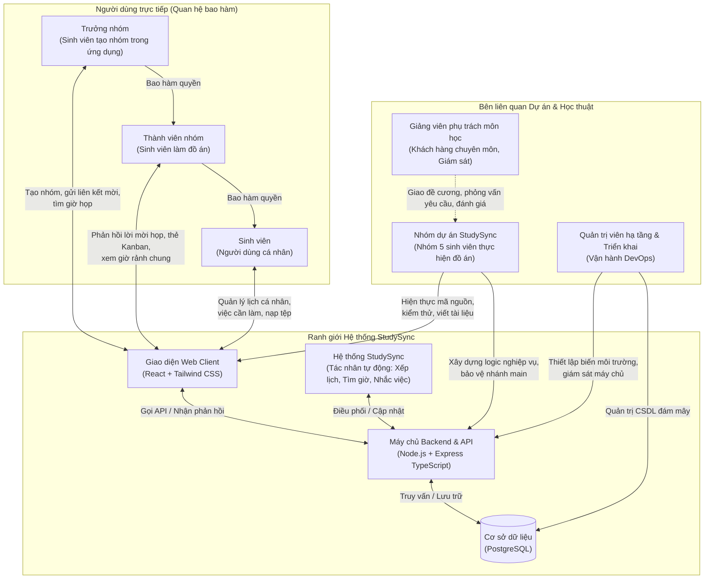

# Mục 3.1: Danh sách các bên liên quan (Stakeholder)

> Tài liệu thành phần thuộc **Chương 3: Tổng quan yêu cầu** trong Báo cáo Yêu cầu phần mềm (M2).
> Căn cứ theo: Mẫu phân tích yêu cầu của môn học (`Template#1-PhanTich-2019`), Kế hoạch dự án StudySync (Bản 2.1: mục 1.1, 1.3, 2.1, 3.1, 3.2, 3.5), Bảng 2.1 (Vai trò người dùng) và Template 15 (Style Guide & Glossary).

---

## 3. Tổng quan yêu cầu

### 3.1. Danh sách các stakeholder

Trong khuôn khổ xây dựng hệ thống phần mềm StudySync, các bên liên quan (stakeholder) bao gồm toàn bộ các cá nhân, nhóm và tác nhân có vai trò tương tác trực tiếp, chịu ảnh hưởng hoặc có quyền lợi, trách nhiệm đối với việc phát triển và vận hành hệ thống.

Căn cứ theo Bảng 2.1 (Vai trò người dùng của StudySync trong Kế hoạch dự án Bản 2.1), người dùng trực tiếp của hệ thống được phân quyền theo mô hình quan hệ bao hàm: **Trưởng nhóm $\subset$ Thành viên nhóm $\subset$ Sinh viên**. Ngoài nhóm người dùng trực tiếp, hệ thống còn tương tác với tác nhân tự động thông qua Giao diện lập trình ứng dụng (Application Programming Interface - API), lưu trữ dữ liệu tại Cơ sở dữ liệu (CSDL) và chịu sự chi phối, giám sát từ các bên liên quan học thuật và kỹ thuật.

Sơ đồ ngữ cảnh dưới đây mô tả tổng thể ranh giới hệ thống cùng các bên liên quan và mối quan hệ tương tác chính (xem Hình 3.1).

*Hình 3.1: Sơ đồ ngữ cảnh các bên liên quan của hệ thống StudySync*

---

Chi tiết vai trò, trách nhiệm, quyền hạn, các Quy định nghiệp vụ (Business Rule - BR) liên quan và mối quan tâm cốt lõi của từng bên liên quan được trình bày cụ thể theo đúng cấu trúc 3 cột của `Template#1-PhanTich-2019` (xem Bảng 3.1).

**Bảng 3.1: Danh sách các bên liên quan (Stakeholder) của hệ thống StudySync**

| **STT** | **Stakeholder** | **Mô tả** |
| :---: | :--- | :--- |
| 1 | **Sinh viên (Người dùng cá nhân)** | **Phân loại:** Người dùng trực tiếp.  **Tóm tắt vai trò:** Quản lý thời gian biểu cá nhân, sự kiện cố định, việc cần làm, nạp tệp lịch (`.ics`, `.csv`), xem lịch tuần, nhận khung giờ học đề xuất và nhận thông báo nhắc việc.  **Mối quan tâm cốt lõi:** Tiết kiệm thời gian sắp xếp lịch, không trễ hạn chót việc cần làm, không bị xếp trùng sự kiện cố định (BR-01), giao diện trực quan và thao tác nhanh chóng trên cả máy tính lẫn thiết bị di động. |
| 2 | **Thành viên nhóm (Làm đồ án)** | **Phân loại:** Người dùng trực tiếp.  **Tóm tắt vai trò:** Sinh viên tham gia ít nhất một nhóm đồ án trong ứng dụng. Nhận và phản hồi lời mời họp, tạo và di chuyển thẻ Kanban công việc chung, xem thống kê giờ học cá nhân theo tuần.  **Mối quan tâm cốt lõi:** Thống nhất lịch họp nhanh chóng, nắm bắt tiến độ đồ án minh bạch, bảo mật thông tin riêng tư (chỉ thấy trạng thái bận hoặc rảnh, không lộ tên sự kiện riêng tư theo BR-02). |
| 3 | **Trưởng nhóm (Tạo nhóm trong ứng dụng)** | **Phân loại:** Người dùng trực tiếp.  **Tóm tắt vai trò:** Thành viên đã tạo nhóm đồ án trong ứng dụng. Tạo liên kết mời, sử dụng tính năng tìm giờ họp tự động để tìm giờ rảnh chung, gửi lời mời họp, xem phản hồi tham gia, giao thẻ Kanban cho thành viên.  **Mối quan tâm cốt lõi:** Chốt lịch họp nhóm nhanh chóng với độ tham gia cao nhất, phân công công việc minh bạch và theo dõi tiến độ đồ án của toàn nhóm hiệu quả. |
| 4 | **Hệ thống StudySync (Tác nhân tự động)** | **Phân loại:** Tác nhân hệ thống (Background Engine).  **Tóm tắt vai trò:** Xử lý các tác vụ nền: phân tích cú pháp và kiểm tra tệp nạp lịch (BR-05, BR-06), quy đổi múi giờ UTC+7 và lưu UTC (BR-07), chuẩn hóa chuỗi NFC (BR-08), xếp lịch tự động và tái xếp lịch (TV3), tìm giờ rảnh chung (TV4), gửi thông báo nhắc việc (TV4).  **Mối quan tâm cốt lõi:** Đảm bảo tính toàn vẹn dữ liệu, độ chính xác thuật toán khoảng thời gian, xử lý lỗi an toàn (rollback nguyên khối khi tệp lỗi, dừng ngắt ở tối đa 20 dòng lỗi đầu tiên). |
| 5 | **Nhóm dự án StudySync (Nhóm 5 người)** | **Phân loại:** Phát triển & Vận hành.  **Tóm tắt vai trò:** Nhóm 5 sinh viên trực tiếp phân tích yêu cầu, thiết kế kiến trúc ba tầng, viết mã nguồn theo 5 module (TV1 - TV5), kiểm thử tự động và bàn giao sản phẩm.  **Mối quan tâm cốt lõi:** Kiến trúc module rõ ràng, mã nguồn sạch theo chuẩn TypeScript strict, quy trình Git và review chéo chặt chẽ, hoàn thành đầy đủ các tiêu chí chất lượng qua từng mốc đánh giá môn học (M1 - M6). |
| 6 | **Giảng viên phụ trách môn học** | **Phân loại:** Học thuật & Giám sát.  **Tóm tắt vai trò:** Khách hàng chuyên môn, định hướng học thuật thuộc Bộ môn Công nghệ Phần mềm. Cung cấp chuẩn mực, phỏng vấn làm rõ yêu cầu, thẩm định và chấm điểm đồ án.  **Mối quan tâm cốt lõi:** Sinh viên áp dụng đúng quy trình công nghệ phần mềm chuẩn mực; tài liệu nhất quán, truy vết được yêu cầu; sản phẩm chạy ổn định trên môi trường chạy thật. |
| 7 | **Quản trị viên hạ tầng (DevOps)** | **Phân loại:** Phát triển & Vận hành.  **Tóm tắt vai trò:** Quản lý môi trường chạy thật trên các dịch vụ đám mây miễn phí (Vercel, Render, PostgreSQL Supabase/Neon), biến môi trường, bảo mật kết nối và luồng Tích hợp liên tục (Continuous Integration - CI).  **Mối quan tâm cốt lõi:** Môi trường triển khai ổn định, không vượt hạn mức gói miễn phí, tự động hóa kiểm tra qua GitHub Actions và sẵn sàng cao cho các buổi chạy thử kịch bản demo. |

---

### 3.1.1. Mô tả chi tiết từng bên liên quan

**Khối 1: Nhóm Người dùng trực tiếp (Direct Users)**

**1. Sinh viên (Người dùng cá nhân)**
- **Vai trò:** Là người dùng cá nhân có tài khoản trong hệ thống, quản lý toàn bộ thời gian biểu học tập và sinh hoạt cá nhân. Đây là vai trò nền tảng của hệ thống, mọi người dùng đều mang vai trò này.
- **Quyền hạn và tương tác chính:**
  - Đăng ký tài khoản, đăng nhập, đăng xuất và cập nhật hồ sơ cá nhân (Module TV1).
  - Khởi tạo nhóm đồ án hoặc tham gia nhóm trong ứng dụng thông qua liên kết mời (Module TV1).
  - Nhập thủ công, chỉnh sửa, xóa sự kiện cố định (lịch học, lịch thi, ca làm thêm) và việc cần làm kèm hạn chót, độ ưu tiên, độ khó, thời lượng (Module TV2).
  - Nạp dữ liệu lịch hàng loạt từ tệp ngoại vi định dạng `.ics` hoặc `.csv` (Module TV2).
  - Xem giao diện lịch tuần tổng hợp gồm sự kiện cố định, việc cần làm và khung giờ học đề xuất đã xác nhận (Module TV2).
  - Đánh dấu việc cần làm là đã hoàn thành để hệ thống không xếp giờ hay nhắc việc đó nữa (Module TV2).
  - Xem, chấp nhận hoặc từ chối khung giờ học đề xuất; báo đã lỡ buổi học để nhận khung giờ bù; nhận đề xuất tái xếp lịch khi có việc phát sinh; đánh dấu buổi học đã học xong (Module TV3).
  - Nhận thông báo nhắc việc khi việc cần làm chưa hoàn thành sắp đến hạn chót (Module TV4).
- **Mối quan tâm và kỳ vọng:** Tiết kiệm tối đa thời gian lập kế hoạch, không bị bỏ quên việc cần làm, không bị xếp trùng sự kiện cố định (tuân thủ quy định BR-01), lịch tái xếp chỉ áp dụng sau khi xác nhận (tuân thủ quy định BR-03), giao diện trực quan và thao tác nhanh chóng trên cả máy tính lẫn thiết bị di động.

**2. Thành viên nhóm (Thành viên nhóm đồ án trong ứng dụng)**
- **Vai trò:** Là sinh viên đã tham gia vào ít nhất một nhóm đồ án cụ thể trong ứng dụng. Theo quan hệ bao hàm, Thành viên nhóm có toàn bộ quyền hạn của Sinh viên.
- **Quyền hạn và tương tác chính:**
  - Tham gia phối hợp đồ án trong các nhóm đã gia nhập thông qua liên kết mời (Module TV1).
  - Tiếp nhận lời mời họp từ Trưởng nhóm; xác nhận hoặc từ chối tham dự buổi họp (Module TV4).
  - Tạo mới, chỉnh sửa, xóa thẻ Kanban do mình tạo và chuyển thẻ Kanban công việc chung giữa 3 cột trạng thái cố định (Cần làm, Đang làm, Đã xong) để cập nhật tiến độ cho cả nhóm (Module TV5).
  - Lọc danh sách thẻ Kanban theo người được giao (Module TV5).
  - Xem thống kê số giờ học cá nhân tích lũy theo tuần (Module TV5).
  - Thực hiện rời nhóm đồ án khi hoàn thành môn học hoặc không còn tham gia (Module TV1).
- **Mối quan tâm và kỳ vọng:** Nắm bắt tiến độ công việc nhóm minh bạch, thống nhất lịch họp thuận tiện mà không cần khảo sát thủ công qua nhiều kênh; đảm bảo tính riêng tư cá nhân khi tham gia nhóm (hệ thống chỉ hiển thị trạng thái bận hoặc rảnh trong khung giờ rảnh chung, tuyệt đối không hiển thị tên hay chi tiết sự kiện riêng tư theo quy định BR-02).

**3. Trưởng nhóm (Trưởng nhóm đồ án trong ứng dụng)**
- **Vai trò:** Là Thành viên nhóm đã tạo ra nhóm đồ án đó trong ứng dụng (khác với Trưởng nhóm dự án là bạn Kiên). Theo quan hệ bao hàm, Trưởng nhóm có toàn bộ quyền hạn của Thành viên nhóm và Sinh viên. Vai trò này được tính riêng theo từng nhóm đồ án (một sinh viên có thể là Trưởng nhóm của nhóm này nhưng đồng thời là Thành viên nhóm thông thường của nhóm khác).
- **Quyền hạn và tương tác chính:**
  - Khởi tạo nhóm đồ án mới trong ứng dụng (Module TV1).
  - Tạo và chia sẻ liên kết mời để các thành viên khác tham gia vào nhóm mà không phải thêm thủ công (Module TV1).
  - Sử dụng tính năng "Tìm giờ họp" tự động để tìm kiếm các khung giờ rảnh chung có nhiều thành viên cùng rảnh nhất mà không phải lập bảng khảo sát (Module TV4).
  - Lựa chọn một khung giờ từ đề xuất buổi họp và gửi lời mời họp đến toàn bộ thành viên trong nhóm (Module TV4).
  - Xem danh sách thành viên đã xác nhận hoặc từ chối lời mời họp để biết buổi họp đã đủ người hay cần chọn giờ khác (Module TV4).
  - Phân công (giao) thẻ Kanban cho từng thành viên chịu trách nhiệm thực hiện (Module TV5).
- **Mối quan tâm và kỳ vọng:** Công cụ hỗ trợ chốt lịch họp nhanh chóng với tỷ lệ tham gia cao nhất, phân chia công việc minh bạch và kiểm soát tiến độ thực hiện đồ án của toàn nhóm một cách trực quan, chính xác.

---

**Khối 2: Nhóm Tác nhân hệ thống (System Actor)**

**4. Hệ thống StudySync (Tác nhân tự động)**
- **Vai trò:** Là tác nhân tự động (Automated Actor) thực hiện các tác vụ tính toán thuật toán, xử lý logic nền và dịch vụ ngầm (background jobs) mà không yêu cầu tương tác thủ công liên tục từ người dùng. Tác nhân này xuất hiện trong các kịch bản Trường hợp sử dụng (Use Case) với vai trò xử lý nghiệp vụ tự động.
- **Quyền hạn và trách nhiệm chính:**
  - Phân tích cú pháp và kiểm tra tính hợp lệ của tệp nạp lịch `.ics` và `.csv` theo chuẩn RFC 5545, RFC 4180; giới hạn dung lượng tệp tối đa 5 MB (BR-05); từ chối toàn bộ tệp khi có dòng không hợp lệ kèm danh sách tối đa 20 dòng lỗi đầu tiên (BR-06); tự động chuẩn hóa chuỗi Unicode về dạng NFC và cắt khoảng trắng hai đầu trước khi đếm giới hạn 100/200 ký tự (BR-08).
  - Quy đổi thời gian và lưu trữ chuẩn UTC trong PostgreSQL, hiển thị giao diện theo múi giờ Việt Nam UTC+7 (BR-07); tự động gán thời lượng mặc định 1 giờ cho việc cần làm nếu người dùng để trống (BR-04).
  - Tự động tính toán, đề xuất khung giờ học và tái xếp lịch theo độ ưu tiên, độ khó và thời lượng mà không trùng sự kiện cố định (Module TV3).
  - Tự động tìm kiếm các khung giờ rảnh chung có nhiều thành viên nhóm cùng rảnh nhất dựa trên thư viện khoảng thời gian dùng chung (Module TV4).
  - Định kỳ quét và gửi thông báo nhắc việc sắp đến hạn chót (Module TV4).
  - Đảm bảo thực thi 100% các quy định nghiệp vụ cốt lõi (BR-01 đến BR-08) và duy trì tính toàn vẹn dữ liệu.
- **Mối quan tâm và kỳ vọng:** Độ chính xác toán học của các khoảng thời gian (thời điểm kết thúc luôn sau thời điểm bắt đầu), tốc độ xử lý thuật toán tối ưu, cơ chế dừng ngắt an toàn và khả năng khôi phục nguyên vẹn trạng thái khi xảy ra lỗi dữ liệu.

---

**Khối 3: Nhóm Học thuật và Giám sát (Academic Stakeholder)**

**5. Giảng viên phụ trách môn học**
- **Vai trò:** Đóng vai trò là khách hàng chuyên môn, người định hướng học thuật và thẩm định chất lượng đồ án thuộc Bộ môn Công nghệ Phần mềm, Khoa Công nghệ Thông tin, Trường Đại học Khoa học Tự nhiên - ĐHQG-HCM.
- **Tương tác và trách nhiệm:**
  - Cung cấp yêu cầu môn học, đề cương và mẫu tài liệu chuẩn (`Template#1-PhanTich-2019`).
  - Tham gia các phiên phỏng vấn làm rõ yêu cầu phần mềm cùng nhóm dự án ở giai đoạn khảo sát (Tuần 4 - 5).
  - Thẩm định và đánh giá tiến độ qua từng mốc nộp bài (Project Proposal M1, Báo cáo Yêu cầu M2, Báo cáo Phân tích thiết kế M3, Demo tiến độ giai đoạn 2 M4, Báo cáo UI và Testing M5, Báo cáo và Sản phẩm cuối kỳ M6).
  - Đánh giá chất lượng tài liệu đặc tả, tính khả thi của giải pháp kỹ thuật, mức độ hoàn thiện của sản phẩm và tính minh bạch trong đóng góp của từng thành viên để chấm điểm.
- **Mối quan tâm và kỳ vọng:** Nhóm dự án áp dụng đúng quy trình công nghệ phần mềm chuẩn mực (phương pháp Hybrid kết hợp Sprint, quản lý backlog trên GitHub Projects, kiểm soát phiên bản Git, Pull Request, review chéo); tài liệu đặc tả rõ ràng, truy vết được yêu cầu; sản phẩm hoạt động ổn định trên môi trường chạy thật theo đúng kịch bản nghiệp vụ; đánh giá công bằng, minh bạch mức độ đóng góp của từng thành viên.

---

**Khối 4: Nhóm Phát triển và Vận hành (Engineering Stakeholders)**

**6. Nhóm dự án StudySync (Nhóm phát triển phần mềm 5 người)**
- **Vai trò:** Nhóm dự án gồm 5 sinh viên trường Đại học Khoa học Tự nhiên - ĐHQG-HCM trực tiếp phân tích, thiết kế, hiện thực, kiểm thử và bàn giao sản phẩm phần mềm StudySync trong môn học Nhập môn Công nghệ Phần mềm.
- **Phân công trách nhiệm:**
  - Nguyễn Đình Trung Kiên (MSSV: 24120195): Trưởng nhóm dự án, phụ trách Product Owner/BA, thiết kế UI/UX và phát triển Module TV5 (Kanban và thống kê).
  - Trịnh Nguyễn Huỳnh Nhi (MSSV: 24120404): Backend Lead, phụ trách kiến trúc thư viện khoảng thời gian và phát triển Module TV3 (Xếp lịch tự động).
  - Lê Huỳnh Anh Thư (MSSV: 24120226): System/DB Architect, phụ trách CSDL, thiết lập DevOps/CI và phát triển Module TV1 (Tài khoản và nhóm).
  - Đỗ Quỳnh Anh Thư (MSSV: 24120143): QA Lead và Technical Writer, phụ trách kiểm thử, chuẩn hóa tài liệu và phát triển Module TV4 (Giờ chung và nhắc việc).
  - Đào Ngọc Hưng (MSSV: 24120319): Developer fullstack, đồng review frontend cùng Kiên, hỗ trợ DevOps và phát triển Module TV2 (Lịch cá nhân và nhập lịch).
- **Mối quan tâm và kỳ vọng:** Xây dựng hệ thống ổn định theo đúng kiến trúc ba tầng (React, Express, PostgreSQL); mã nguồn chuẩn TypeScript strict; các module độc lập theo ranh giới quy định; hoàn thành đầy đủ các tiêu chí kiểm thử tự động và đạt chất lượng cao nhất qua các mốc đánh giá môn học.

**7. Quản trị viên hạ tầng & Triển khai (DevOps)**
- **Vai trò:** Vai trò kỹ thuật nội bộ do thành viên Lê Huỳnh Anh Thư phụ trách chính và Đào Ngọc Hưng hỗ trợ kỹ thuật, đảm bảo hệ thống vận hành liên tục trên các nền tảng đám mây.
- **Quyền hạn và trách nhiệm chính:**
  - Cấu hình, bảo mật và duy trì môi trường chạy thật (production) trên các nền tảng đám mây miễn phí: Vercel (frontend), Render (backend), Supabase hoặc Neon (CSDL PostgreSQL), song song với môi trường cục bộ (local environment).
  - Quản lý các biến môi trường (`.env`), kiểm soát an toàn chuỗi kết nối và chứng chỉ bảo mật.
  - Thiết lập và duy trì luồng kiểm tra tự động GitHub Actions CI cho mọi Pull Request.
  - Giám sát trạng thái hoạt động của hệ thống (endpoint kiểm tra sức khỏe `/api/health`, thời gian phản hồi, giới hạn tài nguyên của gói dịch vụ miễn phí).
  - Hỗ trợ triển khai nhanh các bản vá lỗi, sao lưu CSDL và chuẩn bị môi trường ổn định phục vụ các buổi demo đánh giá.
- **Mối quan tâm và kỳ vọng:** Môi trường chạy thật hoạt động ổn định và liên tục, không vượt quá giới hạn tài nguyên của gói dịch vụ miễn phí, tự động hóa quy trình kiểm tra qua CI và đảm bảo tính sẵn sàng cao cho các buổi báo cáo đánh giá.

---

### 3.1.2. Ghi chú áp dụng và quy ước liên quan

1. **Quan hệ bao hàm người dùng:** Ba vai trò người dùng trực tiếp tuân thủ chặt chẽ mô hình quan hệ bao hàm:
   $$\text{Trưởng nhóm} \subset \text{Thành viên nhóm} \subset \text{Sinh viên}$$
   Một người dùng khi đăng ký tài khoản mặc định mang vai trò Sinh viên. Khi tham gia một nhóm đồ án trong ứng dụng, người dùng có thêm vai trò Thành viên nhóm của nhóm đó. Khi tạo nhóm mới, người dùng tự động trở thành Trưởng nhóm của nhóm đó.
2. **Tính độc lập theo nhóm:** Vai trò Thành viên nhóm và Trưởng nhóm được tính riêng biệt theo từng nhóm đồ án cụ thể trong ứng dụng. Một sinh viên có thể là Trưởng nhóm của nhóm đồ án A, nhưng đồng thời là Thành viên nhóm thông thường trong nhóm đồ án B.
3. **Phân biệt tác nhân hệ thống:** Hệ thống StudySync là tác nhân tự động thực hiện các thuật toán tính toán và công việc ngầm, không được xem là một vai trò người dùng trong hệ thống. Tác nhân này chỉ xuất hiện trong sơ đồ Use Case và luồng sự kiện đặc tả tại mục 4.1 và mục 4.2 để biểu diễn các phản hồi tự động.
4. **Phân biệt vai trò Trưởng nhóm:** Cần phân biệt rõ ràng giữa "Trưởng nhóm" (người dùng tạo và quản lý nhóm đồ án trong ứng dụng StudySync) và "Trưởng nhóm dự án" (bạn Nguyễn Đình Trung Kiên, đại diện nhóm dự án 5 sinh viên thực hiện đồ án).
