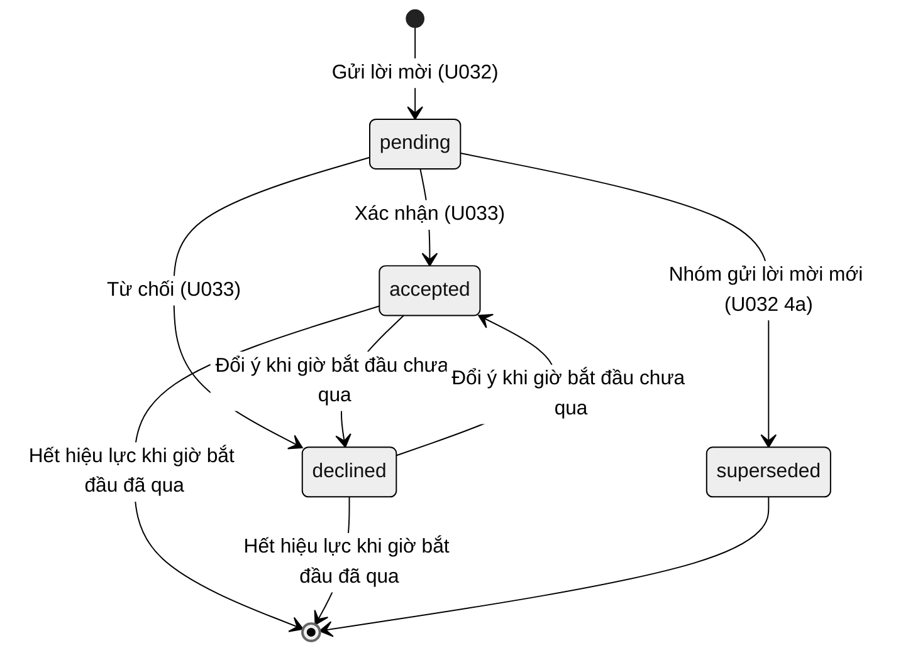
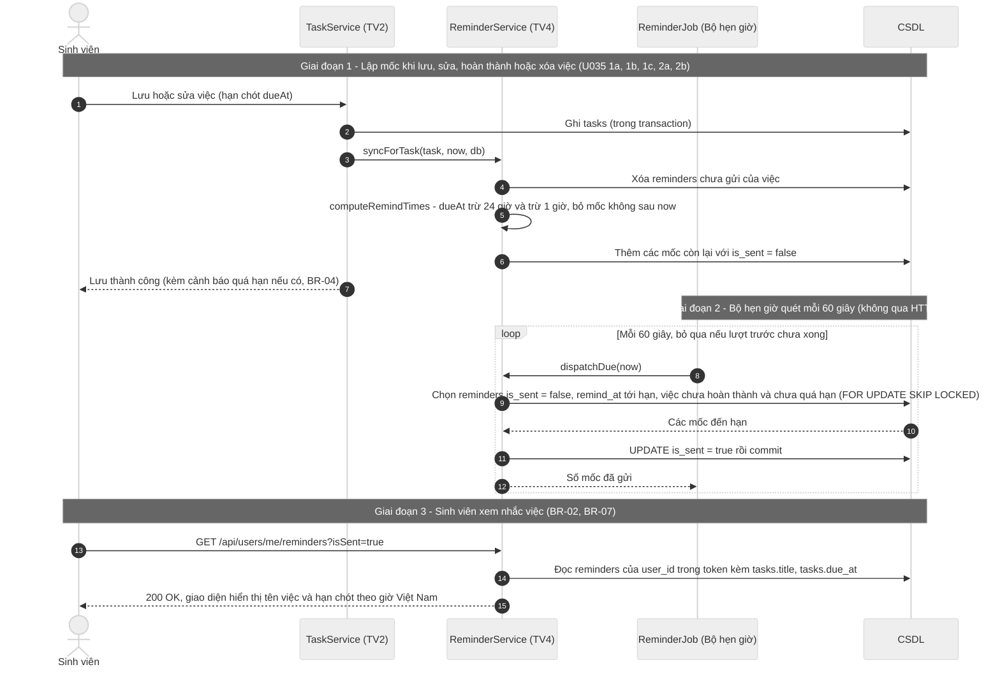
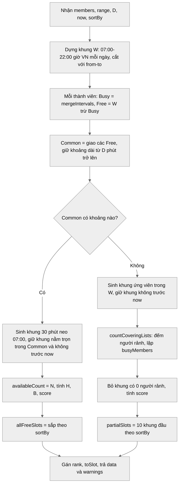

# Thiết kế giải thuật tìm giờ họp chung và nhắc việc TV4

Trạng thái: Chờ review · Người viết: Thư Q.A. · Người review: Hưng · Issue: #113 · Cập nhật: 20/11/2026

Tài liệu này là bản trong repo của mục 4.4 (phần 4.4.1 đến 4.4.7) và mục 5.2, 5.3 (bảng TV4) của báo cáo M3. Số hình và số bảng giữ đúng như trong báo cáo để hai nơi tra chéo được. Thiết kế dựa trên `docs/api.md` (vùng TV4), `docs/data-dictionary.md` (vùng TV4), `docs/architecture.md` (Hình 7, Hình 12), `docs/testing/strategy.md` và thư viện `backend/src/utils/interval.ts`. Đây là đặc tả cho Issue #120 (cài đặt `MeetingSlotFinder`, `MeetingSlotService`, `MeetingProposalService`, `MeetingPermissionService`, `ReminderService` và `ReminderJob`).

---

## 4.4 Module TV4: Giờ chung và nhắc việc

- Use case liên quan: U031 đến U036 (yêu cầu 4.1 đến 4.6, US-23 đến US-28).
- Sơ đồ tuần tự: tìm giờ họp (Hình 4.6); gửi lời mời và xác nhận (Hình 4.7); bộ hẹn giờ nhắc việc (Hình 4.7b).
- Sơ đồ lớp: Hình 4.15 (lớp thực thể) và Hình 4.20 (tầng xử lý), xem mục 4.7.7 và 4.7.9.
- Thuật toán tìm giờ họp chung: xem mục 5.2.

### 4.4.1 Phạm vi và thành phần xử lý

Module TV4 gồm ba nhóm chức năng: tìm giờ họp chung (U031), vòng đời lời mời họp (U032, U033, U034, U036) và nhắc việc sắp đến hạn (U035). Mọi thông báo của module là thông báo trong ứng dụng. Hệ thống không có bảng hay endpoint thông báo riêng, mỗi thông báo được đọc ra từ dữ liệu gốc (lời mời, phản hồi, nhắc việc). Frontend gọi lại khi mở ứng dụng hoặc theo chu kỳ, phiên bản này không đẩy (push).

Bảng 4.4a: Ánh xạ use case, endpoint, thành phần xử lý và dữ liệu

| Use case | Endpoint | Service và hàm | Dữ liệu đọc, ghi |
| :-- | :-- | :-- | :-- |
| U031 | `POST /api/groups/{groupId}/meeting-slots/search` | `MeetingSlotService.searchSlots` gọi `MeetingSlotFinder.findCommonFreeSlots` | Đọc `group_members`, `users.display_name`, `fixed_events` (chỉ `user_id`, `starts_at`, `ends_at`). Không ghi |
| U032 | `POST /api/groups/{groupId}/meeting-proposals` | `MeetingProposalService.createProposal` | Ghi `meeting_proposals`, `meeting_invitations` trong một transaction |
| U033 | `POST .../invitations/{invitationId}/respond`, `GET /api/users/me/meeting-invitations` | `MeetingProposalService.respond`, `listMyInvitations` | Đọc, ghi `meeting_invitations` |
| U034 | `GET /api/groups/{groupId}/meeting-proposals` và `.../{proposalId}` | `MeetingProposalService.listProposals`, `getProposalDetail` | Đọc `meeting_proposals`, `meeting_invitations`, `group_members` |
| U035 | `GET /api/users/me/reminders`, Bộ hẹn giờ `ReminderJob` | `ReminderService.syncForTask`, `dispatchDue`, `listMine` | Đọc `tasks`; đọc, ghi `reminders` |
| U036 | `PATCH /api/groups/{groupId}/members/{userId}/meeting-permission` | `MeetingPermissionService.setPermission` | Ghi `group_members.can_organize_meetings` |

### 4.4.2 Phân quyền Người tổ chức họp

Quyền được kiểm tra động ở Service (`MembershipService.requireOrganizer`), không chỉ ẩn nút ở giao diện. Mỗi lần gọi, Service đọc lại dòng `group_members` của người gọi trong CSDL, nên quyền thay đổi có hiệu lực ngay ở yêu cầu kế tiếp.

Bảng 4.4b: Quy tắc phân quyền của TV4

| Thao tác | Điều kiện cho phép | Khi không đạt |
| :-- | :-- | :-- |
| Tìm giờ họp (U031), gửi lời mời (U032) | Người gọi là thành viên hiện tại của nhóm và (`role = 'leader'` hoặc `can_organize_meetings = true`) | Không có nhóm: 404. Không thuộc nhóm hoặc không đủ quyền: 403, không trả dữ liệu lịch |
| Bật hoặc tắt ủy quyền (U036) | Người gọi là Trưởng nhóm hiện tại; người được chọn còn là thành viên | Người gọi không phải Trưởng nhóm: 403. Người được chọn đã rời nhóm: báo "Thành viên không còn trong nhóm" |
| Phản hồi lời mời (U033) | Người gọi là chủ của lời mời (`meeting_invitations.user_id`), vẫn là thành viên và đã vào nhóm trước khi đề xuất được tạo | 403, không hiển thị nội dung lời mời |
| Xem phản hồi của mọi người (U034) | Trưởng nhóm hiện tại hoặc người gửi lời mời (`organizer_user_id`) gọi là `viewScope = "all"`; thành viên khác chỉ thấy lời mời của mình (`"self"`) | Không có lỗi: dữ liệu bị thu hẹp theo `viewScope` |

Hai điểm cần lưu ý khi cài đặt. Thứ nhất, quyền ủy quyền tự mất khi người đó rời nhóm vì dòng `group_members` bị xóa trong transaction rời nhóm của TV1, TV4 không cần xử lý thêm. Thứ hai, thu hồi quyền không hủy lời mời đã gửi, vì lời mời gắn với `organizer_user_id` của đề xuất chứ không gắn với cờ ủy quyền.

### 4.4.3 Luồng tìm giờ họp chung (U031)

Thứ tự kiểm tra của `POST /api/groups/{groupId}/meeting-slots/search` giống Hình 4.6, mỗi bước dừng ngay khi lỗi:

1. Xác thực JWT. Lỗi: 401.
2. Kiểm tra định dạng: `from`, `to` là ISO 8601 hậu tố Z; `from` trước `to`; khoảng `to − from` không vượt quá 31 ngày; khoảng `[from, to)` chưa qua hoàn toàn; `durationMinutes` (mặc định 60) nằm trong 30 đến 900 và chia hết cho 30; `sortBy` (mặc định `"time"`) thuộc `["time", "score"]`. Lỗi: 400 `VALIDATION_ERROR`.
3. Tìm nhóm. Lỗi: 404 `NOT_FOUND`.
4. Kiểm tra quyền Người tổ chức họp (Bảng 4.4b). Lỗi: 403 `FORBIDDEN`.
5. Đếm thành viên hiện tại, tối thiểu 2. Lỗi: 400 `VALIDATION_ERROR`.
6. Nạp khoảng bận bằng `FixedEventRepository.findBusyIntervals(userIds, from − 60 phút, to + 60 phút)`. Lề 60 phút ở hai đầu chỉ để tính khoảng đệm ở mục 5.2.5 cho đúng ở mép tuần, không làm đổi giờ rảnh.
7. Gọi `MeetingSlotFinder.findCommonFreeSlots` (mục 5.2). Service là nơi đọc giờ hiện tại và truyền `now` vào, Finder là hàm thuần.
8. Dựng phản hồi `{ data: { allFreeSlots, partialSlots }, warnings }`. Mỗi khung gồm `startsAt`, `endsAt` (UTC, có mili giây), `availableCount`, `totalMembers`, `busyMembers` (`Array<{ displayName: string }>`), `score` và `rank` (mục 5.2.5). Cảnh báo `MEMBER_NO_FIXED_EVENTS` được sinh cho từng thành viên không có sự kiện nào trong `[from, to)`.

Bảo đảm BR-02 được dựng thành nhiều lớp, mỗi lớp tự đúng khi lớp khác bị sửa nhầm:

- Lớp truy vấn: SQL chỉ chọn ba cột `user_id`, `starts_at`, `ends_at`. Kiểu trả về của repository không có trường nào khác, nên Service không thể vô tình đọc `title`, `kind`, `location`, `notes`, `source`. Không đọc `tasks` và `study_slots` (yêu cầu 4.1: không tính là bận).
- Lớp thuật toán: Finder chỉ nhận `TimeInterval[]` và tên hiển thị, không có kiểu nào chứa nội dung sự kiện (mục 5.2.7).
- Lớp phản hồi: DTO được dựng theo danh sách trường cho phép. Điểm `score` là một số tổng hợp, không kèm số liệu từng người.
- Lớp nhật ký: không ghi khoảng bận hay kết quả tìm kiếm vào log.

### 4.4.4 Luồng gửi lời mời họp (U032)

Người tổ chức họp chọn một khung giờ trong kết quả tìm kiếm rồi gửi. Server không bắt buộc khung gửi phải trùng một khung đã tìm ra (người dùng được tự nhập giờ theo `docs/api.md`), vì kết quả tìm kiếm không được lưu ở server. Việc cảnh báo "khung có người bận" (U032 3c) làm ở giao diện dựa trên `availableCount` và `busyMembers` mà kết quả tìm kiếm đã trả, người gửi xác nhận lại rồi mới gọi API. Server không kiểm tra lại số người bận để khỏi đọc lịch lần thứ hai, và vì lịch có thể đã đổi sau lần tìm.

Kiểm tra định dạng ở API: `title` chuẩn hóa NFC, cắt khoảng trắng, đếm theo code point, từ 1 đến 200 (BR-08, quá dài thì 400, không tự cắt); `startsAt`, `endsAt` là ISO 8601 hậu tố Z và `endsAt` sau `startsAt`; `startsAt` chưa qua tại lúc gửi (U032 3b, thông báo "Khung giờ đã qua"); `location`, `notes` tùy chọn.

Phần xử lý trong Service chạy trong **một transaction**, thứ tự như sau:

1. `GroupRepository.lockForUpdate(groupId)` (khóa dòng `groups`). Việc khóa này làm hai lần gửi đồng thời trong cùng một nhóm chạy lần lượt, nhờ đó "mỗi nhóm chỉ giữ một lời mời chưa chốt" luôn đúng. Nó cũng khớp với `GroupService.leaveGroup`, vốn khóa cùng dòng này, nên một thành viên rời nhóm giữa chừng không làm danh sách người được mời bị lệch.
2. Đọc lại vai trò, cờ ủy quyền của người gọi và danh sách thành viên hiện tại (sau khi đã giữ khóa). Không đủ quyền: 403. Dưới 2 thành viên: 400.
3. Chuyển lời mời cũ sang `superseded`: `UPDATE meeting_invitations SET status = 'superseded' WHERE status = 'pending' AND meeting_proposal_id IN (SELECT id FROM meeting_proposals WHERE group_id = $groupId AND status = 'open')`. Lời mời `accepted`, `declined` giữ nguyên để lưu vết. Buổi họp đã "Đủ người" không còn dòng `pending` nào nên tự được giữ nguyên (U032 4b).
4. `INSERT meeting_proposals` (`status = 'open'`, `organizer_user_id` = người gọi).
5. `INSERT meeting_invitations` (`status = 'pending'`) cho mọi thành viên hiện tại trừ Người tổ chức họp. Người tổ chức họp được tính "Đã xác nhận" qua `organizer_user_id`, không có dòng lời mời riêng.
6. Commit, trả 201 cùng `invitationsSent`.

Người vào nhóm sau thời điểm này không nằm trong danh sách được mời, điều kiện `meeting_proposals.created_at >= group_members.joined_at` ở các truy vấn đọc bảo đảm điều đó. Thông báo "Lời mời mới" và "Lời mời đã được thay bằng giờ mới" không cần bước ghi riêng, chúng là chính các dòng `pending` và `superseded` vừa ghi (Bảng "Thông báo trong ứng dụng" của `docs/api.md`).

### 4.4.5 Phản hồi lời mời và trạng thái buổi họp (U033, U034)

Hình 4.7a mô tả vòng đời một lời mời. Người được mời đổi phản hồi tùy ý giữa `accepted` và `declined` cho tới khi giờ bắt đầu qua hoặc lời mời bị thay.



Hình 4.7a: Máy trạng thái của một lời mời họp (`meeting_invitations.status`)

Các bước của `MeetingProposalService.respond`:

1. API kiểm tra `response` là `accepted` hoặc `declined`. Sai: 400.
2. Nạp lời mời kèm đề xuất theo `invitationId`, đối chiếu `proposalId` và `groupId` trên đường dẫn. Không khớp: 404.
3. Người gọi không phải chủ lời mời, hoặc không còn là thành viên, hoặc vào nhóm sau khi đề xuất được tạo: 403.
4. Lời mời hết hiệu lực: `status = 'superseded'`, hoặc đề xuất không còn `open`, hoặc `starts_at` đã qua so với `now`, hoặc đề xuất đã bị đề xuất mới hơn của nhóm thay thế (`replacedByProposalId` khác null) mà chưa "Đủ người". Kết quả: 409 `CONFLICT`, thông báo "Lời mời đã hết hiệu lực", trạng thái không đổi.
5. Mở transaction ngắn, `SELECT ... FOR UPDATE` dòng lời mời rồi `UPDATE ... SET status = $response, responded_at = now()`. Khóa dòng làm việc phản hồi và việc `superseded` (bước 3 của mục 4.4.4) xếp hàng, nên không có chuyện lời mời vừa bị thay vẫn ghi nhận được phản hồi: nếu thay trước thì bước kiểm tra lại trong khóa thấy `superseded` và trả 409.
6. Trả 200 với lời mời đã cập nhật. Thông báo từ chối cho người gửi lời mời và Trưởng nhóm là các dòng `declined` đọc ra từ `GET .../meeting-proposals` (mảng `declinedMembers`), không có bước ghi thông báo riêng.

Trạng thái chung của buổi họp (`summary.state`) do server tính khi đọc, không lưu. Các điều kiện được xét theo đúng thứ tự trong Bảng 4.4c, điều kiện đầu tiên thỏa thì dừng.

Bảng 4.4c: Trạng thái chung của buổi họp và thứ tự xét

| Thứ tự | `state` | Hiển thị | Điều kiện |
| :-- | :-- | :-- | :-- |
| 1 | `full` | Đủ người | Mọi người được mời, kể cả Người tổ chức họp, đều đã `accepted` |
| 2 | `superseded` | Đã thay thế | Chưa `full` và nhóm có đề xuất tạo sau đề xuất này |
| 3 | `expired` | Đã hết hiệu lực | `startsAt` đã qua và chưa `full`; các phản hồi đã lưu giữ nguyên |
| 4 | `insufficient` | Chưa đủ người | Có ít nhất một người `declined`, `startsAt` chưa qua; giao diện hiện nút "Chọn giờ khác" |
| 5 | `waiting` | Đang chờ phản hồi (x/y đã xác nhận) | Các trường hợp còn lại |

Cách đếm khi thành viên thay đổi (U033 5a, U034 2a): tổng số người được mời chỉ tính các thành viên **hiện tại** đã vào nhóm trước thời điểm đề xuất được tạo, nên người rời nhóm bị loại khỏi tử số lẫn mẫu số (3/5 thành 3/4) và người vào sau không bị tính. Người tổ chức họp được cộng vào cả tử và mẫu nếu còn trong nhóm. Nếu Trưởng nhóm đã gửi lời mời rồi rời nhóm, Trưởng nhóm cũ bị loại như mọi người rời nhóm, còn Trưởng nhóm mới có `viewScope = "all"`. Dòng `meeting_invitations` của người rời nhóm không bị xóa (giữ lịch sử) mà bị lọc ra bằng phép nối với `group_members`.

Chọn giờ khác (U034 4a): nút này chỉ điều hướng giao diện về trang tìm giờ họp của tuần đã chọn. Server không giữ kết quả cũ, lần tìm mới đọc lịch hiện tại của các thành viên. Phản hồi của người khác ở đề xuất cũ giữ nguyên đến khi có lời mời mới ở U032.

### 4.4.6 Cơ chế nhắc việc tự động (U035)

Nhắc việc phục vụ US-28: nhắc Sinh viên khi **việc cần làm cá nhân** chưa hoàn thành sắp đến hạn chót, tại hai mốc 24 giờ và 1 giờ trước hạn. Theo phạm vi M2 đã chốt, phiên bản hiện tại không có nhắc trước giờ họp và thẻ Kanban của nhóm cũng không tạo nhắc việc. Cơ chế gồm hai phần tách biệt: **lập mốc** khi dữ liệu việc thay đổi, và **kích hoạt** khi tới mốc.

**Phần 1. Lập mốc (`ReminderService.syncForTask(task, now, db)`).** Hàm do TV4 sở hữu và được `TaskService` (TV2) gọi bên trong transaction lưu, sửa, đánh dấu hoàn thành hoặc bỏ đánh dấu một việc (tham số `db: Queryable` nhận `PoolClient` của transaction). Hàm có tính lũy đẳng: gọi nhiều lần với cùng dữ liệu cho cùng kết quả.

1. `DELETE FROM reminders WHERE task_id = $taskId AND is_sent = false` (xóa các mốc chưa gửi, giữ các mốc đã gửi làm lịch sử).
2. Nếu việc đã hoàn thành (`is_done = true`), dừng ở đây.
3. Với mỗi độ lệch trong {24 giờ, 1 giờ}, tính `remindAt = dueAt − độ lệch` bằng số mili giây trên UTC (không dùng múi giờ). Chỉ giữ mốc có `remindAt > now`. Mốc đã qua bị bỏ, không gửi bù (`Reminder.computeRemindTimes`).
4. `INSERT` các mốc còn lại với `is_sent = false`, `user_id` là chủ việc.

Bảng 4.4d: Sự kiện của việc cần làm và tác động lên nhắc việc

| Sự kiện | Xử lý của `syncForTask` | Căn cứ |
| :-- | :-- | :-- |
| Lưu việc mới, hạn chót còn 30 giờ | Tạo cả hai mốc | U035 1 |
| Lưu việc, còn 5 giờ | Chỉ giữ mốc 1 giờ | U035 1b |
| Lưu việc, còn 30 phút hoặc đã quá hạn | Không tạo mốc nào (việc quá hạn vẫn lưu được, kèm cảnh báo của BR-04) | U035 1a, 1b |
| Sửa hạn chót | Hủy mốc chưa gửi, tính lại theo hạn mới. Không bao giờ gửi theo hạn cũ | U035 1c |
| Đánh dấu hoàn thành | Hủy mốc chưa gửi, không tạo mốc mới | U035 2a |
| Bỏ đánh dấu hoàn thành, hạn chưa qua | Tính lại, chỉ khôi phục mốc chưa qua, không gửi bù mốc đã qua | U035 2b |
| Xóa việc | Mốc bị xóa theo `ON DELETE CASCADE` | U035 2a |

**Phần 2. Kích hoạt (`ReminderJob` và `ReminderService.dispatchDue`).** Bộ hẹn giờ chạy trong tiến trình backend, không đi qua HTTP (Hình 4.7b).

- `ReminderJob.start()` đặt chu kỳ quét 60 giây (cấu hình `REMINDER_POLL_SECONDS`, mặc định 60) và chạy một lượt ngay khi khởi động. Mỗi lượt kiểm tra cờ `isRunning` để lượt sau không chồng lên lượt trước. Độ trễ tối đa bằng chu kỳ cộng thời gian xử lý, nhỏ hơn nhiều so với giới hạn 5 phút của yêu cầu 4.6.
- `dispatchDue(now)` đọc `now` một lần rồi chạy trong một transaction: chọn các dòng đến hạn bằng `SELECT r.id FROM reminders r JOIN tasks t ON t.id = r.task_id WHERE r.is_sent = false AND r.remind_at <= $now AND t.is_done = false AND t.due_at > $now ORDER BY r.remind_at, r.id LIMIT 500 FOR UPDATE OF r SKIP LOCKED`, rồi `UPDATE reminders SET is_sent = true WHERE id = ANY($ids)` và commit. Lặp lại cho tới khi một lượt trả ít hơn 500 dòng.
- "Gửi" nghĩa là đặt `is_sent = true`. Thông báo trong ứng dụng là các nhắc việc `is_sent = true` mà `GET /api/users/me/reminders?isSent=true` trả về, tên việc và hạn chót lấy từ `tasks` lúc đọc. Vì chọn dòng và đánh dấu nằm trong cùng một transaction, và `SKIP LOCKED` không cho hai tiến trình cùng lấy một dòng, mỗi mốc được gửi tối đa một lần ngay cả khi có hơn một bản backend chạy.
- Điều kiện `t.due_at > $now` là quy tắc xử lý khi máy chủ ngừng hoạt động một thời gian: mốc đến muộn vẫn được gửi nếu việc chưa quá hạn (nhắc "còn 21 giờ" vẫn có ích), còn mốc của việc đã quá hạn thì bỏ, vì nhắc "còn 1 giờ" sau hạn chót là sai. Các dòng bị bỏ này giữ `is_sent = false` và không xuất hiện ở danh sách "sắp đến" vì `remind_at` đã qua.
- Lỗi trong một lượt được ghi log (không kèm tên việc), transaction rollback, lượt sau thử lại. Không có trạng thái gửi dở.
- Riêng tư: mỗi dòng `reminders` có `user_id` của chủ việc; `listMine` luôn lọc theo `user_id` của token. Nhắc việc cá nhân không bao giờ hiện cho Thành viên nhóm khác, kể cả Trưởng nhóm.



Hình 4.7b: Sơ đồ tuần tự lập mốc và kích hoạt nhắc việc (U035)

### 4.4.7 Truy vết

Bảng 4.4e: Truy vết từ story đến thiết kế

| Story | Use case | Mục thiết kế | Hàm chính |
| :-- | :-- | :-- | :-- |
| US-23 | U031, U036 | 4.4.2, 4.4.3, 5.2 | `searchSlots`, `findCommonFreeSlots`, `setPermission` |
| US-24 | U032 | 4.4.4 | `createProposal` |
| US-25, US-26 | U033 | 4.4.5 | `respond`, `listMyInvitations` |
| US-27 | U034 | 4.4.5 | `listProposals`, `getProposalDetail` |
| US-28 | U035 | 4.4.6 | `syncForTask`, `dispatchDue`, `listMine` |


---

## 5.2 Thuật toán tìm giờ họp chung (TV4)

### 5.2.1 Bài toán, đầu vào và đầu ra

**Bài toán.** Cho nhóm có N thành viên hiện tại (N ≥ 2), lịch bận của từng người trong một khoảng tìm kiếm, và thời lượng họp D phút. Tìm các khung giờ dài đúng D phút mà mọi người cùng rảnh, xếp hạng theo độ thuận tiện. Nếu không có khung nào cả nhóm cùng rảnh thì trả tối đa 10 khung có nhiều người rảnh nhất.

**Đầu vào** (Service nạp, Finder là hàm thuần nên không đọc CSDL và không đọc giờ hiện tại):

```ts
interface MemberBusy {
  userId: string;
  displayName: string;        // chỉ tên hiển thị, dùng cho busyMembers và cảnh báo
  busy: TimeInterval[];       // chỉ [starts_at, ends_at) của sự kiện cố định, đã nạp thêm lề 60 phút
}
interface SlotSearchInput {
  range: TimeInterval;        // [from, to) theo UTC
  durationMinutes: number;    // 30 đến 900, bội số của 30
  now: Date;                  // do Service truyền vào
  sortBy: 'time' | 'score';   // mặc định 'time'
}
function findCommonFreeSlots(members: MemberBusy[], input: SlotSearchInput): SlotSearchResult;
```

**Đầu ra**: `allFreeSlots` (khung cả nhóm rảnh) và `partialSlots` (chỉ có khi `allFreeSlots` rỗng), mỗi khung gồm `startsAt`, `endsAt`, `availableCount`, `totalMembers`, `busyMembers` (`Array<{ displayName: string }>`), `score`, `rank`. Danh sách cảnh báo `MEMBER_NO_FIXED_EVENTS` do Service sinh từ thành viên có `busy` rỗng trong `[from, to)`.

Bảng 5.2a: Hằng số của thuật toán

| Hằng số | Giá trị | Nguồn |
| :-- | :-- | :-- |
| `STEP` (bước giữa các khung ứng viên) | 30 phút | Yêu cầu 4.1 |
| Khung hoạt động mỗi ngày | 07:00 đến 22:00 giờ Việt Nam (900 phút) | Yêu cầu 4.1 |
| Thời lượng mặc định, nhỏ nhất, lớn nhất | 60, 30, 900 phút | Yêu cầu 4.1, `docs/api.md` |
| `MAX_PARTIAL` | 10 khung | Yêu cầu 4.1 |
| `CAP` (trần khoảng đệm) | 60 phút | Đề xuất, mục 5.2.5 |
| Trọng số điểm: giờ hành chính, khoảng đệm | 0,6 và 0,4 | Đề xuất, mục 5.2.5 |
| Số khung được đánh dấu gợi ý | 3 | Đề xuất |

### 5.2.2 Quy ước thời gian

Mọi khoảng là nửa mở `[start, end)` theo UTC, cùng quy ước với BR-01 và thư viện khoảng thời gian: khung kết thúc đúng lúc sự kiện bắt đầu (hoặc ngược lại) không tính là giao nhau. Việt Nam không dùng giờ mùa hè nên 07:00 đến 22:00 giờ Việt Nam luôn là 00:00 đến 15:00 UTC của cùng ngày dương lịch theo giờ Việt Nam. Phép đổi múi giờ chỉ xuất hiện ở hai nơi: dựng khung tìm kiếm (mục 5.2.3) và tính điểm giờ hành chính (mục 5.2.5). Các bước còn lại chỉ so sánh thời điểm tuyệt đối bằng các hàm của thư viện.

### 5.2.3 Bước 1. Dựng khung tìm kiếm

Với mỗi ngày lịch giờ Việt Nam chạm tới `[from, to)`, tạo cửa sổ `[07:00, 22:00)` của ngày đó rồi cắt với `[from, to)`. Tập các cửa sổ này gọi là W; nó là danh sách chuẩn (đã sắp, không chồng, không chạm nhau) vì hai cửa sổ của hai ngày liền kề cách nhau 9 giờ. Phần đã qua so với `now` không bị cắt khỏi W mà bị loại ở bước sinh khung ứng viên (mục 5.2.5), để lưới 30 phút luôn neo ở 07:00.

### 5.2.4 Bước 2. Hợp khoảng bận và lấy phần bù

Với mỗi thành viên i:

1. Busy(i) = `mergeIntervals(busy_i)`: hợp các sự kiện chồng nhau hoặc chạm nhau của người đó thành khoảng bận, đúng điều kiện "hai sự kiện chồng nhau của cùng một người được gộp thành một khoảng bận".
2. Free(i) = `subtractIntervals(W, Busy(i))`: phần bù của khoảng bận trong khung tìm kiếm.

Giờ rảnh chung là Common = `intersectIntervalLists([Free(1), ..., Free(N)])`. Theo luật De Morgan, Common = W \ (Busy(1) ∪ ... ∪ Busy(N)), tức hợp khoảng bận của cả nhóm rồi lấy phần bù trong W; thiết kế chọn cách tính theo từng người (bước 2.2) vì cùng một danh sách Free(i) còn được dùng để đếm số người rảnh ở trường hợp không có giờ chung (mục 5.2.7). Cuối cùng giữ lại các khoảng của Common dài ít nhất D phút (`filterByMinDuration`).

Thành viên chưa nhập sự kiện cố định nào có Busy(i) rỗng, nên Free(i) = W: được tính là rảnh cả khung tìm kiếm, đồng thời Service sinh cảnh báo `MEMBER_NO_FIXED_EVENTS` nêu `displayName` của người đó. Cảnh báo không đổi kết quả tính, chỉ để người tổ chức biết kết quả có thể chưa phản ánh đúng.

Sự kiện nằm ngoài 07:00 đến 22:00 hoặc vắt qua nửa đêm không cần xử lý riêng: phép trừ chỉ cắt phần chạm vào W, phần còn lại bị bỏ qua.

### 5.2.5 Bước 3. Sinh khung ứng viên, chấm điểm và xếp hạng

**Sinh khung ứng viên.** Trong mỗi khoảng của Common, các điểm bắt đầu nằm trên lưới 30 phút neo ở 07:00 giờ Việt Nam (07:00, 07:30, ...). Khung `[t, t + D)` được giữ nếu nằm trọn trong khoảng đó, `t ≥ from`, `t + D ≤ to` và `t ≥ now`. Điều kiện `t ≥ now` thay cho "bỏ các khung đã qua" của tuần hiện tại: lúc 10:10 thì khung đầu tiên là 10:30, không phải 10:10 hay 10:00. Sự kiện kết thúc lúc 09:30 vẫn cho khung 09:30 đến 10:30 hợp lệ.

**Tiêu chí xếp hạng.** Ba tiêu chí, thứ tự ưu tiên giảm dần:

1. **Số thành viên rảnh tối đa** (`availableCount`). Với `allFreeSlots` mọi khung đều là N/N nên tiêu chí này chỉ phân biệt ở `partialSlots`. Đây là khóa sắp thứ nhất, không phải một thành phần cộng điểm: thiếu một người là chi phí cứng, không bù được bằng giờ đẹp.
2. **Giờ hành chính** H(w), từ 0 đến 1: trung bình hệ số của các khối 30 phút trong khung (giờ Việt Nam), theo Bảng 5.2b.
3. **Cách đều các buổi học** B(w), từ 0 đến 1: khung không bị ép sát các buổi bận của người tham dự và nằm giữa khoảng rảnh thay vì dính một đầu.

Bảng 5.2b: Hệ số giờ hành chính (mỗi khối 30 phút)

| Thời gian (giờ Việt Nam) | Hệ số |
| :-- | :-- |
| Thứ Hai đến Thứ Sáu, 08:00 đến 11:30 và 13:00 đến 17:00 | 1,0 |
| Thứ Hai đến Thứ Sáu, 07:00 đến 08:00 và 17:00 đến 19:00 | 0,6 |
| Thứ Hai đến Thứ Sáu, 11:30 đến 13:00 (nghỉ trưa) | 0,4 |
| Thứ Hai đến Thứ Sáu, 19:00 đến 22:00 | 0,3 |
| Thứ Bảy, Chủ Nhật, 08:00 đến 19:00 | 0,5 |
| Thứ Bảy, Chủ Nhật, 07:00 đến 08:00 và 19:00 đến 22:00 | 0,3 |

**Khoảng đệm B(w).** Với mỗi thành viên i rảnh trong w (thuộc tập Avail(w)), lấy `gapBefore(i)` là số phút từ cuối khoảng bận gần nhất của i kết thúc không muộn hơn `w.start` đến `w.start`, và `gapAfter(i)` là số phút từ `w.end` đến đầu khoảng bận gần nhất của i bắt đầu không sớm hơn `w.end`. Không có khoảng bận ở phía nào thì phía đó lấy giá trị `CAP`. Khi đó:

- q(i) = min(gapBefore(i), gapAfter(i), CAP) / CAP
- B(w) = trung bình của q(i) trên Avail(w)

Với một khoảng rảnh cố định, min(gapBefore, gapAfter) lớn nhất khi khung nằm chính giữa, hai phía cách đều buổi bận liền kề, nên đại lượng này vừa thưởng khoảng nghỉ giữa các buổi vừa thưởng việc cách đều. Chỉ dùng biên của khoảng bận đã gộp, không dùng tên hay loại sự kiện, nên không vi phạm BR-02.

**Điểm và thứ tự.** `score(w) = round(100 × (0,6 × H(w) + 0,4 × B(w)), 1)`, trong đoạn từ 0 đến 100.

Bảng 5.2c: Thứ tự sắp xếp theo `sortBy`

| `sortBy` | `allFreeSlots` | `partialSlots` (lấy 10 khung đầu) |
| :-- | :-- | :-- |
| `time` (mặc định, đúng yêu cầu 4.1) | `startsAt` tăng dần | `availableCount` giảm dần, bằng nhau thì `startsAt` tăng dần |
| `score` (xếp hạng thuận tiện) | `score` giảm dần, bằng nhau thì `startsAt` tăng dần | `availableCount` giảm dần, rồi `score` giảm dần, rồi `startsAt` tăng dần |

Trường `rank` luôn được tính theo thứ tự của `sortBy = score` trên các khung được trả về (1 là tốt nhất), không phụ thuộc `sortBy` đã chọn, để giao diện đánh dấu "Gợi ý" cho các khung có `rank` từ 1 đến 3 dù đang hiển thị theo thời gian. Nhờ đó thứ tự mặc định vẫn theo yêu cầu 4.1 còn xếp hạng thuận tiện là phần bổ sung, không thay thế.

### 5.2.6 Mã giả

```text
function findCommonFreeSlots(members, range, D, now, sortBy):
    W ← dailyWindows(range)                                  # 5.2.3
    for each member m:
        busy[m] ← mergeIntervals(m.busy)                     # 5.2.4 bước 1
        free[m] ← subtractIntervals(W, busy[m])              # 5.2.4 bước 2
    common ← filterByMinDuration(intersectIntervalLists(values(free)), D)

    if common is not empty:                                  # có giờ chung
        slots ← candidates(common, D, range, now)            # lưới 30 phút neo 07:00
        for each w in slots: w.availableCount ← N; w.busyMembers ← []
        scoreAll(slots)                                      # H, B, score
        return { allFreeSlots: sort(slots, sortBy), partialSlots: [] }

    pool ← candidates(W, D, range, now)                      # không có giờ chung
    for each w in pool:
        avail ← { m : countCoveringLists([free[m]], w) = 1 }
        w.availableCount ← |avail|
        # Kiểu DTO theo docs/api.md: Array<{ displayName: string }>
        w.busyMembers ← [ { displayName: m.displayName } for each m not in avail ]
    pool ← { w in pool : w.availableCount ≥ 1 }
    scoreAll(pool)
    return { allFreeSlots: [], partialSlots: first(sort(pool, sortBy), MAX_PARTIAL) }
```

Độ phức tạp: gọi E là tổng số sự kiện nạp vào, M = N là số thành viên, T là số ngày của khoảng tìm kiếm, C là số khung ứng viên (C ≤ 29 × T khi D = 30, ít hơn khi D lớn). Bước hợp và phần bù tốn O(E log E + M × T); phép giao tốn O(tổng độ dài các danh sách Free); sinh khung O(C); đếm người rảnh ở nhánh không có giờ chung tốn O(C × M × log K) với K là số khoảng rảnh lớn nhất của một người; tính B tương tự. Với một tuần và nhóm vài chục người, khối lượng này nhỏ so với thời gian truy vấn CSDL. Để chặn khoảng tìm kiếm quá dài, API áp dụng điều kiện `to − from ≤ 31 ngày` (400 `VALIDATION_ERROR`, đã đồng bộ trong `docs/api.md`).



Hình 5.2: Lưu đồ thuật toán tìm giờ họp chung

### 5.2.7 Riêng tư (BR-02) và thành viên chưa nhập lịch

**BR-02.** Thuật toán bảo đảm không lộ nội dung lịch cá nhân bằng bốn cách, nằm ở bốn lớp khác nhau (mục 4.4.3): chỉ đọc `starts_at`, `ends_at`; Finder chỉ nhận khoảng thời gian và tên hiển thị; phản hồi dựng theo danh sách trường cho phép; mọi số liệu trả về đều là tổng hợp trên nhóm. Thông tin duy nhất liên quan đến từng người là `busyMembers` (`Array<{ displayName: string }>`, yêu cầu 4.1 đòi hỏi) và cảnh báo `MEMBER_NO_FIXED_EVENTS`. Hai thông tin này chỉ cho biết bận hoặc rảnh, không cho biết bận vì việc gì. Điểm `score` là số tổng hợp theo cả nhóm, không có thành phần theo từng người. Kiểm thử bằng cách so khóa của JSON phản hồi với tập tên trường cho phép (TC-TV4-12; ánh xạ `TS-10`/`TC-98` và `TS-11`/`TC-61` trong `docs/testing/strategy.md`).

**Thành viên chưa nhập lịch.** Người đó có Busy rỗng nên Free = W (rảnh cả khung tìm kiếm). Cách tính này không bỏ sót người nào, nhưng có thể đề xuất khung mà người ấy thực tế đang bận vì chưa khai lịch; vì vậy cảnh báo luôn đi kèm kết quả và nêu tên người đó. Nếu mọi thành viên đều chưa nhập lịch, mọi khung trong W là khung chung và cảnh báo liệt kê toàn bộ nhóm. Người đã rời nhóm không nằm trong `members`, nên không bị tính vào N và không sinh cảnh báo.

### 5.2.8 Ví dụ minh họa

Nhóm 3 người (An, Bình, Chi), tìm giờ họp 60 phút trong ngày Thứ Hai 09/11/2026 (giờ Việt Nam). An bận 07:30 đến 09:30 và 13:00 đến 15:00. Bình bận 09:00 đến 11:00. Chi chưa nhập sự kiện nào (có cảnh báo).

- Hợp khoảng bận của cả nhóm: 07:30 đến 11:00 và 13:00 đến 15:00. Phần bù trong 07:00 đến 22:00: 07:00 đến 07:30, 11:00 đến 13:00, 15:00 đến 22:00.
- Khoảng 07:00 đến 07:30 chỉ dài 30 phút nên bị loại. Còn lại 11:00 đến 13:00 (3 khung: 11:00, 11:30, 12:00) và 15:00 đến 22:00 (13 khung: 15:00 đến 21:00), tổng 16 khung, đều 3/3.

Bảng 5.2d: Một số khung của ví dụ (giờ Việt Nam)

| Khung | H | B | Điểm | Ghi chú |
| :-- | :-- | :-- | :-- | :-- |
| 11:00 đến 12:00 | 0,70 | 0,67 | 68,7 | Nửa giờ sau rơi vào giờ nghỉ trưa; Bình vừa xong buổi bận lúc 11:00 nên khoảng đệm 0 |
| 15:00 đến 16:00 | 1,00 | 0,67 | 86,7 | An vừa xong buổi bận lúc 15:00 nên khoảng đệm 0 |
| 15:30 đến 16:30 | 1,00 | 0,83 | 93,3 | |
| 16:00 đến 17:00 | 1,00 | 1,00 | 100,0 | Cách đều, đủ đệm cho mọi người, trọn giờ hành chính |
| 16:30 đến 17:30 | 0,80 | 1,00 | 88,0 | Nửa giờ sau là 17:00 đến 17:30 |

Với `sortBy = time`, khung đầu tiên là 11:00 đến 12:00; với `sortBy = score`, thứ tự đầu là 16:00, 15:30, 16:30, và ba khung này có `rank` 1, 2, 3.

Biến thể không có giờ chung: nếu An bận 07:00 đến 22:00, Bình bận 07:00 đến 12:00 và Chi bận 13:00 đến 22:00 thì Common rỗng. Khung 12:00 đến 13:00 có 2/3 người rảnh (Bình và Chi), `busyMembers = [{ displayName: "An" }]`, đứng đầu `partialSlots`; sau đó là các khung 1/3 theo thời gian tăng dần từ 07:00 (chỉ Chi rảnh), cho đủ tối đa 10 khung.

---

## 5.3 Trường hợp biên (các dòng của TV4 trong Bảng 5.1)

Bảng 5.1: Trường hợp biên và kết quả mong đợi (TV4)

| Trường hợp | Kết quả mong đợi | Mã ca biên | Ánh xạ `docs/testing/strategy.md` (Sheets) |
| :-- | :-- | :-- | :-- |
| Lịch trống (mọi thành viên chưa có sự kiện) | Mọi khung trong 07:00 đến 22:00 là khung chung, `allFreeSlots` đủ lưới 30 phút; cảnh báo `MEMBER_NO_FIXED_EVENTS` cho từng người | TC-TV4-01 | Unit `tests/meeting.test.ts` (#120) |
| Lịch kín (một người bận kín 07:00 đến 22:00 mọi ngày) | `allFreeSlots` rỗng; `partialSlots` chỉ gồm khung có người rảnh, `busyMembers` có người bận kín | TC-TV4-02 | Unit `tests/meeting.test.ts` (#120) |
| Trùng đúng giờ biên (bận 07:30 đến 09:30) | Khung 09:30 đến 10:30 hợp lệ, khung 09:00 đến 10:00 bị loại | TC-TV4-03 | `TS-02` (TC-58, TC-87), `TS-04` (TC-89) |
| Không có giờ chung | `allFreeSlots` rỗng; `partialSlots` tối đa 10 khung, sắp theo `availableCount` giảm dần rồi `startsAt` tăng dần | TC-TV4-04 | `TS-10b` (TC-99), `TS-11b` (TC-101) |
| Không ai rảnh ở bất kỳ khung nào (nhóm bận kín) | Cả hai danh sách rỗng, giao diện báo "Không có giờ rảnh chung" | TC-TV4-05 | Unit `tests/meeting.test.ts` (#120) |
| Thành viên chưa nhập lịch, các người khác có lịch | Người đó được tính rảnh, cảnh báo nêu `displayName` | TC-TV4-06 | `TS-11b` (TC-101) |
| Hai sự kiện của cùng một người chồng nhau hoặc chạm nhau | Gộp thành một khoảng bận, không tạo khoảng rảnh giữa hai sự kiện | TC-TV4-07 | Unit `tests/interval.test.ts`, `tests/meeting.test.ts` |
| Tuần hiện tại, đang là 10:10 | Khung đầu tiên bắt đầu 10:30; không có khung đã qua | TC-TV4-08 | Unit `tests/meeting.test.ts` (#120) |
| Tuần đã qua hoàn toàn | 400 "Không thể tìm giờ họp cho tuần đã qua" | TC-TV4-09 | `IT-03` (TC-145) |
| Thời lượng 900 phút và 930 phút, 0, 45 | 900: chỉ khung 07:00 đến 22:00 nếu cả nhóm rảnh; 930, 0, 45 (không chia hết cho 30): 400 | TC-TV4-10 | Unit & Integration TV4 (#120) |
| Nhóm có 1 thành viên | 400 "Nhóm cần có ít nhất 2 thành viên để tìm giờ họp" | TC-TV4-11 | `IT-03` (TC-145) |
| Phản hồi tìm giờ họp chứa tên, địa điểm hay loại sự kiện | Không bao giờ: chỉ có các trường cho phép (BR-02) | TC-TV4-12 | `TS-10` (TC-98), `TS-11` (TC-61), `TS-14b` (TC-61, TC-62) |
| `from` không rơi đúng lưới 30 phút (10:15) | Khung đầu tiên bắt đầu 10:30, không có khung nào vượt `to` | TC-TV4-13 | Unit `tests/meeting.test.ts` (#120) |
| Thành viên đã rời nhóm | Không nằm trong N, không có cảnh báo, không ảnh hưởng kết quả | TC-TV4-14 | `IT-06` (TC-147) |
| Hai khung cùng `availableCount` và cùng `score` | Sắp theo `startsAt` tăng dần, thứ tự ổn định giữa các lần gọi | TC-TV4-15 | Unit `tests/meeting.test.ts` (#120) |
| Lời mời: phản hồi khi đã `superseded`, quá giờ, hoặc đề xuất đã bị thay | 409 "Lời mời đã hết hiệu lực", trạng thái không đổi | TC-TV4-16 | `IT-03` (TC-145) |
| Nhắc việc: lưu việc còn 5 giờ, còn 30 phút, đã quá hạn | Chỉ mốc 1 giờ; không có mốc; không có mốc (U035 1a, 1b) | TC-TV4-17 | `TS-51` (TC-139), `TS-51b` (TC-140) |
| Nhắc việc: sửa hạn chót, hoàn thành, bỏ hoàn thành | Mốc chưa gửi bị hủy và tính lại; không gửi theo hạn cũ; không gửi bù mốc đã qua | TC-TV4-18 | `TS-51c` (TC-141) |
| Nhắc việc: hai lượt quét chạy cùng lúc | Mỗi mốc gửi đúng một lần (`SKIP LOCKED`, `is_sent`) | TC-TV4-19 | Integration `tests/integration/meeting.integration.test.ts` (#120, #122) |

*(Ghi chú: Luồng tích hợp liên module TV1 + TV2 + TV4 được kiểm thử đầy đủ tại `IT-03` (`TC-145`) và tác động rời nhóm tại `IT-06` (`TC-147`) trong `docs/testing/strategy.md`; các mã `TC-TV4-xx` chưa có mã `TC-xx` trên Sheets sẽ được bổ sung vào unit/integration test TV4 khi triển khai `#120` và `#122`.)*
