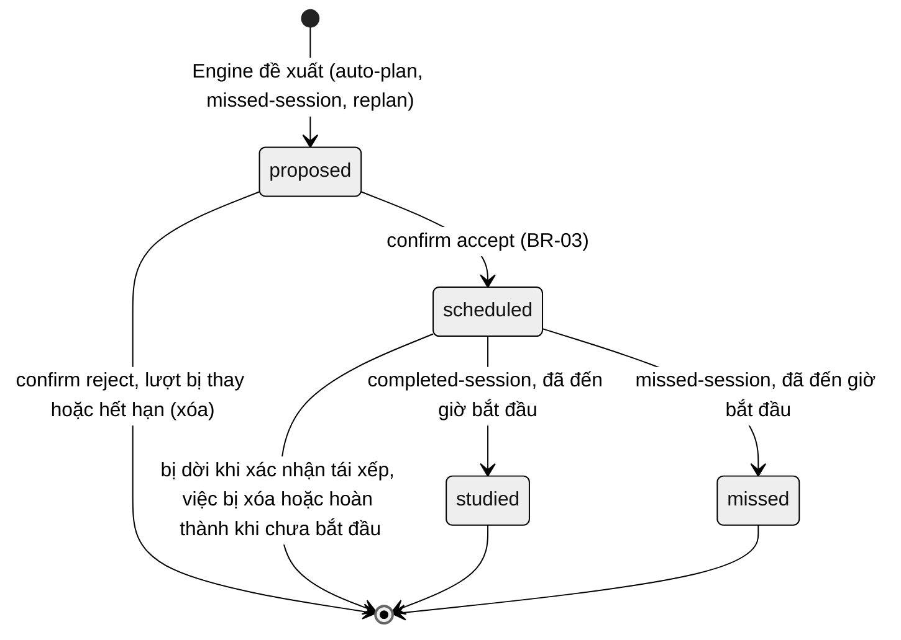
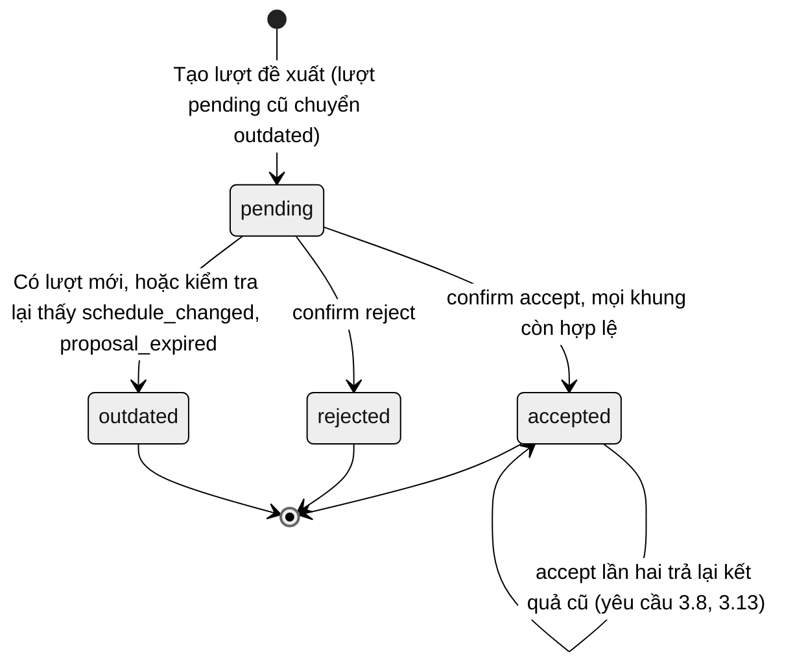
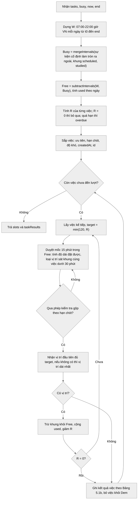
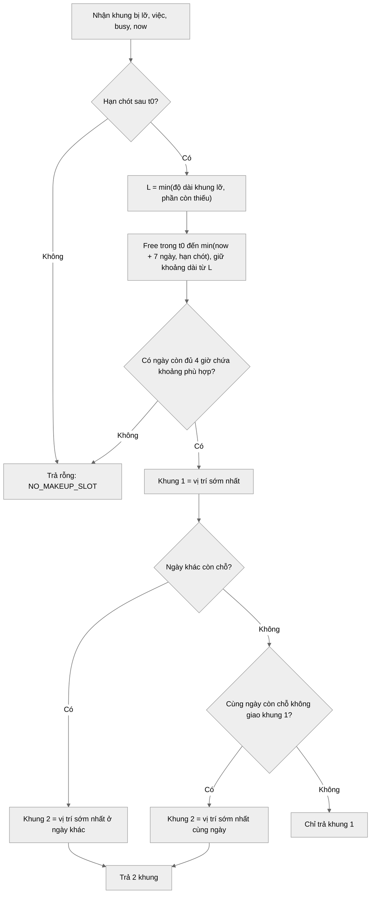

# Thiết kế giải thuật xếp lịch TV3

Trạng thái: Chờ review · Người viết: Nhi · Người review: Hưng · Issue: #112 · Cập nhật: 19/11/2026

Tài liệu này là bản trong repo của mục 4.3 (phần 4.3.1 đến 4.3.4) và mục 5.1, 5.3 (bảng TV3) của báo cáo M3. Số hình và số bảng giữ đúng như trong báo cáo để hai nơi tra chéo được. Thiết kế dựa trên `docs/api.md` (vùng TV3), `docs/data-dictionary.md` (vùng TV3), `docs/architecture.md` (Hình 6, Hình 11) và thư viện `backend/src/utils/interval.ts`. Đây là đặc tả cho Issue #119 (cài đặt `SchedulerEngine` và `SchedulerService`).

## 1. Thành phần xử lý và trạng thái (mục 4.3 báo cáo M3)

### 4.3.1 Phạm vi và thành phần xử lý

Module TV3 gồm bốn use case U021 đến U024 và một luồng phụ chạy cùng thao tác của TV2 (yêu cầu 3.19). Mọi phép tính khung giờ học nằm trong lớp thuần `SchedulerEngine` (Hình 4.19). `SchedulerService` nạp dữ liệu, đọc giờ hiện tại một lần rồi truyền vào Engine, mở transaction và ghi kết quả. Nhờ vậy giải thuật ở mục 5.1 kiểm thử được bằng unit test mà không cần CSDL.

Bảng 4.3a: Ánh xạ use case, endpoint, thành phần xử lý và dữ liệu của TV3

| Use case | Endpoint | Phương thức Service | Phương thức Engine (mục 5.1) | Bảng được ghi |
| :-- | :-- | :-- | :-- | :-- |
| U021 Xếp lịch học tự động | `POST /api/scheduler/auto-plan` | `autoPlan(userId)` | `planSlots` (mục 5.1.3 đến 5.1.7) | `schedule_proposals`, `study_slots` (`proposed`) |
| U021, U022, U023 (bước xác nhận) | `POST /api/scheduler/confirm` | `confirm(userId, input)` | Không gọi Engine, chỉ kiểm tra lại bằng `hasOverlap` | `schedule_proposals`, `study_slots` |
| U022 Báo lỡ và chọn khung giờ bù | `POST /api/scheduler/missed-session` | `reportMissed(userId, slotId)` | `findMakeupSlots` (mục 5.1.8) | `study_slots` (`missed`), `schedule_proposals` (`makeup`) |
| U023 Tái xếp lịch khi có việc phát sinh | `POST /api/scheduler/replan` | `replan(userId, input)` | `planReplan` (mục 5.1.9) | `schedule_proposals` (`replan`), `study_slots` (`replaces_slot_id`) |
| U024 Đánh dấu đã học | `POST /api/scheduler/completed-session` | `markCompleted(userId, slotId)` | Không | `study_slots` (`studied`) |
| Yêu cầu 3.19 (xóa, hoàn thành, sửa việc ở TV2) | Endpoint `/api/tasks` của TV2 | `TaskService` gọi `StudySlotRepository.deleteOpenSlotsOfTask` (Bảng 4.3) | Không | `study_slots` |

### 4.3.2 Trạng thái khung giờ học và vai trò trong giải thuật

Cột `study_slots.status` có bốn giá trị. Nhãn "Cần xếp lại" không lưu mà tính khi đọc (`needsReschedule`, yêu cầu 3.18). Bảng 4.3b ghi mỗi nhãn có được giải thuật coi là bận, có được tính vào thời lượng đã xếp và vào giới hạn 4 giờ mỗi ngày hay không. Đây là đầu vào chung của cả ba phương thức Engine.

Bảng 4.3b: Nhãn khung giờ học và cách giải thuật sử dụng

| Nhãn | Giá trị lưu | Là khoảng bận khi xếp | Tính vào thời lượng đã xếp (yêu cầu 3.5) | Tính vào giới hạn 4 giờ mỗi ngày (yêu cầu 3.3) | Bị dời khi tái xếp (yêu cầu 3.15) |
| :-- | :-- | :-- | :-- | :-- | :-- |
| Khung đề xuất đang chờ | `proposed` | Không | Không | Không | Không áp dụng |
| "Đã xếp" | `scheduled` | Có | Có | Có | Có, nếu chưa bắt đầu và giao sự kiện cố định |
| "Cần xếp lại" | `scheduled`, `needsReschedule = true` | Có, giữ chỗ cho tới khi được gỡ | Không | Có | Có, nếu chưa bắt đầu và giao sự kiện cố định |
| "Đã học" | `studied` | Có | Có | Có | Không |
| "Bỏ lỡ" | `missed` | Không | Không | Không | Không |

Khung "Cần xếp lại" vẫn được coi là bận và vẫn tính vào giới hạn 4 giờ vì nó chỉ bị gỡ khi một đề xuất có khung mới cho cùng việc được chấp nhận (yêu cầu 3.7). Nếu không coi là bận, khung mới của việc khác có thể đè lên nó trong lúc nó còn trên lịch tuần.



Hình 4.5a: Máy trạng thái của khung giờ học (`study_slots.status`)



Hình 4.5b: Máy trạng thái của lượt đề xuất (`schedule_proposals.status`)

### 4.3.3 Luồng xử lý của SchedulerService

Thứ tự kiểm tra của từng endpoint giống Hình 4.4 và 4.5, mỗi bước dừng ngay khi lỗi. Phần dưới chỉ ghi chỗ Service gọi giải thuật và cách xử lý kết quả.

Xếp lịch (`autoPlan`, U021):

1. Xác thực JWT. Lỗi: 401.
2. Đọc `now` một lần, đặt `end = now + 7 ngày`.
3. Nạp các việc `is_done = false` của người gọi (`TaskRepository`), sự kiện cố định giao `[now, end)` (`FixedEventRepository`, chỉ `starts_at`, `ends_at`) và khung `scheduled`, `studied` của người gọi (`StudySlotRepository.listBusyByUser`). Khung của việc dài hơn phạm vi vẫn được nạp để tính thời lượng đã xếp và khoảng nghỉ 30 phút.
4. Không có việc chưa hoàn thành nào: trả 200 với `data.proposal = null` và cảnh báo `NO_TASKS_TO_SCHEDULE`, không ghi CSDL (yêu cầu 3.6, U021 2a).
5. Gọi `SchedulerEngine.planSlots` (mục 5.1.7). Engine trả `slots` và `taskResults`.
6. Trong một transaction: chuyển lượt `pending` cũ sang `outdated` và xóa các khung `proposed` của lượt đó, thêm lượt `auto_plan` mới, thêm các khung `proposed`. Có việc nhưng không xếp được khung nào thì lượt vẫn được tạo với `slots` rỗng để giao diện hiện lý do của từng việc (`docs/api.md`).
7. Trả 200 `{ data: { proposal } }`, mọi mốc thời gian đổi bằng `toSlot`.

Báo lỡ (`reportMissed`, U022):

1. Khóa dòng khung (`StudySlotRepository.lockById`). Không có hoặc của người khác: 404. Chưa đến giờ bắt đầu, đã `studied`, đang "Cần xếp lại", việc đã hoàn thành hoặc đã xóa, hoặc khung đã `missed` mà việc không còn thời lượng chưa xếp: 400.
2. Khung `scheduled` thì chuyển sang `missed`. Khung đã `missed` thì giữ nguyên (nút "Tìm khung giờ bù").
3. Gọi `SchedulerEngine.findMakeupSlots` (mục 5.1.8) với lịch mới nhất.
4. Engine trả danh sách rỗng: commit chỉ với thay đổi ở bước 2, trả 200 `{ data: { missedSlot, proposal: null }, warnings: [NO_MAKEUP_SLOT] }`. Lịch tuần không đổi.
5. Engine trả 1 hoặc 2 khung: tạo lượt `makeup` (`missed_slot_id` là khung bị lỡ) như bước 6 của `autoPlan`, trả 200.

Xác nhận (`confirm`): không tính lại khung mà chỉ kiểm tra lại. Sau khi khóa lượt đề xuất, Service nạp lại sự kiện cố định và khung `scheduled`, `studied` hiện có. Với mỗi khung của lượt (hoặc khung được chạm với lượt `makeup`): `startsAt <= now` thì lượt thành `outdated`, trả 409 `proposal_expired`; `hasOverlap` với một khoảng bận (trừ khung cũ mà chính lượt `replan` sẽ dời) thì lượt thành `outdated`, trả 409 `schedule_changed`. Hai bước ghi tiếp theo đúng bảng "Giao dịch TV3 nhiều bảng" của từ điển dữ liệu.

Tái xếp (`replan`, U023): Service nạp như `autoPlan`, thêm việc mới nếu có `taskId`, rồi gọi `SchedulerEngine.planReplan` (mục 5.1.9). Không có khung bị ảnh hưởng và không có việc mới: trả `data.proposal = null`, không tạo lượt.

### 4.3.4 Truy vết

Bảng 4.3c: Truy vết từ story đến thiết kế giải thuật TV3

| Story | Yêu cầu (M2) | Endpoint | Thiết kế | Test case (mục 5.3) |
| :-- | :-- | :-- | :-- | :-- |
| US-17 | 3.1 đến 3.6 | `auto-plan` | `planSlots`, mục 5.1.3 đến 5.1.7 | TC-TV3-01 đến TC-TV3-22 |
| US-18 | 3.7 đến 3.9 | `confirm` | Mục 4.3.3, Hình 4.5b | TC-TV3-34 đến TC-TV3-36 |
| US-19, US-20 | 3.10 đến 3.14 | `missed-session`, `confirm` | `findMakeupSlots`, mục 5.1.8 | TC-TV3-23 đến TC-TV3-29 |
| US-21 | 3.15 đến 3.19 | `replan`, `confirm` | `planReplan`, mục 5.1.9 | TC-TV3-30 đến TC-TV3-33 |
| US-22 | 3.20, 3.21 | `completed-session` | Hình 4.5a | Theo `docs/api.md` |

## 2. Giải thuật (mục 5.1 báo cáo M3)

Giải thuật xếp lịch của TV3 gồm ba phương thức của `SchedulerEngine`: `planSlots` đề xuất khung giờ học cho các việc cần làm (US-17), `findMakeupSlots` tìm khung giờ bù cho khung bị lỡ (US-20) và `planReplan` tái xếp khi có việc phát sinh (US-21). Ba phương thức dùng chung cách dựng khoảng trống (mục 5.1.3) và chung các hằng số ở Bảng 5.1a. Engine là lớp thuần: không đọc ghi CSDL, không đọc giờ hiện tại, không sửa dữ liệu đầu vào.

### 5.1.1 Bài toán, đầu vào và đầu ra

Bài toán. Cho các việc cần làm chưa hoàn thành của một sinh viên, mỗi việc có hạn chót `dueAt`, độ ưu tiên, độ khó và thời lượng `durationMinutes`, cùng lịch bận trong 7 ngày tới. Đặt các khung giờ học không giao lịch bận sao cho mỗi việc nhận đủ phần thời lượng còn thiếu trước hạn chót, việc ưu tiên cao được xếp trước, và không làm việc khác trễ hạn khi vẫn còn cách xếp kịp hạn (yêu cầu 3.2). Không đủ chỗ thì xếp phần có thể và báo lý do, không xếp ép (yêu cầu 3.6, BR-01).

Đầu vào (Service nạp và truyền vào, các mốc là `TimeInterval` theo UTC):

```ts
interface PlanTask {
  id: string;
  dueAt: Date;
  priority: 'low' | 'medium' | 'high';
  difficulty: 'easy' | 'medium' | 'hard';
  durationMinutes: number;          // > 0, mặc định 60 do TV2 gán (BR-04)
  createdAt: Date;                  // khóa sắp phụ để kết quả ổn định
}
interface PlanSlotInput {           // khung đã có của sinh viên, kể cả ngoài phạm vi 7 ngày
  id: string;
  taskId: string | null;
  interval: TimeInterval;
  status: 'scheduled' | 'studied';
  needsReschedule: boolean;         // tính theo Bảng 4.7 trước khi gọi
}
interface PlanWindow { now: Date; end: Date }          // end = now + 7 ngày
function planSlots(tasks: PlanTask[], busy: { fixed: TimeInterval[]; slots: PlanSlotInput[] },
                   window: PlanWindow): PlanResult;
```

Đầu ra:

```ts
interface PlannedSlot { taskId: string; interval: TimeInterval; replacesSlotId: string | null }
interface TaskResult {
  taskId: string;
  result: 'full' | 'partial' | 'beyond_range' | 'not_enough_time' | 'overdue';
  proposedMinutes: number;
  missingMinutes: number;
}
interface PlanResult { slots: PlannedSlot[]; taskResults: TaskResult[] }
```

`PlanResult` khớp `proposal.slots` và `proposal.taskResults` của `docs/api.md`. Service thêm `id`, `taskTitle` và đổi `interval` sang `startsAt`, `endsAt` bằng `toSlot`.

Bảng 5.1a: Hằng số của giải thuật TV3

| Hằng số | Giá trị | Nguồn |
| :-- | :-- | :-- |
| Khung xếp mỗi ngày (`DAY_START`, `DAY_END`) | 07:00 đến 22:00 giờ Việt Nam | Bảng 1.3 đặc tả TV3, yêu cầu 3.1 |
| Phạm vi xếp (`HORIZON`) | 7 ngày kể từ lúc gọi, không quá hạn chót | Yêu cầu 3.1, 3.12 |
| Giờ học tối đa mỗi ngày (`MAX_DAILY`) | 240 phút, tính khung `scheduled`, `studied` và khung mới | Yêu cầu 3.3 |
| Độ dài tối đa một khung (`MAX_SLOT`) | 120 phút | Yêu cầu 3.3, CHECK `ck_study_slots_max_2_hours` |
| Khoảng nghỉ giữa hai khung của cùng việc (`MIN_GAP`) | 30 phút | Yêu cầu 3.3 |
| Bước lưới thời gian (`STEP`) | 15 phút | Giả định, tài liệu ý tưởng thuật toán (Issue #21) |
| Độ dài tối thiểu một khung khi xếp một phần (`MIN_PART`) | 30 phút, hoặc bằng phần còn thiếu nếu ngắn hơn | Giả định, tài liệu ý tưởng thuật toán (Issue #21) |
| Số khung giờ bù (`MAKEUP_COUNT`) | 2 | Yêu cầu 3.12 |

Các hằng số đặt trong một đối tượng cấu hình của Engine, test đọc từ đối tượng này chứ không ghi cứng.

### 5.1.2 Quy ước thời gian

Mọi khoảng là nửa mở `[start, end)` theo UTC, cùng quy ước với BR-01 và thư viện khoảng thời gian: khung kết thúc đúng lúc sự kiện bắt đầu (hoặc ngược lại) không tính là giao nhau. Việt Nam không dùng giờ mùa hè nên 07:00 đến 22:00 giờ Việt Nam luôn là 00:00 đến 15:00 UTC của cùng ngày dương lịch theo giờ Việt Nam. Phép đổi múi giờ (`APP_TIMEZONE`, BR-07) chỉ xuất hiện ở hai chỗ: dựng khung xếp mỗi ngày và xác định một khung thuộc ngày nào để tính giới hạn 4 giờ.

Mọi khung do Engine tạo nằm trên lưới 15 phút neo ở 00:00 giờ Việt Nam:

- Mốc bắt đầu sớm nhất `t0` là mốc lưới đầu tiên sau `now` (lúc 10:07 thì `t0` là 10:15, lúc đúng 10:15 thì `t0` là 10:30), vì khung phải bắt đầu sau thời điểm hiện tại (yêu cầu 3.1).
- Sự kiện cố định được làm tròn ra ngoài trước khi gộp: giờ bắt đầu làm tròn xuống, giờ kết thúc làm tròn lên (ca làm 13:10 đến 15:05 được coi là bận 13:00 đến 15:15). Làm tròn ra ngoài chỉ làm khoảng bận rộng thêm nên không thể sinh khung trùng sự kiện cố định (BR-01). Thư viện không làm tròn nên TV3 làm trước khi gọi thư viện.
- Mốc cuối mà khung được phép kết thúc là `dueAt` làm tròn xuống theo lưới (khung kết thúc không muộn hơn hạn chót).
- Phần thời lượng còn thiếu làm tròn lên bội số 15 phút (việc 50 phút được xếp 60 phút).

Vì khung xếp, `t0` và khoảng bận đều nằm trên lưới, mọi khoảng trống do `subtractIntervals` trả về cũng nằm trên lưới, nên Engine không phải làm tròn lại ở các bước sau.

### 5.1.3 Bước 1. Dựng khoảng trống bằng thư viện khoảng thời gian

1. W = `dailyWindows(t0, end)`: với mỗi ngày giờ Việt Nam chạm tới `[t0, end)`, lấy `[07:00, 22:00)` của ngày đó cắt với `[t0, end)`. W là danh sách chuẩn (đã sắp, không chồng, không chạm) vì hai khung của hai ngày liền kề cách nhau 9 giờ.
2. Busy = `mergeIntervals(roundOut(fixed) ∪ khung scheduled ∪ khung studied)`. Hai sự kiện cố định chồng hoặc chạm nhau thành một khoảng bận liền (yêu cầu 3.4). Khung `proposed` và `missed` không đưa vào (Bảng 4.3b).
3. Free = `subtractIntervals(W, Busy)`: các khoảng trống, đã sắp theo thời điểm bắt đầu.
4. `used[d]`: tổng phút của khung `scheduled`, `studied` trong ngày d (giờ Việt Nam).

Sự kiện nằm ngoài 07:00 đến 22:00 hoặc vắt qua nửa đêm không cần xử lý riêng: phép trừ chỉ cắt phần chạm vào W. Khoảng trống quá ngắn không cần lọc ở bước này vì bước 4 tự bỏ vị trí không đủ độ dài.

### 5.1.4 Bước 2. Tính phần còn thiếu và phân loại việc

Với mỗi việc chưa hoàn thành:

- R = làm tròn lên bội số 15 của `durationMinutes − (tổng phút khung scheduled không "Cần xếp lại" + tổng phút khung studied)` của việc đó, không âm (yêu cầu 3.5).
- R = 0: việc đã xếp đủ, không có đề xuất mới, không có dòng trong `taskResults` (yêu cầu 3.5).
- `dueAt <= now`: không xếp, `result = overdue`, `missingMinutes = R` (yêu cầu 3.6, BR-04).
- Còn lại: đưa vào danh sách chờ xếp.

Trường hợp không có việc chưa hoàn thành nào do Service xử lý trước khi gọi Engine (`NO_TASKS_TO_SCHEDULE`, mục 4.3.3).

### 5.1.5 Bước 3. Thứ tự xếp và phép kiểm tra gộp theo hạn chót (mô hình EDF)

Thứ tự xếp. Danh sách chờ xếp được sắp theo khóa (độ ưu tiên giảm dần, `dueAt` tăng dần, độ khó giảm dần, `createdAt` tăng dần, `id` tăng dần). Ba khóa đầu là thứ tự của yêu cầu 3.2. Hai khóa cuối chỉ để cùng đầu vào luôn cho cùng kết quả, dễ viết test.

Vì sao không xếp thuần theo hạn chót. Giải thuật hạn chót gần nhất trước (Earliest Deadline First, EDF) là cách tối ưu cho bài toán một nguồn lực với các việc có hạn chót và được phép chia nhỏ: nếu tồn tại cách xếp để mọi việc kịp hạn thì xếp theo hạn chót tăng dần cũng kịp hạn. Yêu cầu 3.2 lại đòi việc ưu tiên cao được chọn chỗ trước. Thiết kế dùng EDF làm phép kiểm tra chứ không làm thứ tự xếp: việc vẫn được xét theo độ ưu tiên, nhưng trước khi nhận một vị trí, Engine kiểm tra điều kiện cần của EDF để không lấy mất chỗ của việc có hạn chót gấp hơn.

Điều kiện EDF. Với một mốc T, gọi:

- Cap(T) = Σ theo từng ngày d của min(số phút trống của ngày d nằm trong `[t0, T)`, 240 − `used[d]`). Đây là số phút còn xếp được trước T khi đã tính giới hạn 4 giờ mỗi ngày.
- Dem(T) = tổng phần còn thiếu R của các việc chưa đến lượt xếp hoặc đang được xếp, có `dueAt <= T`.
- Slack(T) = Cap(T) − Dem(T).

Theo EDF, nếu bỏ qua giới hạn độ dài khung và khoảng nghỉ thì mọi việc kịp hạn khi và chỉ khi Slack(T) ≥ 0 với mọi hạn chót T. Chỉ cần xét T là các hạn chót vì Dem chỉ tăng tại đó.

Phép kiểm tra gộp (yêu cầu 3.2). Một vị trí `[s, s + ℓ)` cho việc đang xếp được nhận nếu, với mọi hạn chót T của các việc chưa đến lượt hoặc đang xếp và T ≤ `end`: Slack(T) trước khi đặt ≥ 0 thì Slack(T) sau khi đặt vẫn ≥ 0. Sau khi đặt, Free mất `[s, s + ℓ)`, `used[ngày của s]` tăng ℓ và R của việc đang xếp giảm ℓ.

Ba điểm của phép kiểm tra:

- Hạn chót đã có Slack âm từ đầu (thiếu chỗ cho mọi việc) không chặn vị trí nào, nhưng các hạn chót khác vẫn được kiểm tra. Khi không đủ chỗ cho tất cả, việc ưu tiên cao giữ chỗ và các việc xếp sau bị báo thiếu.
- Việc có hạn chót sau phạm vi 7 ngày không tham gia kiểm tra: phần còn thiếu của nó được xếp tiếp ở lần sau ("Còn X giờ chưa xếp").
- Khi một việc xong lượt, phần còn thiếu của nó bị bỏ khỏi Dem. Phần này đã không xếp được nên không được phép tiếp tục chặn việc khác.

Phép kiểm tra là điều kiện cần, chưa phải điều kiện đủ, vì nó không xét giới hạn 2 giờ, khoảng nghỉ 30 phút và độ dài tối thiểu. Vì vậy Engine cố gắng không làm việc khác trễ hạn chứ không bảo đảm tuyệt đối, đúng câu chữ đã sửa ở Bảng 1.3 đặc tả TV3. Khi phép kiểm tra cho qua một vị trí mà sau đó việc khác vẫn thiếu chỗ, Engine không vi phạm BR-01, chỉ báo việc đó thiếu thời gian.

### 5.1.6 Bước 4. Đặt khung giờ học

Với từng việc theo thứ tự ở mục 5.1.5, lặp cho tới khi R = 0 hoặc không còn vị trí:

1. Độ dài mục tiêu `target = min(120, R)`, độ dài tối thiểu `minLen = min(30, R)`.
2. Duyệt các mốc lưới s trong Free từ sớm đến muộn. Với mỗi s (thuộc ngày d giờ Việt Nam), tính độ dài lớn nhất đặt được:
   `ℓ(s) = floorStep(min(target, cuối khoảng trống chứa s − s, dueAt − s, 240 − used[d], đầu khung kế tiếp của cùng việc − 30 − s))`.
   Vị trí s bị loại nếu s cách cuối một khung trước đó của cùng việc dưới 30 phút (xét cả khung "Đã xếp", "Đã học" của việc và khung vừa đặt trong lượt này), hoặc ℓ(s) < `minLen`, hoặc không qua phép kiểm tra gộp với độ dài ℓ(s).
3. Nhận vị trí hợp lệ đầu tiên có ℓ(s) = `target`. Không có vị trí nào như vậy thì nhận vị trí hợp lệ có ℓ(s) lớn nhất, bằng nhau lấy vị trí sớm hơn. Cách chọn này ưu tiên khung đủ dài, chỉ cắt ngắn khi lịch bị chia nhỏ.
4. Đặt khung: Free = `subtractIntervals(Free, [[s, s + ℓ)])`, `used[d] += ℓ`, R −= ℓ.
5. Không còn vị trí hợp lệ: dừng việc này, chuyển sang việc kế tiếp. Các việc khác vẫn được xếp (yêu cầu 3.6).

Kết thúc lượt của một việc, kết quả của việc được ghi theo Bảng 5.1b.

Bảng 5.1b: Kết quả của từng việc và thông báo trên giao diện

| `result` | Điều kiện | Thông báo (yêu cầu 3.3, 3.6) |
| :-- | :-- | :-- |
| `full` | Đã đặt đủ R | Không có thông báo riêng |
| `beyond_range` | Chưa đủ R và `dueAt` sau phạm vi 7 ngày | "Còn X giờ chưa xếp" |
| `partial` | Chưa đủ R, `dueAt` trong phạm vi, đã đặt được ít nhất một khung | "Chỉ xếp được X/Y giờ trước hạn chót" |
| `not_enough_time` | `dueAt` trong phạm vi, không đặt được khung nào | "Không đủ thời gian trước hạn chót" |
| `overdue` | `dueAt <= now` (mục 5.1.4) | "Việc cần làm đã quá hạn chót" |

### 5.1.7 Mã giả của planSlots

```text
function planSlots(tasks, busy, window):                 # window = { now, end }
    t0   ← mốc lưới 15 phút đầu tiên sau now
    W    ← dailyWindows(t0, window.end)                  # 07:00-22:00 giờ VN mỗi ngày
    B    ← mergeIntervals(roundOut(busy.fixed) ∪ intervals(busy.slots))
    Free ← subtractIntervals(W, B)                       # Bước 1
    used ← phút đã học/đã xếp theo ngày VN của busy.slots
    results ← [], pending ← []
    for each t in tasks:                                 # Bước 2
        R ← ceilStep(max(0, t.durationMinutes − countedMinutes(t, busy.slots)))
        if R = 0: continue
        if t.dueAt ≤ window.now: results.add(t, overdue, 0, R); continue
        pending.add(t with R)
    sort pending by (priority desc, dueAt asc, difficulty desc, createdAt asc, id asc)   # Bước 3
    rem[t] ← t.R for each t in pending
    planned ← []
    for each t in pending:                               # Bước 4
        own ← khung scheduled, studied của t; placed ← 0
        while rem[t] > 0:
            target ← min(MAX_SLOT, rem[t]); minLen ← min(MIN_PART, rem[t])
            before ← slackAll(Free, used, rem)           # Slack(T) cho mọi hạn chót T ≤ end
            best ← none
            for each grid point s in Free (tăng dần):
                ℓ ← maxLength(s, t, target, Free, used, own)
                if ℓ < minLen or tooCloseToOwn(s, own): continue
                if not keepsDeadlines(before, s, ℓ, t): continue
                if ℓ = target: best ← (s, ℓ); break
                if best = none or ℓ > best.ℓ: best ← (s, ℓ)
            if best = none: break
            slot ← [best.s, best.s + best.ℓ)
            Free ← subtractIntervals(Free, [slot]); used[day(slot)] += best.ℓ
            rem[t] −= best.ℓ; placed += best.ℓ; own.add(slot); planned.add(t, slot)
        missing ← t.R − placed; rem[t] ← 0             # hết lượt: bỏ khỏi Dem
        results.add(t, classify(t, placed, missing, window), placed, missing)   # Bảng 5.1b
    return { slots: planned, taskResults: results }

function keepsDeadlines(before, s, ℓ, t):
    Free' ← subtractIntervals(Free, [[s, s+ℓ)]); used' ← used với ngày của s tăng ℓ
    rem'  ← rem với rem'[t] = rem[t] − ℓ
    after ← slackAll(Free', used', rem')
    return với mọi T trong before: before[T] < 0 or after[T] ≥ 0

function slackAll(Free, used, rem):
    for each hạn chót T (tăng dần) của việc có rem > 0 và dueAt ≤ end:
        Cap(T) ← Σ_d min(phút trống ngày d trong [t0, T), MAX_DAILY − used[d])
        Dem(T) ← Σ rem[u] với u.dueAt ≤ T
        slack[T] ← Cap(T) − Dem(T)
    return slack
```

`maxLength` tính ℓ(s) theo bước 4.2 của mục 5.1.6. `slackAll` duyệt một lượt các khoảng trống và các hạn chót đã sắp nên tốn O(G + K) (ký hiệu ở mục 5.1.10).



Hình 5.1: Lưu đồ thuật toán xếp lịch (`planSlots`)

### 5.1.8 Khung giờ bù (findMakeupSlots)

Đầu vào: khung bị lỡ, việc của khung (`dueAt`, `durationMinutes`), khoảng bận như `planSlots` (khung bị lỡ đã là `missed` nên không còn là bận) và `{ now, end = now + 7 ngày }`. Đầu ra: 0, 1 hoặc 2 khung không giao nhau.

1. Phạm vi tìm: `[t0, min(end, dueAt))`. Hạn chót không muộn hơn `t0` thì trả rỗng.
2. Độ dài khung bù L = min(độ dài khung bị lỡ, R của việc theo mục 5.1.4) (yêu cầu 3.12). Bất biến của yêu cầu 3.19 (giảm thời lượng thì rút khung) bảo đảm L > 0 khi Service cho phép báo lỡ.
3. Dựng Free như mục 5.1.3 trên phạm vi tìm, rồi Cand = `filterByMinDuration(Free, L)`: chỉ giữ khoảng trống đủ dài.
4. Khung thứ nhất: điểm đầu của khoảng sớm nhất trong Cand mà ngày của nó còn đủ giờ (`used[d] + L ≤ 240`). Điểm đầu một khoảng là vị trí sớm nhất của khoảng đó vì mọi khoảng đều nằm trên lưới, còn giới hạn 4 giờ tính theo cả ngày nên ngày đã thiếu giờ thì mọi vị trí trong ngày đều không dùng được.
5. Khung thứ hai: tìm như bước 4 nhưng chỉ ở ngày khác ngày của khung thứ nhất. Không có thì lấy mốc lưới sớm nhất cùng ngày không giao khung thứ nhất (yêu cầu 3.12).
6. Không cần phép kiểm tra gộp theo hạn chót, không áp dụng khoảng nghỉ 30 phút (hai khung là hai lựa chọn thay thế nhau). Giới hạn 4 giờ kiểm tra riêng cho từng khung vì sinh viên chỉ chọn một.

Khi Engine trả danh sách rỗng, Service trả cảnh báo `NO_MAKEUP_SLOT` ("Không còn khung giờ bù trước hạn chót"), khung vẫn là "Bỏ lỡ", không tạo lượt đề xuất, lịch tuần không đổi (yêu cầu 3.14, mục 4.3.3). Bốn nguyên nhân dẫn tới trường hợp này: lịch kín trong phạm vi, mọi ngày còn chỗ đã đủ 4 giờ, hạn chót quá gần, hoặc hạn chót đã qua.

```text
function findMakeupSlots(missed, task, busy, window):
    t0   ← mốc lưới 15 phút đầu tiên sau window.now
    stop ← min(window.end, floorStep(task.dueAt))
    if stop ≤ t0: return []                                     # hạn chót đã qua hoặc quá gần
    L    ← min(duration(missed), remainingMinutes(task, busy.slots))
    Free ← subtractIntervals(dailyWindows(t0, stop),
                             mergeIntervals(roundOut(busy.fixed) ∪ intervals(busy.slots)))
    Cand ← filterByMinDuration(Free, L)
    used ← phút đã học/đã xếp theo ngày VN
    first ← điểm đầu c.start của khoảng c sớm nhất trong Cand với used[day(c)] + L ≤ MAX_DAILY
    if first = none: return []                                  # → NO_MAKEUP_SLOT
    second ← điểm đầu khoảng sớm nhất trong Cand ở ngày ≠ day(first), used[ngày] + L ≤ MAX_DAILY
    if second = none:
        second ← mốc lưới s sớm nhất cùng ngày, [s, s+L) ⊆ một khoảng của Cand,
                 không giao [first, first+L)
    return [first, second] bỏ phần tử none
```



Hình 5.1a: Lưu đồ tìm khung giờ bù (`findMakeupSlots`)

### 5.1.9 Tái xếp lịch khi có việc phát sinh (planReplan)

Đầu vào như `planSlots`, thêm `newTaskId` (có thể rỗng). Đầu ra như `planSlots`, mỗi khung mới có thể ghi `replacesSlotId` là khung cũ bị dời.

1. Khung bị ảnh hưởng A: các khung `scheduled` có `startsAt > now`, `startsAt < end` và `hasOverlap` với một khoảng của `mergeIntervals(fixed)` (yêu cầu 3.15). Khung nối tiếp, khung đã bắt đầu, khung "Đã học", "Bỏ lỡ" không thuộc A.
2. A rỗng và không có việc mới: trả `null`, không tạo lượt (U023 2a).
3. Bỏ A khỏi khoảng bận. Gọi `planSlots` cho tập việc gồm việc mới và các việc có khung trong A. Khung trong A được tính như "Cần xếp lại" nên không vào thời lượng đã xếp, do đó R của các việc này tự gồm phần cần dời. Việc mới và việc bị ảnh hưởng xếp chung theo thứ tự và phép kiểm tra ở mục 5.1.5 (yêu cầu 3.16).
4. Việc mới chưa `full` và có hạn chót trong phạm vi: xét dời khung của việc có độ ưu tiên thấp hơn việc mới (yêu cầu 3.16, U023 3a).
   - Ứng viên: khung `scheduled` chưa bắt đầu, không thuộc A, của việc có độ ưu tiên thấp hơn hẳn việc mới, bắt đầu trước hạn chót của việc mới. Không xét việc cùng hoặc cao hơn độ ưu tiên.
   - Thử nhả hết ứng viên. Nếu việc mới vẫn không đủ thì không nhả khung nào, giữ kết quả bước 3.
   - Nếu đủ: nhả lần lượt từ ứng viên của việc đứng cuối thứ tự xếp, khung muộn nhất trước, dừng ngay khi việc mới đủ. Sau đó gọi `planSlots` một lần nữa cho các việc vừa bị nhả khung.
5. Ghép `replacesSlotId`: mỗi khung mới của một việc có khung bị dời (thuộc A hoặc bị nhả ở bước 4) nhận một khung cũ của chính việc đó theo thứ tự thời gian. Khung cũ còn thừa (việc không xếp lại đủ) được ghi `not_enough_time` hoặc `partial` trong `taskResults` (U023 3b).

```text
function planReplan(tasks, busy, window, newTaskId):
    F ← mergeIntervals(busy.fixed)
    A ← { s ∈ busy.slots : s.status = scheduled, window.now < s.start < window.end,
                           ∃ f ∈ F: hasOverlap(s, f) }
    if A = ∅ and newTaskId = null: return null
    busy1 ← busy với A đánh dấu needsReschedule và bỏ khỏi khoảng bận
    T1    ← { việc của A } ∪ { newTask }
    res   ← planSlots(T1, busy1, window)
    if newTask chưa full và newTask.dueAt ≤ window.end:
        C ← khung scheduled chưa bắt đầu, ∉ A, việc có priority < newTask.priority,
            start < newTask.dueAt
        if newTask đủ khi nhả toàn bộ C:
            release ← []
            for each c in C theo (thứ tự xếp của việc giảm dần, start giảm dần):
                release.add(c)
                if planSlots({newTask} ∪ T1, busy1 bỏ release, window) cho newTask full: break
            res ← planSlots({newTask} ∪ T1 ∪ { việc của release }, busy1 bỏ release, window)
    pairReplacesSlotId(res.slots, A ∪ release)
    return res
```

### 5.1.10 Độ phức tạp

Ký hiệu: n là số việc chưa hoàn thành, m là số sự kiện cố định và khung đã có trong phạm vi, K ≤ n là số hạn chót khác nhau trong phạm vi, G ≤ m + 8 là số khoảng trống, P là số mốc lưới trong phạm vi và S là số khung được đặt. P và S bị chặn bởi hằng số cấu hình: P ≤ 7 ngày × 15 giờ × 4 mốc mỗi giờ = 420, S ≤ 8 ngày × 240 phút / 15 phút = 128 (thực tế ít hơn vì mỗi khung thường dài từ 30 phút).

Bảng 5.1c: Độ phức tạp của các bước

| Bước | Thời gian | Bộ nhớ |
| :-- | :-- | :-- |
| Dựng W, gộp khoảng bận, lấy phần bù (mục 5.1.3) | O(m log m) do `mergeIntervals` sắp; O(m) nếu CSDL trả theo `starts_at` | O(m) |
| Tính R và sắp việc (mục 5.1.4, 5.1.5) | O(n log n + m) | O(n) |
| Đặt khung (mục 5.1.6), bản cài đặt đề xuất | O((S + n) · P · (G + K)) | O(n + G) |
| `planSlots` tổng cộng | O(m log m + n log n + (S + n) · P · (G + K)) | O(n + m) |
| `findMakeupSlots` | O(m log m + G + P) | O(m) |
| `planReplan` | O(c) lần `planSlots`, c là số khung ứng viên bị nhả (c ≤ S) | O(n + m) |

Số lần tìm vị trí là S + n vì mỗi lần hoặc đặt được một khung hoặc kết thúc lượt của một việc. Mỗi lần duyệt tối đa P mốc, mỗi mốc kiểm tra khoảng nghỉ trên các khung của cùng việc (không quá vài khung) và chạy phép kiểm tra gộp O(G + K). Với P, S là hằng số, `planSlots` chạy trong O(m log m + n log n + n · (n + m)). Ở quy mô của một sinh viên (giả định tối đa khoảng 50 việc và 100 sự kiện trong một tuần), số phép tính vào khoảng vài triệu, nhỏ so với thời gian truy vấn CSDL. Nhóm sẽ đo thời gian chạy với bộ dữ liệu lớn nhất khi làm Issue #119.

Cận dưới. Bài toán cần ít nhất Ω(m log m + n log n) phép so sánh: gộp các khoảng bận bất kỳ cần sắp, và kết quả phải theo thứ tự ưu tiên của các việc. Hai phần này của thiết kế đã đạt cận dưới. Phần còn lại O(n · (n + m)) đến từ phép kiểm tra gộp theo hạn chót, bậc hai theo n nhưng với hệ số nhỏ vì P, S là hằng số cấu hình. Các cách giảm chi phí đã dùng trong thiết kế:

- Slack trước khi đặt (`before`) chỉ tính một lần cho mỗi khung, không tính lại ở từng vị trí.
- Dừng duyệt ngay khi gặp vị trí đủ độ dài mục tiêu; với lịch thông thường phần lớn khung được nhận ở vài vị trí đầu.
- Việc có hạn chót sau phạm vi 7 ngày không vào phép kiểm tra, nên K thường nhỏ hơn n nhiều.

Nếu phép đo ở Issue #119 cho thấy chậm, có thể thay việc tính lại Slack bằng cập nhật theo đoạn: đặt một khung làm Cap giảm đúng ℓ với mọi T sau ngày của khung (khung dùng đồng thời ℓ phút trống và ℓ phút của giới hạn ngày), nên với cây phân đoạn mỗi lần kiểm tra còn O(log K) trong trường hợp mọi Slack đều không âm (đủ chỗ cho mọi việc). Trường hợp có Slack âm từ đầu thì vẫn phải duyệt các hạn chót. Nhóm chọn cài bản mảng ở bảng trên vì dễ đọc và dễ test hơn.

### 5.1.11 Ví dụ minh họa

Sinh viên bấm "Xếp lịch" lúc 07:00 Thứ Hai 23/11/2026 (giờ Việt Nam). Sự kiện cố định: Thứ Hai có lớp 07:30 đến 11:30 và ca làm 13:00 đến 17:00; Thứ Ba có lớp 07:30 đến 09:30 và ca làm 18:00 đến 22:00; Thứ Tư đến Chủ Nhật không có sự kiện. Chưa có khung giờ học nào. Dữ liệu là dữ liệu giả.

Bảng 5.1d: Việc cần làm trong ví dụ

| Việc | Ưu tiên | Độ khó | Thời lượng | Hạn chót |
| :-- | :-- | :-- | :-- | :-- |
| A. Ôn thi Giải tích | Cao | Khó | 3 giờ | 07:30 Thứ Tư 25/11 |
| B. Bài tập Cấu trúc dữ liệu | Trung bình | Trung bình | 1 giờ | 12:00 Thứ Ba 24/11 |
| C. Đọc tài liệu Nhập môn Công nghệ phần mềm | Thấp | Dễ | 1 giờ | 13:00 Thứ Hai 23/11 |
| D. Nộp báo cáo thực tập | Trung bình | Trung bình | 1 giờ 30 | 20:00 Chủ Nhật 22/11 (đã qua) |

- `t0` là 07:15. Khoảng trống Thứ Hai: 07:15 đến 07:30, 11:30 đến 13:00, 17:00 đến 22:00. Thứ Ba: 07:00 đến 07:30, 09:30 đến 18:00.
- D quá hạn: `overdue`. Thứ tự xếp: A (Cao), B (Trung bình), C (Thấp).
- A, khung 1 (mục tiêu 2 giờ): vị trí 11:30 chỉ đặt được 90 phút và làm C mất chỗ (trước 13:00 Thứ Hai chỉ còn 15 phút, cần 60 phút) nên bị loại; 11:45 và 12:00 bị loại cùng lý do; 12:15 và 12:30 qua kiểm tra nhưng chỉ đặt được 45 và 30 phút nên chưa nhận. Vị trí 17:00 đủ 2 giờ và qua kiểm tra: 17:00 đến 19:00.
- A, khung 2 (còn 1 giờ): 11:30 đến 12:00 làm C trễ hạn; 12:15, 12:30 không đủ 1 giờ; 19:00, 19:15 cách khung 1 chưa đủ 30 phút. Nhận 19:30 đến 20:30. Thứ Hai đã có 3 giờ học.
- B: đặt vào Thứ Hai (11:30 hay 20:30) sẽ làm Thứ Hai đủ 4 giờ hoặc chiếm chỗ trước 13:00, C không còn chỗ, nên bị loại. Nhận 09:30 đến 10:30 Thứ Ba.
- C: 11:30 đến 12:30 Thứ Hai. Thứ Hai có đúng 4 giờ học.

Bảng 5.1e: Kết quả ví dụ, có và không có phép kiểm tra gộp theo hạn chót

| Việc | Có kiểm tra (thiết kế) | Không kiểm tra (chỉ chọn chỗ sớm nhất) |
| :-- | :-- | :-- |
| A | 17:00 đến 19:00 và 19:30 đến 20:30 Thứ Hai, `full` | 17:00 đến 19:00 và 11:30 đến 12:30 Thứ Hai, `full` |
| B | 09:30 đến 10:30 Thứ Ba, `full` | 19:00 đến 20:00 Thứ Hai, `full` |
| C | 11:30 đến 12:30 Thứ Hai, `full` | Không có khung, `not_enough_time` |
| D | `overdue` | `overdue` |

Phép kiểm tra làm A nhường chỗ buổi trưa cho C (hạn gấp hơn) mà A vẫn kịp hạn, đúng điều kiện cuối của yêu cầu 3.2. Các khung trên chỉ là đề xuất đang chờ, lịch tuần chưa đổi cho tới khi sinh viên bấm "Chấp nhận" (BR-03).

Ví dụ khung giờ bù (yêu cầu 3.12, US-20 tiêu chí 11): khung bị lỡ dài 1 giờ, báo lỡ lúc 08:00 Thứ Hai, hạn chót sau Thứ Ba, trong 7 ngày tới chỉ trống 09:00 đến 12:00 Thứ Hai và 14:00 đến 16:00 Thứ Ba. Khung 1 là 09:00 đến 10:00 Thứ Hai. Khung 2 là 14:00 đến 15:00 Thứ Ba, không phải 10:00 đến 11:00 Thứ Hai, vì khung thứ hai ưu tiên ngày khác.

Các ví dụ trên, hai ví dụ của yêu cầu 3.2 và US-17 tiêu chí 2, 4, 5, 11 đã được chạy thử bằng một bản cài đặt nhỏ của mã giả và cho đúng kết quả mong đợi.

## 3. Trường hợp biên (mục 5.3 báo cáo M3)

Bảng 5.1: Trường hợp biên và kết quả mong đợi (TV3)

| Trường hợp | Kết quả mong đợi | Test case |
| :-- | :-- | :-- |
| Lịch trống (chưa có sự kiện cố định), việc 1 giờ, bấm lúc 06:50 | Khung 07:00 đến 08:00; không khung nào ngoài 07:00 đến 22:00 | TC-TV3-01 |
| Lịch kín 07:00 đến 22:00 mọi ngày trước hạn chót (trong phạm vi) | `not_enough_time`, `slots` rỗng, vẫn 200; các việc khác vẫn được xếp | TC-TV3-02 |
| Trùng đúng giờ biên: lớp 07:30 đến 09:30 | Khung có thể bắt đầu đúng 09:30, không khung nào giao 07:30 đến 09:30 | TC-TV3-03 |
| Hai sự kiện cố định chồng nhau 18:00 đến 20:00 và 19:00 đến 21:00 | Coi là một khoảng bận 18:00 đến 21:00 | TC-TV3-04 |
| Không có việc chưa hoàn thành | `proposal = null`, cảnh báo `NO_TASKS_TO_SCHEDULE`, không ghi CSDL | TC-TV3-05 |
| Mọi việc chưa hoàn thành đều đã xếp đủ | Đề xuất: xử lý như dòng trên (chờ chốt, xem câu hỏi 1 trong hướng dẫn) | TC-TV3-06 |
| Việc có hạn chót đã qua | Không xếp, `overdue`; các việc khác vẫn được xếp | TC-TV3-07 |
| Hạn chót nằm giữa khoảng trống: trống 09:30 đến 12:00, việc 1 giờ hạn 10:00 | Khung 09:30 đến 10:00, `partial` ("Chỉ xếp được 0,5/1 giờ") | TC-TV3-08 |
| Việc 4 giờ, trước hạn chót chỉ còn 2 giờ trống (US-17 tiêu chí 11) | Đề xuất 2 giờ, `partial` ("Chỉ xếp được 2/4 giờ") | TC-TV3-09 |
| Không đủ chỗ cho mọi việc | Việc ưu tiên cao được xếp trước, việc sau `partial` hoặc `not_enough_time` | TC-TV3-10 |
| Ví dụ 1 của yêu cầu 3.2 (A Thấp hạn 12:00 Thứ Hai, B Cao) | A 08:00 đến 10:00, B 14:00 đến 16:00 Thứ Hai | TC-TV3-11 |
| Ví dụ 2 của yêu cầu 3.2 (A1, A2 Thấp, B Cao) | A1 08:00 đến 10:00, A2 10:00 đến 12:00 Thứ Hai, B 07:00 đến 09:00 Thứ Ba | TC-TV3-12 |
| Việc 4 giờ, trống liền 08:00 đến 13:00 (US-17 tiêu chí 4) | 08:00 đến 10:00 và 10:30 đến 12:30 | TC-TV3-13 |
| Việc 10 giờ, trống cả tuần (US-17 tiêu chí 5) | Mỗi ngày không quá 4 giờ, mỗi khung không quá 2 giờ | TC-TV3-14 |
| Việc 6 giờ hạn sau 3 tuần, tuần này không đủ chỗ (US-17 tiêu chí 6) | Mọi khung trong 7 ngày, `beyond_range` ("Còn X giờ chưa xếp") | TC-TV3-15 |
| Khung giờ bị chia nhỏ: trống 08:00 đến 08:45, 09:45 đến 10:30, 11:30 đến 12:00; việc 2 giờ hạn 13:00 | Ba khung 45, 45, 30 phút, cách nhau ít nhất 30 phút, `full` | TC-TV3-16 |
| Sự kiện lệch lưới 13:10 đến 15:05 | Coi là bận 13:00 đến 15:15; khung sớm nhất sau đó là 15:15 | TC-TV3-17 |
| Ranh giới ngày theo UTC: sự kiện 06:30 đến 08:00 giờ Việt Nam (23:30Z hôm trước đến 01:00Z) | Không khung nào trước 08:00 ngày đó | TC-TV3-18 |
| Bấm lúc 22:30, lúc 06:00, đúng 10:15 | Khung sớm nhất lần lượt là 07:00 hôm sau, 07:00, 10:30 | TC-TV3-19 |
| Bấm "Xếp lịch" lần hai: việc 3 giờ đã có khung 1 giờ 30 "Đã xếp" | Chỉ đề xuất 1 giờ 30, cách khung cũ ít nhất 30 phút | TC-TV3-20 |
| Việc có khung "Cần xếp lại" 1 giờ | Phần 1 giờ đó được đề xuất lại; khung cũ vẫn là bận đến khi chấp nhận | TC-TV3-21 |
| Hai việc cùng ưu tiên, hạn chót, độ khó | Sắp theo `createdAt` rồi `id`, kết quả giống nhau giữa các lần chạy | TC-TV3-22 |
| Khung giờ bù: còn chỗ ở hai ngày (US-20 tiêu chí 11) | Hai khung sớm nhất ở hai ngày khác nhau | TC-TV3-23 |
| Khung giờ bù: chỉ một ngày còn chỗ | Hai khung cùng ngày, có thể liền nhau, không giao nhau | TC-TV3-24 |
| Khung giờ bù: chỉ còn chỗ cho 1 khung (lịch gần kín) | Đề xuất 1 khung | TC-TV3-25 |
| Khung giờ bù: lịch kín, hết 7 ngày, hoặc hạn chót quá gần | `proposal = null`, cảnh báo `NO_MAKEUP_SLOT`, khung vẫn "Bỏ lỡ", lịch tuần không đổi | TC-TV3-26 |
| Khung giờ bù: ngày sớm nhất đã đủ 4 giờ học | Khung bù chuyển sang ngày khác | TC-TV3-27 |
| Khung giờ bù trùng đúng giờ biên: ca làm 13:00 đến 15:00 | Khung bù có thể bắt đầu đúng 15:00 | TC-TV3-28 |
| Khung giờ bù: hạn chót của việc đã qua lúc báo lỡ | `NO_MAKEUP_SLOT` (đề xuất, chờ chốt) | TC-TV3-29 |
| Tái xếp: thêm sự kiện 14:00 đến 15:00, đã có khung 15:00 đến 16:00 | Khung 15:00 đến 16:00 giữ nguyên, không có đề xuất | TC-TV3-30 |
| Tái xếp: sự kiện mới giao khung chưa bắt đầu | Chỉ khung đó bị dời; khung "Đã học", "Bỏ lỡ", khung đã bắt đầu giữ nguyên | TC-TV3-31 |
| Tái xếp: việc mới ưu tiên Cao không còn chỗ, có khung của việc Thấp | Dời khung việc Thấp; không dời khung của việc cùng hoặc cao hơn độ ưu tiên | TC-TV3-32 |
| Tái xếp: nhả hết khung ưu tiên thấp vẫn không đủ cho việc mới | Không nhả khung nào, việc mới `partial` hoặc `not_enough_time` | TC-TV3-33 |
| Xác nhận khi lịch đã đổi làm một khung bị trùng | 409 `schedule_changed`, lượt thành `outdated`, không lưu gì | TC-TV3-34 |
| Xác nhận khi có khung đã qua giờ bắt đầu | 409 `proposal_expired`, lượt thành `outdated` | TC-TV3-35 |
| Bấm "Chấp nhận" hai lần, hoặc chạm cả hai khung giờ bù | 200 với kết quả lần đầu, không nhân đôi khung | TC-TV3-36 |
