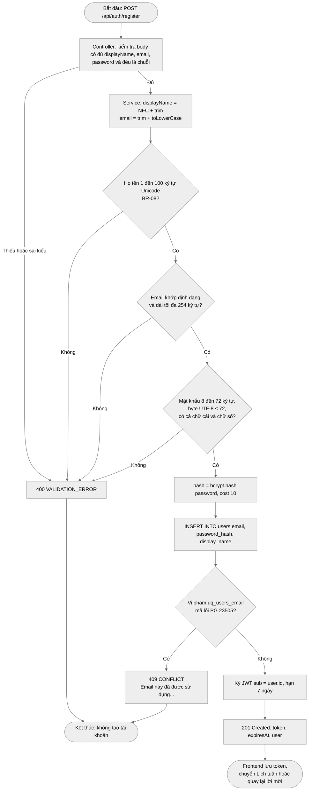
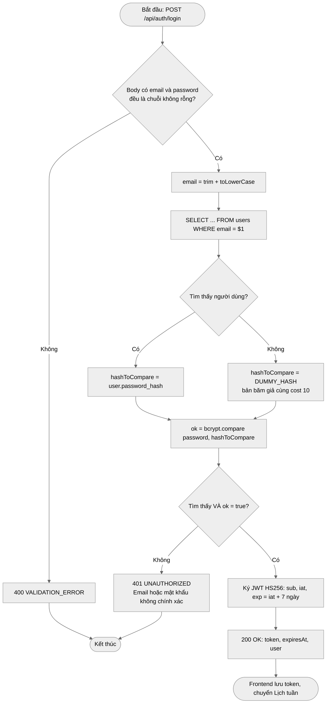
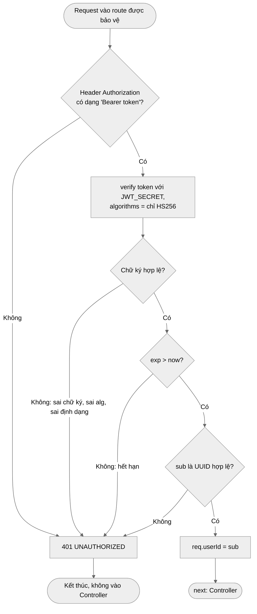
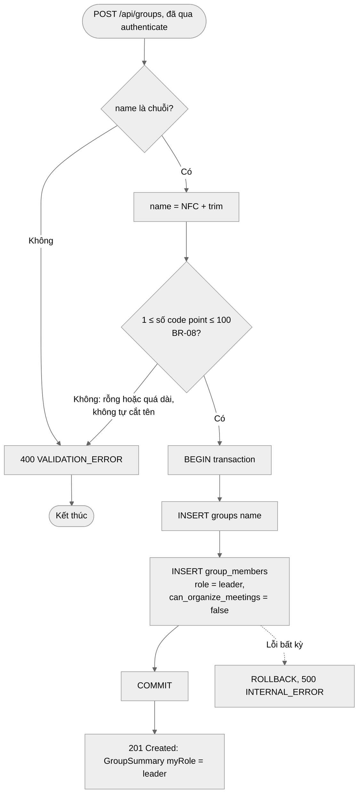
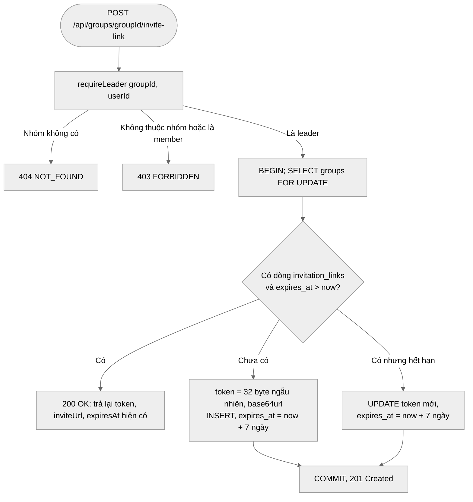
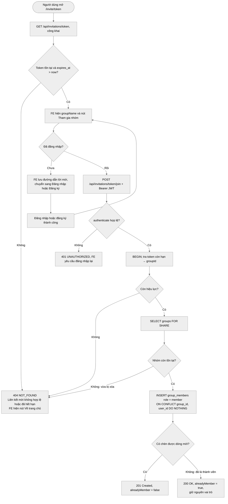

# Thiết kế chi tiết luồng xử lý nghiệp vụ Module TV1: Tài khoản và Nhóm

> Trạng thái: Nháp chờ review · Người soạn: Lê Huỳnh Anh Thư · Người review: Kiên · Ngày soạn: 20/11/2026  
> Căn cứ: Mục 4.1 Báo cáo M3; `docs/tv1-requirements.md` (US-01 đến US-07, UC-01 đến UC-04); `docs/api.md` (vùng TV1); `docs/data-dictionary.md` (bảng `users`, `groups`, `group_members`, `invitation_links`); `docs/architecture.md` (mục 1, 2.4); các quy định BR-02, BR-07, BR-08.  
> Phục vụ: Issue #117 (code API TV1).

Tài liệu đặc tả thuật toán và luồng xử lý của Module TV1: đăng ký (chuẩn hóa email, kiểm tra trùng), đăng nhập (so khớp bcrypt, cấp JWT), xác thực phiên (middleware `authenticate`), quản lý nhóm (tạo nhóm, mời thành viên bằng liên kết, phân quyền Trưởng nhóm/Thành viên) và các điều kiện biên.

---

## 4.1. Phân hệ Tài khoản và Nhóm (Module TV1)

### 4.1.0. Các quyết định thiết kế cần Kiên lưu ý

| # | Nội dung | Quyết định trong tài liệu | Lý do |
| :--- | :--- | :--- | :--- |
| 1 | **Refresh Token**: mô tả task có nhắc "Access Token và Refresh Token", nhưng `api.md` (đã review, mục "Quy định áp dụng cho TV1") ghi rõ *không có cơ chế làm mới token* và đăng xuất chỉ xóa token ở frontend. | **v0.1 chỉ dùng một JWT Access Token, hiệu lực 7 ngày.** Refresh Token được mô tả ở 4.1.4.5 như phương án mở rộng, không đưa vào #117. | Thêm Refresh Token kéo theo bảng lưu token (migration mới), endpoint `/auth/refresh`, `/auth/logout`. Lệch phạm vi đã chốt ở #69. Nếu nhóm muốn có, cần Kiên duyệt và cập nhật `api.md`, từ điển dữ liệu. |
| 2 | Quy tắc họ tên và mật khẩu: `tv1-requirements.md` ghi họ tên 2 đến 50 ký tự, mật khẩu tối thiểu 8; `api.md` (mới hơn, sau review của Nhi) ghi họ tên 1 đến 100 ký tự (BR-08), mật khẩu 8 đến 72. | Dùng số liệu của `api.md` và `backend/src/utils/validation.ts` (`BR08_LIMITS`). | `api.md` khớp ràng buộc CSDL và mã đã có. Cần cập nhật lại `tv1-requirements.md` cho nhất quán. |
| 3 | Claim JWT: bảng quy định ghi `sub`, `iat`, `exp`; sơ đồ đăng nhập trong `api.md` ghi thêm `email`. | Chỉ dùng `sub`, `iat`, `exp`. | Email có thể bị chuẩn hóa/đổi, và payload JWT chỉ được mã hóa base64 chứ không được che giấu. Giữ payload tối thiểu. |

---

### 4.1.1. Phân định trách nhiệm theo tầng

| Tầng | Thành phần TV1 | Trách nhiệm trong các luồng dưới đây |
| :--- | :--- | :--- |
| Route | `authRoutes`, `userRoutes`, `groupRoutes`, `invitationRoutes` | Khai báo đường dẫn; gắn `authenticate` cho mọi route "Đã đăng nhập"; riêng `POST /api/auth/*` và `GET /api/invitations/{token}` là công khai |
| Middleware | `authenticate`, `errorHandler` | `authenticate` xác thực JWT, gắn `req.userId`; `errorHandler` đổi `AppError` thành `{ error: { code, message, details } }` |
| Controller | `AuthController`, `UserController`, `GroupController`, `InvitationController` | Kiểm tra kiểu, trường bắt buộc, UUID của `groupId`; gọi đúng một phương thức Service; chọn mã HTTP |
| Service | `AuthService`, `GroupService`, `MembershipService` | Chuẩn hóa dữ liệu, áp dụng BR-08, băm/so khớp mật khẩu, ký JWT, kiểm tra quyền theo nhóm, mở transaction và khóa dòng |
| Repository | `UserRepository`, `GroupRepository`, `GroupMemberRepository`, `InvitationLinkRepository` | SQL có tham số; không kiểm tra quyền |
| Entity | `User`, `Group`, `GroupMember`, `InvitationLink` | `normalizeEmail`, `isLeader`, `isValidAt`... như Bảng 4 trong `architecture.md` |

Quy tắc xuyên suốt: **quyền được kiểm tra ở Service, không chỉ ẩn nút trên giao diện** (US-04 tiêu chí 4); `passwordHash` không bao giờ rời tầng Service (BR-02, `architecture.md` mục 1.6).

---

### 4.1.2. Luồng Đăng ký tài khoản (US-01, UC-01)

#### 4.1.2.1. Lưu đồ hoạt động



#### 4.1.2.2. Đặc tả thuật toán

```text
register(input):
  1. displayName ← normalizeName(input.displayName)            // NFC rồi trim (BR-08)
  2. email       ← lower(trim(input.email))                    // User.normalizeEmail
  3. Gom TẤT CẢ lỗi vào details[] (không dừng ở lỗi đầu tiên):
       - countCodePoints(displayName) ∉ [1, 100]
       - email không khớp /^[^\s@]+@[^\s@]+\.[^\s@]+$/ hoặc dài > 254
       - password: độ dài ∉ [8, 72] HOẶC Buffer.byteLength(utf8) > 72
                   HOẶC không có chữ cái HOẶC không có chữ số
  4. Nếu details ≠ ∅ → ném ValidationError(400)
  5. passwordHash ← bcrypt.hash(password, 10)
  6. Thử INSERT users(...)  
       Thành công → user
       Lỗi 23505 trên uq_users_email → ném ConflictError(409)
  7. token ← signAccessToken(user.id); trả { token, expiresAt, user }
```

Các điểm thiết kế:

- **Chuẩn hóa trước, kiểm tra sau**: email và họ tên được chuẩn hóa rồi mới kiểm tra, để giá trị kiểm tra, lưu và trả về là một. Khớp các CHECK `ck_users_email_normalized`, `ck_users_display_name_trimmed`.
- **Chống trùng bằng ràng buộc CSDL, không bằng "SELECT rồi INSERT"**: cách SELECT trước có điều kiện đua (hai yêu cầu đồng thời cùng thấy email chưa có). Dựa vào `uq_users_email` và bắt lỗi `23505` thì chỉ một yêu cầu thành công, yêu cầu còn lại nhận 409 (`api.md`, ghi chú `POST /api/auth/register`). Có thể thêm một bước SELECT trước để trả lỗi nhanh, nhưng kết quả cuối cùng vẫn dựa vào ràng buộc.
- **Mật khẩu 72 byte**: bcrypt chỉ dùng 72 byte đầu, nên chuỗi dài hơn bị cắt âm thầm. Kiểm tra theo byte UTF-8 (tiếng Việt có dấu tốn 2 đến 3 byte/ký tự) để không có chuyện hai mật khẩu khác nhau mà băm giống nhau.
- **Ô "xác nhận mật khẩu"** chỉ kiểm tra ở frontend, không gửi lên API (`api.md`).
- Không tiết lộ mật khẩu hay hash trong log và trong lỗi.

---

### 4.1.3. Luồng Đăng nhập và cấp phát JWT (US-02, UC-02)

#### 4.1.3.1. Lưu đồ hoạt động



#### 4.1.3.2. Đặc tả thuật toán

```text
login(email, password):
  1. email ← lower(trim(email))
  2. user  ← UserRepository.findByEmail(email)             // có thể null
  3. hash  ← user ? user.passwordHash : DUMMY_HASH
  4. ok    ← bcrypt.compare(password, hash)                // LUÔN chạy, kể cả khi không có user
  5. nếu user = null HOẶC ok = false → ném UnauthorizedError("Email hoặc mật khẩu không chính xác")
  6. trả signAccessToken(user.id) cùng user (không có passwordHash)
```

Hai điểm bảo mật bắt buộc theo `api.md`:

1. **Thông báo lỗi giống hệt nhau** cho "email không tồn tại" và "sai mật khẩu", không có `details`, để không dò được email nào đã đăng ký (US-02 tiêu chí 2).
2. **Thời gian xử lý tương đương**: khi không có email vẫn gọi `bcrypt.compare` với `DUMMY_HASH` (sinh một lần khi khởi động bằng `bcrypt.hashSync('dummy', 10)`), tránh việc phản hồi nhanh hơn rõ rệt để lộ email chưa đăng ký (timing attack).

Đăng nhập sai không khóa tài khoản trong v0.1. Giới hạn số lần thử (rate limit) là đề xuất ngoài phạm vi, ghi ở 4.1.7.

---

### 4.1.4. Thuật toán sinh và kiểm tra JWT, bảo vệ private route

#### 4.1.4.1. Cấu trúc token

| Thành phần | Giá trị |
| :--- | :--- |
| Thuật toán | `HS256` (đối xứng), khóa `JWT_SECRET` (≥ 32 ký tự, mỗi môi trường một khóa) |
| Header | `{ "alg": "HS256", "typ": "JWT" }` |
| Payload | `sub` = `users.id` (UUID), `iat` = thời điểm cấp (giây UTC), `exp` = `iat` + 7 ngày (`JWT_EXPIRES_IN=7d`) |
| Phản hồi kèm | `expiresAt`: chuỗi ISO 8601 UTC có mili giây, đúng bằng `exp` (BR-07) |
| Nơi lưu (client) | `tokenStorage` ở frontend; gửi qua header `Authorization: Bearer <token>` |

#### 4.1.4.2. Thuật toán sinh token

```text
signAccessToken(userId):
  now ← giờ hiện tại (giây, UTC)
  payload ← { sub: userId, iat: now, exp: now + 7*24*3600 }
  token ← HS256_sign(payload, JWT_SECRET)
  trả { token, expiresAt: toISOString(exp * 1000) }
```

`JWT_SECRET` được đọc và kiểm tra khi khởi động (`config/env.ts`): thiếu, ngắn hơn 32 ký tự hoặc còn dấu `<` thì **dừng tiến trình** thay vì chạy với khóa yếu (khớp ghi chú trong `.env.example`).

#### 4.1.4.3. Middleware `authenticate` (bảo vệ private route)



```text
authenticate(req, res, next):
  header ← req.headers.authorization
  nếu header không khớp /^Bearer (\S+)$/ → 401
  thử payload ← jwt.verify(token, JWT_SECRET, { algorithms: ['HS256'] })
    (verify tự kiểm tra chữ ký và exp; clockTolerance = 0)
  bắt mọi lỗi (TokenExpiredError, JsonWebTokenError, NotBeforeError) → 401
  nếu payload.sub không phải UUID → 401
  req.userId ← payload.sub
  next()
```

Quy ước bảo mật:

- **Cố định thuật toán** `algorithms: ['HS256']` để chặn tấn công `alg: none` và nhầm thuật toán.
- **Một mã lỗi cho mọi trường hợp** (thiếu, sai, hết hạn đều là `401 UNAUTHORIZED`, `api.md`). Frontend gặp 401 thì xóa token và chuyển về trang Đăng nhập (US-02 tiêu chí 4); `apiClient` bỏ qua xác thực với `/auth/login` và `/auth/register` (`skipAuth`).
- **Không truy vấn CSDL trong middleware** (xác thực không trạng thái). Hệ quả: token của tài khoản bị xóa vẫn qua middleware cho tới khi hết hạn. Các endpoint cần dòng `users` (ví dụ `GET /api/users/me`) tự trả 401 nếu không tìm thấy người dùng. v0.1 không có chức năng xóa tài khoản nên chấp nhận được.
- **Đăng xuất** không có endpoint: frontend xóa token. Token cũ còn hợp lệ về mặt kỹ thuật tới hết 7 ngày (đã thống nhất ở review của Nhi, không có blacklist).
- **Frontend**: `ProtectedRoute` kiểm tra có token trong `AuthContext`; khi mở lại ứng dụng gọi `GET /api/users/me` để biết token còn hiệu lực. `ProtectedRoute` chỉ là trải nghiệm người dùng, **bảo vệ thật nằm ở backend**.

#### 4.1.4.4. Quyền theo nhóm (hai lớp)

`authenticate` chỉ cho biết *ai đang gọi*. Quyền đối với từng nhóm kiểm tra tiếp ở Service qua `MembershipService`:

```text
requireMember(groupId, userId):
  gm ← GroupMemberRepository.find(groupId, userId)
  nếu nhóm không tồn tại → 404 NOT_FOUND
  nếu gm = null → 403 FORBIDDEN          // người ngoài nhóm
  trả gm

requireLeader(groupId, userId):
  gm ← requireMember(groupId, userId)
  nếu gm.role ≠ 'leader' → 403 FORBIDDEN
  trả gm
```

Thứ tự kiểm tra: **401 (chưa đăng nhập) → 404 (nhóm không tồn tại) → 403 (không thuộc nhóm / không phải Trưởng nhóm)**. Bảng ma trận quyền:

| Endpoint | Công khai | Đã đăng nhập | Thành viên nhóm | Trưởng nhóm |
| :--- | :---: | :---: | :---: | :---: |
| `POST /api/auth/register`, `POST /api/auth/login` | ✔ | | | |
| `GET /api/invitations/{token}` | ✔ | | | |
| `GET/PATCH /api/users/me`, `POST /api/groups`, `GET /api/groups` | | ✔ | | |
| `POST /api/invitations/{token}/join` | | ✔ | | |
| `GET /api/groups/{groupId}`, `POST .../leave` | | | ✔ | |
| `POST .../invite-link`, `.../invite-link/regenerate`, `PUT .../leader` | | | | ✔ |

Vai trò `leader`/`member` lưu theo **từng nhóm** trong `group_members.role` (một người có thể là Trưởng nhóm của nhóm này và Thành viên của nhóm khác), nên không đưa vai trò vào JWT mà luôn tra CSDL theo `(groupId, userId)`. Cách này tránh token chứa vai trò đã cũ sau khi chuyển quyền hoặc rời nhóm.

#### 4.1.4.5. Phương án mở rộng: Refresh Token (không thuộc v0.1)

Nếu sau này cần: rút Access Token xuống 15 phút; cấp Refresh Token ngẫu nhiên (≥ 32 byte), **chỉ lưu bản băm SHA-256** trong bảng mới `refresh_tokens(id, user_id, token_hash, expires_at, revoked_at)`; `POST /api/auth/refresh` đổi Refresh Token lấy cặp mới (xoay vòng, phát hiện dùng lại thì thu hồi cả chuỗi); `POST /api/auth/logout` thu hồi token ở phía máy chủ. Việc này cần migration mới và sửa `api.md`, nên chỉ thực hiện khi Kiên duyệt.

---

### 4.1.5. Luồng Quản lý nhóm

#### 4.1.5.1. Tạo nhóm (US-03, UC-03)



Hai INSERT nằm trong **một transaction** để không bao giờ có nhóm thiếu Trưởng nhóm. Chỉ mục `uq_group_members_one_leader_per_group` bảo đảm mỗi nhóm tối đa một Trưởng nhóm ở tầng CSDL.

#### 4.1.5.2. Lấy hoặc tạo liên kết mời (US-04)



- Token sinh bằng bộ sinh số ngẫu nhiên mật mã (`crypto.randomBytes(32).toString('base64url')`), **không** dùng `Math.random` hay mã tuần tự.
- Khóa `FOR UPDATE` trên dòng `groups` cùng ràng buộc `uq_invitation_links_group_id` bảo đảm hai Trưởng nhóm bấm đồng thời cũng chỉ có một liên kết còn hiệu lực.
- `inviteUrl = CORS_ORIGIN + '/invite/' + token`; `token`/`inviteUrl` chỉ trả cho Trưởng nhóm.
- `regenerate`: bỏ nhánh "trả lại liên kết cũ", luôn UPDATE token mới và đặt lại 7 ngày; liên kết cũ vô hiệu ngay.

#### 4.1.5.3. Tham gia nhóm bằng liên kết mời (US-05, UC-04)



Điểm thiết kế:

- **Hai giai đoạn**: `GET` công khai chỉ trả `groupName`, `expiresAt` (không lộ `groupId`, số thành viên hay tên thành viên); `POST .../join` bắt buộc đăng nhập.
- **Một thông báo lỗi duy nhất** cho "không tồn tại", "hết hạn", "đã bị thay bằng liên kết mới" để người ngoài không dò được trạng thái của mã.
- **Idempotent**: mở liên kết nhiều lần chỉ có một dòng thành viên nhờ `ON CONFLICT DO NOTHING` và `uq_group_members_group_id_user_id`. Người đã là Trưởng nhóm mở lại liên kết **không bị hạ** thành `member`.
- **Khóa `FOR SHARE`** trên `groups`: nếu thành viên cuối vừa rời và nhóm bị xóa, trả 404 thay vì lỗi khóa ngoại 500.
- Tham gia nhóm không làm lộ lịch riêng tư: API nhóm chỉ trả khoảng bận/rảnh (BR-02).

#### 4.1.5.4. Chuyển quyền và rời nhóm (US-07)

| Nghiệp vụ | Thuật toán (trong một transaction) |
| :--- | :--- |
| Chuyển Trưởng nhóm `PUT .../leader` | `requireLeader` → kiểm tra `userId` ≠ người gọi (400) → khóa `groups FOR UPDATE` → xác minh người nhận là `member` (không thì 404 "Thành viên không còn trong nhóm") → **hạ** Trưởng nhóm cũ xuống `member` → **nâng** người nhận lên `leader`, `can_organize_meetings = false` |
| Trưởng nhóm rời, còn người khác | `requireMember` → khóa → bắt buộc có `successorId` hợp lệ (thiếu hoặc trùng chính mình: 400; không còn trong nhóm: 404) → hạ rồi nâng như trên → xóa dòng `group_members` của người rời → gỡ giao thẻ Kanban (`assigned_to_user_id = NULL`) |
| Thành viên thường rời | khóa → xóa dòng `group_members` → gỡ giao thẻ Kanban; quyền họp mất theo |
| Thành viên cuối rời | khóa → đếm thành viên = 1 → `DELETE groups` (CASCADE xóa `group_members`, `invitation_links`, dữ liệu nhóm); lịch cá nhân, việc, khung giờ học giữ nguyên; `groupDeleted = true` |

**Thứ tự "hạ trước, nâng sau"** là bắt buộc: chỉ mục duy nhất một Trưởng nhóm mỗi nhóm không cho phép tồn tại hai `leader` dù chỉ trong chốc lát giữa hai câu lệnh. Khóa `FOR UPDATE` trên `groups` tuần tự hóa các thao tác đồng thời (ví dụ hai người cuối cùng rời cùng lúc không để lại nhóm rỗng).

---

### 4.1.6. Các điều kiện biên và cách xử lý

| # | Tình huống | Điều kiện phát hiện | Kết quả | Căn cứ |
| :--- | :--- | :--- | :--- | :--- |
| 1 | Email sai định dạng | Không khớp mẫu hoặc > 254 ký tự | 400 `VALIDATION_ERROR`, `details[field=email]` "Địa chỉ email không đúng định dạng" | US-01.3 |
| 2 | Email viết hoa/thừa khoảng trắng (`" An@X.com "`) | Chuẩn hóa `lower(trim)` rồi mới so khớp | Coi như `an@x.com`; trùng thì 409 | `ck_users_email_normalized` |
| 3 | Email đã tồn tại | Vi phạm `uq_users_email` | 409 `CONFLICT` "Email này đã được sử dụng...", giữ dữ liệu đã nhập ở form | US-01.2 |
| 4 | Hai yêu cầu đăng ký đồng thời cùng email | Ràng buộc duy nhất | Một 201, một 409; không có tài khoản trùng | api.md |
| 5 | Mật khẩu yếu: < 8, thiếu chữ hoặc thiếu số | Kiểm tra độ dài và ký tự | 400, "Mật khẩu từ 8 đến 72 ký tự, gồm cả chữ cái và chữ số" | US-01.5 |
| 6 | Mật khẩu > 72 ký tự hoặc > 72 byte UTF-8 | `length` hoặc `Buffer.byteLength` | 400 cùng thông báo (tránh bcrypt cắt âm thầm) | api.md, review Nhi |
| 7 | Họ tên rỗng, chỉ khoảng trắng hoặc > 100 ký tự | NFC + trim + đếm code point | 400; không tự cắt tên | BR-08 |
| 8 | Họ tên chứa emoji/ký tự ngoài BMP | Đếm theo code point, không theo UTF-16 | Đếm đúng 1 ký tự cho mỗi emoji | `countCodePoints` |
| 9 | Xác nhận mật khẩu không khớp | Chỉ kiểm tra ở frontend | Chặn gửi, hiện "Mật khẩu xác nhận không khớp" | US-01.6 |
| 10 | Đăng nhập sai mật khẩu / email không tồn tại | `ok = false` hoặc `user = null` | 401 cùng một thông báo, thời gian tương đương | US-02.2 |
| 11 | Đăng nhập thiếu trường | Controller | 400 `VALIDATION_ERROR` | api.md |
| 12 | Token hết hạn (`exp` ≤ now) | `jwt.verify` báo `TokenExpiredError` | 401; frontend xóa token, về trang Đăng nhập | US-02.4 |
| 13 | Token sai chữ ký, bị sửa, sai `alg`, không có `Bearer` | `jwt.verify` lỗi / sai định dạng | 401 `UNAUTHORIZED` | 4.1.4.3 |
| 14 | `sub` không phải UUID | Kiểm tra sau verify | 401 | 4.1.4.3 |
| 15 | Người không thuộc nhóm gọi `GET /groups/{id}` hoặc `leave` | `requireMember` | 403 `FORBIDDEN` | api.md |
| 16 | Thành viên thường gọi trực tiếp API tạo liên kết mời/chuyển quyền | `requireLeader` | 403 `FORBIDDEN`, không tạo liên kết | US-04.4 |
| 17 | `groupId` không đúng dạng UUID | Controller | 400 `VALIDATION_ERROR` | architecture.md 1.2 |
| 18 | `groupId` hợp lệ nhưng nhóm không tồn tại | Tra nhóm | 404 `NOT_FOUND` | api.md |
| 19 | Tên nhóm rỗng hoặc > 100 ký tự | BR-08 | 400, không tạo nhóm | US-03.2 |
| 20 | Liên kết mời hết hạn / không tồn tại / đã bị thay | `expires_at ≤ now` hoặc không có dòng | 404 cùng một thông báo; FE hiện nút Về trang chủ | US-05.2 |
| 21 | Mở liên kết khi chưa đăng nhập | FE phát hiện chưa có token | Lưu đường dẫn, chuyển Đăng nhập/Đăng ký, xong quay lại màn hình xác nhận | US-05.3 |
| 22 | Đã là thành viên mà mở lại liên kết | `ON CONFLICT DO NOTHING` không chèn | 200 `alreadyMember = true`, giữ nguyên vai trò | US-05.4 |
| 23 | Nhóm bị xóa ngay khi đang tham gia | `FOR SHARE` không thấy nhóm | 404, không 500 | Giao dịch TV1 |
| 24 | Trưởng nhóm rời mà không chỉ định người kế nhiệm | Còn thành viên khác, thiếu `successorId` | 400 "Trưởng nhóm phải chọn người kế nhiệm..." | api.md |
| 25 | Người kế nhiệm đã rời nhóm | Không còn dòng `group_members` | 404 "Thành viên không còn trong nhóm" | api.md |
| 26 | Hai Trưởng nhóm bấm tạo liên kết cùng lúc | `FOR UPDATE` + `uq_invitation_links_group_id` | Chỉ một liên kết hiệu lực; lần sau nhận 200 | Giao dịch TV1 |
| 27 | Lỗi CSDL / mất kết nối | Ngoại lệ không phải `AppError` | 500 `INTERNAL_ERROR`, không lộ chi tiết; transaction ROLLBACK | architecture.md 1.5 |

---

### 4.1.7. Giả định, rủi ro và việc tiếp theo

1. **Chưa giới hạn số lần đăng nhập sai** (rate limit/khóa tạm). Khuyến nghị bổ sung ở bản sau; v0.1 chưa có trong yêu cầu.
2. **Token lưu ở `localStorage`** (qua `tokenStorage`) dễ bị đọc nếu có lỗ hổng XSS. Chấp nhận ở v0.1; React mặc định escape đầu ra, không dùng `dangerouslySetInnerHTML`.
3. **Đăng ký không xác minh email** (`api.md`): ai cũng đăng ký được bằng email chưa xác minh.
4. **Thời hạn token 7 ngày và liên kết mời 7 ngày** vẫn là đề xuất chờ Product Owner xác nhận (`tv1-requirements.md`, mục 2).
5. **Cần đồng bộ tài liệu** nếu Kiên đồng ý các quyết định ở 4.1.0: `tv1-requirements.md` (quy tắc họ tên, mật khẩu) và `api.md` (claim JWT, nếu thêm Refresh Token).
6. **Gợi ý kiểm thử cho #117**: bảng 4.1.6 có thể chuyển thẳng thành các ca kiểm thử (mỗi dòng một ca), đặc biệt các ca 4, 6, 8, 10, 13, 22, 26.
