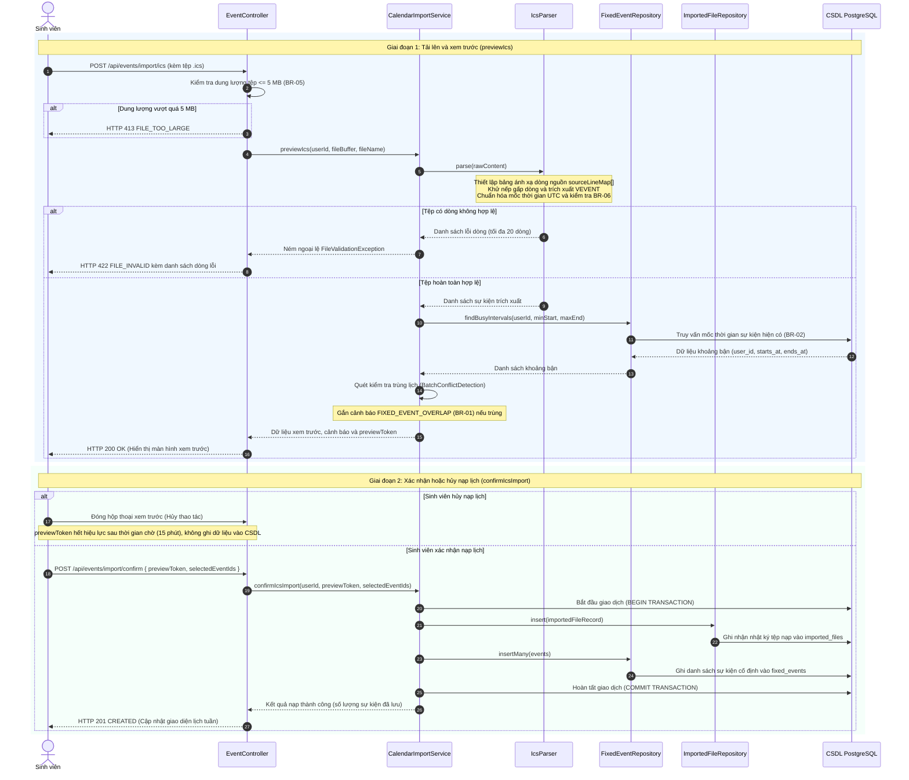

# Thiết kế chi tiết phân hệ TV2 và giải thuật bóc tách thời khóa biểu, kiểm tra trùng lịch

> Trạng thái: Đã cập nhật theo review (#111) · Người soạn: Đào Ngọc Hưng · Người review: Đỗ Thư Q.A. · Ngày cập nhật: 20/11/2026  
> Căn cứ: Mục 4.2 và Mục 5 Báo cáo M3; `docs/architecture.md` (Issue #106); `docs/m2-tv2-requirements.md` (Issue #41); `docs/data-dictionary.md`; `backend/src/utils/interval.ts`; các quy định nghiệp vụ BR-01 đến BR-08.

Tài liệu này đặc tả chi tiết kiến trúc phân tầng, giao diện dịch vụ, giải thuật bóc tách thời khóa biểu từ tệp iCalendar (`.ics`) và bảng tính (`.csv`), thuật toán kiểm tra xung đột trùng lịch giữa các sự kiện cố định theo BR-01, và cơ chế phát sinh cảnh báo nghiệp vụ cho Module TV2 (Lịch cá nhân và nạp lịch).

---

## 4.2. Phân hệ Lịch cá nhân và nạp lịch (Module TV2)

### 4.2.1. Phân định trách nhiệm kiến trúc bốn tầng

Phân hệ TV2 được tổ chức chặt chẽ theo mô hình kiến trúc bốn tầng phân lớp (Layered Architecture) đã thống nhất tại sơ đồ lớp tổng thể của dự án:

1. **Tầng Điều khiển (Route và Controller):**
   - `EventController`: Tiếp nhận các yêu cầu HTTP liên quan đến quản lý sự kiện cố định (`/api/events`) và nạp tệp thời khóa biểu (`/api/events/import/*`). Thực hiện xác thực định dạng dữ liệu đầu vào (chuỗi ký tự tối đa 200 ký tự sau khi cắt khoảng trắng hai đầu theo quy định BR-08, định dạng ngày giờ chuẩn ISO 8601 UTC có hậu tố Z theo quy định BR-07).
   - `TaskController`: Tiếp nhận các yêu cầu liên quan đến việc cần làm (`/api/tasks`). Xác thực hạn chót bắt buộc theo quy định BR-04 và kiểm tra định dạng thời lượng ước tính.
   - `ScheduleController`: Tiếp nhận yêu cầu truy vấn dữ liệu tổng hợp lưới lịch tuần (`/api/schedule/week`).
   - Chuyển đổi các ngoại lệ nghiệp vụ thành mã trạng thái HTTP chuẩn mực: trả về HTTP `413 FILE_TOO_LARGE` khi tệp vượt quá 5 MB (BR-05), trả về HTTP `422 FILE_INVALID` khi tệp có dòng không hợp lệ (BR-06).

2. **Tầng Dịch vụ nghiệp vụ (Service và Engine):**
   - `FixedEventService`: Kiểm tra tính hợp lệ logic của khoảng thời gian ($DTEND > DTSTART$, từ chối sự kiện có thời lượng bằng 0 hoặc kết thúc trước thời điểm bắt đầu theo BR-06), phát hiện va chạm thời gian giữa các sự kiện và đính kèm cảnh báo mềm `FIXED_EVENT_OVERLAP` theo quy định BR-01. Trả về cấu trúc kết quả bọc `Result<FixedEvent>`.
   - `CalendarImportService`: Điều phối quy trình nạp tệp nguyên tử (Atomic File Processing). Phối hợp với các bộ phân tích cú pháp `IcsParser` và `CsvParser`. Quản lý giao dịch ghi CSDL: chỉ ghi nhận dữ liệu khi toàn bộ tệp hợp lệ và người dùng xác nhận nạp tại màn hình xem trước.
   - `TaskService`: Hiện thực hóa quy định BR-04: Tự động gán thời lượng mặc định là 1 giờ khi người dùng xóa trống; kiểm tra hạn chót trong quá khứ để phát sinh cảnh báo `DEADLINE_PASSED`. Đồng bộ mốc nhắc việc sang phân hệ thông báo và dọn dẹp các khung đề xuất liên quan khi việc bị xóa hoặc hoàn thành.
   - `WeekScheduleService`: Tổng hợp dữ liệu hiển thị lịch tuần gồm: sự kiện cố định, khung giờ học đề xuất đã xác nhận và danh sách việc cần làm có hạn chót trong tuần.

3. **Tầng Truy cập dữ liệu (Repository):**
   - `FixedEventRepository`: Thực thi các câu truy vấn SQL trên bảng `fixed_events`. Cung cấp phương thức `findBusyIntervals(userIds, from, to)` chỉ truy vấn ba cột `user_id`, `starts_at`, `ends_at` phục vụ tính toán giờ rảnh nhóm, bảo mật tuyệt đối thông tin chi tiết của sự kiện theo quy định BR-02.
   - `TaskRepository`: Thực thi các câu truy vấn trên bảng `tasks` (`listByUser`, `listOpenByUser`, `insert`, `update`, `delete`).
   - `ImportedFileRepository`: Lưu trữ nhật ký nạp tệp vào bảng `imported_files` để quản lý nguồn gốc dữ liệu.
   - `RecurringRuleRepository`: Quản lý các cấu hình lặp định kỳ trong bảng `recurring_rules`.

4. **Tầng Thực thể miền (Domain Entity):**
   - `FixedEvent`: Thực thể sự kiện cố định, cung cấp các phương thức thuần: `toInterval()` chuyển đổi sang kiểu khoảng thời gian, `overlaps(other)` kiểm tra va chạm, `toBusySlot()` định dạng chuỗi phục vụ giao diện lập trình.
   - `Task`: Thực thể việc cần làm, cung cấp phương thức `isPastDue(now)` kiểm tra việc quá hạn và phương thức cập nhật trạng thái hoàn thành.

---

### 4.2.2. Đặc tả giao diện dịch vụ (Service Interfaces)

```ts
/** Kết quả trả về kèm danh sách cảnh báo nghiệp vụ theo BR-01 và BR-04 */
export interface Result<T> {
  readonly data: T;
  readonly warnings?: readonly BusinessWarning[];
}

export interface BusinessWarning {
  readonly code: 'FIXED_EVENT_OVERLAP' | 'DEADLINE_PASSED';
  readonly message: string;
  readonly conflictingEventId?: string;
}

/** Giao diện dịch vụ sự kiện cố định */
export interface IFixedEventService {
  listEvents(userId: string, from: Date, to: Date): Promise<FixedEvent[]>;
  createEvent(userId: string, input: CreateFixedEventDto): Promise<Result<FixedEvent>>;
  getEvent(userId: string, eventId: string): Promise<FixedEvent>;
  updateEvent(userId: string, eventId: string, input: UpdateFixedEventDto): Promise<Result<FixedEvent>>;
  deleteEvent(userId: string, eventId: string): Promise<void>;
}

/** Giao diện dịch vụ nạp tệp thời khóa biểu */
export interface ICalendarImportService {
  previewIcs(userId: string, fileBuffer: Buffer, fileName: string): Promise<ImportPreviewResult>;
  confirmIcsImport(userId: string, previewToken: string, selectedEventIds?: string[]): Promise<ImportCommitResult>;
  previewCsv(userId: string, fileBuffer: Buffer, fileName: string): Promise<ImportPreviewResult>;
  confirmCsvImport(userId: string, previewToken: string, selectedEventIds?: string[]): Promise<ImportCommitResult>;
}

/** Giao diện bộ phân tích cú pháp tệp lịch */
export interface ICalendarFileParser {
  parse(rawContent: string): ParseResult;
}

export interface ParseResult {
  readonly events: ExtractedEvent[];
  readonly errors: LineValidationError[];
}

export interface LineValidationError {
  readonly line: number;
  readonly reason: string;
}
```

---

### 4.2.3. Sơ đồ tuần tự nạp tệp thời khóa biểu iCalendar



*Hình 4.2: Sơ đồ tuần tự xử lý nạp tệp thời khóa biểu iCalendar (.ics) qua hai giai đoạn Xem trước và Xác nhận nạp*

---

## 5. THIẾT KẾ GIẢI THUẬT HỆ THỐNG

## 5.1. Giải thuật bóc tách dữ liệu thời khóa biểu

### 5.1.1. Giải thuật phân tích cú pháp iCalendar (.ics - chuẩn RFC 5545)

Nhằm đáp ứng yêu cầu định vị chính xác vị trí dòng lỗi thực tế trong tệp của người dùng và tuân thủ nguyên tắc từ chối nguyên khối (BR-06), giải thuật được thiết kế theo quy trình hai bước gồm lập bảng ánh xạ dòng nguồn và xác thực cấu trúc:

```text
Thuật toán: ParseIcsSchedule
Đầu vào:
  - rawContent: Chuỗi văn bản thô của tệp .ics
  - maxFileSize: 5.242.880 bytes (ngưỡng 5 MB theo quy định BR-05)
Đầu ra:
  - Danh sách sự kiện cố định chuẩn hóa UTC hoặc danh sách tối đa 20 dòng lỗi đầu tiên

Bước 1: Kiểm tra dung lượng và cấu trúc bao gói
  1.1. Nếu byteLength(rawContent) > maxFileSize:
         Trả về mã lỗi HTTP 413 FILE_TOO_LARGE.
  1.2. Tách rawContent thành mảng rawLines theo ký tự xuống dòng (\r\n hoặc \n).
  1.3. Nếu tệp rỗng hoặc không có dòng dữ liệu:
         Trả về mã lỗi HTTP 422 FILE_INVALID: "Tệp không đúng định dạng hoặc tệp rỗng".

Bước 2: Xây dựng bảng ánh xạ dòng nguồn (Source Line Mapping) và khử nếp gấp dòng (Unfolding)
  2.1. Khởi tạo mảng unfoldedLines = [], sourceLineMap = [].
  2.2. Duyệt từng dòng rawLines[i] từ i = 0 đến N - 1:
         Nếu dòng bắt đầu bằng khoảng trắng hoặc ký tự tab (dòng bị gập):
           Nếu unfoldedLines đang rỗng:
             Ghi nhận lỗi tại dòng (i + 1): "Dòng gập không hợp lệ ở đầu tệp".
           Ngược lại:
             Nối phần nội dung (bỏ ký tự trắng đầu) vào dòng cuối của unfoldedLines.
         Ngược lại:
           Thêm dòng vào unfoldedLines;
           Ghi nhận chỉ số dòng thực tế: sourceLineMap.push(i + 1).

Bước 3: Xác thực cấu trúc iCalendar
  3.1. Kiểm tra sự tồn tại của từ khóa BEGIN:VCALENDAR và END:VCALENDAR.
  3.2. Nếu không có khối BEGIN:VEVENT nào trong tệp:
         Trả về mã lỗi HTTP 422 FILE_INVALID: "Tệp không chứa sự kiện nào để nạp".

Bước 4: Duyệt bóc tách từng khối sự kiện VEVENT
  Khởi tạo mảng errors = [], events = [].
  Duyệt qua từng khối sự kiện VEVENT:
    4.1. Lấy chỉ số dòng nguồn của BEGIN:VEVENT làm eventStartLine.
    4.2. Bóc tách các trường: SUMMARY, DTSTART, DTEND, DURATION, RRULE, LOCATION, DESCRIPTION.
    4.3. Kiểm tra tính hợp lệ nghiệp vụ:
         a) Thiếu SUMMARY hoặc tiêu đề chỉ chứa khoảng trắng:
            errors.push({ line: eventStartLine, reason: "Thiếu tên sự kiện" }).
         b) Độ dài SUMMARY vượt quá 200 ký tự sau khi cắt khoảng trắng (BR-08):
            errors.push({ line: eventStartLine, reason: "Tên sự kiện vượt quá 200 ký tự" }).
         c) Thiếu trường DTSTART:
            errors.push({ line: eventStartLine, reason: "Thiếu thời gian bắt đầu" }).
         d) Phân tích thời gian bắt đầu và kết thúc:
            - Nếu có DTSTART và DURATION nhưng thiếu DTEND: Tính DTEND = DTSTART + DURATION.
            - Nếu thiếu cả DTEND và DURATION:
                errors.push({ line: eventStartLine, reason: "Thiếu thời gian kết thúc hoặc thời lượng" }).
            - Nếu DTEND < DTSTART:
                errors.push({ line: eventStartLine, reason: "Thời gian kết thúc trước thời gian bắt đầu" }).
         e) Chuẩn hóa múi giờ theo BR-07:
            - Nếu có hậu tố Z: Chuyển đổi trực tiếp về UTC.
            - Nếu có thuộc tính TZID: Quy đổi từ múi giờ được khai báo sang UTC.
            - Nếu không có thông tin múi giờ: Mặc định hiểu là giờ Việt Nam (UTC+7), trừ 7 giờ để đưa về mốc thời gian UTC.
    4.4. Mở rộng quy tắc lặp (RRULE) có kiểm soát:
         - Hỗ trợ lặp tuần (FREQ=WEEKLY).
         - Áp dụng cận chặn an toàn: Giới hạn tối đa 24 tuần (phạm vi 1 học kỳ) và không quá 150 buổi học để ngăn ngừa tấn công cạn kiệt bộ nhớ.
         - Loại trừ các buổi học trùng ngày với thuộc tính EXDATE.
    4.5. Nếu số lượng errors đạt 20 dòng: Dừng duyệt ngay lập tức (BR-06).

Bước 5: Quyết định nạp tệp nguyên tử (Atomic File Rejection)
  Nếu errors.length > 0:
    Từ chối toàn bộ tệp, không lưu dữ liệu, trả về HTTP 422 kèm tối đa 20 dòng lỗi đầu tiên theo mẫu:
    "Tệp không hợp lệ. Lỗi tại dòng N: <lý do>".
  Ngược lại:
    Trả về danh sách events đã được chuẩn hóa về thời điểm UTC.
```

---

### 5.1.2. Giải thuật phân tích cú pháp tệp bảng tính thời khóa biểu (.csv)

1. **Khử Byte Order Mark (UTF-8 BOM):**
   Kiểm tra nếu tệp bắt đầu bằng ký tự `\uFEFF`, tiến hành cắt bỏ ký tự này để bảo vệ tính toàn vẹn của tên cột đầu tiên.
2. **Xác thực cấu trúc tiêu đề:**
   Dòng 1 bắt buộc có đủ 7 cột theo quy định:
   `Tên môn học, Thứ trong tuần, Ngày bắt đầu, Ngày kết thúc, Giờ bắt đầu, Giờ kết thúc, Phòng học`.
   Nếu thiếu bất kỳ cột nào, từ chối toàn bộ tệp ngay tại dòng 1 với thông báo: `Tệp không hợp lệ: Thiếu cột bắt buộc '<tên cột>'`.
3. **Bung lặp buổi học theo tuần:**
   Với mỗi dòng dữ liệu thứ $k$ (tương ứng dòng vật lý $k + 1$ trong tệp):
   - Chuyển đổi giá trị cột `Ngày bắt đầu` và `Ngày kết thúc` (định dạng `DD/MM/YYYY`).
   - Kiểm tra ràng buộc: Ngày kết thúc không sớm hơn ngày bắt đầu; giờ kết thúc phải sau giờ bắt đầu ($DTEND > DTSTART$).
   - Quét qua từng tuần từ ngày bắt đầu đến ngày kết thúc, tính toán ngày chính xác khớp với giá trị cột `Thứ trong tuần` (từ Thứ Hai đến Chủ Nhật).
   - Ghép giờ bắt đầu, giờ kết thúc và chuyển đổi sang thời điểm tuyệt đối UTC theo giờ Việt Nam.
4. **Quyết định từ chối nguyên khối (Atomic File Rejection - BR-06):**
   Trong suốt quá trình duyệt các dòng dữ liệu, nếu phát hiện bất kỳ dòng nào vi phạm quy tắc (thiếu trường bắt buộc, sai định dạng ngày giờ, ngày kết thúc trước ngày bắt đầu, hoặc giờ kết thúc không sau giờ bắt đầu), hệ thống lập tức ghi nhận lỗi vào danh sách `errors`. Nếu danh sách `errors` không rỗng, hệ thống **từ chối toàn bộ tệp, tuyệt đối không lưu bất kỳ bản ghi nào vào CSDL**, trả về mã lỗi HTTP `422 FILE_INVALID` kèm danh sách tối đa 20 dòng lỗi đầu tiên theo mẫu quy định:
   `Tệp không hợp lệ. Lỗi tại dòng N: <lý do>`.
   Chỉ khi 100% các dòng đều hợp lệ, danh sách sự kiện trích xuất mới được chuyển tiếp sang giải thuật kiểm tra trùng lịch và trả về màn hình xem trước.

---

## 5.2. Giải thuật kiểm tra xung đột trùng lịch (Interval Overlap Detection)

### 5.2.1. Cơ sở toán học khoảng thời gian nửa mở

Hệ thống biểu diễn mỗi sự kiện dưới dạng một khoảng thời gian nửa mở trên trục số nguyên thời gian (mili giây UTC):
$$I = [S, E) = \{ t \in \mathbb{R} \mid S \le t < E \}$$
Trong đó $S = \text{startsAt.getTime()}$, $E = \text{endsAt.getTime()}$.

Ràng buộc tính hợp lệ: $S \le E$. Nếu $S > E$, hệ thống ném ngoại lệ `RangeError` để bảo vệ các thuật toán liên module.

### 5.2.2. Vị từ kiểm tra giao nhau thực sự

Hai khoảng thời gian $A = [S_A, E_A)$ và $B = [S_B, E_B)$ có độ dài lớn hơn 0 được xác định là giao nhau thực sự khi và chỉ khi:
$$\text{hasOverlap}(A, B) \iff (S_A < E_B) \land (S_B < E_A)$$

Khi hai khoảng thời gian tiếp giáp nhau (ví dụ sự kiện A kết thúc lúc 09:00 và sự kiện B bắt đầu lúc 09:00, tức $E_A = S_B$), biểu thức $S_B < E_A$ trở thành $S_B < S_B$ (mang giá trị sai). Do đó hàm trả về `false`. Điều này khớp hoàn toàn với quy định nghiệp vụ BR-01: các khung giờ nối tiếp nhau không bị coi là trùng lịch.

```ts
/**
 * Kiểm tra hai khoảng thời gian có giao nhau thực sự hay không.
 * Tuân thủ quy định BR-01: Tiếp giáp mút không tính là trùng.
 */
export function hasOverlap(a: TimeInterval, b: TimeInterval): boolean {
  if (a.start.getTime() > a.end.getTime() || b.start.getTime() > b.end.getTime()) {
    throw new RangeError('Khoảng thời gian không hợp lệ: start sau end');
  }
  const sA = a.start.getTime();
  const eA = a.end.getTime();
  const sB = b.start.getTime();
  const eB = b.end.getTime();

  // Khoảng thời gian độ dài bằng 0 không giao với bất kỳ khoảng nào
  if (sA === eA || sB === eB) {
    return false;
  }

  // Điều kiện giao nhau của hai khoảng nửa mở [start, end)
  return sA < eB && sB < eA;
}
```

> **Lưu ý về khoảng thời gian suy biến ($S = E$):**
> Hàm `hasOverlap` xử lý an toàn bằng cách trả về `false` khi gặp khoảng thời gian có độ dài bằng 0 ($S = E$) nhằm phòng vệ ngoại lệ toán học trong các thuật toán so khớp tổng quát. Tuy nhiên, ở tầng dịch vụ nghiệp vụ (`FixedEventService`, `IcsParser`, `CsvParser`), hệ thống áp dụng điều kiện hợp lệ nghiêm ngặt $DTEND > DTSTART$. Mọi sự kiện có thời lượng bằng 0 hoặc kết thúc trước thời điểm bắt đầu đều bị từ chối ngay tại tầng kiểm thực dữ liệu (trả về mã lỗi HTTP 422) theo quy định BR-06, không được phép lưu trữ vào CSDL.

---

### 5.2.3. Bảng ma trận phân tích các trường hợp biên của khoảng thời gian

*Bảng 5.1: Ma trận kiểm tra trường hợp biên giữa sự kiện A [09:00, 10:00) và sự kiện B*

| STT | Trường hợp kiểm thử biên | Mốc thời gian sự kiện B | Biểu thức kiểm tra va chạm | Kết quả `hasOverlap` | Ý nghĩa nghiệp vụ theo BR-01 |
| :---: | :--- | :--- | :---: | :---: | :--- |
| 1 | **Tách rời phía trước** | $[07:30, 08:30)$ | $09:00 < 08:30 \ (\text{Sai})$ | `false` | Hoàn toàn không trùng |
| 2 | **Tiếp xúc mút trước** | $[08:00, 09:00)$ | $09:00 < 09:00 \ (\text{Sai})$ | `false` | Giờ nối tiếp, không tính là trùng (BR-01) |
| 3 | **Giao nhau mút trước** | $[08:30, 09:30)$ | $09:00 < 09:30 \ (\text{Đúng}) \land 08:30 < 10:00 \ (\text{Đúng})$ | `true` | **Trùng lịch một phần**, phát sinh cảnh báo |
| 4 | **B nằm trọn trong A** | $[09:15, 09:45)$ | $09:00 < 09:45 \ (\text{Đúng}) \land 09:15 < 10:00 \ (\text{Đúng})$ | `true` | **Trùng lịch lồng nhau**, phát sinh cảnh báo |
| 5 | **Trùng khớp tuyệt đối** | $[09:00, 10:00)$ | $09:00 < 10:00 \ (\text{Đúng}) \land 09:00 < 10:00 \ (\text{Đúng})$ | `true` | **Trùng lịch hoàn toàn**, phát sinh cảnh báo |
| 6 | **A nằm trọn trong B** | $[08:30, 10:30)$ | $09:00 < 10:30 \ (\text{Đúng}) \land 08:30 < 10:00 \ (\text{Đúng})$ | `true` | **Trùng lịch bao trùm**, phát sinh cảnh báo |
| 7 | **Giao nhau mút sau** | $[09:30, 10:30)$ | $09:00 < 10:30 \ (\text{Đúng}) \land 09:30 < 10:00 \ (\text{Đúng})$ | `true` | **Trùng lịch một phần**, phát sinh cảnh báo |
| 8 | **Tiếp xúc mút sau** | $[10:00, 11:00)$ | $10:00 < 10:00 \ (\text{Sai})$ | `false` | Giờ nối tiếp, không tính là trùng (BR-01) |
| 9 | **Tách rời phía sau** | $[10:30, 11:30)$ | $10:30 < 10:00 \ (\text{Sai})$ | `false` | Hoàn toàn không trùng |
| 10 | **Khoảng suy biến 0 phút**| $[09:00, 09:00)$ | $s_B == e_B$ | `false` | Khoảng rỗng; tầng Service từ chối bằng HTTP 422 (BR-06) |

---

### 5.2.4. Thuật toán phát hiện xung đột hàng loạt (Batch Conflict Detection)

Khi người dùng nạp một tệp chứa $M$ sự kiện mới vào lịch cá nhân đang có sẵn $N$ sự kiện:

```text
Thuật toán: BatchConflictDetection
Đầu vào:
  - newEvents: Danh sách M sự kiện mới trích xuất từ tệp (mỗi sự kiện có tempId tạm thời)
  - existingEvents: Danh sách N sự kiện đã có trong CSDL của người dùng
Đầu ra:
  - newEvents kèm mảng warnings đối với các sự kiện bị trùng

Bước 1: Sắp xếp danh sách sự kiện theo mốc thời gian bắt đầu startsAt
  1.1. Sắp xếp existingEvents tăng dần theo startsAt: Độ phức tạp O(N log N).
  1.2. Sắp xếp newEvents tăng dần theo startsAt: Độ phức tạp O(M log M).

Bước 2: Phát hiện xung đột chéo với sự kiện đã có trong CSDL (Cross-Check against DB)
  Với mỗi sự kiện E trong newEvents (tổng số M sự kiện):
    2.1. Áp dụng tìm kiếm nhị phân trên existingEvents để xác định vị trí sự kiện đầu tiên thỏa mãn endsAt > E.startsAt: O(log N).
    2.2. Quét tuyến tính từ vị trí đó sang phải chừng nào startsAt < E.endsAt:
         Nếu hasOverlap(E, X) == true (với X là sự kiện trong existingEvents):
           E.warnings.push({
             code: 'FIXED_EVENT_OVERLAP',
             message: 'Sự kiện bị trùng thời gian với sự kiện khác',
             conflictingEventId: X.id
           });

Bước 3: Phát hiện tự xung đột nội bộ trong tệp nạp (Self-Conflict Sweep-Line)
  Duyệt danh sách newEvents đã sắp xếp từ chỉ số i = 0 đến M - 1:
    Duyệt j = i + 1, i + 2, ... chừng nào newEvents[j].startsAt < newEvents[i].endsAt:
      Nếu hasOverlap(newEvents[i], newEvents[j]) == true:
        newEvents[i].warnings.push({
          code: 'FIXED_EVENT_OVERLAP',
          message: 'Sự kiện bị trùng thời gian với sự kiện khác trong cùng tệp nạp',
          conflictingEventId: newEvents[j].tempId
        });
        newEvents[j].warnings.push({
          code: 'FIXED_EVENT_OVERLAP',
          message: 'Sự kiện bị trùng thời gian với sự kiện khác trong cùng tệp nạp',
          conflictingEventId: newEvents[i].tempId
        });

Bước 4: Trả về danh sách newEvents kèm đầy đủ cờ cảnh báo để hiển thị trên màn hình xem trước.
```

- **Độ phức tạp thời gian:**
  - Sắp xếp hai danh sách: $\mathcal{O}(N \log N + M \log M)$.
  - So khớp chéo CSDL: $\mathcal{O}(M \log N + k)$ với $k$ là số cặp sự kiện thực tế giao nhau ($k \ll N \cdot M$).
  - Quét tự xung đột nội bộ (Sweep-Line): Vì danh sách đã được sắp xếp theo thời gian, mỗi sự kiện chỉ cần so khớp với các sự kiện bắt đầu trước khi nó kết thúc. Đối với lịch sinh viên thực tế, số sự kiện chồng lấn đồng thời tại một thời điểm được chặn bởi hằng số nhỏ $c \le 3$, do đó số phép kiểm tra tại Bước 3 là $\mathcal{O}(c \cdot M) = \mathcal{O}(M)$.
  - **Tổng độ phức tạp thời gian:** $\mathcal{O}((N + M) \log(N + M))$. Thuật toán tối ưu triệt để, loại bỏ hoàn toàn nguy cơ suy biến thành $\mathcal{O}(M^2)$ so với duyệt vét cạn hai vòng lặp lồng nhau.
- **Độ phức tạp không gian:** $\mathcal{O}(M)$ để lưu trữ danh sách cảnh báo `warnings` và định danh xung đột.

---

## 5.3. Cơ chế xử lý cảnh báo nghiệp vụ và chuyển giao dữ liệu liên module

### 5.3.1. Cảnh báo trùng lịch cố định `FIXED_EVENT_OVERLAP` (BR-01)
- Khi sự kiện cố định mới có thời gian trùng với sự kiện cố định đã tồn tại, hệ thống vẫn cho phép lưu sự kiện vào CSDL.
- Phản hồi API trả về đối tượng `Result<FixedEvent>`:
  ```json
  {
    "data": {
      "id": "fe_018f23a1-...",
      "title": "Học Lập trình Web",
      "startsAt": "2026-11-20T01:00:00.000Z",
      "endsAt": "2026-11-20T03:00:00.000Z"
    },
    "warnings": [
      {
        "code": "FIXED_EVENT_OVERLAP",
        "message": "Sự kiện bị trùng thời gian với sự kiện khác",
        "conflictingEventId": "fe_018f22bc-..."
      }
    ]
  }
  ```
- Giao diện người dùng hiển thị biểu tượng cảnh báo và viền màu phân biệt, không chặn thao tác lưu và không hiển thị mã quy tắc nghiệp vụ `(BR-01)`.

### 5.3.2. Cảnh báo việc cần làm quá hạn `DEADLINE_PASSED` (BR-04)
- Khi tạo hoặc cập nhật việc cần làm có thời hạn nằm trong quá khứ so với thời điểm hiện tại (`dueAt < now`), hệ thống vẫn lưu vào CSDL và trả về cảnh báo `DEADLINE_PASSED`.
- **Cơ chế liên module giữa TV2 và TV3:**
  - Phân hệ TV2 lưu trữ thuộc tính thời hạn `due_at` thực tế vào bảng `tasks`, tuyệt đối không sinh thêm cột cờ dư thừa `is_past_due` trong CSDL nhằm tuân thủ chuẩn hóa dữ liệu tại `docs/data-dictionary.md`.
  - Khi phân hệ TV3 (Xếp lịch tự động) thu thập danh sách việc cần làm để tính toán đề xuất khung giờ học, lớp `SchedulerService` truy vấn dữ liệu thông qua phương thức `TaskRepository.listOpenByUser(userId)`.
  - Phương thức này thực thi câu truy vấn SQL có điều kiện loại trừ động:
    ```sql
    SELECT * FROM tasks
    WHERE user_id = $1
      AND is_done = false
      AND due_at > now()
    ORDER BY due_at ASC;
    ```
  - Cơ chế này loại trừ động toàn bộ việc cần làm đã quá hạn (`due_at <= now()`) khỏi tập dữ liệu đầu vào của thuật toán đề xuất TV3 một cách triệt để, ngăn chặn thuật toán cố gắng xếp lịch cho các mục tiêu đã hết hạn.
- **Thời lượng mặc định:** Nếu trường thời lượng ước tính bị xóa trống, hệ thống tự động gán giá trị mặc định là 1 giờ (hiển thị chuỗi chuẩn "1 giờ") trước khi ghi nhận vào CSDL.
